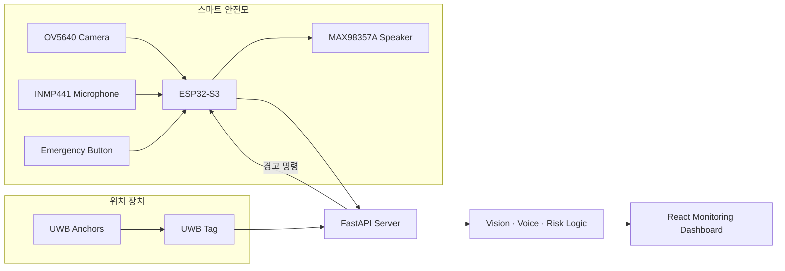

# 🦺 HANMIR — 산업용 AI 스마트 안전모

## iPhone / Mac 설치 준비 — 2026-10-25

- **[Mac에서 최신 iPhone 앱 설치하기 — 준비 스크립트·서명·서버 연결·검증 순서](docs/HANMIR_IOS_MAC_HANDOFF_2026-10-25.md)**
- 최신 Android와 같은 React UI·CSS·통화 소스를 iOS arm64 **v1.8/build27**로 컴파일했습니다. [서명 전 IPA](releases/HanmirSafety-ios-v1.8-build27-unsigned.ipa)는 별도 Apple 서명이 필요합니다.
- Mac에서 `bash frontend/scripts/prepare-ios-mac.sh` 실행 → Xcode에서 본인 Team/아이폰 선택 → Run. 최초 권한·서버 주소 설정은 필요합니다. **iPhone 실기기 설치·전체 기능 검증은 아직 하지 않았습니다.**

## 최신 Android 앱·전체 화면 점검 — 2026-10-25

- [최신 Android APK build26](releases/HanmirSafety-p4-mobile-v1.8-build26.apk) · 관리자/근로자 다크 UI 및 아이콘 통일, 실기기 설치 확인.
- [관리자 13개·근로자 6개 화면 점검/수정/남은 문제](docs/HANMIR_2.0_FULL_MOBILE_UI_AUDIT_2026-10-25.md) · [수치 요약](docs/evidence/2026-10-25/mobile-ui-audit-summary.json).
- 위치 계산 실패 알림은 현장·작업자별 10분에 한 번. 원시 로그/좌표 품질 검사는 유지하며 서버 재시작 후에도 대기 시간을 이어갑니다.
- iPhone 최신 서명 IPA/실기기 검증은 별도입니다. 아래 10/24 장비 성능 수치는 당시 시험 결과입니다.


## 최신 개발 마무리 기록 — 2026-10-24

최신 통합 브랜치: **`integration/hanmir-final-prd-20261016`**. P4/C6 영상·음성·UWB·방향·통화·낙상 확인·대피 경로·비인가 구역 경고의 수정 코드와 실측 기록을 함께 보존합니다.

- **[전체 기능·개선 전후 수치·방법·시연 준비 최종 총정리](docs/HANMIR_2.0_FINAL_TECHNICAL_REPORT_2026-10-24.md)**
- [단계별 상세 근거 통합본](docs/HANMIR_2.0_ALL_EVIDENCE_ARCHIVE_2026-10-24.md) · [수치 JSON/지도 사본](docs/evidence/2026-10-24/)
- [서버 시연 설정 예제](backend/.env.demo.example) · [P4 시연 설정 예제](firmware/helmet_p4/sdkconfig.demo-20261024.example)

최종 단기 기록은 YOLO 평균10.20FPS, 시험 통화 표본9.97FPS, 상세3.55FPS입니다. 5000mAh 배터리는 별도30분 SOC시험에서 혼합부하 약5시간으로 추정했습니다. 모든 순간10FPS·장시간 무단절·현장 안전 인증을 뜻하지 않습니다. 현재 호출어는 서버 STT 경로이고, 최신 APK/IPA 재제작은 별도입니다. 시연 전 지도·금지구역·낙상 기준 자세를 확인하세요.

아래 10/16·10/10 설명은 **당시 기록**입니다. 최신 장치/코드 상태와 충돌하면 위 최종 총정리를 우선합니다.


## 이전 README 보존

<details>
<summary>10월 16일 이전 상태·기존 S3 기준 설명 보기</summary>

## 2026-10-16 UWB 소스 통합 업데이트

10월 15일 `codex/uwb-stabilization-handoff-20261015`의 측정 식별자·거리 중앙값·신호 품질/속도 관찰·마지막 유효 위치 표시를 기존 P4 통합 브랜치에 반영했습니다. 보정 OFF, median5, 품질/속도 observe 정책이며 기존 현장 분리와 웹 디자인을 유지했습니다. [브랜치 검토·통합 내용 및 적용 절차](docs/GITHUB_BRANCH_SYNC_2026-10-16.md)를 확인하세요. 이번 기록은 소스 업데이트이며 실제 펌웨어 업로드·서버 재시작·새 앱 배포 결과가 아닙니다. 아래 10월 10일 상태는 당시 기록입니다.

## 과거 통합 기록 — 2026-10-10

**현재 장치 주의:** P4는 스피커 무음 비교를 위해 통화 수정 전 펌웨어로 롤백된 상태입니다. 최신 소스와 장치 버전이 다르며, 독립 검사에서 GPIO20·21 교차 현상이 관측됐습니다. [어제·오늘 전체 상세 인수인계](docs/HANMIR_2.0_FULL_HANDOFF_2026-10-09_10.md)를 먼저 확인하세요.

최신 작업 브랜치는 `integration/p4-mobile-live-heading-20261010`입니다. ESP32-P4 통신·카메라·BNO 방향 수정, AI/STT/TTS 서버, UWB 수동 지도, 최신 관리자/작업자 앱 및 PC 웹 디자인을 함께 반영했습니다. 최신 웹 원본은 `codex/integrated-worker-app-v1.8-web-ui-20261010` (`51d555c`)입니다.

Android 최신 빌드는 **[v1.8 / build 13](releases/HanmirSafety-p4-mobile-v1.8-build13.apk)**입니다. 통화 서버 주소 및 오류 표시를 수정했습니다. 최종 build12 위에는 업데이트할 수 있으며 기존 build10·build11은 서명이 달라 삭제 후 설치해야 합니다. iOS 프로젝트 자산도 build13으로 동기화했지만 새 서명 IPA는 아직 제작하지 않았습니다. 기존 IPA와 `release-packages`의 build10 ZIP에는 최신 P4 통합 변경 전체가 들어 있지 않습니다. 이어받을 때는 이 브랜치 소스를 사용하세요.

[전체 통합·설치·남은 확인사항](docs/MOBILE_P4_INTEGRATION_2026-10-10.md) · [동시 부하 진단](docs/HANMIR_INTEGRATED_DIAGNOSTICS_2026-10-10.md) · [실시간 방향](docs/MAP_LIVE_HEADING_2026-10-10.md) · [UWB 수동 지도](docs/UWB_MANUAL_XY_ROLLBACK_2026-10-10.md)

[웹·앱 통화 연결 오류 원인 및 P4 수정](docs/P4_CALL_CONNECTION_FIX_2026-10-10.md)

> 모바일 통합판 **v1.8 / build 10**: 관리자·근로자 통합 로그인, 계정별 현장 데이터 분리, 근로자의 누적 작업·휴게시간, 지도·근무 달력·팀 채팅·교육/허가·안전 점검·배터리 경고를 제공합니다. 같은 기능이 반영된 iOS IPA와 Android APK는 [`releases`](releases/)에서 확인할 수 있습니다. [추가 기능 안내](docs/근로자앱_기능확장_2026-10-09.md) · [통합 기록](docs/브랜치_비교_업데이트_2026-10-09.md) · [근로자 앱 실행 안내](docs/근로자앱_실행안내.md)

<div align="center">


**작업자의 보호구 착용·위치·위험 상황을 감지하고 작업자와 관리자에게 전달하는 HW·AI·관제 통합 시스템**

[프로젝트 개요](#-프로젝트-개요) • [핵심 기능](#-핵심-기능) • [시스템 구조](#-시스템-아키텍처) • [문제 해결](#-핵심-문제-해결) • [구현 경계](#-현재-구현-경계)

</div>

---

## 📌 프로젝트 개요

**HANMIR**는 산업 현장 작업자의 보호구 착용 여부, 위치와 위험 상황을 실시간으로 확인하고 음성으로 경고하기 위한 스마트 안전모 프로젝트입니다.

ESP32-S3 기반 카메라·마이크·스피커 장치, UWB 위치 장치, 비전 AI, FastAPI 서버와 React 관제 화면을 하나의 데이터 흐름으로 연결했습니다. 개발 환경에서 동작하는 개별 기능을 단순히 모으는 데 그치지 않고, 실제 배경과 배선·핀 배치·전원·접지 조건에서 발생한 문제를 분리해 개선하는 데 초점을 맞췄습니다.

---

## ✨ 핵심 기능

| 기능 | 구성 |
| --- | --- |
| 보호구 판별 | 카메라 영상에서 인물과 보호구 상태 분석 |
| 위험 안내 | 감지 결과와 음성 에이전트를 연동해 작업자에게 경고 |
| 위치 관제 | UWB 태그·앵커 데이터를 이용한 작업자 위치 표시 |
| 긴급 이벤트 | 버튼 입력과 위험 상황을 서버·관제 화면에 전달 |
| 장치 상태 확인 | heartbeat, RSSI, 배터리와 부품 상태를 진단 화면에서 확인 |

---

## 🏗️ 시스템 아키텍처



---

## 🔧 핵심 문제 해결

### 1. 실제 작업 배경에서 저하된 보호구 인식

- 개발 환경에서는 동작하던 보호구 인식이 복잡한 실제 작업 배경에서 흔들리는 문제를 확인했습니다.
- 현장 배경 이미지를 학습 데이터에 추가했습니다.
- 전체 화면에서 보호구부터 찾는 대신 인물 영역을 먼저 분리하고 보호구를 판별하도록 인식 순서를 조정했습니다.

### 2. 카메라 핀과 오디오 신호선 충돌

- 카메라용 핀에 오디오 신호선이 함께 연결되면서 마이크 잡음이 발생했습니다.
- ESP32-S3 데이터시트와 핀맵을 확인해 사용 가능한 여유 핀을 찾았습니다.
- 오디오 신호선을 해당 핀으로 재배선해 카메라와 오디오 신호 경로를 분리했습니다.

### 3. 전원·접지 조건에 따른 마이크 노이즈

- 신호선 변경 후에도 남는 잡음을 배선·전원·접지 구간으로 나눠 점검했습니다.
- 전원·접지 배선을 정리하고 커패시터를 추가했습니다.
- 변경 후 마이크 입력과 전체 시스템 동작을 반복 확인했습니다.

---

## 🧰 기술 구성

| 구분 | 사용 기술·부품 |
| --- | --- |
| Embedded HW | ESP32-S3-CAM, OV5640, INMP441, MAX98357A, Button |
| Position | UWB Tag/Anchor, 거리 데이터 기반 위치 계산 |
| AI | YOLO 기반 보호구 인식, 음성 에이전트 연동 |
| Backend | Python, FastAPI, SQLite, WebSocket |
| Frontend | React, TypeScript, Vite |
| Verification | Serial log, heartbeat API, server log, HW diagnostic dashboard |

---

## 📁 저장소 구조

```text
safe-halmat-capston-/
├── firmware/
│   ├── helmet_av_device/       # 카메라·마이크·스피커·버튼
│   ├── uwb_position_device/    # 안전모 UWB 태그
│   └── uwb_anchor/             # 현장 고정 UWB 앵커
├── backend/                    # FastAPI·위험도·위치·이벤트·진단
├── frontend/                   # React 관제 Dashboard
├── simulator/                  # 실제 API 형식의 mock 데이터
├── sample_data/                # 지도·앵커·위험구역·테스트 이미지
└── docs/                       # 제작·배선·실행·협업 가이드
```

---

## 🚀 실행 방법

Windows 환경에서 다음 파일로 통합 환경을 구성하고 실행할 수 있습니다.

```bat
install_windows.bat
run_all.bat
```

- Frontend: `http://localhost:5173`
- API 문서: `http://localhost:8000/docs`
- 실제 UWB 연동: `run_hardware_map.bat COM6` (`COM6`는 장치 포트에 맞게 변경)

세부 순서는 [`통합_시작가이드.md`](통합_시작가이드.md)와 [`docs/PROJECT_A_TO_Z_GUIDE.md`](docs/PROJECT_A_TO_Z_GUIDE.md)를 참고하세요.

---

## 🧪 소프트웨어 검증

```bat
cd backend
..\.venv\Scripts\python -m pytest

cd ..\frontend
npm run build
```

실물 장치에서는 펌웨어 시리얼 로그, heartbeat API, 서버 로그와 관제 화면의 하드웨어 진단 정보를 함께 확인합니다.

---

## ⚠️ 현재 구현 경계

README가 구현 완료 범위를 과장하지 않도록 실제 장치와 mock 구간을 구분합니다.

- YOLO 모델 파일이 없으면 dummy detection 구조를 사용합니다.
- 음성 인식 엔진이 설치되지 않은 환경에서는 dummy STT를 사용합니다.
- DW3000 보드·라이브러리가 확정되지 않은 환경에서는 UWB mock adapter를 사용합니다.
- ESP32-S3의 카메라·오디오 GPIO는 실제 보드 핀맵을 기준으로 충돌 여부를 다시 확인해야 합니다.

세부 결선 상태는 [`docs/CURRENT_HARDWARE_WIRING_STATUS.md`](docs/CURRENT_HARDWARE_WIRING_STATUS.md), 통합 결과는 [`INTEGRATION_SUMMARY.md`](INTEGRATION_SUMMARY.md)를 참고하세요.

---

## ✅ 프로젝트 결과

- 실제 배경을 반영한 보호구 인식 흐름 개선
- ESP32-S3 카메라·오디오 핀 충돌을 데이터시트 확인과 재배선으로 개선
- 전원·접지 배선 정리와 커패시터 추가 후 마이크 입력 반복 점검
- 비전 AI·음성 안내·UWB 위치·관제 화면을 하나의 시스템 구조로 통합


</details>
