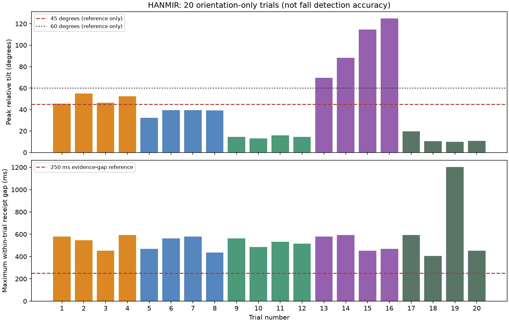

# HANMIR 2.0 기능별 상세 근거 통합본

작성: 2026-10-24, 한국시간.

[최종 총정리로 돌아가기](HANMIR_2.0_FINAL_TECHNICAL_REPORT_2026-10-24.md)

이 파일은 단계별 상세 기록 원문을 한 파일로 모은 보존본이다. **과거 문서의 현재/최종/대기는 해당 시점의 상태다. 최신 구현 여부는 최종 총정리를 우선한다.** 과거 성공과 실패 수치를 함께 보존하며 시험을 새로 실행한 결과가 아니다. 구현 계획과 실측을 구분한다. 원시 음성·전체 계정 DB·개인 영상은 포함하지 않는다.

## 포함 문서
1. [HANMIR_2.0_FULL_HANDOFF_2026-10-09_10.md](HANMIR_2.0_FULL_HANDOFF_2026-10-09_10.md) — 176,046바이트
2. [HANMIR_2.0_FULL_WORK_REPORT_2026-10-16_17.md](HANMIR_2.0_FULL_WORK_REPORT_2026-10-16_17.md) — 247,244바이트
3. [HANMIR_2_DAILY_REPORT_2026-10-02.md](HANMIR_2_DAILY_REPORT_2026-10-02.md) — 25,861바이트
4. [HANMIR_2_P4_COMMUNICATION_PLAN_2026-10-02.md](HANMIR_2_P4_COMMUNICATION_PLAN_2026-10-02.md) — 24,634바이트
5. [HANMIR_2_P4_FIRST_BOOT_2026-10-09.md](HANMIR_2_P4_FIRST_BOOT_2026-10-09.md) — 14,459바이트
6. [HANMIR_2_PC_HANDOFF_2026-10-09.md](HANMIR_2_PC_HANDOFF_2026-10-09.md) — 23,441바이트
7. [HANMIR_2_VOICE_PREP_2026-10-02.md](HANMIR_2_VOICE_PREP_2026-10-02.md) — 4,395바이트
8. [HANMIR_BATTERY_30MIN_LOAD_REPORT_2026-10-24.md](HANMIR_BATTERY_30MIN_LOAD_REPORT_2026-10-24.md) — 10,633바이트
9. [HANMIR_BNO_FALL_PREFLASH_2026-10-24.md](HANMIR_BNO_FALL_PREFLASH_2026-10-24.md) — 13,726바이트
10. [HANMIR_BNO_ORIENTATION_20_TRIALS_2026-10-24.md](HANMIR_BNO_ORIENTATION_20_TRIALS_2026-10-24.md) — 12,675바이트
11. [HANMIR_BNO_POSTFLASH_RUNTIME_2026-10-24.md](HANMIR_BNO_POSTFLASH_RUNTIME_2026-10-24.md) — 5,189바이트
12. [HANMIR_CALL_AUDIO_QUALITY_2026-10-24.md](HANMIR_CALL_AUDIO_QUALITY_2026-10-24.md) — 9,186바이트
13. [HANMIR_CALL_RX_QUEUE_INVESTIGATION_2026-10-24.md](HANMIR_CALL_RX_QUEUE_INVESTIGATION_2026-10-24.md) — 14,974바이트
14. [HANMIR_CALL_VOICE_END_2026-10-24.md](HANMIR_CALL_VOICE_END_2026-10-24.md) — 3,325바이트
15. [HANMIR_CAMERA_RECHECK_AND_TUNING_2026-10-10.md](HANMIR_CAMERA_RECHECK_AND_TUNING_2026-10-10.md) — 9,005바이트
16. [HANMIR_DUAL_WIFI_2026-10-24.md](HANMIR_DUAL_WIFI_2026-10-24.md) — 17,118바이트
17. [HANMIR_EVACUATION_CORRIDOR_2026-10-24.md](HANMIR_EVACUATION_CORRIDOR_2026-10-24.md) — 3,000바이트
18. [HANMIR_FALL_BATTERY_RETEST_2026-10-24.md](HANMIR_FALL_BATTERY_RETEST_2026-10-24.md) — 5,430바이트
19. [HANMIR_FALL_CONFIRMATION_2026-10-24.md](HANMIR_FALL_CONFIRMATION_2026-10-24.md) — 10,230바이트
20. [HANMIR_FALL_INCIDENT_2026-10-24_211232.md](HANMIR_FALL_INCIDENT_2026-10-24_211232.md) — 5,570바이트
21. [HANMIR_FIRE_GUIDANCE_STOP_2026-10-24.md](HANMIR_FIRE_GUIDANCE_STOP_2026-10-24.md) — 1,961바이트
22. [HANMIR_FIRMWARE_UPLOAD_2026-10-24.md](HANMIR_FIRMWARE_UPLOAD_2026-10-24.md) — 7,079바이트
23. [HANMIR_INTEGRATED_DIAGNOSTICS_2026-10-10.md](HANMIR_INTEGRATED_DIAGNOSTICS_2026-10-10.md) — 23,667바이트
24. [HANMIR_LAYOUT_APPLY_FIX_2026-10-24.md](HANMIR_LAYOUT_APPLY_FIX_2026-10-24.md) — 1,907바이트
25. [HANMIR_PPE_ADMIN_POLICY_2026-10-24.md](HANMIR_PPE_ADMIN_POLICY_2026-10-24.md) — 5,630바이트
26. [HANMIR_TRANSPORT_OPTIMIZATION_2026-10-24.md](HANMIR_TRANSPORT_OPTIMIZATION_2026-10-24.md) — 10,971바이트
27. [HANMIR_UWB_DISTANCE_BIAS_2026-10-24.md](HANMIR_UWB_DISTANCE_BIAS_2026-10-24.md) — 18,606바이트
28. [HANMIR_UWB_REVIEWED_SURVEY_IMPLEMENTATION_2026-10-24.md](HANMIR_UWB_REVIEWED_SURVEY_IMPLEMENTATION_2026-10-24.md) — 13,908바이트
29. [HANMIR_UWB_REVIEWED_SURVEY_PLAN_2026-10-24.md](HANMIR_UWB_REVIEWED_SURVEY_PLAN_2026-10-24.md) — 11,758바이트
30. [HANMIR_UWB_STATIONARY_5.2x3.6_2026-10-24.md](HANMIR_UWB_STATIONARY_5.2x3.6_2026-10-24.md) — 3,517바이트
31. [HANMIR_UWB_STATIONARY_AND_SURVEY_UI_2026-10-24.md](HANMIR_UWB_STATIONARY_AND_SURVEY_UI_2026-10-24.md) — 10,506바이트
32. [HANMIR_UWB_WALK_TEST_2026-10-24.md](HANMIR_UWB_WALK_TEST_2026-10-24.md) — 4,206바이트
33. [HANMIR_UWB_WEIGHTED_JUMP_2026-10-24.md](HANMIR_UWB_WEIGHTED_JUMP_2026-10-24.md) — 5,887바이트
34. [HANMIR_ZONE_WARNINGS_2026-10-24.md](HANMIR_ZONE_WARNINGS_2026-10-24.md) — 12,193바이트
35. [MAP_LIVE_HEADING_2026-10-10.md](MAP_LIVE_HEADING_2026-10-10.md) — 4,631바이트
36. [TUTUS_PILOT_TRAINING_2026-10-16.md](TUTUS_PILOT_TRAINING_2026-10-16.md) — 15,170바이트
37. [YOLO_DETAIL_3TO5FPS_2026-10-16.md](YOLO_DETAIL_3TO5FPS_2026-10-16.md) — 6,228바이트
38. [VEST_RECALL_AND_BOX_REFRESH_2026-10-16.md](VEST_RECALL_AND_BOX_REFRESH_2026-10-16.md) — 5,154바이트
39. [VOICE_RESTORE_2026-10-17.md](VOICE_RESTORE_2026-10-17.md) — 2,443바이트


---

# 근거 문서 1: HANMIR_2.0_FULL_HANDOFF_2026-10-09_10.md

> 출처: [HANMIR_2.0_FULL_HANDOFF_2026-10-09_10.md](HANMIR_2.0_FULL_HANDOFF_2026-10-09_10.md). 본문은 당시 기록이며 최신 상태는 최종 총정리 우선.

# HANMIR 2.0 — 2026-10-09~10 전체 작업 상세 인수인계

작성일: 2026-10-10, 한국 시각. 용도: 팀원 공유, 다른 PC에서 작업 인수, 코드·장치 버전 및 실제 검증 범위 확인.

이 문서는 현재 상태 요약과 날짜별 상세 원문을 한 파일에 합친 인수인계 자료다. **본문의 현재 상태를 우선한다. 부록의 진행 중/정상/미업로드 문구는 해당 기록 작성 당시의 상태다.**

## 1. 현재 상태 — 가장 먼저 확인

| 항목 | 현재 상태 |
|---|---|
| 저장소 | https://github.com/j91332992-dev/safe-halmat-capston- |
| 통합 브랜치 | `integration/p4-mobile-live-heading-20261010` |
| 작성 직전 최신 코드 | `c9d0209`, 스피커 전용·독립 GPIO 진단 및 교차 핀 관측 |
| 최신 소스 | P4 통신·영상·센서·음성, 최신 웹/앱 디자인, 새 통화 모듈 포함 |
| Android 배포 | v1.8 / build13 APK |
| iOS | build13 자산 동기화, 신규 서명 IPA 미제작 |
| **실제 P4 버전** | **통화 수정 전 `df52167` 소스 기반 일반 펌웨어로 롤백·복구** |
| 새 양방향 통화 | 현재 P4에서는 비활성. `channel_online=false`는 롤백 상태에서 예상되는 값 |
| 스피커 | 무음 미해결. 전체 롤백과 6가지 출력 설정에서도 무음 |
| 핵심 추가 근거 | GPIO20(BCLK)·21(WS)이 서로 HIGH/LOW를 따라가는 현상이 독립 GPIO 검사에서도 2회 재현 |
| UWB 지도 | 사용자 직접 X/Y 입력. 자동 측량/자동 지도 생성 제거, 앵커 4개 재업로드 완료 |
| 장시간 안정성 | 카메라 수 분 정지 이력이 있어 전체 병목 해소 완료로 판단하지 않음 |

문서 작성 때 읽기 확인: P4 online=true, 배터리 보고값 약 73.07%, last_error=null, call channel_online=false. 순간 상태이며 새로운 동시 부하 시험은 아니다. 배터리 값은 앰프에 5V가 공급된다는 증거가 아니다.

**GitHub 최신 소스와 현재 P4의 펌웨어가 다르다.** 다음 작업자는 이 차이를 먼저 확인한다. 최신 통화 펌웨어로 곧바로 덮어쓰기보다 스피커 신호 경로를 먼저 조사한다.

## 2. 유지한 프로젝트 구조

- 기존 ESP32-S3 펌웨어/서버를 삭제하지 않고 P4 AV 구조를 추가·통합했다.
- OV5640 DVP에서 OV5647 MIPI CSI로 전환했다.
- P4는 내장 C6 경유 2.4GHz Wi-Fi를 사용한다. 외부 C5는 이번 운영에 미사용이다.
- UWB는 독립 태그·앵커 체계이며 P4와 데이터 GPIO를 연결하지 않는다.
- FastAPI/YOLO/STT/DB/React 구조를 유지했다.
- 연결 성공, 데이터 쓰기 성공, 실제 가청 출력, 인식률 향상은 별도의 판정이다.

```text
OV5647 → P4 CSI/RGB565/JPEG → 최신 프레임 큐 → C6 Wi-Fi/WS
       → FastAPI → YOLO 워커 → 원본/분석 화면 → 웹·앱
INMP441 → I2S RX → NS/AFE VAD → 음성 구간 업로드 → STT
        → 호출어/의도 분류 → 조회·규칙 또는 설명형 LLM → TTS
        → P4 I2S TX → MAX98357A → 스피커
BNO085 → UART/SH-2 → yaw/pitch/roll → 100ms 방향 이벤트 → 지도
UWB 앵커 ↔ 독립 태그 → 자체 Wi-Fi → 거리/좌표 → 수동 지도
최신 통화 소스: 휴대폰 PCM ↔ 서버 WebSocket ↔ P4 call_client
현재 물리 P4: 통화 수정 전 버전이므로 새 통화 경로는 꺼져 있음
```

## 3. 어제·오늘 작업 흐름

### 10월 9일

1. ESP-IDF 5.5.5 빌드·업로드 환경과 ASCII 경로 staging 준비.
2. P4/C6 Wi-Fi·서버 연결, OV5647·마이크·배터리·UWB·웹 개별 확인.
3. BNO085 UART 무수신 원인 분석. 바이트별 TX 완료와 1ms 간격, 폴링 yield로 SH-2/회전벡터 수신 복구.
4. 지도 기준 방향 보정, 사용자 회전 확인.
5. 사용자 요청으로 부팅 시 약 5초 스피커 테스트 제거.
6. 15fps/YOLO640 시도. 촬영·수신·분석·화면 FPS를 분리 계측.
7. 카메라 전송 버퍼16KB, timeout1500ms, 실패 후 재연결, 전송 로그, 웹 MJPEG 적용.

### 10월 10일

1. WISET 환경에 맞춰 P4/태그 주소 갱신, 서버·웹 재실행.
2. 영상/음성/UWB/BNO 동시 로그, 플래시·메모리 분석 및 카메라 후속 측정.
3. 10초 앵커간 자동 측량/지도 실험 후 사용자 요청으로 수동 X/Y 방식 완전 롤백. 앵커1~4 실제 재업로드.
4. 방향 전송을 heartbeat와 분리해 약10Hz 송신, 웹 화살표 보간. 사용자가 반응 정상 확인.
5. 최신 모바일/PC 웹 디자인 병합, 네이티브 이미지 No Frame 수정, 작업자 방향 연결.
6. Android build11→12→13 생성·배포, CI 서명키 경로/캐시 보완. iOS 자산 동기화.
7. 통화 ticket409/주소 오류 수정, P4 양방향 통화 추가, 실제 Android PCM 로그 확인.
8. 하향 음성·일반 확인음 무음 조사. 충전/전원 재시작/상세 로그/전체 이전 소스 롤백.
9. 전용 I2S 6조건 비교와 독립 GPIO 검사로 GPIO20·21 교차 현상 발견.
10. 진단 종료 후 P4를 통화 수정 전 일반 버전으로 복구. 진단 코드·결과까지 GitHub 업로드.

## 4. 카메라·YOLO: 변경과 수치

현재 기록 기준: 실제 영상800×640, JPEG75, 목표15fps, YOLO 전체 입력640. ‘640’은 원본640×480이 아니다. ROI sharp640/original960 추가 추론이 있어 프레임당 최대3회 실행 가능. 일반 분석 목표4fps, 음성 활성 시1fps.

| 구간 | 서버 수신 FPS | YOLO FPS |
|---|---:|---:|
| 10/9 초기15fps/640 | 2.57 | 1.98 |
| 16KB/1500ms·복구 적용 | 6.93 | 2.90 |
| 10/10 정지 포함 최초 구간 | 10.39 | 2.36 |
| 카메라 정지 구간 | 0 | 0 |
| 재부팅 후 약29초 | 16.25 | 3.31 |
| 후속44.266초 | 12.33 | 2.21 |
| 후속19.265초 | 11.99 | 3.01 |

서로 다른 장면/부하의 측정이므로 특정 설정의 개선 효과로 단정하지 않는다. 최신 큐 폐기는 무선 패킷 손실률이 아니다.

11:12:14.742 이후 frame ID12034와 수신/분석 카운터가 정지했다. 분석 큐0인 동안 음성 HTTP200/UWB/BNO는 계속됐다. 프레임 나이가 수 분까지 증가했고 재부팅으로 복구됐다. CSI DQBUF·캡처·인코더·센서/FPC 원인 위치는 미확정이다. 상태 capturing/connected가 실제 진행을 보장하지 못한다.

후속 서버CPU 중앙52.5%/최대57.7%, 가용RAM 최소약3.20GiB. 전체 서버 고갈의 증거는 없었지만 프레임 나이 최대1.609~2.453초가 있어 장시간 안정성은 남았다.

사용자 조끼·헬멧 착용 장면에서 person0.607/vest0.483/helmet0.549 검출 사례, 최종 두 PPE=true 확인. 머리 잘림·직전 helmet=null도 있어 정확도/재현율은 미계산이다.

아직 적용 결과가 아닌 개선 후보: 정지 감시·단계별 시각·동적 메모리, 동일 장면 JPEG75→85, 상세960 조건/주기 최적화, 1280×960 후보 검증, 같은 JPEG 오프라인 비교, 실제 장착 시점 정답 자료 평가.

## 5. AI Agent·STT·TTS의 실제 범위

| 항목 | 확인한 설정/코드 |
|---|---|
| STT | gpt-4o-mini-transcribe, 한국어, timeout10초, SDK retry0 |
| 설명형 LLM | gpt-6-luna, timeout5초, 출력80토큰, reasoning effort none 요청 |
| 후처리 | 한 줄 공백 정리, 최대120문자 |
| TTS | Edge TTS ko-KR-SunHiNeural, WAV16kHz/16bit/mono 캐시 |
| P4 전처리 | WebRTC NS/AFE VAD |
| 음성 구간 | 최대5초, pre-roll300ms, 종료무음500ms, 업로드 큐3 |
| 호출어 | 서버 별칭/유사도 판별, 후속 질의20초 |
| 로컬 WakeNet | 비활성. 전용 투투스 모델 없음 |
| AEC | 미구현/비활성 |

모델명은 로컬 설정 확인값이다. 최신 가격/한국어 모델 성능 비교를 새로 수행한 자료는 아니다.

FAST_INTENTS의 배터리/위치/PPE/장치/방향·경고/비상/대피 등은 서버 조회·규칙/고정 응답을 먼저 사용한다. 설명형 요청만 제공된 최신 상태를 문맥으로 API에 보내고 실패 시 fallback. 프롬프트는 보통1문장/필요 시2문장, 없는 센서값 생성 금지다.

PRD의 get_worker_status/location/heading/battery, get_ppe_status, get_recent_events, get_nearest_exit, get_device_status는 완성된 Tool Calling 인터페이스로 모두 구현된 상태라고 확인되지 않았다. 현재는 서버 함수·의도 분기 중심이다.

미완료/문제:

- heading_query는 확인 불가 응답. 지도 화살표와 음성 길 안내는 범위가 다름.
- worker.ppe와 전방 사람YOLO PPE의 출처/대상 구분 필요.
- ‘조그만’의 ‘그만’ 부분 문자열을 stop_speaking으로 오인한 사례.
- ‘비상 상황이면’ 같은 조건문 경보 정책 미정리.
- 일반 주변 발화도 STT에 업로드해 비용·큐·부하 발생.
- 재생 중 음성 억제에 따른 비상 발화 누락 가능성 별도 시험 필요.
- 호출 횟수/실패 원음/단계별 시간표 부족. 기억상60~70%와 새 성공률 비교 불가.

10/9 배터리 응답,10/10 위치/배터리 응답 실제 청취 성공은 기록돼 있다. 일부 배터리42% 기록과 사용자34% 청취 차이는 시각/음원 대조가 남았다. DB STT 저장→이벤트 간격은 전체 응답 지연이 아니다. 오늘 분석·통화 작업이 위 AI 논리 문제를 모두 해결했다는 뜻은 아니다.

## 6. UWB 지도 롤백과 실시간 방향

자동 지도는 시행 기록만 보관하며 현재 제거됐다. 서버 API/서비스·웹 패널·앵커 survey 코드 제거, X/Y 입력→설계 저장→현장 적용 유지. 앵커1~4 일반 앱 재업로드·해시 검증 완료. 태그 시계 오프셋 부호 확장 오류 및 SQLite NullPool 변경은 유지했다.

앵커 당시 COM7/8/9/10, 앱286032/285776/285776/285776bytes. 지도 치수는 사용자 설정에 따라5.2×3.2→4.8×2.5→후속5.0×3.3m 기록이 있으므로 과거값을 강제하지 말고 layout/draft/적용값을 대조한다. 작업자 X/Y와 작업장 크기를 구분한다.

UWB mask=F는4개 거리 입력 관측. 약12초UART POST34건HTTP200, 약2.78Hz/간격중앙0.313초/최대0.719초. 실제 위치 오차와 개별 앵커 heartbeat는 별도다. 낮은 confidence도 기록됐다.

BNO UART:GPIO23 RX/51 TX,3Mbps,바이트별1ms송신. 센서10Hz를 별도100ms 방향 이벤트로 서버에 전달. 송신대기30ms/최신값만, live 캐시/샘플별DB쓰기 없음/단일서버프로세스 전제. 서버신선도2초, 웹live3초 초과 숨김, 80ms 보간 및359↔0 최단각도.

12초실측 방향95건/7.95Hz, 간격중앙109.5ms/최대219ms. 사용자 실제 회전 후 ‘잘된다’ 확인. 자기장·장착축 오차와 센서→휴대폰 전체지연은 별도 검증이다. 앵커1·4 벽면 기준 보정값을 보존한다.

## 7. 웹·앱 병합과 APK/iOS

- 최신 앱 원본775d06f, 로컬P4 묶음8a62933, 병합43b7ebe.
- 네이티브 카메라/작업자 방향1a6c753.
- 최신 PC웹 디자인51d555c, 병합a62f7a7. DesktopSafetyOverview/메뉴아이콘/작업자선택/최근이벤트정렬/PC CSS 적용.
- 원본 관리자·작업자 앱 기능을 유지했다. 달력/채팅/교육/허가/작업시간 등을 오늘 모두 휴대폰 검증했다는 뜻은 아니다.

Android No Frame:서버JPEG/API 정상, 휴대폰metadata조회는 있으나 실제이미지요청이 없던 상태. CapacitorHttp로 JPEG→bytes→Blob URL, 순차조회/200ms간격/중첩방지/Blob해제 적용. PC는MJPEG. 앱 표시목표최대약5fps와P4송신15fps는 다르다. **새 APK에서 카메라 실제 표시 성공의 최종 사용자 확인은 기록이 부족하다.**

작업자/me 장치상태 및 작업자범위WebSocket, WorkerMap 방향 추가.2초폴링 보조, 느린응답의 최신방향 덮어쓰기 방지. 실제작업자계정 휴대폰 전체검증은 남았다.

| 배포 | 상태 |
|---|---|
| build10 | 팀원 원본, 최신P4 전체 변경 아님 |
| build11 | 초기통합, 원본서명과 불일치 |
| 최종build12 | 최신PC웹 포함, CI서명키경로/캐시 보완 |
| build13 | 앱통화주소·오류표시 수정, 현재최신 |

build13 파일:`releases/HanmirSafety-p4-mobile-v1.8-build13.apk`,Actions38029735257 성공,version1.8/code13.

APK SHA256:`47a0bba1c4b09cfc5b303a836d4e5ce560799eccf035a8b70d2768bc885ba1ab`.

최종build12·13 인증서SHA256:`267e18f5d8ec2585c4b6a0b67abcd576f90635033ff9a0aba616960d6a49d974`.

원본build10/초기build11과 서명이 달라 사용자가 삭제·재설치 선택. build12→13은 동일서명. CIdebug키캐시 유지가 필요하며 정식배포키 운영 완료 의미는 아니다. 사용자는 build13 설치·로그인·통화 시도했다. iOS는 자산/build13만 동기화, 새 IPA는Mac/Xcode/인증서/프로비저닝 필요. 기존IPA와build10 ZIP을 최신으로 혼동하지 않는다.

## 8. 통화 수정·실제 PCM 결과

원인:P4 새call_client 부재/CALL_DEVICE_TOKEN 미설정, 앱WS가window localhost 기준 주소 사용. ticket409와 앱 일반 권한안내를 구분했다.

수정:저장서버주소 getWsBaseUrl, 구체적 권한/오프라인/로그인/비보안주소 오류, 스트림/AudioContext 정리, 연결확정전 송신억제. 서버 Authorization헤더 지원/상태API/PCM카운터. P4 기존AFE공유,16kHz mono PCM16,20ms640bytes,TX/RX큐6/오래된프레임폐기/재연결,재생mutex,통화중AI업로드억제,play_alert우선중단,DMA160/6개버퍼. AEC는 추가하지 않았다.

새 펌웨어 업로드 시 ticket200/채널등록 확인. 첫통화 안전모→관리자1176패킷602112bytes, 관리자→안전모936패킷599040bytes(약18.82/18.72초PCM). P4 RX는2초당60160~64640bytes/peak10818~32768/speaker_write=ok. 사용자는 안전모마이크가폰에서 들림,폰마이크는안전모에서안들림 확인.

웹마이크는localhost/HTTPS조건 확인. LAN HTTP제한을앱권한과혼동하지 않는다. 현재P4 롤백으로 새통화는 비활성이다.

## 9. 스피커 문제: 모든 비교와 결론

사용자는 통화권한 수정 전까지 분명 작동했고 배선은 건드리지 않았다고 확인했다. 이를 유지한 채 다음 비교를 수행했다.

1. 서버전달·ACK,휴대폰PCM 실제P4 수신.
2. 통화종료 상태 확인음, DMA변경,수정전speaker.c/통화중지 비교.
3. 충전기·배터리스위치·전체전원재시작.
4. 실행/lock/I2S활성화/쓰기 상세로그.1000Hz1500ms24000샘플,48000/48000bytes ok.
5. df52167 전체31개파일 복원,부트로더/파티션/앱/model 업로드.
6. I2S1 mono left/right16bit,stereo16/32bit,I2S0 stereo16bit,48kHz 등6조건. 모두무음.
7. I2S삭제 후100펄스 교차검사.
8. I2S·PCNT 없는 별도 일반GPIO검사2회.

사용자가 ‘하나 이상 들림’이라고 했다가 즉시 ‘전부 안들림’으로 정정했다. 최종결과 모두무음. 전용진단의 초기버퍼 스택오류는static버퍼로고쳐 정상완료했으며 기존문제와구분한다. 라이브러리esp_hosted 부팅자동초기화는 존재했다.

핵심관측(읽기순서20,21,22):

```text
GPIO20 LOW  → 0,0,0 / HIGH → 1,1,0 / 100펄스 → 100,100,0
GPIO21 LOW  → 0,0,0 / HIGH → 1,1,0 / 100펄스 → 100,100,0
GPIO22 LOW  → 0,0,0 / HIGH → 0,0,1 / 100펄스 → 0,0,100
```

독립GPIO시험에서도2회 동일, SigOut ID256(simple GPIO),나머지핀OutputEn0 확인. **20·21이 서로 전기적으로 영향을 받는 관측이 있어 BCLK/WS경로가 최우선이다.** 단락0옴/정확한위치/앰프내부/전원/배선/P4원인 또는스피커단품고장은 확정하지 못했다.

사용자는납땜이라분리불가·측정기없음·배선표대로연결이라고 답했다. 다음 확인은 전체전원OFF 확대사진(P4 GPIO20/21 및MAX BCLK/LRC 앞뒷면),가능하면전압/저항측정,앰프쪽 신호선분리비교. 외관정상은측정된교차현상을배제하지 않는다. 임의5V추가/단자쇼트/SPK−GND연결은 하지않는다.

현재 일반롤백앱1890400bytes/SHA256:`135166fbc2d99b694fe0a704c220c37eb6f3c5f4871d5b7e695fd543128a0950`. 당시sdkconfig/바이너리 완전스냅샷은없어비트동일이라고하지않는다. 진단후일반앱 재업로드·해시·재부팅·online확인.

**빌드stage main소스도 복구했으나 build폴더 BIN/ELF는 마지막진단일수있다. 새업로드 전 정상소스로 반드시재빌드한다.** 저장소 최신통화코드는 보관했다.

## 10. GPIO·전원 기준

| 부품 | 연결 |
|---|---|
| OV5647 | CSI FPC, SCCB7 SDA/8 SCL/0x36 |
| INMP441 | VDD3.3V/GND,SCK31/WS34/SD36,L/R GND |
| MAX98357A | VIN스위치후5V/GND,BCLK20/LRC21/DIN22,SD/GAIN설계상미연결 |
| 스피커 | MAX SPK+→+/SPK−→−,SPK−는공통GND에연결하지않음 |
| MAX17048 | VIN3.3V,SDA33/SCL32/I2C1/0x36,배터리측JST |
| BNO085 | TX(SDA)→23 RX,RX(SCL)→51 TX,P1HIGH/P0LOW |
| UWB | 5V/GND만공유,P4데이터선없음 |
| C6 | SDIO14~19/RESET54 |
| microSD | 내장39~45,전체기능검증완료아님 |
| C5 | 초기미사용 |

OV5647과MAX17048은주소0x36이지만다른버스. GPIO정적중복검사는물리쇼트를검출하지못한다. 배터리→SW6106→5V→스위치→P4/UWB/MAX. P4 PC USB전원과MAX5V가별개라P4 ACK만으로앰프전원확인불가.

## 11. 플래시·메모리

P4 Flash16MiB/PSRAM32MiB 확인. 당시초기앱1890048bytes,4MiB앱45.06%/약55%여유. 현재롤백1890400bytes,최신상세진단통화앱1893696bytes(당시산출물). 정적D/IRAM161232/576464bytes(27.97%),data/bss/text22812/42112/96308bytes. model실파일4bytes,로컬WakeNet없음.

파티션:NVS0x9000/24KiB,PHY0xF000/4KiB,factory0x10000/4MiB,model0x410000/6MiB예약,0xA10000이후약5.9375MiB미배정. OTA슬롯이없어현재그대로OTA가능이라하지않는다.

RGB565800×640버퍼2개약1.953MiB는전체PSRAM사용량아님. 동적free/min/largest heap·PSRAM잔량·스택여유는정기계측없어확인불가. 정적여유/부팅시험성공으로누수배제불가.

UWB Flash물리16MiB/현재파티션4MiB.앱807585/1310720bytes61.6%,BIN814160bytes,정적RAM46140/327680bytes14.1%. C6개별메모리미계측. PC당시RAM약15.59GiB/CPU18,YOLORSS약592.5MiB/backend181.5~191.1MiB. 날짜별버전수치는서로다를수있다.

## 12. 주요 소스 위치

- P4:`firmware/helmet_p4/main/`의app_main/network/api_client/camera_source/camera_transport/voice/speaker/command_client/sensors/pin_guard/call_client,hanmir.h,bno_sh2 및CMake/Kconfig/config예제.
- 진단:`firmware/diagnostics/p4_speaker_isolation/`의app_main.c,gpio_only.c,CMakeLists.txt,README.md. 운영에자동포함되지않음.
- AI:`backend/app/services/speech_service.py,assistant_service.py,tts_generator_service.py`,config.py.
- 서버영상:`routers/camera.py,services/camera_service.py`및분석워커.
- 방향:`orientation_service.py,serializers.py,routers/devices.py,main.py`.
- 통화:`main.py,websocket/call_manager.py`.
- 웹/앱:`CameraFrame.tsx,LiveCameraFrame.tsx,HelmetCall.tsx,SiteMap.tsx,mobile/WorkerMap.tsx,hooks/useSafetyData.ts,services/cameraImage.ts`.
- APK:`.github/workflows/android-p4-integration.yml`,frontend네이티브자산/버전,releases.
- UWB:별도태그·앵커프로젝트.자동측량제거/기존anchor복원.

정확한전체변경은브랜치Git diff/log로확인한다. 모든파일전체를이번에새로작성했다는뜻은아니다.

## 13. 다른 PC 인수·실행

현재repo:`C:/Users/조성준/OneDrive - pukyong.ac.kr/바탕 화면/hanmmir2.0`.

P4stage:`C:/dev/hanmir-p4/helmet_p4`,UWBstage:`C:/dev/hanmir-uwb-link/uwb_multi_test`,로그/백업:`C:/dev/hanmir-runtime`. IDF5.5.5:`C:/Espressif/frameworks/esp-idf-v5.5.5`,TEMP/TMP:`C:/dev/tmp`,P4현재COM25(다른PC재확인).

서버:`http://192.168.0.40:8000`,PC웹:`http://localhost:5174`,LAN웹:`http://192.168.0.40:5174`. DHCP주소변경가능. 최신서버로그backend-speaker-recheck.out/err.log. 서버재시작시메모리세션초기화→앱재로그인.

```powershell
git clone https://github.com/j91332992-dev/safe-halmat-capston-.git
cd safe-halmat-capston-
git switch integration/p4-mobile-live-heading-20261010
```

backend의Python환경/requirements와로컬.env/DB준비후:

```powershell
python -m uvicorn app.main:app --host 0.0.0.0 --port 8000
```

frontend에서:

```powershell
npm ci
npm run dev -- --host 0.0.0.0 --port 5174
```

앱은Vite없이실행하지만API서버필요. 서버주소저장/로그인. IDF export활성화/실제sdkconfig확인/정상source staging후빌드·업로드. 현재롤백과최신통화소스를혼동하지말것.

별도안전한경로로인수할항목:backend/.env/API키/네트워크비밀번호/장치sdkconfig/호출·영상토큰/DB/보정값. 토큰은장치와서버일치필요. 문서·GitHub에비밀값포함안함. DB미전달시사용자/지도/보정값재현안됨. 원시증거ZIP은사진·로그포함으로공개업로드대신로컬보관,필요시검토후별도전달.

## 14. 주요 커밋과 다음 작업

8a62933 P4검증통합 /43b7ebe 모바일병합 /1a6c753 네이티브카메라·작업자방향 /a62f7a7 PC웹 /df52167 build12·현재롤백기준 /eeddb02 통화주소 /3b876c4 build13 /d35102d P4통화 /b5ce98f DMA·RX /8dc4711 I2S진단 /64ed41e·dce4587 전체롤백 /c9d0209 독립GPIO.

우선순위:

1. GPIO20·21영향범위/앰프전원확인→확인음/TTS가청복구→최신통화펌웨어반영→양방향/종료후AI/경고우선권검증.
2. 카메라정지위치·동적메모리·장시간동시부하계측/복구.
3. AI부분문자열오인·조건문비상·재생중비상·PPE출처·단계별ID시간계측.
4. Android관리자/작업자전체기능확인,새IPA제작후iPhone동일검증.
5. 실측위치/방위오차,낙상/화재/대피/microSD/배터리장시간시험.

## 15. 팀원에게 전달할 두 줄

> P4 카메라·마이크·BNO 방향·UWB 수동 지도·AI 서버를 최신 웹/Android build13과 통합하고 실제 부하·통화 로그까지 확인했습니다.
> 현재 P4는 스피커 무음 때문에 통화 수정 전 버전이며, GPIO20(BCLK)·21(WS)이 서로 따라가는 현상을 찾았으니 이 경로부터 확인한 뒤 최신 통화 펌웨어와 앱 전체 기능을 이어서 검증해 주세요.

## 16. 아래 부록의 읽기 규칙

아래는 날짜별상세기록원문이다. 완료이력/설정/측정근거보존을위해포함했으며본문현재상태와다른과거문구를최신상태로해석하지않는다. 특히이전IP/지도치수/build11·12/스피커정상/통화online/미업로드표기는시점별기록이다. 현재기준은build13소스,물리P4통화수정전롤백,스피커미해결,자동지도제거다.


---

# 부록 — 날짜별 상세 작업 기록 원문


---

## 부록 1: HANMIR_2_PC_HANDOFF_2026-10-09.md

> 당시 작업 기록입니다. 최신 상태는 본문 1절을 우선합니다.

## HANMIR 2.0 — 다른 PC 인수인계 및 현재 진행상황

작성일: 2026-10-09 / 마지막 실물 확인: 같은 날 13:10 KST 부근.

이 문서는 다른 컴퓨터·다른 담당자가 현재 작업을 이어가기 위한 시작 문서다. 아래 상태는 확인 시점의 기록이며 장치가 계속 온라인이라는 뜻은 아니다. 비밀번호·API 키·장치 토큰은 포함하지 않았다.

### 1. 먼저 알아야 할 현재 상황

**P4 실물 업로드와 기본 서버 연결까지 완료했다.** 카메라 원본 전송, 서버 YOLO 추론, 배터리 읽기, 음성 처리 초기화, 명령 수신·스피커 재생 완료 보고를 확인했다. 독립 UWB 태그도 서버 주소를 고쳐 업로드했으며 앵커 4개 거리 수신과 서버 위치 갱신을 확인했다.

**남은 우선 작업은 UWB 실제 좌표 등록과 마이크의 유효 음성 입력 확인이다.** ‘투투스’ 맞춤 WakeNet, BNO085 방향·낙상, 양방향 통화는 완료 상태가 아니다. 모든 프로그램이 실제 안전모에서 검증됐다고 설명하면 안 된다.

다른 PC에서 GitHub 코드만 받으면 로컬 설정·DB·설치 환경은 따라오지 않는다. P4와 UWB 태그에는 기존 PC 서버 주소가 저장돼 있으므로 새 서버 PC 주소로 각각 설정을 맞춰야 한다.

### 2. 이어받을 저장소·브랜치·커밋

- 저장소: https://github.com/j91332992-dev/safe-halmat-capston-
- 브랜치: `feature/mobile-safety-app-20261001`
- 이 문서 작성 시작 시 코드 기준 커밋: `8d9fbc6`. 이 문서를 포함한 후속 문서 커밋도 받는다.
- 기존 PC 저장소: `C:\Users\조성준\OneDrive - pukyong.ac.kr\바탕 화면\hanmmir2.0`

| 커밋 | 주요 내용 |
|---|---|
| `ef7c68f` | P4 CSI 영상·C6 Wi-Fi 실물 구동 및 최신 데이터 기반 음성 응답 보완 |
| `d9b2846` | 부팅 시 스피커 TX 비활성, 실제 재생 때만 활성·종료 후 비활성 |
| `8d9fbc6` | 실제 UWB 프로젝트 경로 보완, 로컬 비밀설정 Git 제외, 태그 연결 복구 기록 |

새 PC의 영문 경로를 권장한다. 예:

```powershell
New-Item -ItemType Directory -Force C:\dev | Out-Null
Set-Location C:\dev
git clone --branch feature/mobile-safety-app-20261001 https://github.com/j91332992-dev/safe-halmat-capston- hanmir
Set-Location C:\dev\hanmir
git status
git log -5 --oneline
```

이미 작업 중인 저장소에서는 변경사항을 먼저 확인하고, 무조건 reset하거나 기존 작업을 덮어쓰지 않는다. 기존 ESP32-S3·UWB 프로젝트는 보존한다.

### 3. 현재 실제 확인 결과와 미완료 항목

| 항목 | 확인된 것 | 남은 것 |
|---|---|---|
| P4 보드 | DFR1172, ESP32-P4 rev 1.3, Flash 16MB, PSRAM 32MB, COM25 업로드·해시 검증 | USB 재연결·새 PC에서 COM 번호 재확인 |
| 내장 C6 | ESP-Hosted SDIO 4bit/40MHz, Wi-Fi·서버 heartbeat·WS 연결 | 장시간 동시 부하·AP/서버 재접속 시험 |
| 카메라 | OV5647 PID 확인, 800×640 캡처·JPEG·웹 원본 영상 | 사람/PPE 장면의 품질·정확도, 실제 FPS·지연 |
| YOLO | `backend/best.pt` 실제 로드·CPU 추론 | 안전모 영상의 PPE 인식률 평가·성능 조정 |
| 배터리 | MAX17048 SOC 약 9% 수신 | 실제 잔량 정확도·충방전 추적 |
| 스피커 | 명령 전달·WAV 완료 보고, 부팅 TX 비활성 수정 후 재업로드 | 실제 청취·음량·잡음 평가 |
| 마이크 | INMP441 I2S, WebRTC NS, AFE VAD 초기화 | 실제 발화 PCM·녹음 내용·STT·응답 전체 경로 |
| AI API | 기존 PC에서 인증 및 합성 음성 STT·설명 응답 확인 | 새 PC 키 설정, 실제 마이크 인식률·지연 측정 |
| UWB | 태그 Wi-Fi 전송 HTTP 200, 앵커 4개 온라인, 위치 이력 갱신 | 실제 앵커 좌표 등록·보정·실제 위치 정확도 |
| BNO085 | 핀 설정 후보 존재, 상태 `unverified` | 표준 UART/SHTP 드라이버·방향·낙상 구현/시험 |
| 호출어 | 서버 STT 결과에 별칭·유사도·후속 발화 게이트 적용 | ‘투투스’ 전용 로컬 WakeNet 모델 확보·평가 |
| 긴급어 | STT 결과의 긴급 표현은 호출어 없이 서버 판정 가능 | 로컬 긴급어 검출·오프라인 전달 보장 |
| 통화 | 기존 서버/웹 기능 존재 | P4 양방향 PCM 통화 미구현 |

초기 마이크 진단에서 PCM peak `1/32768`이 관측됐다. 이후 서버의 `last_audio_at` 갱신은 관측했지만, 이것만으로 실제 음성이 제대로 들어왔다거나 명령이 정상 인식됐다고 판단하지 않았다. **발화 중 PCM·서버 WAV·전사 내용을 함께 확인해야 한다.**

기존 서버 시험 77개 및 웹 TypeScript/Vite 빌드는 앞선 작업에서 통과했다. 이 인수인계 문서 작성 시 전체 시험을 새로 수행한 결과는 아니다.

### 4. 시스템 구조·주요 코드

```text
OV5647 → P4 CSI/ISP → 하드웨어 JPEG → 영상 전용 WebSocket
                                         ↓
                                   FastAPI → YOLO → React

INMP441 → P4 WebRTC NS → VAD/앞부분 보존 → WAV 업로드
                                                ↓
                      서버 STT → 호출어/긴급어 → intent/규칙/설명 AI
                                                ↓
                    Edge TTS → WAV → 별도 장치 명령 WS → P4 스피커

MAX17048 → P4 I2C1 → heartbeat → 서버/웹

UWB 앵커 4개 ↔ ESP32+DW3000 태그 → 자체 Wi-Fi → FastAPI 거리/위치 API
```

P4에는 내장 C6가 Wi-Fi를 담당한다. 외부 ESP32-C5는 초기 구조에 연결하지 않았고 ESP-NOW 통신도 사용하지 않는다. UWB 태그는 P4에 데이터선을 연결하지 않는다.

| 영역 | 주요 파일/폴더 |
|---|---|
| 현재 P4 통합 펌웨어 | `firmware/helmet_p4/` |
| P4 설정 | `sdkconfig.defaults`, `sdkconfig.dfr1172.example`, `main/Kconfig.projbuild` |
| P4 통신·명령 | `main/network.c`, `api_client.c`, `camera_transport.c`, `command_client.c` |
| P4 카메라·음성·센서 | `main/camera_source.c`, `voice.c`, `speaker.c`, `sensors.c`, `pin_guard.c` |
| 음성 실험 프로젝트 | `firmware/helmet_p4_voice_lab/` — 현재 안전모 통합 펌웨어와 구분 |
| 실제 UWB 다중 앵커 펌웨어 | `firmware/uwb_multi_test - 복사본/` |
| UWB 드라이버·도구 | `firmware/lib/Dw3000/`, `configure_wifi_tag.py`, `uwb_tool.py`, `uwb_live_bridge.py` |
| 서버 음성·Agent | `backend/app/routers/audio.py`, `services/audio_service.py`, `safety_agent_service.py`, `voice_execution_gate.py`, `tts_generator_service.py` |
| 서버 영상·위치 | `routers/camera.py`, `routers/uwb.py`, `services/camera_service.py`, `location_service.py`, `uwb_service.py` |
| 서버 설정 | `backend/app/config.py`, `backend/.env.example` |
| 웹 | `frontend/`, `frontend/vite.config.ts` |

`firmware/uwb_position_device` 등 다른 UWB 폴더에는 모의/미완성 드라이버 경로가 있으므로 실제 다중 앵커 태그에 잘못 업로드하지 않는다. 현재 사용한 것은 **`uwb_multi_test - 복사본`의 `tag` 환경**이다.

### 5. AI Agent 현재 모델·논리·한계

- STT: OpenAI `gpt-4o-mini-transcribe`, 한국어, 기본 제한 10초.
- 설명 생성: 설정상 OpenAI `gpt-6-luna`, reasoning none, 기본 최대 출력 80 tokens·제한 5초. 기존 PC의 단일 호출에서 확인한 설정이며 새 키에서도 접근 가능한지 확인한다.
- TTS: Edge TTS `ko-KR-SunHiNeural`, P4 재생용 16kHz/16bit/mono WAV.
- 배터리·PPE·위치·연결 상태 등은 서버 데이터·규칙으로 답하며 LLM을 호출하지 않는다.
- 긴급 표현은 일반 상태 질문보다 먼저 처리한다. 오래된 센서 값은 현재 상태로 단정하지 않고 ‘확인 불가’로 응답한다.
- 호출어 별칭 예: 투투스, 투투, 투투즈, 두두스. 서버 fuzzy 기본값 65는 매칭 임계값이며 인식 성공률 65%를 뜻하지 않는다.
- 현재 파이프라인은 **NS → VAD → 서버 STT → 호출어/긴급어 판단**이다. 맞춤 로컬 WakeNet이 이미 동작하는 구조가 아니다.
- 스피커 재생 중에는 마이크 구간을 버린다. AEC와 재생 중 긴급어 감지는 미완료다.
- 업로드 큐는 메모리 기반이다. 전원 차단·네트워크 실패 시 긴급 신고 보존·전달을 보장하지 않는다.

기존 PC 합성 음성 단일 연결 시험은 STT 약 7.0초, 설명 생성 약 3.7초, TTS 약 3.3초였다. 실제 마이크의 종단 지연이나 안정적인 성능 수치가 아니다. 사용자가 기억한 호출 성공률 60~70%도 정식 기준 시험 결과가 아니며, 현재 개선율을 숫자로 주장할 근거는 없다.

### 6. 새 PC 서버·웹 준비

기존 PC 실행 환경: Python **3.12.10**, Node **24.18.0**. Python 3.14에서는 선택 AI 패키지 일부가 설치되지 않으므로 재현에는 Python 3.12를 사용한다. ESP-IDF 전용 Python과 서버용 가상환경은 분리한다.

저장소 루트 PowerShell에서:

```powershell
py -3.12 -m venv backend\.venv
& .\backend\.venv\Scripts\python.exe -m pip install -r backend\requirements.txt
& .\backend\.venv\Scripts\python.exe -m pip install -r backend\requirements-ai.txt
Copy-Item backend\.env.example backend\.env
Set-Location frontend
npm.cmd ci
```

위 `.env` 복사는 **새 파일이 없는 최초 설치 때만** 한다. 이미 설정된 파일을 덮어쓰지 않는다. `TEAM_SETUP_WINDOWS.bat`도 있지만 기본 서버 의존성 설치 중심이며 실제 YOLO에는 AI 의존성이 추가로 필요하다.

#### backend/.env에 직접 설정할 항목

| 항목 | 설정 |
|---|---|
| `OPERATION_MODE` | `hardware` |
| `OPENAI_API_KEY` | 담당자가 발급·전달받은 유효 키를 로컬에 입력 |
| `CAMERA_INGEST_TOKEN` | 비어 있지 않은 토큰. P4 `HANMIR_CAMERA_TOKEN`과 동일 |
| `STT_MODEL`, `GPT_MODEL` | 현재 설정은 위 5절 참고. 새 계정의 접근 가능 여부 확인 |
| `YOLO_ENABLED`, `YOLO_MODEL_PATH` | `true`, backend 기준 `./best.pt` |
| `DATABASE_URL` | backend 기준 `sqlite:///./safety.db` 또는 새 PC 절대 경로 |
| `CORS_ORIGINS` | 사용하는 웹 origin. 아래 5173 예시에는 localhost/127.0.0.1:5173 |
| `SITE_WIDTH_M`, `SITE_HEIGHT_M` | 실제 현장 기준. DB의 기존 앵커/레이아웃 값도 함께 확인 |

기본 관리자 ID는 `TUTUS`이며 암호는 소유자에게 별도로 전달받는다. API 키·암호는 문서나 GitHub에 적지 않는다. `CALL_DEVICE_TOKEN` 등 기존 인증 설정도 사용하는 기능에 맞춰 별도 전달한다.

#### 실행 — 창 2개

창 1, backend 디렉터리:

```powershell
Set-Location C:\dev\hanmir\backend
& .\.venv\Scripts\python.exe -m uvicorn app.main:app --host 0.0.0.0 --port 8000
```

창 2, frontend 디렉터리:

```powershell
Set-Location C:\dev\hanmir\frontend
npm.cmd run dev -- --host 0.0.0.0 --port 5173
```

이번 PC와 같은 주소는 `http://localhost:5173`, 서버 문서는 `http://localhost:8000/docs`다. 저장소 Vite 기본 포트와 `TEAM_RUN_FRONTEND.bat`는 **5174**이므로 위처럼 5173을 지정하지 않으면 포트·CORS를 5174에 맞춘다. 새 PC에서는 가상환경 위치가 root `.venv`인지 backend `.venv`인지 구분한다. 위 절차는 backend `.venv`로 통일했다.

P4·UWB가 PC에 접속할 수 있도록 Windows 방화벽의 해당 서버 8000 포트 접근을 허용하고 같은 LAN을 사용한다. 방화벽 전체를 끄지 않는다. 휴대폰 웹을 쓸 때 localhost는 휴대폰 자신이므로 실제 서버 주소·웹 프록시·CORS를 확인한다.

### 7. PC 변경 시 반드시 맞출 네트워크 설정

| 이전 확인값 | 용도 |
|---|---|
| `192.168.0.40:8000` | 기존 PC FastAPI 서버 |
| `192.168.0.43` | 기존 P4 DHCP 주소 |
| `192.168.0.20` | 기존 UWB 태그 DHCP 주소 |
| `WISET_2.4G` | P4 내장 C6·UWB 태그가 연결한 AP |
| `COM25` / `COM6` | 기존 PC P4 / UWB 태그 USB 포트 |

이 값들은 자동으로 새 PC에 맞춰지지 않는다. P4 내장 C6는 2.4GHz AP를 사용한다. PC는 같은 공유기의 5GHz에 연결해도 LAN 상호 접근이 허용되면 된다.

1. `ipconfig`로 새 PC의 해당 LAN IPv4를 확인한다.
2. P4 `HANMIR_SERVER_HOST`와 UWB `HANMIR_SERVER_URL`을 새 PC 주소로 수정한다.
3. 카메라 토큰을 서버와 P4에서 일치시킨다.
4. 변경한 두 장치를 각각 재빌드·업로드한다. 서버 `.env`만 고쳐서는 장치에 저장된 목적지가 바뀌지 않는다.
5. DHCP 주소 변경 재발을 줄이려면 서버 PC의 공유기 DHCP 예약을 검토한다.

### 8. P4 펌웨어 재현·업로드

현재 확인한 ESP-IDF는 **5.5.5**다. Espressif 공식 설치 도구로 설치하고 해당 버전의 ESP-IDF PowerShell 환경에서 진행한다. 기존 PC의 `Initialize-Idf.ps1` 설치 식별자는 새 PC에서 그대로 사용하지 않는다.

기존 빌드 작업 경로는 `C:\dev\hanmir-p4\helmet_p4`였다. 새 PC는 영문 clone 경로의 `firmware/helmet_p4`에서 빌드해도 된다. **이전에 빌드된 같은 폴더의 sdkconfig가 있으면 먼저 별도 보관하고 설정 차이를 확인한다.**

최초 빌드:

```powershell
Set-Location C:\dev\hanmir\firmware\helmet_p4
idf.py -D "SDKCONFIG_DEFAULTS=sdkconfig.defaults;sdkconfig.dfr1172.example" set-target esp32p4
idf.py menuconfig
idf.py build
idf.py -p COM25 flash
idf.py -p COM25 monitor
```

COM25는 새 PC의 실제 P4 포트로 바꾼다. menuconfig의 **HANMIR P4 integration** 메뉴에서 SSID·암호·서버 IP/포트·카메라 토큰·ID를 설정한다. 연결하지 않은 부품은 해당 기능을 비활성화하거나 핀 `-1`로 유지한다. 예제는 기존 PC에서 연결한 부품 기준으로 카메라·음성을 활성화한다.

- 보드 rev 1.3: `CONFIG_ESP32P4_SELECTS_REV_LESS_V3=y` 및 16MB Flash/PSRAM 설정 확인.
- C6 SDIO: CLK18, CMD19, D0–D3=14–17, RESET54.
- 카메라: CSI 커넥터, SCCB SDA7/SCL8, OV5647 800×640 RAW8 모드, JPEG75·목표10FPS.
- INMP441: BCLK31, WS34, SD36, L/R=GND.
- MAX98357A: BCLK20, WS21, DIN22.
- MAX17048: **표준 I2C1**, SCL32/SDA33, 주소0x36. 카메라 SCCB도 주소0x36이지만 별도 버스를 사용한다.
- BNO085: UART RX23/TX51 후보. 현재 드라이버는 미구현이며 핀 설정만으로 동작하지 않는다.
- microSD GPIO39–45, 내장 C6 및 CSI 예약핀과 충돌하지 않도록 `pin_guard.c` 점검을 유지한다.

현재 펌웨어 버전 문자열은 `2.0.0-p4-hw-bringup-20261009`다. 같은 버전 문자열이어도 후속 수정이 있으므로 **Git 커밋도 함께 기록**한다. 부팅 시 스피커 송신은 켜지지 않아야 하고 실제 명령 때만 켜져야 한다.

`dependencies.lock`을 유지한다. 확인한 컴포넌트는 ESP-Hosted3.0.9, Wi-FiRemote1.6.5, ESP-SR2.5.5, ESP-Video2.5.0, ESP-Cam-Sensor2.6.0이다. C6 출고 버전이 0.0.0으로 표시돼 호스트 버전 경고가 있었으나 연결은 동작했다. 제조사 절차 확인 없이 내장 C6를 재플래시하지 않는다.

### 9. UWB 태그 재현·업로드 및 위치 문제

현재 실제 태그는 ESP32-D0WD-V3 + DW3000, USB CP210x(COM6)다. 앵커 번호는 펌웨어 0~3 ↔ 서버 anchor-001~004 대응이다.

저장소 루트에서:

```powershell
& .\backend\.venv\Scripts\python.exe -m pip install platformio
& .\backend\.venv\Scripts\python.exe configure_wifi_tag.py
& .\backend\.venv\Scripts\python.exe uwb_tool.py upload --role tag-multi --port COM6
```

설정 도구에서 2.4GHz SSID·암호·새 서버 PC IP를 입력한다. `wifi_secrets.h`는 Git 제외 파일이다. 도구는 프로젝트·라이브러리를 영문 경로에 복사하고 PlatformIO도 영문 코어 경로를 사용한다. 최초 설치에는 패키지 다운로드가 필요하다. COM6는 실제 태그 포트로 바꾼다. **앵커에 태그 펌웨어를 올리지 않는다.**

기존 PC의 수동 빌드 경로는 `C:\dev\hanmir-uwb-link\uwb_multi_test`였고, 글로벌 패키지의 한글 경로 컴파일 문제를 영문 경로로 해결했다. 이 경로와 패키지 junction은 새 PC에 필수 복사할 데이터가 아니다. 재현 도구의 영문 경로로 새 환경을 구성한다.

#### 복구 결과

기존 태그의 목적지가 `192.168.0.27`로 남아 `POST failed: -1`이 반복됐다. `.40`으로 고친 태그 앱을 업로드하고 해시 검증했다. 18초 시리얼 관찰: 거리 프레임54개, 4앵커 수신53개, HTTP200 53건, 전송 실패0건. 원시 거리 중앙값은 3.50 / 2.04 / 1.04 / 3.89m였다. 태그와 앵커4개 모두 온라인이며 `last_uwb_at`과 위치 이력의 새 데이터로 수신을 확인했다. USB 브리지는 실행하지 않았다.

#### 아직 해결하지 않은 위치 정확도

서버 등록 좌표는 `(0,0)`, `(5.8,0)`, `(5.8,8.2)`, `(0,8.2)`m이고 실제 설치 배치는 미확인이다. 신뢰도는 **0.05**였다. 이는 잔차 기반 코드 지표이며 정확도5%가 아니다. 관측된 거리 관계가 등록 좌표와 맞지 않아 계산된 위치를 실제 위치로 확정하면 안 된다.

담당자가 확인할 항목:

1. 1~4번 앵커의 실제 번호·좌표, 공간 가로·세로, 태그/앵커 높이.
2. DB에 등록된 앵커 및 레이아웃을 실제 배치로 수정. `.env`의 공간 크기만 바꾸고 기존 DB가 자동 갱신된다고 가정하지 않는다.
3. `uwb_calibration.json`과 서버 거리 보정 확인. 이미 보정한 거리를 다시 보정하지 않는다.
4. 현재 `location_service.py`는 수평2D 모델로 z값을 사용하지 않는다. 높이 차이 보정이 필요한지 실물 시험 후 결정한다.
5. 알려진 위치에서 정지·이동 시험. 필터가 작은 흔들림의 이력을 억제하므로 지도 점이 잠시 정지했다고 수신 실패로 판단하지 않는다. `last_uwb_at`도 확인한다.

USB를 빼도 태그 자체 Wi-Fi 전송은 가능하지만 안전모 전원은 유지돼야 한다. `uwb_live_bridge.py`는 USB 진단 대안이며 태그 직접 전송과 동시에 켜 중복 데이터를 보내지 않는다.

### 10. GitHub 외에 따로 인수할 로컬 데이터

| 데이터 | 전달/설정 방법 |
|---|---|
| API 키·Wi-Fi 암호·장치 토큰 | 소유자에게 별도로 전달받거나 새로 설정. MD/Git에 넣지 않음 |
| `backend/.env` | 새 PC 경로·토큰에 맞춰 재작성 |
| `backend/safety.db` | 기존 현장 좌표·이력·계정을 이어받으려면 별도 전달. 서버 중지 후 일관된 DB 사본 확보 |
| `backend/best.pt` | Git 추적 파일. clone 후 실파일 및 모델 로드 확인 |
| `uwb_calibration.json` | Git 추적 파일. 실제 설치의 보정값인지 확인 |
| P4 로컬 `sdkconfig` | 비밀값 포함. 필요하면 별도 전달 후 새 IP/포트/설정 재검토 |
| UWB `wifi_secrets.h` | 비밀값 포함. 새 PC에서 설정 도구로 재생성 권장 |
| 가상환경·node_modules·빌드 캐시 | 새 PC에서 재설치. 기존 폴더를 그대로 복사하지 않음 |
| 진단 로그·캡처 | 기존 PC `C:\dev\hanmir-runtime`에서 필요한 파일만 별도 전달 |
| P4 원본 전체 백업 | 기존 PC `C:\dev\hanmir-runtime\p4-original-flash.bin` 16MB. 비밀값 포함 가능하므로 Git 제외 |
| UWB 원본 진단 파일 | `uwb-tag-app-prefix.bin`은 앞부분256KiB뿐. 전체 복원용 백업이 아님 |

기존 DB를 전달하지 않으면 새 서버는 초기 데이터로 시작하며 기존 관제 이력·현장 배치가 자동 복원되지 않는다. 원본 백업·로그는 GitHub에 없다.

### 11. 다음 담당자의 실제 작업 순서

#### 1순위 — 새 PC 연결 복구

1. 브랜치 clone, Python/Node/IDF 환경 구성, 비밀설정·필요 DB 인수.
2. 서버8000·웹5173 또는5174 실행. 모델 로드·관리자 로그인 확인.
3. 서버 LAN IP 확인 후 P4·UWB 목적지 및 토큰 갱신·업로드.
4. `GET /api/dashboard/snapshot`에서 hardware모드·장치 온라인·최근 수신 시각 확인.
5. 웹 원본 영상 및 서버 `GET /api/locations/worker-001/history?limit=5`의 새 UWB 이력 확인. 과거 DB 값을 정상 수신으로 오인하지 않음.

#### 2순위 — UWB 정확도

실제 앵커 위치와 서버좌표를 일치시킨 뒤 알려진 위치에서 거리·필터·좌표를 비교한다. 정확도가 확인되기 전 대피 방향·위험구역 진입 위치를 정확하다고 보장하지 않는다.

#### 3순위 — 마이크·음성 전체 경로

1. 배선·3.3V·L/R·I2S 채널 확인, 발화 중 PCM peak 및 WAV 내용 확인.
2. ‘투투스 배터리 얼마야’: 전사 → 호출어 → intent → 최신 배터리 답변 → 스피커 청취.
3. 시험임을 공유한 상태에서 ‘살려주세요’, ‘불이야’: 호출어 없이 긴급 판정·관제 기록·응답 확인. 시험 이벤트는 정리.
4. 화자·거리·소음·문구를 고정해 미탐·오탐·P50/P95 지연을 측정하고, 이후 맞춤 WakeNet/긴급어 모델·AEC를 검토.

#### 4순위 — 영상·통신 성능

사람/PPE를 향한 장면에서 원본 품질부터 확인한다. 캡처 목표10FPS와 실제 수신·추론FPS는 다르다. 원본 수신FPS, YOLO처리FPS, 큐·드롭·종단 지연을 카메라 단독/음성 동시/UWB 동시로 측정한다. 기존 PC 추론은 CPU였으며 GPU 환경이라면 별도로 구성·기록한다.

#### 그다음

BNO085 표준 UART/SHTP 실물 모드 확인과 드라이버 구현, 양방향 통화, 오프라인 긴급 보존, microSD 로그 등은 별도 구현·시험 후 완료 처리한다. GPIO는 사용자 최종 배선표와 보드 예약핀을 기준으로 관리한다.

### 12. 다음 담당자/Codex에게 그대로 전달할 요청

> HANMIR 2.0 작업을 이어받아 주세요. `feature/mobile-safety-app-20261001`의 최신 코드와 `docs/HANMIR_2_PC_HANDOFF_2026-10-09.md`를 먼저 읽으세요. P4 실물 기본 구동과 독립 UWB 태그 전송은 확인했지만 UWB 좌표 보정, 실제 마이크 인식률, BNO085, 맞춤 WakeNet, 양방향 통화는 미완료입니다. 새 PC 서버 주소·카메라 토큰을 P4와 UWB에 맞춰 연결부터 복구하고, UWB 실제 배치와 마이크 유효 입력을 우선 확인해 주세요. 기존 코드를 지우거나 GPIO를 임의로 확정하지 말고, 실제 로그와 최신 수신값을 근거로 작업하고 변경내용·남은 한계를 기록해 주세요.

이 요청과 MD는 작업 기준을 전달한다. 실제 HW·설정·유효 API 키가 없으면 자동으로 모든 기능이 완료되는 것은 아니다.

### 13. 함께 읽을 자료

- [2026-10-09 실물 구동·검증 상세 기록](HANMIR_2_P4_FIRST_BOOT_2026-10-09.md) — 초반 기록보다 뒤의 UWB복구 절이 최신.
- [P4 통합 펌웨어 안내](../firmware/helmet_p4/README.md)
- [P4 통신 개편 계획](HANMIR_2_P4_COMMUNICATION_PLAN_2026-10-02.md)
- [음성 준비 기록](HANMIR_2_VOICE_PREP_2026-10-02.md)
- [하드웨어 재설계 문서](HARDWARE_REDESIGN_ESP32P4.md), [현재 하드웨어 상태](CURRENT_HARDWARE_WIRING_STATUS.md)

문서 내용이 다르면 2026-10-01 사용자 최종 배선표와 실제 보드 확인, 최신 커밋의 코드·실물 로그를 대조한다. 오래된 설계 계획을 현재 완료 기능으로 취급하지 않는다.


---

## 부록 2: HANMIR_2_P4_FIRST_BOOT_2026-10-09.md

> 당시 작업 기록입니다. 최신 상태는 본문 1절을 우선합니다.

## HANMIR 2.0 — P4 실물 초기 구동 및 서버·웹 검증

작성일: 2026-10-09. 브랜치: `feature/mobile-safety-app-20261001`.

**최신 상태 안내:** 아래 초기 구동 기록은 확인 순서대로 보존했다. 이후 UWB 태그 연결은 8절에서 복구했고, 서버의 음성 수신 시각 갱신도 관측했으나 실제 마이크 음질·인식 검증은 미완료다. 다른 PC 인수에는 [최신 인수인계 문서](HANMIR_2_PC_HANDOFF_2026-10-09.md)를 먼저 읽는다.

### 1. 실제 확인한 결과

| 항목 | 확인 결과 | 확인 방법 |
|---|---|---|
| ESP32-P4 | DFR1172, 칩 rev 1.3, 16MB Flash, 32MB PSRAM | COM25 부팅 로그, PSRAM 메모리 시험 |
| 펌웨어 업로드 | ESP-IDF 5.5.5 빌드·플래시, 기록 해시 검증 성공 | esptool 로그 |
| 원본 복구 | 플래시 전체 16MB 백업 확보 | PC 로컬 백업 파일 |
| 내장 C6 통신 | P4→C6 SDIO 4비트 40MHz, Wi-Fi 접속 | SDIO 초기화 및 IP 이벤트 |
| 서버 연결 | 장치 등록·heartbeat HTTP 200, 명령·영상 WS 연결 | FastAPI 로그 |
| OV5647 | 센서 PID 0x5647, 800×640 캡처·JPEG 전송 | 보드 로그 및 웹 실제 천장 영상 |
| YOLO | 서버 `best.pt` 모델 로드·실제 추론 | 카메라 API의 `analysis.mode=real` |
| MAX17048 | SOC 약 9% 읽힘 | heartbeat 배터리 값. 정확도·충방전 추적은 별도 검증 |
| 스피커 | 웹 명령 전달 및 WAV 재생 완료 보고 | `last_speaker_status=ok`. 사람이 듣는 음질은 별도 확인 |
| 마이크 처리 | INMP441 I2S·AFE VAD·독립 WebRTC NS 초기화 | 보드 로그. 실제 음성 녹음·인식률 검증은 미완료 |
| OpenAI | API 인증·설정 모델 접근 및 합성 음성 STT/설명 응답 성공 | 로컬 환경에서 API 호출 |
| 웹 | 실시간 연결 복구·P4 영상·배터리 규칙 응답 | 브라우저 확인 |
| 서버 회귀 시험 | 77개 통과 | `pytest tests -q` |
| 웹 빌드 | TypeScript 및 Vite production 빌드 성공 | tsc·Vite 로그 |

**전 기능 완료를 뜻하지 않는다.** 아직 사람을 향한 PPE 정확도, 실제 마이크 호출 성공률, 긴급 음성 종단 전달 시간, 양방향 통화, BNO085 방향·낙상 판정은 확인하지 않았다. UWB 태그는 독립 장치이며 이번 연결에서 오프라인이다.

최종 업로드된 버전은 `2.0.0-p4-hw-bringup-20261009`이다. heartbeat에서 camera=capturing, battery=ready, speaker=initialized, mic=initialized, noise_suppression=ready를 확인했다. **마이크 PCM peak는 1/32768이고 실제 음성 업로드는 아직 없다.** 초기화는 됐지만 유효 음성 입력을 확인하지 못했다. 발화 중에도 같은 값이면 INMP441 3.3V·GND·L/R=GND·BCLK31·WS34·SD36 배선과 채널을 확인한다.

### 2. 이번에 수정한 펌웨어

- 칩 rev 1.3에 필요한 `ESP32P4_SELECTS_REV_LESS_V3` 설정. rev 3 기본 이미지와 혼용하지 않는다.
- DFR1172의 내장 C6 SDIO 핀: CLK18, CMD19, D0–D3=14–17, RESET54. 제조사 자료를 기준으로 설정.
- OV5647 캡처 빈 함수를 V4L2 MIPI CSI·ISP RGB565·하드웨어 JPEG 경로로 구현.
- 초기 영상 설정은 800×640, JPEG 품질 75, 캡처 목표 최대 10 FPS. 카메라 센서 내부 모드 50 FPS와 서버 수신·추론 FPS는 서로 다르다.
- 최신 프레임 1장 큐와 기존 HMR2 바이너리 WS 전송을 연결. 오래된 프레임은 버리므로 프레임 드롭 수 자체가 전송 실패 횟수를 뜻하지 않는다.
- AFE에 `WEBRTC`를 NS 모델 이름으로 넣던 설정은 런타임 초기화에 실패했다. `esp_ns.h`의 WebRTC NS를 독립 10ms 프레임으로 처리한 뒤 AFE VAD로 전달하도록 수정.
- AFE 프레임 512샘플과 NS 프레임 160샘플 크기가 달라 버퍼로 연결. NS 초기화 상태와 마이크 PCM peak 로그를 추가.
- heartbeat에 카메라 캡처·마이크·NS·스피커·배터리·IMU의 실제 초기화 상태를 반영하도록 수정. 초기화 성공은 음질이나 인식률 평가 성공과 다르다.
- 부팅 시 스피커 I2S 송신을 켜지 않도록 변경. 실제 음성·경고 명령에서만 송신을 켜고 재생이 끝나면 끈다. DMA 자동 비우기를 적용해 이전 PCM 반복 출력을 방지한다. 현재 P4 코드에는 별도의 5초 부팅 테스트 호출이 없다.
- `sdkconfig.dfr1172.example`에 연결한 외부 부품 핀과 카메라 센서 선택을 제공. Wi-Fi 비밀번호와 토큰은 포함하지 않는다.
- `dependencies.lock`에 이번 컴포넌트 버전을 기록. ESP-Hosted 3.0.9, Wi-Fi Remote 1.6.5, ESP-SR 2.5.5, ESP-Video 2.5.0, ESP-Cam-Sensor 2.6.0.

#### 확인 과정에서 해결한 문제

1. Wi-Fi SSID `WISET`로는 AP를 찾지 못했다. PC의 실제 스캔 결과 `WISET_2.4G`를 적용해 접속했다.
2. 첫 카메라 초기화는 센서 ID 읽기가 실패했다. 사용자가 카메라 연결을 확인한 뒤 재부팅에서 PID 및 영상 캡처가 성공했다.
3. AFE NS 모델 초기화 실패를 독립 WebRTC NS 경로로 수정했다.
4. C6는 출고 버전을 `0.0.0`으로 보고하여 호스트와 버전 불일치 로그가 있다. 실제 SDIO·Wi-Fi·WS 통신은 동작했으며 C6를 별도 플래시하지 않았다. 장시간 부하·재접속은 추가 시험한다.

### 3. 현재 AI Agent와 수정 내용

#### 모델과 처리 위치

- STT: 서버 OpenAI `gpt-4o-mini-transcribe`.
- 설명형 응답: 서버 OpenAI `gpt-6-luna`, reasoning none, 짧은 출력·호출 시간 제한.
- TTS: 서버 Edge TTS 한국어 음성 → 16kHz·16bit·mono WAV → P4 I2S 스피커.
- P4 로컬: 마이크 입력, WebRTC NS, VAD, 300ms pre-roll, 최대 5초 WAV 구간, 업로드, 명령 수신·재생.
- 서버 로컬: 호출어 게이트, intent 분류, 상태·배터리·위치·PPE 답변, 위험 규칙, 대피 계산, 긴급 처리.

#### 답변 로직

1. 긴급어·신체 위험 표현을 일반 상태 질문·관리자 연결보다 먼저 판정한다.
2. 배터리·PPE·장치 상태·방향 질문 intent를 추가하고 단순 조회에서 LLM을 호출하지 않는다.
3. 위치는 최근 UWB 수신, PPE·영상 상태는 최근 카메라 수신, 배터리는 최근 장치 heartbeat를 근거로 한다.
4. 최신 정보가 없으면 과거 DB 값으로 현재 상태를 확정하거나 안전한 작업 지속을 권하지 않고 ‘확인 불가’로 답한다.
5. 설명형 AI에도 최신 정보가 없는 센서 값은 ‘확인 불가’로 전달한다.
6. BNO085 방향 데이터가 구현·검증되지 않아 방향 질문은 확인 불가로 응답한다.

#### 호출어·긴급어의 현재 한계

‘투투스’ 전용 WakeNet과 로컬 긴급어 모델은 아직 없다. 현재는 **소음 제거 → VAD 녹음 → 서버 STT → 호출어/긴급어 판정**이다. ‘살려주세요’, ‘화재발생’, ‘불이야’ 등은 서버 게이트에서 호출어 없이 통과하지만, 네트워크·STT가 실패하면 로컬에서 긴급 신고를 확정할 수 없다. 스피커 재생 중에는 마이크 구간을 버리므로 재생 중 비상어 감지는 현재 지원하지 않는다.

사용자가 기억하는 60~70% 성공률은 기준 측정치가 아니다. 이번 초기화·합성 음성 API 확인만으로 향상률을 주장할 수 없다. 같은 화자·거리·소음·문구의 반복 실험에서 미탐·오탐·P50/P95 지연을 측정해야 한다.

합성 음성 단일 연결 시험: TTS 약 3.3초, STT 약 7.0초, 설명 생성 약 3.7초. 캐시·네트워크·PC 부하의 영향을 받으며 실제 마이크 호출의 종단 지연이나 정상 성능 목표를 뜻하지 않는다.

### 4. 웹 수정

- React 개발 모드 effect 정리 시 WebSocket 연결 중 상태가 남아 재접속을 막던 문제를 수정. 정리 시 연결 플래그·소켓·이벤트 핸들러를 초기화.
- Vite의 `/tts` 프록시 추가.
- 서버와 웹을 실제 hardware 모드로 시작. 웹에서 장치 1/2 연결 및 실시간 카메라 원본 수신을 확인.

### 5. PC 실행 환경과 재현

- 저장소: `C:\Users\조성준\OneDrive - pukyong.ac.kr\바탕 화면\hanmmir2.0`
- IDF: `C:\Espressif\frameworks\esp-idf-v5.5.5`
- IDF Python: `C:\Espressif\python_env\idf5.5_py3.12_env`
- ASCII 빌드 경로: `C:\dev\hanmir-p4\helmet_p4`
- 장치 포트: COM25. USB 재연결 시 바뀔 수 있다.
- 웹: `http://localhost:5173`, 서버: `http://localhost:8000`.
- 현재 LAN: 서버 PC `192.168.0.40`, P4 `192.168.0.43`. DHCP 주소는 재확인한다.
- 원본 백업: `C:\dev\hanmir-runtime\p4-original-flash.bin`.
- 로그·웹 캡처: `C:\dev\hanmir-runtime`.

빌드는 공식 IDF 환경을 초기화한 PowerShell에서 `idf.py set-target esp32p4`, `idf.py menuconfig`, `idf.py build`, `idf.py -p COM25 flash` 순서로 진행한다. 한글·공백이 있는 저장소 경로 대신 ASCII 작업 경로를 사용했다. 보드 설정 예제를 defaults와 함께 적용하되 SSID·서버주소·카메라 토큰은 사용 장소의 로컬 설정에 입력한다.

서버는 루트 `.venv` Python으로 backend 디렉터리에서 `python -m uvicorn app.main:app --host 0.0.0.0 --port 8000`, 웹은 frontend에서 `npm run dev -- --host 0.0.0.0 --port 5173`으로 시작한다. 서버 `backend/.env`의 카메라 토큰과 P4 설정을 일치시킨다.

API 키·비밀번호·카메라 토큰·로컬 sdkconfig·백업 이미지·설정이 포함된 펌웨어 바이너리는 Git에 올리지 않는다. 새 PC에서는 별도로 설정해야 한다.

### 6. 이어서 할 실물 시험

1. 마이크 가까이서 ‘투투스 배터리 얼마야’를 말하고 PCM peak, WAV 업로드, STT 텍스트, intent, 스피커 완료 로그를 대조.
2. 실제 스피커 청취 확인. 소리·음량·잡음·재생 중 마이크 중단 동작 확인.
3. 테스트 환경에서 ‘살려주세요’, ‘불이야’를 호출어 없이 시험. 긴급 이벤트·관제 표시·응답 시간을 확인하고 시험 경보를 정리.
4. 사람과 보호구가 보이는 장면에서 원본/분석 영상을 비교. 이번 천장 장면만으로 PPE 인식률을 평가하지 않는다.
5. 빌드를 멈춘 PC에서 영상 수신 FPS·YOLO 분석 FPS·지연·드롭을 각각 측정. 현재 YOLO는 CPU로 동작한다.
6. BNO085 모드·UART baud·SHTP 보고 검증 후 방향·낙상 기능 구현. 현재 펌웨어는 낙상·방향을 보고하지 않는다.
7. 양방향 통화 PCM, 오프라인 긴급 전달 보존, 맞춤 WakeNet·긴급어 모델, AEC는 별도 작업으로 남아 있다.

### 7. 기준 자료

- [DFRobot 보드·SDIO 핀 자료](https://wiki.dfrobot.com/dfr1172/)
- [Espressif 공식 영상 예제](https://github.com/espressif/esp-video-components/tree/master/esp_video/examples/capture_stream)
- 저장소의 2026-10-01 최종 HW 배선 및 기존 HANMIR 서버·S3 코드.

### 8. UWB 태그 연결 복구 및 실물 확인

2026-10-09 13:10 KST 기준, P4와 별도 장치인 ESP32 + DW3000 태그를 COM6으로 연결해 확인했다. UWB 앵커 펌웨어는 변경하지 않았다.

#### 원인과 조치

- 기존 태그는 앵커 0~3의 거리를 수신했지만 HTTP 전송에서 `POST failed: -1`이 반복됐다.
- 기존 앱 이미지에서 확인한 목적지는 `http://192.168.0.27:8000/api/uwb/distances`였다. 현재 서버 PC는 `192.168.0.40`이다.
- 실제 다중 앵커 프로젝트인 `firmware/uwb_multi_test - 복사본`을 사용해 현재 서버 주소를 적용했다. Wi-Fi 설정은 로컬 `include/wifi_secrets.h`에만 저장하고 Git에서 제외했다.
- 영문 작업 경로에서 PlatformIO 태그 빌드 성공. 앱 크기 814,160 bytes. COM6의 앱 영역 `0x10000`에 업로드하고 플래시 해시 검증을 통과했다. 이번 UWB 작업에서 전체 플래시 백업은 완료하지 못했으며, 로컬의 `uwb-tag-app-prefix.bin`은 앱 앞부분 256 KiB만 읽은 진단 자료다.
- `configure_wifi_tag.py`와 `uwb_tool.py`가 실제 프로젝트 폴더를 찾도록 보완하고, 복사본 폴더를 사용해도 스테이징 경로는 영문으로 만들도록 수정했다.

#### 확인 결과

- 태그 Wi-Fi IP: `192.168.0.20`. 서버 주소 `.40`과 구분한다.
- 약 18초 시리얼 관찰에서 HTTP 200 응답 53건, `POST failed` 0건을 확인했다. 거리 프레임 54개 중 53개는 앵커 4개 모두 수신했으며 1개는 3개 수신했다. 장시간 안정성 시험 결과는 아니다.
- 4개 모두 수신한 프레임의 원시 거리 중앙값: 앵커 1~4 순서로 3.50 / 2.04 / 1.04 / 3.89 m. 서버에는 기존 거리 보정이 적용된다.
- 서버에서 `helmet-001-uwb` 및 앵커 001~004 모두 온라인. `last_uwb_at`이 04:09:35Z에서 04:10:09Z로 갱신됐고 위치 이력 API에도 새 좌표가 기록됐다. 이번 확인은 시리얼·서버 API 기준이며 웹 지도 화면을 추가로 관찰한 결과는 아니다.
- 태그 자체 Wi-Fi로 전송하며 PC의 USB 시리얼 브리지는 실행하지 않았다. USB를 빼면 태그에 안전모 전원이 유지돼야 한다.

#### 위치 정확도는 추가 설정 필요

서버 앵커 좌표는 현재 `(0,0)`, `(5.8,0)`, `(5.8,8.2)`, `(0,8.2)` m다. 실제 설치 위치는 아직 확인하지 않았다. 위치 계산 신뢰도는 `0.05`로 낮으며 이는 코드의 잔차 기반 지표이고 실제 정확도 5%를 뜻하지 않는다. 기록된 `(약 1.8, 4.6)` m를 정확한 실물 위치로 해석하면 안 된다.

예를 들어 등록된 앵커 2~3 간격은 8.2 m인데 관측 거리 합은 약 3.08 m라 현재 등록 좌표와 원시 거리의 기하 관계가 맞지 않는다. 실제 앵커 배치·번호 대응·거리 보정을 확인해야 한다. 현재 계산기는 수평 2D 거리 모델이며 앵커의 z 값을 계산에 사용하지 않으므로 설치 높이 차이도 후속 검토 대상이다. 좌표를 임의로 변경하지 않았다.

다음 작업은 앵커 실제 좌표와 공간 크기를 등록하고, 알려진 위치의 태그를 이동시키면서 거리·좌표·지연·신뢰도를 대조하는 것이다. 서버 PC 주소가 DHCP로 바뀌면 로컬 태그 설정을 갱신해 재업로드해야 하므로 공유기 DHCP 예약도 고려한다.

로컬 증거: `C:\dev\hanmir-runtime\uwb-tag-after-flash.log`, `uwb-tag-flash.log`, `uwb-live-verification.json`. 설정이 포함된 펌웨어 바이너리는 Git에 올리지 않는다.


---

## 부록 3: BNO085_UART_FIX_2026-10-09.md

> 당시 작업 기록입니다. 최신 상태는 본문 1절을 우선합니다.

## BNO085 UART 방향 데이터 수신 복구 — 2026-10-09

### 결과

DFR1172 ESP32-P4(COM25)에 수정 펌웨어를 실제 플래시했고, BNO085의 rotation vector 10 Hz 수신 및 yaw/pitch/roll 계산을 확인했다. 22초 부팅 로그에서 방향값이 지속 출력됐으며 watchdog 재발은 관찰되지 않았다.

실측 로그 예:

```text
BNO085 SH-2 reset complete
BNO085 rotation-vector report enabled at 10 Hz
BNO085 orientation yaw=154.5 pitch=77.8 roll=-11.8 deg
BNO085 orientation yaw=148.1 pitch=77.8 roll=-18.3 deg
BNO085 orientation yaw=146.6 pitch=77.8 roll=-19.6 deg
```

### 원인과 수정

GPIO23(RX)/GPIO51(TX)는 펌웨어 pin guard에서 예약 핀 또는 중복 사용으로 검출되지 않았다. 센서는 명령마다 SHTP 채널 0 오류 목록을 반환했으므로 양방향 UART 경로는 동작했다.

기존 송신은 UART-SHTP 프레임 전체를 3 Mbps로 연속 전송했다. 수신 오류 프레임은 `0f 00 00 <seq> 01 02 02 02 02 02 02 02 02 02 0c`였다. CEVA SHTP 문서상 응답 1은 오류 목록, 오류 2는 4바이트 헤더보다 짧은 host write, 오류 12는 오류 목록 잘림이다. 리셋은 실제로 완료되지 않았고 방향 리포트도 활성화되지 않았다.

기준 BNO08x UART HAL과 같이 송신 바이트마다 TX 완료를 기다리고 1 ms 간격을 추가했다. 같은 배선에서 그 수정 후 정상 advertisement(276바이트), SH-2 초기화, 채널 1 reset complete, rotation vector가 차례로 수신됐다. 따라서 이번 증상은 송신 타이밍 문제로 해결됐다. RX 버퍼 초기 정리와 제한된 리셋 재시도도 적용했다.

SH-2 동기 폴링에는 task yield를 추가해 idle task를 굶겨 watchdog을 발생시키는 소프트웨어 문제도 보완했다.

### 유지 설정

- 센서 TX(SDA) → P4 GPIO23 / UART1 RX
- 센서 RX(SCL) → P4 GPIO51 / UART1 TX
- UART-SHTP 모드: P1 HIGH, P0 LOW
- UART: 3,000,000 baud, 8N1
- `CONFIG_HANMIR_ENABLE_BNO_SH2=y`: DFR1172 보드 설정 예제에 저장
- rotation vector: 100,000 us 간격(10 Hz)

현재 실기 빌드 위치는 `C:\dev\hanmir-p4\helmet_p4`이고, 원본 코드는 저장소 `firmware/helmet_p4/main/sensors.c`에 반영했다. 기존 sdkconfig를 재사용하는 PC는 `CONFIG_HANMIR_ENABLE_BNO_SH2=y` 설정을 확인해야 한다.

방향값 수신은 확인했으나 장착 축, 자기장 보정, 실제 방위와의 오차는 아직 검증하지 않았다. 서버는 현재 로그에서 Wi-Fi 연결 실패 및 `192.168.0.40:8000` 접근 불가가 관찰돼 웹 표시 확인은 별도 네트워크 복구가 필요하다.

### 근거

- 실기 로그: `C:\dev\hanmir-runtime\bno-startup-debug.log`
- [CEVA Sensor Hub Transport Protocol](https://www.ceva-ip.com/wp-content/uploads/Sensor-Hub-Transport-Protocol.pdf), UART 송신 간격 및 오류 목록 정의
- Adafruit BNO08x 기준 구현의 UART HAL은 바이트마다 1 ms 간격으로 송신한다.


---

## 부록 4: HARDWARE_WEB_VERIFICATION_2026-10-09.md

> 당시 작업 기록입니다. 최신 상태는 본문 1절을 우선합니다.

## HANMIR P4 실물·웹 기능 검증 — 2026-10-09

### 검증 환경

- PC 서버: 192.168.0.222:8000, 웹: http://localhost:5173
- 실제 Windows 연결 SSID: AIHSLab2. 사용자 전달 SSID와 차이가 있어 실제 연결 프로필을 기준으로 설정했다.
- P4: COM25, Wi-Fi IP 192.168.0.226. UWB 태그: COM6, IP 192.168.0.227.
- P4 및 UWB 태그의 이전 Wi-Fi·서버 설정을 현재 환경으로 변경하고 빌드·업로드 완료.
- 비밀번호와 API 키는 이 문서에 포함하지 않는다. 로컬 설정을 다른 PC에서 재입력해야 한다.
- 서버는 hardware 모드. 웹 진단 최종 결과: 장치 2/2 온라인, 앵커 4/4 수신, recent_errors 빈 목록.

### 확인 결과

| 항목 | 확인 근거 | 결과 |
| --- | --- | --- |
| P4 통신 | heartbeat, 명령 WebSocket, 카메라 WebSocket | 실제 서버 연결 확인 |
| OV5647 | 실내 원본 영상, live frame 번호와 수신 시각 갱신 | 영상 수신 확인 |
| YOLO | 보호구 미착용인 사람을 사용자가 비춤. 웹에 전방 사람 추적 및 안전모·조끼·장갑 미착용 표시 | 해당 장면에서 일치 확인 |
| INMP441 | 실제 PCM peak 2914/32768, 음성 업로드 HTTP 200 | 마이크 입력·서버 업로드 확인 |
| 음성 명령 | 사용자가 ‘투투스 배터리 얼마야’ 발화. 명령 ID 8에 ‘배터리얼마야’, battery_query, confidence 0.98 기록 | 실제 STT·명령 분류 확인 |
| 스피커/TTS | 웹 배터리 조회 응답 재생, 장치 ok 응답, 사용자 ‘들림’ 확인 | 실제 소리 확인 |
| MAX17048 | heartbeat SOC 약 8.96%, 웹 9%, 음성 응답 9퍼센트 | 값 수신 확인. 실제 잔량 정확도는 별도 검증 |
| BNO085 | SH-2 reset_seen=1, report_enabled=1, yaw/pitch/roll 지속 수신. 사용자가 비틀었을 때 각도 변함 | 회전 데이터 확인 |
| UWB | 태그 로그 POST 200, 실시간 앵커 4개, 지도 좌표 갱신 | 거리 전송·위치 계산·지도 표시 확인 |
| 규칙 기반 AI | 배터리 질문 즉시 데이터 기반 응답 | 확인 |
| 설명형 AI | 웹 ‘현재 상황을 설명해줘’에 설명 응답 생성 및 TTS 전달 | 호출 경로 동작 확인 |

음성 명령의 confidence 0.98은 명령 분류 점수이며, STT 정확도 98% 또는 웨이크워드 성공률 98%를 의미하지 않는다.

### BNO085 수정 요약

GPIO23 RX / GPIO51 TX는 기존 배정대로 유지했다. UART 전송 시 SH-2 프레임을 한 번에 보내는 방식에서 바이트별 전송 및 1ms 간격으로 변경한 뒤 센서 보고가 시작됐다. UART 무수신 대기에는 태스크 yield를 추가했다. 상세 근거는 `BNO085_UART_FIX_2026-10-09.md` 참고.

각도는 센서 좌표계이다. 안전모 장착 방향·수평·북쪽 기준 보정 전에는 현재 yaw를 현장 이동 방향으로 단정하면 안 된다. 음성 heading_query는 아직 ‘확인 불가’ 응답이므로 웹 각도 표시와 음성 방향 안내의 구현 범위가 다르다.

### 측정한 영상 성능

19:21 무렵 약 10.03초 구간의 서버 카운터 차이:

- 영상 수신: 약 2.99fps.
- YOLO 분석 완료: 약 2.19fps.
- 마지막 추론 시간: 48.5ms.
- 분석 대기열 깊이: 0, 최대 대기열: 1.

이 값은 짧은 실험 결과이다. 설정 목표 분석 4fps를 지속 달성했다고 볼 수 없다. P4 로그에 transport drops 누적도 존재하므로 촬영·전송·음성 처리 동시 부하 및 WebSocket 재연결 원인을 추가 측정해야 한다. 정상 연결과 병목 해소 완료는 별개의 검증 항목이다.

### 남은 검증 및 발견한 제한

1. UWB 좌표는 갱신되지만 실제 앵커 좌표와 배치, 정답 위치를 대조하지 않았다. 지도 신뢰도 약 50~52%는 실측 오차를 대신하지 않는다.
2. 영상 속도·재연결·프레임 폐기의 원인은 장시간 로그와 구간별 지연 측정이 필요하다.
3. 단일 음성 발화 성공으로 기존 호출 성공률 60~70%가 개선됐다고 결론낼 수 없다. 조용한 환경/현장 소음/거리별 반복 실험 필요.
4. 카메라는 전방 작업자를 판정한다. AI 설명 코드 `assistant_service.py`는 worker.ppe 값을 사용하며 전방 사람 PPE와 별개의 값이다. 실제 설명에서 조끼·장갑 착용 응답이 나온 반면 이후 전방 사람 화면은 미착용이었다. 대상 및 최신 판정의 출처를 구분하도록 보완 필요.
5. 현재 설정 모델: STT `gpt-4o-mini-transcribe`, 설명형 응답 `gpt-6-luna`. TTS는 한국어 Edge TTS 경로. 실제 모델별 지연·비용 비교는 이 검증 범위에서 측정하지 않았다.
6. 실제 화재·연기·낙상, 웨이크 없이 비상 발화, 비상구 안내, microSD 저장, 배터리 소진·충전 장시간 운전은 이번 실물 검증에서 확인하지 않았다.
7. 위험도 60점은 서버에 설정된 화기 작업 위험구역 진입에 의한 값이다. 실제 현장 위험구역 배치가 올바른지는 별도 확인 필요.

### 소스 변경과 인수 위치

- P4 센서 드라이버, SH-2 소스 및 초기화·진단 로그가 저장소 작업 트리에 반영되어 있다.
- 웹 진단은 speaker 상태 `initialized`도 초기화 완료로 표시하도록 수정. 프런트엔드 빌드 성공.
- 실제 업로드한 P4 빌드 디렉터리: `C:\dev\hanmir-p4\helmet_p4`.
- 실제 업로드한 UWB 빌드 디렉터리: `C:\dev\hanmir-uwb-link\uwb_multi_test`.
- 로컬 증거: `C:\dev\hanmir-runtime\web-validation-snapshot.json`, `p4-web-validation.log`, `web-camera-validation.jpg`, `web-hardware-validation.jpg`.
- 이 검증 단계의 변경 사항은 아직 Git commit/push하지 않았다.

### 웹에서 다시 확인하는 순서

1. `/hardware`: 장치 2개 ONLINE, 앵커 4개 최근 수신, 각도 갱신 확인.
2. `/camera`: 밝은 곳의 사람을 향하게 하고 원본 및 전방 PPE 판정 확인. 사람이 사라지면 판정 보류가 정상이다.
3. `/assistant`: 배터리 조회 후 스피커 재생 확인. 다음으로 마이크에서 동일 명령 발화 후 새 명령 기록 확인.
4. `/map`: 앵커 배치와 실제 위치를 비교하고 이동 시 좌표 변화를 확인.


---

## 부록 5: MAP_HEADING_2026-10-09.md

> 당시 작업 기록입니다. 최신 상태는 본문 1절을 우선합니다.

## 지도 시선 방향 표시

### 구현

- BNO085 yaw에 현장 보정값을 적용하여 지도 방향을 표시한다.
- 현재 앵커 1 (0,0), 앵커 4 (0,8.2)의 벽을 정면으로 바라보면 지도 왼쪽이다. 해당 벽에 수직인 방향으로 보정한다. 특정 앵커의 점을 바라보는 보정은 아니다.
- 사용자 ‘벽 보고 있음’ 확인 후 웹의 보정 버튼으로 기준 저장 완료. 최초 지도 표시: 왼쪽 180도.
- 지도 작업자 아이콘에 파란 화살표와 시선 부채꼴 표시. 위치 이동 경로와 독립적으로 센서 회전에 따라 갱신한다.
- 지도 X/Y 화면 축척 차이를 반영하여 화살표 각도를 계산한다.
- 지도 각도: 오른쪽 0도, 위쪽 90도, 왼쪽 180도, 아래쪽 270도. 지리적 동서남북은 아니다.
- 센서 데이터가 15초 이상 오래됐거나 장치가 오프라인이면 ‘확인 불가’, 화살표 숨김.
- 보정값은 Device의 component_status_json에 저장한다. 펌웨어 heartbeat가 해당 서버 보정값을 덮어쓰지 않게 보존한다. 다른 PC도 같은 서버에 연결하면 동일 기준 사용.

### 사용

센서와 안전모/카메라의 상대 방향을 고정하고, 앵커 1·4 벽을 정면으로 본 상태에서 지도 ‘앵커 1·4 벽을 정면으로 보고 보정’ 버튼을 누른다. 센서 장착 위치 또는 현장 앵커 배치가 바뀌면 다시 보정한다. 현재 방식은 센서 yaw의 회전 변화에 오프셋을 적용하므로 센서의 올바른 장착 축이 필요하다. 눈동자 시선 추적 기능이 아니라 안전모 방향 표시이다.

### 변경 파일

- backend/app/schemas/api.py: 보정 요청 스키마.
- backend/app/routers/devices.py: POST /api/devices/{device_id}/heading-calibration. 최신 IMU 값 확인, 앵커 벽 방향 계산, 보정값 저장.
- backend/app/services/device_service.py: IMU 수신시각, 보정값 보존.
- backend/app/services/serializers.py: heading_deg / heading_at / heading_calibrated_at 전달.
- frontend/src/types/index.ts, services/api.ts: 방향 데이터와 보정 API.
- frontend/src/App.tsx, components/SiteMap.tsx, styles.css: 지도 방향 표시·보정 UI.

프런트엔드 빌드 성공. 서버 재시작 후 실제 웹 보정과 180도 표시 확인. 기존 P4 펌웨어가 yaw를 보내므로 이번 기능은 P4 재플래시 없이 적용됐다. 실제 90도 회전량·장착 축 정확도는 실물 비교 필요.


---

## 부록 6: CAMERA_15FPS_YOLO640_TRIAL_2026-10-09.md

> 당시 작업 기록입니다. 최신 상태는 본문 1절을 우선합니다.

## 카메라 15fps / YOLO 640 1차 실물 측정

### 적용

- P4 CONFIG_HANMIR_CAMERA_TARGET_FPS: 10 → 15. 빌드·COM25 업로드 및 해시 검증 완료.
- backend/.env YOLO_IMAGE_SIZE: 320 → 640. 서버 재시작 후 설정 640 확인.
- 카메라 출력 800×640, JPEG 품질 75 유지. 실제 수신 JPEG 69,930바이트.
- YOLO 분석 목표 제한은 기존 4fps 유지. 음성 처리 중에는 기존 1fps 우선 정책 유지.
- 웹 원본 영상 갱신은 기존 500ms 간격으로, 별도의 약 2fps 표시 제한이 있다. 이번에는 서버 수신 카운터로 FPS를 측정했다.

### 실측

빌드 종료 및 P4 재부팅 이후 16개 서버 상태 샘플, 첫/마지막 카운터 사이 약 60.61초:

| 지표 | 측정값 |
| --- | --- |
| P4 촬영 | 약 16fps: 부팅 후 34.795~59.815초에 500→900 프레임 |
| 서버 수신 | 2.57fps |
| YOLO 분석 완료 | 1.98fps |
| 추론 시간 샘플 중앙값 | 80.1ms |
| 추론 시간 샘플 최대 | 148.6ms |
| 음성 처리 활성 샘플 | 16개 중 5개 |
| 분석 대기열 최대 | 0 |
| 서버 stale 폐기 카운터 증가 | 0 |

촬영 목표 15fps는 대기 시간 설정이다. 태스크 tick 반올림과 촬영/인코딩 처리 시간 때문에 정확히 15fps가 보장되는 제어 구조는 아니다.

P4 촬영 500→900 구간에서 transport drops 441→781, 즉 증가량 340/촬영 400이었다. 이 카운터는 최신 프레임 큐 교체와 전송 실패 등을 합친 값이며, 이를 전부 무선 패킷 손실로 해석하면 안 된다.

### 발견 사항

- P4 촬영 속도를 높여도 서버 수신 FPS는 목표 15fps에 도달하지 못했다.
- 실제 로그에 transport_poll_write(0), esp_transport_write() returned 0, send failed bytes=0, 2초 재연결이 반복됐다. 전송 경로에서 프레임이 많이 폐기되는 것은 확인됐다.
- send_bin 호출의 timeout은 600ms이고 WebSocket 전송 버퍼는 사용자 지정 없이 라이브러리 기본값 사용. 버퍼 크기/분할 전송/소켓 대기/내장 C6 통신과 음성 동시 부하를 분리 측정하는 후속 실험이 필요하다. 현재 로그만으로 Wi-Fi 대역폭만의 문제라고 단정하지 않는다.
- 이전 짧은 구간의 수신 약 2.99fps, 분석 약 2.19fps, 마지막 추론 48.5ms와 비교하면 이번 수신/분석은 개선되지 않았다. 장면·음성 부하·측정 시간이 동일한 통제 실험은 아니다.
- YOLO 640에서 추론 시간 부담은 증가했다. 기존 PPE 상세 분석은 별도로 640 및 960 crop pass를 수행할 수 있으므로 기본 입력 640만의 비용으로 해석하면 안 된다.
- 웹에 실제 사람은 보였으나 측정 중 영상이 180도 뒤집힌 장면이었고, 마지막 분석 person_seen=False. 사용자에게 영상 방향 수정 요청. 이번 결과로 인식률 향상은 결론낼 수 없다.

### 현재 상태 및 후속 우선순위

15fps/640 설정은 적용된 상태로 유지한다. 다음 작업은 해상도/JPEG 품질 추가 상승보다 전송 실패·재연결 개선을 우선한다. 그다음 웹 갱신 제한 개선 및 같은 정상 방향 장면에서 320/640 검출 비교를 진행한다.

근거 파일(이 PC): C:\dev\hanmir-runtime\fps15-measurement.json, fps15-serial.log, fps15-boot.log, fps15-camera.jpg.
재현: P4 설정 15fps, 서버 .env YOLO_IMAGE_SIZE=640, 서버 재시작 후 빌드 작업 없이 약 1분간 수신/분석 누적 카운터 차이를 측정.


---

## 부록 7: CAMERA_TRANSPORT_IMPROVEMENT_2026-10-09.md

> 당시 작업 기록입니다. 최신 상태는 본문 1절을 우선합니다.

## 카메라 전송 개선 실물 결과

### 적용 내용

1. P4 카메라 WebSocket 버퍼 16KB. 기존에는 라이브러리 기본 버퍼 사용.
2. send timeout을 설정 항목으로 분리. 최종 실물 적용 1,500ms.
3. 실패한 JPEG 전송 이후 연결을 stop/start하여 불완전한 프레임이 다음 프레임에 이어지는 것을 방지. 연결 끊김이 10초 이상 지속되면 복구 시도. 호출은 WebSocket 이벤트 콜백이 아니라 별도 sender task에서 실행.
4. 평균 JPEG 크기, 전송 소요시간 및 20회 단위 실패 횟수 로그 추가.
5. 서버 명령으로 timeout 변경, 범위 100~5,000ms. NVS 저장으로 재부팅 후 유지. heartbeat에 실효 timeout과 버퍼 크기 보고.
6. 웹 원본 영상은 500ms 이미지 재요청에서 MJPEG 스트림으로 변경. 서버 메모리의 최신 프레임만 최대 15fps 전송하고 늦은 클라이언트용 프레임 큐는 쌓지 않는다. 상태 표시용 metadata polling은 500ms로 유지.

800×640, JPEG 품질 75, 촬영 목표 15fps, YOLO 기본 입력 640, 분석 상한 4fps 및 음성 우선 정책은 유지했다. 회전 보정은 이번 변경에 포함하지 않았다. 서버 프레임 디스크 저장 제거 및 음성/영상 전송률의 별도 제어는 아직 적용하지 않았다.

### 비교 결과

| 조건 | 서버 수신 FPS | YOLO 완료 FPS | 추론 ms 샘플 중앙값 |
| --- | ---: | ---: | ---: |
| 이전 15fps/640 | 2.57 | 1.98 | 80.1 |
| 16KB·600ms, 명시적 복구 추가 전 | 2.71 | 1.01 | 62.7 |
| 16KB·1,500ms, 복구 추가 후 | 6.93 | 2.90 | 70.95 |
| 같은 복구 코드·16KB·600ms 재비교 | 5.33 | 2.09 | 66.9 |

최종 선택: 16KB·1,500ms·명시적 복구. 기존 측정 대비 수신 약 2.7배. 단, 장면·음성 처리 상태가 완전히 통제된 실험은 아니며 개선을 특정 설정 하나의 효과로 단정하지 않는다.

최종 1,500ms 실험 카운터 구간은 약 36.50초, 직렬 로그 구간 약 35초. 해당 직렬 로그의 20회 단위 TX sample 12개는 모두 failures=0. 평균 전송 102~177ms, JPEG 약 68~69KB. 이 짧은 구간에서 전송 실패가 없었다는 의미이며 장시간 안정성을 보장하지 않는다.

600ms 재비교에서는 연결 끊김 복구 로그가 3회 기록됐다. 복구 처리가 있는 상태에서 전송을 다시 시작할 수 있었다. 마지막 카메라 분석은 person_seen=True였으나 이는 검출 사례 하나이며 정확도 검증 결과는 아니다.

### 검증

- P4 빌드·업로드·해시 검증 완료.
- 프런트엔드 TypeScript/Vite 빌드 성공.
- 실제 웹 img 소스 `/api/camera/helmet-001-av/live/mjpeg`, naturalWidth=800 / naturalHeight=640 확인.
- 최종 timeout 명령 전달 후 heartbeat camera_send_timeout_ms=1500, camera_ws_buffer_bytes=16384 확인.
- 측정 후 서버와 웹을 실행 상태로 유지.

### 설정·인수 방법

Kconfig: HANMIR_CAMERA_WS_BUFFER_BYTES / HANMIR_CAMERA_SEND_TIMEOUT_MS.
새 보드용 sdkconfig.dfr1172.example은 16KB·1,500ms로 설정했다.
실험용 업로드 바이너리는 최초 기본값 600ms로 빌드했고, 이후 명령으로 1,500ms를 NVS에 저장했다. NVS 값이 기본값보다 우선한다. NVS를 지우거나 새 보드에 올릴 때는 example의 1,500ms 설정으로 빌드한다.

명령: POST /api/devices/helmet-001-av/command

```json
{"command_type":"set_camera_timeout","payload":{"send_timeout_ms":1500}}
```

명령 delivered는 전달 여부다. 적용 완료는 `/api/diagnostics/devices`의 component_status.camera_send_timeout_ms로 확인한다. 다른 부품 배선·GPIO 변경은 없다.

### 증거 및 다음 단계

로컬 파일: C:\dev\hanmir-runtime\ws16k-600ms-measurement.json, ws16k-1500ms-recovery-measurement.json, ws16k-600ms-recovery-measurement.json 및 대응 serial.log.

아직 실제 15fps는 달성하지 못했다. 평균 전송 자체가 100~180ms로, 현재 구간에서는 연속 전송 가능한 속도에 한계가 있다. 후속은 동일 장면의 장시간 실험, 32KB 비교, 내장 C6 경로/음성 업로드 동시 부하 측정, JPEG 크기 최적화, 서버 수신 디스크 쓰기 제거 순서로 검토한다. 지금 개선만으로 통신 병목이 전부 해결됐다고 판단하지 않는다.


---

## 부록 8: HANMIR_INTEGRATED_DIAGNOSTICS_2026-10-10.md

> 당시 작업 기록입니다. 최신 상태는 본문 1절을 우선합니다.

## HANMIR 2.0 통합 동작·통신·메모리 실측 보고서

작성일: 2026-10-10. 시각은 한국 표준시(KST, UTC+9).

### 1. 최종 판단

**현재 상태를 ‘모든 기능 정상, 병목 없음’으로 판정할 수 없다.** 음성 명령·스피커·UWB·BNO가 동작하는 동안 카메라 입력이 정지했다. 장치 재부팅 후 영상은 복구됐지만, 장시간 정지 원인은 아직 확정하지 못했다.

- 위치 질문은 서버 명령 기록·음성 전송 기록과 사용자의 실제 청취 확인이 일치한다.
- 배터리 명령 2건은 기록상 42%로 답변했다. 사용자는 약 34%로 들었다고 했으므로, 해당 발화의 실제 음원을 함께 듣기 전에는 일치 여부를 확정할 수 없다.
- UWB 업로드는 정상 응답하지만 좌표 계산의 신뢰도는 낮다. 서버 앵커 배치와 측정 거리 사이에 기하학적 불일치가 있다.
- 재부팅 후 약 29초 동안 수신 16.25 FPS, YOLO 분석 3.31 FPS를 측정했다. 이 짧은 성공 구간만으로 장시간 안정성을 보장하지 않는다.
- P4 플래시 용량은 여유가 있다. 다만 실행 중 힙·PSRAM 잔량은 계측되지 않아 메모리 부족 가능성을 배제할 수 없다.

### 2. 측정 조건과 범위

| 항목 | 조건 |
|---|---|
| 서버 PC | 192.168.0.40, WISET_5G |
| P4 | 192.168.0.43, 2.4 GHz Wi-Fi, USB COM25 |
| 독립 UWB 태그 | 192.168.0.20, 2.4 GHz Wi-Fi, USB COM6 |
| 백엔드 | FastAPI, 포트 8000 |
| 웹 | Vite, 포트 5174 |
| 영상 | 실제 프레임 800×640, 전송 목표 15 FPS |
| YOLO | best.pt, 입력 640, 보호구 상세 분석 입력 640 |
| 분석 목표 | 일반 4 FPS, 음성 처리 활성 시 1 FPS |
| 근거 | 서버 API 누적 카운터, DB 명령/이벤트, P4·태그 UART, 프로세스 자원, 빌드 map, 물리 flash_id |

현재 네트워크에 맞춘 장치 설정과 실행 서버를 기준으로 측정했다. 이 보고서의 플래시 ID 확인은 읽기 작업이지만 도구가 장치를 의도적으로 재부팅했다. 이 재부팅을 자발적 크래시로 집계하지 않는다. 본 진단에서는 카메라 복구 코드를 추가하지 않았다.

### 3. 카메라·YOLO 실측

| 구간 | 관측 시간 | 샘플 | 수신 증가 | 분석 증가 | 평균 수신 FPS | 평균 분석 FPS |
|---|---|---:|---:|---:|---:|---:|
| 정지 발생을 포함한 최초 구간 | 11:11:30.448~11:12:28.593 | 19 | 604 | 137 | 10.39 | 2.36 |
| 정지 상태, UART 동시 기록 | 11:13:50.968~11:14:50.541 | 58 | 0 | 0 | 0 | 0 |
| 의도적 재부팅 후 | 11:21:25.182~11:21:54.489 | 28 | 476 | 97 | 16.25 | 3.31 |

FPS는 마지막·첫 누적 카운터 차이를 실제 단조 시계 경과 시간으로 나눈 값이다. 최초 측정은 프로세스 조회 비용 때문에 약 3.2초 간격이며, 이후는 약 1초 간격이다. 최초 구간 평균에는 마지막 약 14초의 정지 시간이 포함된다.

#### 3.1 실제 정지 증거

- 마지막 영상 수신: **11:12:14.742**, 마지막 원시 프레임 ID 12034.
- 서버 수신 카운터 16,772, 분석 완료 3,581에서 정지.
- 서버 분석 큐 깊이 0. 분석 대기 프레임이 쌓여 멈춘 상황은 관측되지 않았다.
- P4의 카메라 드롭 카운터도 2,717에서 정지.
- UART 동시 측정에서 마지막 영상 나이는 95.828초 → 155.391초로 증가했다. 이후 확인에서는 약 236초까지 오래된 영상이었다.
- 같은 구간에 음성 POST 15건이 HTTP 200으로 응답했고, BNO 자세 로그와 UWB 위치 갱신은 계속됐다.
- YOLO 프로세스 CPU 증가량은 정지 측정 구간에서 0이었다. 서버가 바쁘게 추론하면서 영상을 못 따라가는 상황보다 **영상 공급 자체가 멈춘 상황**에 가깝다.
- 상태 표시는 camera=capturing, video_transport=connected였다. 이 표시는 실제 프레임 진행 여부를 보장하지 않는다.

정지 중 표시된 last_inference_ms=85.5는 마지막 성공 추론의 보관 값이다. 정지 중 새 추론이 85.5ms로 실행됐다는 뜻이 아니다.

#### 3.2 코드상 의심 지점과 확정 한계

`firmware/helmet_p4/main/camera_source.c`의 캡처 루프는 `VIDIOC_DQBUF`를 호출해 버퍼를 기다린다. 현재 코드에는 이 대기에 대한 명시적 제한 시간이나 프레임 정지 감시·재초기화가 없다. JPEG 인코더 제한 시간은 1,000ms이다. 버퍼 반환 실패 시 루프를 종료하는 경로에는 충분한 오류 기록이 없다.

`capturing`은 초기화 성공 시 설정되는 값이다. 캡처 진행이 멈춰도 그대로 표시될 수 있다. `camera_transport.c`는 전송 오류 시 WebSocket을 재연결하지만, 멈춘 CSI/캡처 소스를 복구하지는 않는다.

따라서 우선 의심할 부분은 CSI 버퍼 대기, 캡처·JPEG 처리, 태스크 진행 정지이다. **어느 호출에서 멈췄는지 직접 찍힌 로그가 없으므로 SW 버그로 확정하지 않는다.** FPC 접촉·센서 전원도 확인 대상이다. 전체 Wi-Fi 장애나 전체 서버 장애만으로는 음성·UWB가 계속 성공한 현상을 설명하기 어렵다.

#### 3.3 재부팅 후 상태

- 펌웨어 수정 없이 재부팅으로 영상이 복구됐다.
- 약 35초 UART에서 20프레임 단위 전송 로그 28묶음: 560회 시도, 보고된 전송 실패 0회.
- 묶음별 평균 전송 시간의 중앙값 55ms, 가장 큰 묶음 평균 117ms. 개별 프레임 최댓값이나 p95가 아니다.
- 묶음별 평균 JPEG 크기의 중앙값 약 48,483바이트.
- API 샘플에서 마지막 프레임 나이 최댓값 47ms. 브라우저 표시 지연까지 포함한 값은 아니다.
- 샘플에 표시된 최근 추론 시간 중앙값 102.6ms, 최대 123.9ms. 전체 추론 호출의 분포가 아니다.
- 서버 오래된 프레임 제거 카운터는 63 증가했다. 최신 영상 우선 정책에 따른 분석 생략이며, Wi-Fi 패킷 손실률로 해석하면 안 된다.
- 음성 활성 상태는 28샘플 중 5샘플이었다. 음성 처리 중 분석 목표가 1 FPS로 내려가므로 수신 FPS와 YOLO FPS가 다르게 나오는 것은 일부 의도된 동작이다.

영상은 정상 전송돼도 YOLO가 모든 프레임을 분석하지 않는다. 15 FPS 영상 전송과 15 FPS YOLO 추론은 별도 목표다.

#### 3.4 인식률 검증 한계

저장한 재부팅 후 영상에는 큰 물체가 시야 대부분을 가리고 벽·문·천장이 보인다. 사람이 보이지 않아 person_seen=false는 이 장면과 모순되지 않는다. 이번 측정으로 보호구 검출 정확도 향상을 입증할 수 없다. 같은 거리·조명에서 사람이 보호구를 착용/미착용한 영상을 확보해야 한다.

### 4. 음성·AI·스피커

#### 4.1 현재 실제 파이프라인

I2S 마이크 → WebRTC 노이즈 억제 → AFE VAD → 음성 구간 HTTP 업로드 → STT → 서버 웨이크 표현 검사 → intent 분류 → 조회/계산/LLM → TTS → P4 스피커.

| 항목 | 현재 값/동작 |
|---|---|
| STT | gpt-4o-mini-transcribe, 제한 시간 10초, SDK 재시도 0 |
| 설명형 LLM | gpt-6-luna, 제한 시간 5초, SDK 재시도 0, 최대 출력 80토큰 |
| TTS | Edge TTS ko-KR-SunHiNeural, WAV 캐시, 16kHz·16bit·mono |
| 단순 조회 | 배터리·위치는 서버 템플릿; LLM 미호출 |
| 비상 | STT 이후 서버 비상 판별·이벤트 처리 |
| 로컬 WakeNet | **비활성화**. 전용 ‘투투스’ 모델 실행 중이 아님 |
| 음성 구간 | 최대 5초, 프리롤 300ms, 종료 무음 500ms, 업로드 큐 3 |
| 연속 질의 | 서버 웨이크 후속 허용 20초 |

따라서 현 상태를 로컬 전용 웨이크 모델로 호출 성공률을 개선한 상태라고 설명하면 안 된다. 일반 음성도 STT에 보낸 뒤 서버에서 거르는 구조가 남아 있다. 모델 이름은 설정 확인값이며, 오늘 단순 조회 성공이 설명형 LLM의 정확도를 검증한 것은 아니다.

#### 4.2 명령 기록과 시간

아래 시간은 DB의 STT 결과 저장 시각 → 관련 이벤트 저장 시각 차이이다. 녹음 시작·VAD 종료·STT 시간이 이미 지난 뒤이므로 **전체 응답 지연이나 첫 소리 지연이 아니다.**

| KST / 명령 ID | 인식 내용 | 응답/결과 | STT 이후 이벤트 간격 |
|---|---|---|---:|
| 11:04:49 / 15 | 바로 온다던 왜 이렇게 안 오는 거야? | 설명형 응답 전달 | 5,307.7ms |
| 11:05:08 / 16 | 비상 상황이면 반드시 연락 달라. | 비상 이벤트·스피커·관리자 호출 요청 | 17.9ms |
| 11:05:39 / 17 | 위치 조회 | X 3.6m, Y 4.8m | 652.1ms |
| 11:08:09 / 18 | 아 | 요청 확인 불가 안내 | 2,763.0ms |
| 11:08:24 / 19 | 빈 인식 결과 | 빈 응답, 음성 없음 | 1.0ms |
| 11:10:18 / 20 | 지금 배터리가 얼마나 남았어 | 42% | 673.7ms |
| 11:10:43 / 21 | 지금 배터리 얼마인지 알려줘 | 42%, TTS 캐시 | 5.0ms |
| 11:12:46 / 22 | 위치 조회 | X 3.4m, Y 4.5m | 609.7ms |
| 11:14:50 / 23 | 위치 조회 | X 3.4m, Y 4.5m, 사용자 청취 확인 | 8.8ms |
| 11:16:13 / 24 | 토투스 부르고 조그만 거 고칠 때마다… | stop_speaking으로 분류 | 2.5ms |

11:14:50 위치 명령은 카메라 정지 구간에서도 처리됐다. 응답 WAV는 5.448초이고 스피커 완료 ACK는 11:14:56.532로, 명령 저장부터 약 6.257초이다. 이 간격에는 실제 음성 재생 시간이 들어 있다. 배터리 42% WAV 재생 길이는 3.576초이다.

비상 관리자 호출은 요청 후 약 30초에 미응답(missed) 처리됐다. 관리자 수신자가 응답하지 않은 기록이며 통신 전송 실패와 동일시하지 않는다. 화재 관련 모든 표현이 이번에 검증된 것은 아니다.

#### 4.3 발견한 논리 문제

1. **정지 명령 부분 문자열 오인:** ‘조그만’에 포함된 ‘그만’을 정지 명령으로 분류했다. 단어 경계·의도 확인 없이 부분 문자열로 찾는 로직을 수정해야 한다. 일반 대화가 경고 재생을 중단할 위험이 있다.
2. **비상 조건문 구분 부족:** ‘비상 상황이면’ 같은 조건 표현도 비상 키워드로 걸린다. 즉시 경보의 민감도를 유지하면서 인용·조건·부정 문장의 정책을 분리해야 한다.
3. **재생 중 마이크 억제:** 현재 AEC는 비활성화이며 스피커 재생 중 수집 음성을 버리는 경로가 있다. 이 시간에 외친 비상 발화가 서버까지 가지 못할 수 있다. 이번 기록에서 실제 누락이 입증된 것은 아니지만, 별도 시험이 필요하다.
4. **불필요한 STT 업로드:** 웨이크가 없는 주변 발화도 업로드되므로 비용·음성 큐·YOLO 우선순위에 영향을 준다.
5. **측정 부족:** 녹음 시작, STT 시작/완료, 웨이크 인정, 응답 생성, 첫 재생 시각을 하나의 request ID로 저장하지 않는다.

#### 4.4 인식 성공률을 계산할 수 없는 이유

전체 실제 호출 횟수와 실패한 발화의 원음·시각이 없다. HTTP 200은 업로드 성공이지 ‘투투스’ 인식 성공이 아니다. 따라서 기억에 따른 60~70%와 오늘 결과를 비교해 개선율을 숫자로 제시할 수 없다. 호출 20회·비상 20회 등 정해진 발화 시험에서 원음과 단계별 처리 결과를 대조해야 한다.

### 5. UWB·방향 데이터

#### 5.1 통신

- 영상 정지 중 58/58 API 샘플에서 UWB 갱신이 이어졌고, 샘플에서의 최대 데이터 나이는 약 0.669초였다.
- 별도 약 12초 태그 UART에서 POST 34건 모두 HTTP 200, 보고된 오류 0건.
- UART 시각 기준 갱신 약 2.78Hz, 간격 중앙값 0.313초, 최대 0.719초.
- mask=F로 4개 앵커 거리 입력이 관측됐다. 이는 태그가 4개 거리를 받았다는 근거이며 각 앵커의 직접 서버 heartbeat 검증은 아니다.
- DB 위치 행은 위치 변화 시에만 저장될 수 있으므로, 행 저장 간격을 업로드 주기로 사용하지 않았다.
- BNO 방향 로그도 영상 정지 중 계속됐다. 정확한 방위 오차·낙상 검출 성능을 이번 통신 관측만으로 보장하지 않는다.

#### 5.2 위치 계산 문제

| 앵커 | 서버 좌표(m) | 저장된 보정 거리 예시(m) |
|---|---|---:|
| 1 | (0, 0) | 4.03 |
| 2 | (5.8, 0) | 3.42 |
| 3 | (5.8, 8.2) | 2.41 |
| 4 | (0, 8.2) | 3.10 |

서버 배치에서 앵커 1↔3 거리는 약 10.04m다. 같은 기록의 태그↔1 및 태그↔3 거리 합은 6.44m다. 두 거리의 합이 앵커 사이 거리보다 작아 삼각 부등식을 만족하지 않는다. 이 배치와 거리를 동시에 정확하다고 볼 수 없다.

현재 confidence는 최소 0.371, 중앙값 0.4405, 최대 0.558이며 LOW_POSITION_CONFIDENCE가 표시됐다. 코드의 confidence는 거리 잔차 RMSE를 변환한 값으로, 정확도 44%라는 의미가 아니다. 중앙값에 대응하는 거리 잔차 RMSE는 약 1.68m이며 실제 위치 오차와도 다르다.

실제 앵커 간 가로·세로 거리, ID 대응, 거리 보정·단위, 장애물 영향을 확인해야 한다. 오늘 배치가 여전히 5.8×8.2m인지 사용자 확인을 요청한 상태이며 답변 전에는 원인을 확정하지 않는다. 좌표는 응답했지만 현재 좌표를 정밀한 안전 유도로 사용하기에는 검증이 부족하다.

### 6. 플래시·RAM·PSRAM 사용량

단위: MiB=1,048,576바이트, KiB=1,024바이트. 정적 빌드 사용량과 실행 중 여유 메모리를 구분한다.

#### 6.1 P4

| 항목 | 측정값 | 의미 |
|---|---:|---|
| 물리 플래시 | **16MiB** | esptool flash_id 직접 확인 |
| 물리 PSRAM | **32MiB** | 부팅 초기화·메모리 시험 로그 확인 |
| 앱 BIN | 1,890,048바이트, 약 1.802MiB | 실제 빌드 산출물 |
| 앱 파티션 | 4,194,304바이트, 4MiB | factory |
| 앱 사용 비율 | **45.06%** | 앱 파티션 대비 |
| 앱 남은 공간 | 2,304,256바이트, 약 2.197MiB | 54.94% |
| 정적 D/IRAM | 161,232 / 576,464바이트, 27.97% | 링커 map 영역 기준 |
| 정적 data / bss / text | 22,812 / 42,112 / 96,308바이트 | D/IRAM 구성 |
| map의 플래시 코드 / rodata | 1,402,244 / 367,892바이트 | BIN 전체 크기와 다른 집계 |
| bootloader / 파티션 테이블 BIN | 23,088 / 3,072바이트 | 별도 산출물 |
| 음성 model 파일 | **4바이트** | 로컬 WakeNet 모델 실사용 없음 |
| 실행 중 free heap / min free / largest block | **확인 불가** | 현재 텔레메트리 없음 |
| 실행 중 PSRAM 잔량 / 태스크 스택 여유 | **확인 불가** | 현재 텔레메트리 없음 |

| 파티션 | 시작 | 크기 |
|---|---|---|
| nvs | 0x9000 | 24KiB |
| phy | 0xF000 | 4KiB |
| factory | 0x10000 | 4MiB |
| model | 0x410000 | 6MiB 예약 |
| 마지막 파티션 이후 | 0xA10000~16MiB 끝 | 약 5.9375MiB 미배정 |

6MiB 모델 영역은 예약 공간이며 실제 모델이 6MiB를 소비하는 것이 아니다. 현 P4 파티션에는 ota_0/ota_1/otadata가 없어 그대로 OTA 업데이트 가능하다고 보장할 수 없다.

카메라 RGB565 버퍼 2개만 계산하면 800×640×2×2바이트, 약 1.953MiB다. 여기에 JPEG·전송·오디오·네트워크·드라이버·모델 버퍼가 추가된다. 이 예시는 전체 PSRAM 사용량이 아니다. 부팅 시 PSRAM 시험 성공이나 정적 RAM 여유만으로 실행 중 누수·단편화를 배제할 수 없다.

#### 6.2 UWB 태그와 내장 C6

| 항목 | 측정값 |
|---|---:|
| 태그 물리 플래시 | **16MiB**, flash_id 확인 |
| 태그 펌웨어 설정·기존 파티션 범위 | **4MiB** |
| PlatformIO 앱 플래시 사용 | 807,585 / 1,310,720바이트, **61.6%** |
| 앱 파티션 내 여유 | 503,135바이트 |
| 실제 앱 BIN | 814,160바이트 |
| 정적 RAM | 46,140 / 327,680바이트, **14.1%** |
| 정적 RAM 예산 잔여 | 281,540바이트; 실행 중 free heap과 다름 |

태그 파티션은 app0/app1 각 1.25MiB, NVS 20KiB, otadata 8KiB, SPIFFS 1,441,792바이트, coredump 64KiB로 4MiB 범위다. 물리 16MiB의 나머지를 현재 펌웨어가 자동으로 활용하는 것은 아니다.

내장 C6의 개별 플래시·동적 RAM은 이번에 직접 계측하지 않았다. P4의 map을 C6 사용량으로 해석하지 않는다.

#### 6.3 PC 자원·저장 공간

| 항목 | 관측 |
|---|---|
| PC RAM / 논리 CPU | 약 15.59GiB / 18 |
| 영상이 흐르던 최초 측정의 CPU | 중앙값 42.7%, 최대 56.4% |
| 최초 측정의 최소 가용 RAM | 약 2.26GiB |
| 영상 정지 측정의 CPU | 중앙값 10.35%, 최대 28% |
| 영상 정지 측정의 최소 가용 RAM | 약 2.53GiB |
| 백엔드 RSS | 약 181.5~191.1MiB |
| YOLO 워커 RSS | 약 592.5MiB |
| 프런트엔드 RSS | 약 91.1~93.5MiB |
| 영상 정지 중 YOLO CPU 증가 | 0초 |
| captures 전체 | 349파일, 약 22.11MiB |
| TTS 출력 | 19파일, 약 3.72MiB |

이번 구간에는 서버 메모리 부족·프로세스 크래시·대량의 분석 큐 적체 증거가 없다. PC의 여유 RAM이 무한한 것은 아니며 다른 프로그램과 장시간 실행에 대한 관측은 별도다.

### 7. 오류·병목 판정

| 항목 | 판정 | 근거/한계 |
|---|---|---|
| 카메라 장시간 진행 | **실패 확인** | 수신·분석·캡처 카운터 정지, 재부팅 후 복구 |
| 영상 정지 자동 복구 | **보완 필요** | 연결 표시 유지, 캡처 감시 없음 |
| 짧은 재부팅 후 영상 전송 | 성공 | 16.25 FPS, UART 보고 전송 실패 0 |
| YOLO 동시 실행 | 부분 확인 | 추론 진행 확인, 실제 PPE 정답 비교 없음 |
| 음성 배터리·위치 | 성공 기록 | 사용자 청취 확인, 위치 ACK 확인 |
| 웨이크 인식률 개선 | 확인 불가 | 로컬 WakeNet 비활성, 시험 분모 없음 |
| 비상 호출 | 이벤트/전달 확인 | 관리자 미응답, 모든 비상 표현 검증 아님 |
| UWB 전송 | 짧은 구간 성공 | 34 POST 200, 4개 거리 입력 |
| UWB 위치 정확도 | **보완 필요** | 거리·배치 불일치, 낮은 confidence |
| P4 플래시 용량 | 여유 확인 | 앱 45.06% |
| P4 실행 중 메모리 안정성 | 확인 불가 | 동적 계측 없음 |

P4 UART 동시 구간에 heartbeat 1회 `ESP_ERR_HTTP_INCOMPLETE_DATA`, status=0이 기록됐다. 이후 등록·heartbeat가 이어졌고 전체 연결 단절로 이어지지는 않았다. 서버의 최근 오류 목록만 보면 놓칠 수 있는 장치 측 오류다.

서버 전체 세션 로그의 시점별 집계는 음성 POST 348, UWB POST 6,600, heartbeat POST 297이 모두 2xx였다. 이 누적 수는 시험 창의 호출 수·정상 인식률을 의미하지 않는다. WebSocket accept 반복도 부팅·설정 변경을 포함하므로 그대로 장애 횟수로 계산하지 않는다. localhost의 일부 404/405는 진단 중 잘못된 GET 경로 조회였으며 장치 오류에서 제외했다.

### 8. 수정 우선순위와 대상

#### 1순위: 카메라 정지 감지·원인 기록·복구

- `firmware/helmet_p4/main/camera_source.c`: 캡처·DQBUF·JPEG 시작/완료·QBUF 시각, 반환 코드, 마지막 성공 프레임 시각 기록. 드라이버 API에 맞는 비차단/제한 시간 방법 검토. 진행 정지 시 안전하게 스트림·센서 재초기화.
- `firmware/helmet_p4/main/camera_transport.c`: 전송 시간·실패 원인·재연결 시간 기록. 캡처 정지와 소켓 정지를 구분.
- `firmware/helmet_p4/main/api_client.c`: heartbeat에 last_capture_age, last_send_age, 카운터 증가 여부, 메모리 정보 포함.
- `backend/app/routers/camera.py` 및 웹 상태 표시: 프레임 수신 나이로 정상/오래됨/정지 판정. connected나 capturing만으로 녹색 표시 금지.
- 자동 복구 검증: 최소 10~30분 연속 전송과 음성·UWB 동시 시험. 정지 재현 시 원인 로그 보존.

#### 2순위: 실행 중 메모리 계측

내부 RAM·PSRAM 각각 free/minimum/largest block, 태스크 스택 최저 여유, 버퍼 할당 실패 횟수를 일정 주기로 기록한다. 데이터가 증가하는지·메모리가 감소하는지 비교한 뒤 누수나 단편화 여부를 판단한다.

#### 3순위: 음성 intent·재생 중 비상 처리

- `backend/app/services/speech_service.py` 및 실제 intent/웨이크 판별 모듈: 부분 문자열 오인을 제거하고 명령 경계·조건/인용 정책 적용.
- `backend/app/routers/audio.py`: 요청 ID별 단계 시각, 처리 경로, 원래 STT 결과와 정규화 결과, 첫 재생/완료 ACK를 연결.
- P4 음성 수집 모듈: AEC·출력 기준 신호와 재생 중 비상 감지 가능성 검토. 무조건 마이크 차단하는 현재 경로를 실험으로 검증.
- 로컬 웨이크 모델은 실제 탑재 여부·한국어 호출 성능을 별도 확인. 이름만 설정한다고 동작하지 않는다.

#### 4순위: UWB 기준 배치 정정

- 실제 앵커 ID·좌표·거리부터 확인.
- `backend/app/services/location_service.py`와 UWB 거리 보정 설정: 원시 거리→보정 거리→잔차→confidence를 비교.
- 알려진 위치 3~5곳에서 실제 거리와 추정 좌표 오차 기록. 방향 보정도 같은 지도 축을 기준으로 재확인.

#### 5순위: YOLO 장면·성능 검증

전방 사람 1~2m, 일정한 조명, 렌즈 가림 없음 조건에서 보호구 착용/미착용 표본을 수집한다. 전송 FPS, 추론 FPS, 검출 정답을 별도로 비교한다. 입력 해상도만 올리는 것으로 시야 가림·흔들림·노출 문제를 해결할 수 없다.

### 9. 사용자에게 필요한 확인

1. 오늘 실제 앵커 배치가 가로 5.8m × 세로 8.2m인지, 앵커 1~4가 지도와 같은 위치인지 알려주기.
2. 전원을 끈 상태에서 카메라 FPC 삽입·잠금과 접촉 확인. 검증 중 USB 데이터 연결은 유지.
3. 카메라 앞 다른 사람이 보이게 하고 보호구 착용/미착용을 알려주기. 현재 저장 장면만으로는 인식률 판정 불가.
4. 단계별 계측과 카메라 자동 복구를 적용한 다음, 정해진 발화·연속 운전 시험으로 최종 판정하기.

이미 확인한 위치 안내와 스피커 청취를 같은 조건으로 계속 반복할 필요는 없다. 다음 시험은 정지 원인·실제 위치 오차·웨이크 누락을 구분할 수 있는 계측을 추가한 뒤 진행하는 것이 효율적이다.

### 10. 원본 증거 파일

원본 진단 자료 위치: `C:\dev\hanmir-runtime`.

- `integrated-20261010-raw.json`: 정지 발생 포함 최초 API/프로세스 샘플.
- `integrated-20261010-uart-raw.json`: 카메라 정지 중 약 60초 API/프로세스 샘플.
- `integrated-20261010-uart-serial.log`, `integrated-20261010-uart-serial-records.json`: 해당 P4 UART와 PC 시각.
- `integrated-20261010-after-reset-raw.json`: 재부팅 후 API/프로세스 샘플.
- `integrated-20261010-after-reset-serial.log`, `integrated-20261010-after-reset-serial-records.json`: 재부팅 후 P4 UART.
- `uwb-integrated-20261010.json`: 태그 UART 단기 기록.
- `p4-memory-20261010.json`: ESP-IDF map 정적 메모리 집계.
- `p4-flash-id-20261010.log`, `uwb-flash-id-20261010.log`: 물리 플래시 ID/용량.
- `integrated-after-reset-raw.jpg`, `integrated-after-reset-yolo.jpg`: 재부팅 후 실제 영상 장면.

보고서와 함께 제공하는 공유 ZIP에는 요약 계측·UART·메모리·이미지만 포함한다. Wi-Fi 설정 파일, API 키, 환경 파일, 전체 DB 덤프는 포함하지 않는다. 본 문서의 판단은 위 측정 구간에 한정되며 추가 코드 수정·장시간 시험 결과로 갱신해야 한다.


---

## 부록 9: HANMIR_CAMERA_RECHECK_AND_TUNING_2026-10-10.md

> 당시 작업 기록입니다. 최신 상태는 본문 1절을 우선합니다.

## HANMIR 통합 재측정 및 카메라 개선안

작성: 2026-10-10, 한국 시각. 펌웨어·서버 설정 변경 없이 재측정했다.

### 1. 재측정 결과

| 항목 | 11:41:13~11:41:57 | 11:43:42~11:44:01 |
|---|---:|---:|
| 실제 경과 | 44.266초 | 19.265초 |
| API 샘플 | 43 | 18 |
| 영상 수신 | 546장 / 12.33 FPS | 231장 / 11.99 FPS |
| YOLO 분석 | 98장 / 2.21 FPS | 58장 / 3.01 FPS |
| 최근 추론 시간 샘플 중앙값 | 381.1ms | 98.05ms |
| 최근 추론 시간 샘플 최대 | 762.5ms | 439.1ms |
| 원시 프레임 나이 최대 | 1,609ms | 2,453ms |
| 음성 처리 활성 샘플 | 8/43 | 2/18 |

추론 시간은 API가 보관한 최근 값의 샘플 통계이며 전체 호출 p95가 아니다. 프레임 나이는 서버 수신 기준이며 센서 노출부터 웹 화면까지의 지연이 아니다. 측정 구간·장면이 달라 첫 구간과 두 번째 구간을 설정 개선 효과로 해석하면 안 된다.

첫 구간의 프레임 나이 중앙값은 32ms이고 500ms 초과 샘플은 5/43이었다. 대부분 빠르게 갱신됐지만 간헐적으로 1~2초 이상 갱신이 늦어졌다. 이번 구간에 앞서 발생했던 수 분의 지속 정지는 관측되지 않았으나, 이전 정지 원인이 해결된 것은 아니다.

첫 구간과 겹치는 약 50초 UART에서 전송 로그 32묶음, 총 640회 시도, 보고된 실패 0회였다. 묶음별 평균 전송 시간 중앙값 60.5ms, 최대 묶음 평균 237ms, 묶음별 평균 JPEG 크기의 평균 약 48,965바이트였다. 실패 없이 전송 완료됐어도 지연이 발생할 수 있다. API 창과 UART 창 길이가 달라 프레임 수를 직접 일치시키지 않는다.

서버 CPU 중앙값 52.5%, 최대 57.7%, 가용 RAM 최소 약 3.20GiB. 카메라 상태 API 응답 중앙값 8.78ms·최대 32.09ms, 위치 API 중앙값 10.69ms·최대 31.84ms. 측정 중 서버 전체 자원 고갈이나 모든 API 동시 지연 증거는 없다.

UWB 데이터 최대 나이는 약 0.317초였다. confidence는 0.281~0.55, 중앙값 0.382로 여전히 낮다. 전송 갱신과 위치 정확도는 구분해야 한다.

### 2. 실제 음성·보호구 확인

사용자는 조끼와 헬멧을 착용했고 배터리 질문에 답변이 들렸다고 확인했다. 서버 명령 ID 27, 11:43:22.229의 STT 결과는 ‘배터리와 잔량 알려줘.’이며 battery_query, confidence 0.97로 저장됐다. 이 명령은 최초 44초 측정 종료 후라서 최초 창에 명령이 없었다는 사실을 인식 실패로 해석하지 않는다.

초기 장면은 몸이 너무 크게 잡히고 머리가 화면 밖으로 잘렸다. 이후 11:44:05.490 분석에서는 다음이 검출됐다.

| 대상 | 검출 confidence | 경로 |
|---|---:|---|
| 사람 | 0.607 | 전체 영상 |
| 조끼 | 0.483 | 사람 ROI, sharp640 |
| 헬멧 | 0.549 | 사람 ROI, original960 |

최종 PPE 상태는 helmet=true, vest=true였다. 직전 분석에서는 조끼=true, 헬멧=null로 흔들림도 있었다. 따라서 검출 가능성은 확인했지만 안정적인 인식률·미착용 판단 정확도는 아직 계산하지 못했다. confidence는 정답 확률의 검증값이 아니다.

### 3. 현재 카메라 구조

- OV5647 센서 모드: RAW8 800×640, 모드 명칭 기준 50 FPS.
- P4 캡처 출력: RGB565 → 하드웨어 JPEG, YUV422, 품질 75.
- 전송 목표 15 FPS, 최신 프레임 큐 1, WebSocket → 내장 C6 Wi-Fi → 서버.
- YOLO 전체 입력 실제 설정 640. 코드의 기본값 320과 주석이 남아 있으나 실행 환경은 640이다.
- 일반 분석 목표 4 FPS, 음성 처리 활성 시 1 FPS.
- 사람 검출 시 최대 2초 ROI 유지. 상세 분석 간격 0.3초.
- 상세 분석은 선명화 ROI 640과 원본 ROI 960을 모두 추론한다. 전체 추론까지 합하면 해당 프레임당 최대 3회 모델 실행이다.

고해상도 상세 분석이 일부 보호구 검출에 도움이 된 증거는 있지만 CPU 비용도 있다. 전송 FPS를 높여도 현재 분석기가 모든 프레임을 추론하는 구조는 아니다.

### 4. 개선 순서

#### 1단계: 안정성·구도 기준 고정

카메라 정지 감시와 캡처/전송 단계별 시각을 먼저 추가한다. 순간 2.45초 정체가 센서 대기·인코더·전송·서버 어느 구간인지 구분해야 한다. 자동 복구는 이전 상세 진단 보고서의 우선순위를 따른다.

사람의 머리~허리가 화면에 들어오도록 1~2m에서 고정하고, 밝은 배경으로 인한 역광·렌즈 가림·초점·흔들림을 확인한다. 원본 JPEG와 분석 결과를 같은 프레임 ID로 비교한다. 잘린 머리는 JPEG 품질이나 FPS를 올려 복원할 수 없다.

#### 2단계: 800×640, 15 FPS 유지하고 JPEG 75→85 비교

가장 작은 변경으로 먼저 시험할 후보다. 동일 장면에서 보호구 경계의 압축 손상이 줄어드는지, JPEG 크기·전송 지연·누락이 얼마나 증가하는지 비교한다. 품질 85가 인식률을 몇 % 올린다고 사전 보장할 수 없다. 품질 90~100은 첫 변경 후보로 삼지 않는다.

현재 평균 약 49KB와 15 FPS를 가정하면 JPEG 페이로드만 약 5.9Mbps다. 동일 크기 20 FPS는 약 7.8Mbps다. 프로토콜 오버헤드·재전송·음성은 별도이며, JPEG 크기는 장면·품질에 따라 변한다.

#### 3단계: 상세 추론을 필요한 경우에만 실행

전체 영상 분석과 보호구 상세 분석 주기를 분리한다. 640 상세 1회로 충분히 판단되는 경우 960을 생략하고, 불확실하거나 대상이 작은 경우에만 960을 추가하는 방식을 비교한다. 상세 갱신 0.5~1초를 실험 후보로 두고 실제 보호구 판정 지연과 누락을 측정한다.

주의: 이번 헬멧은 original960에서 검출됐다. 960 경로를 무조건 제거하면 인식이 나빠질 수 있다. 전체 프레임 분석 4~5 FPS를 목표로 하되 실제 측정 후 확정한다. 안전 경보·음성 중에도 필요한 최소 분석률을 별도로 정한다.

#### 4단계: 원본 해상도 확대

먼 거리에서 보호구가 작은 경우, 센서 드라이버에 존재하는 1280×960 RAW10 binning 모드를 후보로 검토한다. 현재 비활성인 모드이며 ISP 형식·버퍼·JPEG 용량·Wi-Fi 지연을 확인한 후 적용해야 한다. 첫 시험은 10~12 FPS, JPEG 80~85를 후보로 한다. 특정 해상도와 속도가 바로 지원·안정화된다고 보장하지 않는다.

1280×960은 현 원본의 2.4배 픽셀이다. 그런데 전체 YOLO 입력을 640으로 유지하면 전체 영상이 다시 축소된다. 고해상도 원본을 보존한 ROI 추론 또는 전체 입력 768/960을 함께 비교해야 한다. 전체 입력 768은 640 대비 입력 픽셀 수 1.44배이며 실행 시간은 장비·모델에 따라 측정해야 한다.

#### 5단계: 모델·경보 검증

저장된 동일 P4 JPEG를 서버 모델에 오프라인 입력해 실시간 결과와 비교한다. P4 JPEG에서도 실패하면 전송 문제보다 입력 장면·모델 문제가 의심된다. 같은 JPEG의 오프라인 결과는 좋고 실시간만 나쁘다면 프레임 선택·ROI·후처리·상태 유지 로직을 확인한다.

헬멧 시점의 거리·흔들림·역광 표본으로 착용/미착용 정답 자료를 만들고 필요하면 재학습한다. confidence 임계값을 내리는 것만으로 정확도를 높였다고 평가하지 않는다. 보이지 않는 보호구는 ‘미착용’과 구분해 ‘확인 불가’로 처리하는 정책도 검증한다.

### 5. 권장 비교표

| 순서 | 원본 | JPEG 품질 | 전송 목표 | 분석 |
|---|---|---:|---:|---|
| 기준 | 800×640 | 75 | 15 FPS | 현재 전체640 + ROI640/960 |
| 1차 | 800×640 | 85 | 15 FPS | 현재와 동일, 화질 효과만 비교 |
| 2차 | 800×640 | 85 | 15 FPS | ROI 추가 추론 조건·주기 최적화 |
| 3차 | 1280×960 후보 | 80~85 | 10~12 FPS | 원본 ROI 유지, 전체768 후보 비교 |

매 조건에서 같은 사람·거리·조명·움직임으로 정답 대비 검출률, 잘못된 경보, 수신 FPS, 분석 FPS, 프레임 나이 p95/최대, 전송 지연, 동적 메모리, 음성 응답 지연을 기록한다. 이번에는 구간별 샘플만 있으므로 해당 p95를 확보했다고 주장하지 않는다.

### 6. 공식 참고 문서

- [Espressif JPEG 드라이버](https://docs.espressif.com/projects/esp-idf/en/stable/esp32p4/api-reference/peripherals/jpeg.html): JPEG 품질·입력 형식 설정. 로컬 설치 버전 헤더를 적용 기준으로 삼는다.
- [Ultralytics Predict](https://docs.ultralytics.com/modes/predict/): imgsz, conf 및 추론 입력 크기 설정.

이 문서는 개선 계획이며 아직 품질85·해상도 변경·추론 주기 변경을 적용한 결과가 아니다. 재측정 원본은 `C:\dev\hanmir-runtime\integrated-20261010-recheck-*`, `integrated-20261010-ppe-recheck-*`에 보관했다.


---

## 부록 10: UWB_AUTOMATIC_ANCHOR_SURVEY_2026-10-10.md

> 당시 작업 기록입니다. 최신 상태는 본문 1절을 우선합니다.

## UWB 시작 시 10초 자동 지도 측량 — 중단 및 수동 방식 복원

> 2026-10-10 사용자 요청으로 자동 지도 생성을 철회했다. 자동 측량 서버 라우터·계산 서비스·웹 패널·앵커 코드를 제거했다. 아래 내용은 시행 당시 기록이며 현재 동작 설명이 아니다. 최신 상태는 `UWB_MANUAL_XY_ROLLBACK_2026-10-10.md` 참조.

### 최신 상태 — 10초 평균으로 X·Y 확정 후 고정 (2026-10-10)

사용자 요구: 모든 앵커가 준비되면 처음 10초간 실제 앵커 간 거리를 모아 이상값을 제거한 평균으로 X·Y를 확정하고, 이후 측정 흔들림은 지도 크기에 반영하지 않는다. 이동하는 안전모 태그 위치만 계속 갱신한다. 현재 재측량은 네 앵커 전체 재부팅이 필요하다. 아래 이전 단계 기록은 당시 상태이며 현재 상태는 이 절을 우선한다.

이 흐름의 펌웨어 수집과 서버 계산 코드는 반영돼 있다. 계산은 각 쌍의 이상값 제거 후 평균 → X=평균(1↔2,3↔4), Y=평균(1↔4,2↔3) → 두 대각선 및 맞은편 변 일치 검증 순서다. 네 앵커가 같은 높이의 직사각형 모서리에 설치된 경우를 전제로 한다. 부팅·네트워크 준비 시간을 포함한 전원 투입 순간부터 정확히 10초가 아니라, 모든 앵커의 준비 완료 후 10초 측정 창이다.

시계 오프셋 중복 부호 확장 수정본을 앵커 1·2·3 및 태그에 반영한 뒤, 사용자 확인 전체 재부팅으로 새 세션 `anchor-001-922116`이 수신됐다. 2026-10-10 13:11 KST 서버 접수, 10초 실제 측량 표본 총 46개. 1↔2 거리 변동으로 거부됐으며 자동 지도 적용은 성공하지 않았다. API started_at/finished_at은 완료 업로드의 서버 처리 시각이므로 실제 무선 측정 창 10초를 나타내지 않는다.

| 쌍 | 표본 수 | 중앙값(m) | 최솟값~최댓값(m) |
|---|---:|---:|---:|
| 1↔2 | 8 | 6.950 | 5.64~9.84 |
| 1↔3 | 9 | 6.960 | 6.30~7.06 |
| 1↔4 | 8 | 3.615 | 3.57~4.07 |
| 2↔3 | 6 | 3.380 | 3.31~3.41 |
| 2↔4 | 7 | 6.280 | 6.11~6.49 |
| 3↔4 | 8 | 4.920 | 4.82~5.06 |

중앙값은 진단용이며 확정된 X·Y가 아니다. 맞은편 가로 1↔2와 3↔4의 중앙값 차이도 2.03m로 커, 평균만 내고 강제 고정하면 잘못된 지도가 될 수 있다. 기존 수동 지도 5.2×3.2m를 유지한다. 1번 주변 가림·금속·높이·안테나 배치와 거리 측정 보정 등을 추가 확인해야 하며, 현재 로그만으로 SW/HW 원인을 확정하지 않는다.

남은 작업: 거리 불일치 원인 확인, 유효 측량 확보, 기존 출구·활성 위험 구역 좌표와 새 지도 경계 처리, 실제 지도 적용 및 웹 표시 확인. 기존 장애물/활성 구역이 있을 때 자동 적용을 보류하는 정책도 아직 남아 있으므로 평균 고정 기능 전체 완료로 표현하지 않는다. 근거 API 기록: `C:\dev\hanmir-runtime\anchor-survey-corrected-result-20261010.json`.


### 추가 진행: 앵커 2번 업데이트 완료

#### 고정 후 재측량 및 시계 보정 결함 확인

수정본 전체 반영: UWB 태그(COM6, 일련번호 02E4F879)도 수정본 업로드·플래시 해시 검증 성공. 기존 로컬 Wi-Fi 설정을 유지했다. UART에서 거리 수신과 서버 `POST 200`, 위치 최신 API HTTP 200 확인. 관측에는 `mask:7`, `mask:3`, `mask:0`도 있어 매 측정 주기의 네 거리 수신이 항상 성공한 것은 아니다. 한 API 스냅샷의 confidence=0.894는 정답 위치 정확도나 장시간 성능 개선율을 입증하지 않는다.

현재 시계 보정 수정본은 앵커 1·2·3 및 태그에 반영 완료, 4번은 이번 계산 수정 대상이 아니다. 수정본 전체 적용 후 앵커 네 개를 모서리에 고정해 모두 재부팅하도록 사용자에게 요청했다. 자동 지도 최신 API는 아직 수정 전 세션의 거부 결과이므로 새 측량 결과가 아니다. 태그 업로드 근거: `C:\dev\hanmir-runtime\tag-clock-fix-upload-20261010.log`, `tag-clock-fix-boot-20261010.log`.

수정본 추가 반영: 3번(COM9)도 중복 부호 확장 제거본 빌드·업로드·플래시 해시 검증 성공. UART의 `SURVEY_STATUS anchor=3 active=0 finished=0`과 태그 보고 수신 확인. 근거: `C:\dev\hanmir-runtime\anchor-03-clock-fix-upload-20261010.log`, `anchor-03-clock-fix-boot-20261010.log`. 거리 계산을 시작하는 앵커 1·2·3 수정본 반영 완료, 태그 수정본 업로드 및 전체 재측량이 남았다. 4번은 계산 시작 역할이 없어 이번 수정 재업로드 대상이 아니다.

수정본 반영 진행: 2번(COM8)도 시계 오프셋 중복 부호 확장을 제거한 펌웨어로 빌드·업로드 및 해시 검증 성공. UART에서 `SURVEY_STATUS anchor=2 active=0 finished=0` 확인. 태그 보고는 계속 들어오지만 관측 중 `mask:7`, `mask:B`도 있어 모든 개별 주기에 4개 거리 수신이 보장된 것은 아니다. 근거: `C:\dev\hanmir-runtime\anchor-02-clock-fix-upload-20261010.log`, `anchor-02-clock-fix-boot-20261010.log`. 수정본은 1·2번 완료, 3번과 태그 업로드가 남았다. 거리 정확도 개선·지도 자동 적용은 수정본 전체 반영 뒤 재측정해야 한다.

사용자가 네 모서리 고정·전체 재부팅을 확인한 뒤 새 세션 `anchor-001-5373001`의 50개 표본이 서버에 저장됐다. 서버는 1↔2 이상값 비율로 거부했다. 쌍별 중앙값/범위: 1↔2 7.22m(6.29~7.40), 1↔3 7.36m(6.53~7.58), 1↔4 3.975m(3.88~4.10), 2↔3 3.455m(3.36~5.14), 2↔4 7.355m(7.20~7.39), 3↔4 4.78m(4.73~4.83). 모든 쌍에 8~9개 표본이 있으나 맞은편 가로 길이 등이 맞지 않아 실제 지도 크기를 확정할 수 없다.

사용 중인 DW3000 드라이버 `dw3000_device_api.cpp`의 `dwt_readclockoffset()`은 이미 부호 확장된 int16_t를 반환하며, 드라이버 예제는 이를 그대로 2^26으로 나눈다. 기존 태그에서 가져온 코드와 초기 survey 코드에는 bit 10(0x400)을 검사해 0xFFFFF800으로 다시 확장하는 잘못된 처리가 있었다. 특정 값에서 시계 보정 오차를 만들 수 있는 확정 코드 결함이므로 제거했다. 해당 세션에는 원시 시계 오프셋 기록이 없어 이 결함이 위 거리 오차 전체를 설명한다고 단정하지 않는다.

`anchor_survey.h`, 원본 `tag.cpp`에서 수정했다. 실제 거리 측정 시작 역할이 있는 1·2·3번과 태그의 새 펌웨어 반영이 필요하다. 4번은 현재 프로토콜에서 응답만 하므로 이 계산 수정만을 위해 다시 업로드할 필요는 없다. 수정한 1번 업로드 이후 2·3번과 태그는 USB 연결·업로드가 추가로 필요하다. 전체 자동 지도 적용은 아직 성공하지 않았다.

재측량 원본: `backend/captures/_surveys/c887ef8f9d0a5665aca2c124fe9e4c75b925c13960c16e625bf116ec3b03f7b8.json`. 진단 결과: `C:\dev\hanmir-runtime\anchor-survey-fixed-corners-20261010.json` 및 동명 `.log`.

최신 진행: 앵커 1번(COM7, 일련번호 02E4F754) `anchor-01` 빌드·업로드 및 플래시 해시 검증 완료. 따라서 1·2·3·4 모두 새 코드 업로드 완료. 1번 정적 RAM 47,948바이트(14.6%), 앱 플래시 집계 937,681바이트(71.5%). 1번은 Wi-Fi·HTTP 조정자 코드가 포함돼 다른 앵커보다 앱이 크다.

첫 실제 부팅 측량에서 `ready_mask=F`, `SURVEY_END samples=50` 확인. 측량 결과 서버 접수도 확인했으나 `anchor-002 ↔ anchor-004 거리 변동이 커 지도 생성 불가`로 거부됐다. 즉 앵커 간 무선 표본 수집은 진행됐지만 자동 지도 확정은 성공하지 않았다. 기존 지도 유지. 원래 네 모서리에 앵커를 고정하고 네 앵커 전체 재부팅 후 재측정하도록 사용자에게 요청했다.

서버 반영을 위해 재시작했을 때 SQLAlchemy QueuePool(5+10 연결) 대기 시간 초과가 발생해 측량 HTTP 전송도 타임아웃됐다. DB에 직접 짧게 쓰기 잠금 요청을 했을 때 약 27ms로 획득돼 지속적인 외부 쓰기 잠금 증거는 없었다. 파일 SQLite에 NullPool을 적용해 연결 풀 슬롯을 기다리는 경로를 제거하고 다시 실행한 뒤 새 측량 API HTTP 200과 결과 접수를 확인했다. 이것이 모든 DB/통신 병목 해결을 입증하는 것은 아니며 동시 부하 관측은 계속 필요하다.

측량 거부 원인을 추적하도록 API에 6쌍별 표본 개수·중앙값·최솟값·최댓값을 추가했다. 이후 completed 업로드의 실제 원본은 `backend/captures/_surveys/<session_id의 SHA256>.json`에 보관한다. 첫 세션의 전체 원본은 이 보관 기능 추가 전이라 해당 위치에 없다. 근거: `C:\dev\hanmir-runtime\anchor-01-survey-upload-20261010.log`, `anchor-01-survey-20261010.log`, `anchor-01-survey-after-server-fix-20261010.log`. 새 서버 실행 로그는 `backend-survey-audit-20261010.*.log`.

후속 작업: 네 모서리 고정 후 재부팅 측량, 각 쌍의 변동 원인 확인, 현재 활성 위험 구역의 좌표 검토, 자동 지도 실제 적용·웹 표시 검증. 앵커 개별 업데이트는 완료됐지만 이 후속 작업은 미완료다.

추가: 앵커 4번(COM10, USB 일련번호 02E4F8EE)도 `anchor-04` 빌드·업로드 및 플래시 해시 검증 완료. UART에서 `SURVEY_STATUS anchor=4 active=0 finished=0`과 기존 태그 보고 `mask:F`, `fail:0`을 확인했다. 현재 2·3·4번 완료, 1번 업로드가 남았다. 근거: `C:\dev\hanmir-runtime\anchor-04-survey-upload-20261010.log`, `anchor-04-survey-20261010.log`. 자동 지도 적용 및 6쌍 실측 검증은 아직 완료 전이다.

추가: 앵커 3번(COM9, USB 일련번호 02E4F8D0)도 `anchor-03` 빌드·업로드 및 플래시 해시 검증 완료. UART에서 `SURVEY_STATUS anchor=3 active=0 finished=0`과 기존 태그 보고 `mask:F`, `fail:0`을 확인했다. 현재 2·3번 완료, 4번과 1번이 남았다. 증거: `C:\dev\hanmir-runtime\anchor-03-survey-upload-20261010.log`, `anchor-03-survey-20261010.log`. 전체 앵커 간 측량 검증은 아직 수행 전이다.

2026-10-10 앵커 간 측량 프로토콜 코드를 `firmware/uwb_multi_test - 복사본/src/anchor_survey.h`에 추가하고 `anchor.cpp`에 연결했다. 네 앵커의 준비 확인, 200ms 슬롯별 6쌍 SS-TWR, 10초 수집, 결과 중복 제거, 1번 앵커의 비동기 HTTP 결과 업로드를 구현했다. `POST /api/anchors/survey/completed`와 웹 지도 설계 페이지의 측량 상태 표시도 추가했다. 전체 무선 측량의 정확성과 동시 동작은 아직 검증하지 않았다.

앵커 2번(COM8, ESP32-D0WD-V3)에 `anchor-02` 빌드·업로드 성공, 플래시 해시 검증 성공. 정적 RAM 21,792바이트(6.7%), 앱 플래시 집계 287,929바이트(22.0%). 업로드 후 UART에서 `SURVEY_STATUS anchor=2 active=0 finished=0`을 확인했다. 이는 새 코드 실행과 준비 대기 확인이며 6쌍 측량 성공이 아니다.

남은 업로드 순서는 3번 → 4번 → 1번이다. 1번도 아직 새 코드 업로드 전이다. 모두 업데이트한 뒤 원래 모서리에 고정하고 함께 전원을 다시 켜야 시작 측량을 확인할 수 있다. 결과는 최초 준비 완료 뒤 10초 창에서 한 번 수집하고 고정한다. 개별 장치 재부팅만으로 재측량할 때의 복구 정책은 아직 별도 검증하지 않았다.

실행 서버에는 새 API를 반영하기 위한 재시작이 남아 있다. 현재 저장 작업장 5.2×3.2m에 기존 활성 위험 구역이 남아 있어, 서버 초기 정책은 측량 proposal까지만 반환하고 자동 적용을 보류한다. 측량값과 위험 구역/출구 기준 좌표를 함께 확인해야 한다. 이전 단계 기록의 ‘펌웨어 작업이 남음’은 아래 최초 준비 시점 상태이며, 현재는 코드 추가·2번 업로드까지 진행됐다.

현장 연결 대기 중인 남은 장치의 펌웨어 빌드·업로드, 서버 반영, 웹 빌드, 6쌍 실측 검증과 위험 구역 처리 연결은 완료되지 않았다. 비밀 Wi-Fi 헤더는 로컬 staging에서 공급하며 공유·커밋하지 않는다. UART 근거는 `C:\dev\hanmir-runtime\anchor-02-survey-20261010.log`에 보관했다.

### 요청과 현재 진행 상태

앵커 1~4를 기존 지도 순서로 작업장의 네 모서리에 배치한다. 전원을 켠 뒤 앵커들이 준비되면 10초간 앵커끼리 거리를 측정하고, 이상값을 제거해 가로·세로를 계산한다. 확정 이후 거리가 조금씩 변해도 지도는 움직이지 않는다. 앵커를 옮겼을 때는 새 측량 세션을 시작한다.

**현재는 서버 수집·통계·좌표 계산 코드를 준비한 단계다. 자동 측량이 장치에서 동작하거나 현장 지도에 적용된 상태는 아니다.** 앵커 1번이 COM7에 연결된 것을 UART로 확인했다. 해당 펌웨어는 태그 보고를 출력하며 앵커 간 측량 기능은 없다. 앵커 2·3·4의 연결 및 펌웨어 작업이 남아 있다. 기존 정상 위치 지도를 가짜 추정값으로 덮어쓰지 않았다. 실행 중 서버는 재시작하지 않았다.

### 태그 거리와 앵커 거리 구분

지금 `T0,mask:F,range:(...)`는 안전모 태그에서 네 앵커까지의 거리다. 이 값을 앵커끼리 거리로 사용하면 지도 크기가 잘못 계산된다. 자동 측량은 1↔2, 1↔3, 1↔4, 2↔3, 2↔4, 3↔4의 **6개 실제 앵커 쌍**을 별도로 측정해야 한다.

앵커들이 벽 모서리에 있을 때 계산 결과가 작업장 크기에 해당한다. 앵커가 벽에서 떨어져 있거나 높이가 서로 다르면 앵커 사이 거리와 실제 바닥 외곽 크기는 다르다. 같은 높이의 직사각형 배치를 기준으로 첫 버전을 준비했다. 대각선 거리도 검증하므로 사각형이 크게 뒤틀리면 적용을 거부한다.

### 준비한 서버 코드

- `backend/app/services/anchor_geometry_service.py`: 6개 쌍 표본 → 중앙값/MAD로 이상값 제거 → 남은 값 평균 → 직사각형 검증.
- `backend/app/routers/anchor_survey.py`: 10초 수집 세션, 중복 제거, 제한 시간 종료 후 적용 또는 거부, 지도 변경 알림.
- `backend/app/routers/__init__.py`: 신규 라우터 등록.

#### 통계 기준 (초기 설정, 실제 앵커 측량 뒤 조정 필요)

- 쌍마다 유효 표본 최소 5개.
- 중앙값 기준 허용 오차 `max(0.10m, 3 × 1.4826 × MAD)`로 이상값 제거.
- 남은 표본 최소 5개 및 원래 표본의 70% 이상.
- 남은 값 범위가 `max(0.30m, 거리의 10%)`보다 크면 거부.
- 가로 = 평균(1↔2, 3↔4), 세로 = 평균(1↔4, 2↔3).
- 두 대각선은 `sqrt(가로² + 세로²)`와 비교. 각 변·대각선 오차가 `max(0.20m, 기대 거리의 5%)`보다 크면 거부.
- 앵커 좌표: 1=(0,0), 2=(가로,0), 3=(가로,세로), 4=(0,세로).
- 전송 재시도는 쌍+sequence로 중복 제거. 재시도 표본을 새 측정으로 세지 않는다.
- 10초 종료 뒤 들어온 값은 지도에 반영하지 않는다.
- 표본 부족·지오메트리 불일치·DB 적용 실패 시 기존 지도 유지.

기존 장애물이나 활성 위험 구역이 있으면 자동 적용은 보류하고 측량 proposal을 반환한다. 지도 크기만 바뀐 채 기존 위험 구역이나 출구가 잘못 표시되는 것을 막기 위한 현재 정책이다. 장애물·구역을 유지하는 현장에서 자동 적용하려면 해당 데이터의 기준 좌표·경계 검증 정책도 연결해야 한다. 앵커 위치와 크기는 적용 전 LayoutVersion으로 저장한다.

### API 계약

1. 조정 장치/브리지가 `POST /api/anchors/survey/start`를 호출해 session_id를 받는다. 서버 수신 시점부터 정확히 10초 창을 시작한다. 펌웨어가 시작 준비를 끝낸 뒤 호출해야 하며 전원 투입 이전의 샘플은 섞지 않는다.
2. `POST /api/anchors/survey/ranges`로 아래 형태의 실제 측정값을 보내며, sequence는 같은 앵커 쌍의 새 측정마다 증가시킨다.

```json
{
  "session_id": "start 응답에서 받은 ID",
  "measurements": [
    {"from_anchor_id": "anchor-001", "to_anchor_id": "anchor-002", "distance_m": 3.25, "sequence": 1}
  ]
}
```

위 3.25는 API 형식 설명용 예시이며 실제 측정 결과가 아니다.

3. `GET /api/anchors/survey`로 awaiting_anchor_firmware, collecting, applied, rejected 상태를 확인한다. applied이면 결과 크기와 6쌍 통계를 반환한다.
4. 서버가 재시작되면 진행 중인 메모리 세션은 사라지고 기존 저장 지도를 유지한다. 이 버전은 현재 단일 FastAPI 워커 구조를 기준으로 준비했다. 여러 워커·프로세스 간 수집 상태 공유와 완료 상태 영속화는 추가 작업이다.

### 남은 장치·웹 작업

1. 앵커별 실제 ID/보드/현재 빌드 설정 확인.
2. 앵커 1번을 측량 조정자로 두고 준비 알림·측량 순서를 동기화. 각 앵커가 한 슬롯에서만 송신하도록 하고 정상 태그 위치 측정과 충돌하지 않게 한다.
3. 전용 앵커 간 TWR 측정과 응답 ID/sequence 검사·무응답 제한 시간 추가. 태그 거리 보정을 그대로 앵커 간 거리 보정에 사용하지 않는다.
4. 6개 쌍 표본을 서버 API로 전달하는 경로 구현. 서버 start 요청 성공 뒤 10초 측량을 수행하고 실패하면 기존 지도 사용.
5. 앵커 1~4 순차 빌드·업로드. 현재는 1번만 USB 확인했으므로 전체 측량 시험은 아직 불가.
6. 웹에 수집 진행·유효 표본 수·실패 원인·확정 크기를 표시하고 layout_changed 후 지도 데이터를 다시 읽게 한다.
7. 새 지도 적용 후 방향 기준·위치 필터·위험구역/출구를 확인. 현 코드는 위치 필터를 초기화하지만 방향 기준 재보정과 웹 상태 연결은 남아 있다.
8. 실제 줄자로 잰 값과 자동 지도 값 비교, 재부팅 반복, 한 앵커 누락, 장애물/NLOS, 앵커 이동 시 재측량을 검증.

‘전원 켠 후 10초’는 모든 앵커가 통신 준비를 마친 뒤 시작하는 측정 창이다. 늦게 켜진 앵커의 표본을 억지로 보충하거나 태그 거리로 대체하지 않는다. 완성 전에는 자동 지도 기능으로 기존 현장 지도를 변경하지 않는다.


---

## 부록 11: UWB_MANUAL_XY_ROLLBACK_2026-10-10.md

> 당시 작업 기록입니다. 최신 상태는 본문 1절을 우선합니다.

## UWB 수동 X·Y 지도 방식 롤백 — 2026-10-10

### 요청 및 변경

사용자 요청으로 시작 시 10초 앵커 간 자동 측량과 지도 생성을 제거한다. 웹의 기존 작업장 설계에서 가로 X(m)·세로 Y(m)를 직접 입력하고 설계 저장 후 현장에 적용한다. 자동 측량 서버 API/계산 서비스, 웹 상태 패널/API 메서드, 앵커 survey 헤더와 연결 코드를 제거했다. anchor.cpp는 자동 측량 추가 전 HEAD 내용으로 복원하고 ASCII 빌드 staging에도 반영했다.

태그 거리 계산의 잘못된 시계 오프셋 부호 확장 제거, 파일 SQLite NullPool, P4·카메라·음성·방향 관련 개선은 유지했다. 자동 측량 원본 자료와 이전 진행 문서는 시행 기록으로 보관한다.

### 서버·웹

실행 서버를 재시작해 수동 지도 코드 반영. GET /api/layout 응답의 지도는 5.2×3.2m, 앵커 좌표는 1=(0,0), 2=(5.2,0), 3=(5.2,3.2), 4=(0,3.2), 높이 2.2m로 유지됐다. DB 지도/구역/출구/설계안을 임의 변경하지 않았다. 웹 기존 LayoutEditor의 가로 X·세로 Y 입력, 설계 저장, 현장에 적용 흐름을 복원했다. 실제 브라우저 화면 조작 검증이나 테스트 스위트는 실행하지 않았다.

### 장치 업데이트

자동 측량은 이미 네 앵커에 업로드됐으므로 서버 변경만으로 장치 측 측량을 없앨 수 없다. 앵커 1→2→3→4 순서로 USB를 연결해 일반 위치 측정 펌웨어를 재업로드해야 한다. 태그와 P4는 이번 롤백 재업로드 대상이 아니다. 1번 USB COM7/02E4F754 확인, 현재 롤백 펌웨어 빌드 및 업로드 진행 중. 완료 내역은 아래에 추가한다.

빌드 근거: C:\dev\hanmir-runtime\anchor-manual-rollback-build-20261010.log
서버 로그: C:\dev\hanmir-runtime\backend-manual-map-20261010.*.log

#### 앵커 1번 완료

COM7/02E4F754 확인 후 일반 anchor-01 앱(286032바이트)을 0x10000에 업로드했다. esptool 해시 검증 성공 및 하드 리셋 완료. 근거: C:/dev/hanmir-runtime/anchor-01-manual-rollback-upload-20261010.log. 2·3·4번 업로드는 아직 남아 있다.

#### 앵커 2번 완료

COM8/02E4F75D 확인 후 일반 anchor-02 앱(285776바이트)을 0x10000에 업로드했다. esptool 해시 검증 성공 및 하드 리셋 완료. UART 원본은 C:/dev/hanmir-runtime/anchor-02-manual-rollback-boot-20261010.log에 저장했다. 1·2번 완료, 3·4번 업로드가 남았다. 업로드 근거: C:/dev/hanmir-runtime/anchor-02-manual-rollback-upload-20261010.log.

#### 앵커 3번 완료

COM9/02E4F8D0 확인 후 일반 anchor-03 앱(285776바이트)을 0x10000에 업로드했다. esptool 해시 검증 성공 및 하드 리셋 완료. UART 기록: C:/dev/hanmir-runtime/anchor-03-manual-rollback-boot-20261010.log. 1·2·3번 완료, 4번 업로드가 남았다. 업로드 근거: C:/dev/hanmir-runtime/anchor-03-manual-rollback-upload-20261010.log. 네 앵커 롤백 펌웨어 전체 빌드 성공(빌드 로그 확인).

#### 앵커 4번 완료 및 롤백 완료

COM10/02E4F8EE 확인 후 일반 anchor-04 앱(285776바이트)을 0x10000에 업로드했다. esptool 해시 검증 성공 및 하드 리셋 완료. 1·2·3·4번 전체 일반 위치 측정 펌웨어 반영 완료. UART 원본: C:/dev/hanmir-runtime/anchor-04-manual-rollback-boot-20261010.log. 업로드 근거: C:/dev/hanmir-runtime/anchor-04-manual-rollback-upload-20261010.log. 서버·웹의 자동 측량 기능 제거와 네 앵커 재업로드까지 완료했다. 웹에서 가로 X·세로 Y 입력 → 설계 저장 → 현장에 적용으로 사용한다.

#### 웹 실행본 갱신 완료
사용자의 웹 롤백 요청 후 자동 측량 코드 참조가 없는 것을 재확인하고 npm run build(TypeScript 및 Vite) 성공. dist 실행 산출물 갱신. 기존 Vite PID 8616을 확인 후 종료하고 수동 지도 웹을 5174 포트에 재시작했다. HTTP 200 확인. 브라우저에서는 새로고침해 사용한다. 카메라/방향 등 자동 지도 추가 전에 진행한 기능은 유지했다.

#### 지도 값 불일치 제보 확인
사용자 제보 후 실제 Chrome의 /layout 및 /map 화면과 서버 layout/draft, layout, dashboard/snapshot을 비교했다. 현재 사용자 저장 설계는 4.8×2.5m(13:38:59 KST 저장)이며 세 API와 실시간 지도 상단 모두 동일했다. 이전 5.2×3.2m 기록은 당시 값이며 현재값이 아니다. 오른쪽 현재 위치 X4.3/Y2.5m는 작업자 태그 좌표로 지도 크기와 다른 값이다. 자동 측량 참조는 제거된 상태이며 LayoutEditor/layout.py는 HEAD 대비 변경 없음. 사용자 입력값을 임의로 이전 치수로 덮어쓰지 않았다.


---

## 부록 12: MAP_LIVE_HEADING_2026-10-10.md

> 당시 작업 기록입니다. 최신 상태는 본문 1절을 우선합니다.

## 지도 방향 실시간 갱신 — 2026-10-10

### 변경 이유

BNO085 SH-2 rotation vector는 기존에도 10Hz(100000us)로 읽었다. 하지만 서버에 보내는 방향값은 5초 heartbeat에만 포함돼 있고, 웹은 heartbeat마다 전체 snapshot/history를 다시 조회했다. 센서 입력 속도와 화면 갱신 속도가 달랐다.

### 반영 내용

- P4 command_client.c: 기존 /ws/device/{device_id} 명령 WebSocket을 공유하는 독립 heading task 추가. 최신 yaw/pitch/roll을 100ms 간격으로 보내며, 연결이 끊기면 송신하지 않는다. 송신 대기 시간은 30ms로 제한하며 과거 표본을 큐에 쌓지 않는다. 기존 5초 heartbeat는 유지한다.
- main.py: 장치 socket에서 orientation JSON을 수신한다. 크기 512자 제한, 등록된 assistant_device만 처리, 숫자/유한값/각도 범위 검증, 최대 20Hz 처리 제한. 현재 기존 장치 socket의 인증 정책을 따른다.
- orientation_service.py: 최신 방향만 프로세스 메모리에 보관한다. 샘플별 DB 쓰기를 하지 않는다. 2초가 지난 live 표본은 미확인 처리하며 과거 heartbeat 방향으로 되돌리지 않는다. 단일 서버 워커를 전제로 한다. 여러 워커에서는 공유 캐시/메시지 전달이 추가로 필요하다.
- serializers.py/devices.py: snapshot과 방향 보정 시 최신 live 값을 사용한다. 보정 offset은 기존 서버 설정을 유지한다. 센서의 yaw만으로 임의 북쪽 방향을 만들지 않는다.
- useSafetyData.ts: orientation 이벤트에서 해당 장치의 방향만 직접 갱신한다. 10Hz마다 전체 snapshot/history를 재조회하지 않는다. 진행 중인 느린 snapshot 응답이 더 최신 방향을 덮어쓰지 않게 수신 시각을 비교한다.
- SiteMap.tsx: 화살표 회전에 requestAnimationFrame과 80ms 보간을 사용한다. 359↔0도는 최단 회전 경로로 연결한다. 기존 지도 가로/세로와 Y축 반전을 반영한 각도 변환을 유지한다. live 방향은 3초 이상 오래되면 숨긴다. 기존 5초 heartbeat 장치에는 기존 15초 기준을 사용한다.

자동 지도 생성 기능은 다시 추가하지 않았다. 사용자 수동 X·Y 설정과 기존 앵커 배치를 유지한다. 실시간 방향은 휴대폰 자체 나침반이 아니라 안전모 BNO085의 방향이다.

### 빌드·업로드 및 실제 관측

웹 npm run build(TypeScript/Vite) 성공. ESP-IDF 5.5.5 P4 빌드 성공. 앱 바이너리 1890400바이트, 4MiB 앱 파티션 중 약 55% 여유. 데이터 USB COM25(303A:1001, 30:ED:A0:EA:5C:E2)를 확인하고 앱만 0x10000에 업로드, esptool 해시 검증 및 하드 리셋 완료. 파티션/음성 모델 데이터는 변경하지 않았다. 서버 재시작으로 새 수신 경로 반영.

실제 dashboard WebSocket을 12초 동안 관측: orientation 95건, 수신율 7.95Hz, 간격 중앙값 109.5ms, 최대 219.0ms. 동시에 location 38건, camera_frame 10건, heartbeat 2건을 수신했다. 이는 짧은 구간에서의 이벤트 수신 관측으로 전체 센서→휴대폰 지연, 카메라 FPS 또는 장시간 병목 부재를 입증하지 않는다. 정지 상태 yaw 범위는 -152.177~-152.085도였다.

사용자에게 안전모/BNO를 함께 좌우로 돌려 지도 화살표 반응과 방향을 확인하도록 요청했고, 사용자가 “ㅇㅇ 잘된다”라고 답했다. 특정 휴대폰/브라우저 종류와 정량 회전 지연은 별도 확인되지 않았다. 단위 테스트나 테스트 스위트는 추가·실행하지 않았다.

### 근거

- C:/dev/hanmir-runtime/p4-live-heading-build-20261010.log
- C:/dev/hanmir-runtime/p4-live-heading-upload-20261010.log
- C:/dev/hanmir-runtime/p4-live-heading-observation-20261010.json
- C:/dev/hanmir-runtime/backend-live-heading-v2-20261010.*.log

### 제한 및 인수 사항

새 서버 코드와 새 P4 펌웨어를 함께 사용한다. 이전 펌웨어는 기존 heartbeat 방향 갱신을 계속 사용한다. 서버를 다시 켜면 transient 방향 캐시는 비워지고 새 표본으로 복구된다. BNO 센서 읽기 함수의 기존 신선도 기준은 2초라 센서 자체가 멈췄을 때 이를 판별하는 시간은 별도로 발생한다. 실제 자기장 간섭·장착 방향·센서 보정에 따른 각도 정확도는 갱신 속도와 별개다. ESP-IDF 활성화는 한글 TEMP 경로 문제를 피하려고 TEMP/TMP=C:/dev/tmp로 실행했다. staging 경로는 C:/dev/hanmir-p4/helmet_p4이며 이번 변경 command_client.c를 원본과 동기화했다.


---

## 부록 13: MOBILE_P4_INTEGRATION_2026-10-10.md

> 당시 작업 기록입니다. 최신 상태는 본문 1절을 우선합니다.

## HANMIR P4 + 최신 모바일 앱 통합 인수인계

작성일: 2026-10-10. 실제 휴대폰 검증은 진행 중이며 완료된 항목과 구분한다.

최신 추가 작업: 웹·앱 통화 요청이 HTTP 409로 실패하는 원인을 확인하고 P4 통화 채널, 서버 인증 설정, 앱 WebSocket 주소를 수정했다. Android 최신 배포는 build13이다. 최종 build12와 인증서가 같으며 웹 마이크는 localhost/HTTPS 조건을 확인한다. 상세 내용과 실제 업로드·검증 범위는 [통화 수정 기록](P4_CALL_CONNECTION_FIX_2026-10-10.md)을 참조한다.

### 최신 추가 반영: PC 웹 디자인 및 build12

- 사용자가 추가로 지정한 최신 웹 브랜치 `codex/integrated-worker-app-v1.8-web-ui-20261010` (`51d555c`)를 통합했다. 병합 커밋 `a62f7a7`.
- PC 안전 현황 요약 `DesktopSafetyOverview`, 실시간 작업자 선택, 메뉴 아이콘, 최근 이벤트 정렬, PC 전용 CSS를 반영했다.
- 충돌 1건은 `safetyPresentation.ts`의 동일한 안전 요약 함수였다. 최신 웹 버전으로 해결했으며 P4·서버 코드의 추가 변경은 없었다.
- 이번 병합은 어제·오늘의 카메라 전송, BNO UART/방향, AI/STT/TTS, 수동 UWB 지도, 앱 이미지 로딩 및 작업자 실시간 방향 변경을 유지한다.
- Android versionCode 및 iOS build number를 **12**로 올리고 `npm run build:mobile`로 TypeScript/Vite 빌드 및 양 플랫폼 자산 동기화에 성공했다.
- 웹 개발 서버는 `http://localhost:5174`, 다른 PC/휴대폰 브라우저에서는 `http://192.168.0.40:5174`다. 앱의 API 서버 설정은 계속 `http://192.168.0.40:8000`이다.
- P4/앵커 펌웨어는 이번 웹 디자인 병합으로 바뀌지 않았다. 연결된 장치에 다시 업로드할 필요가 없다.
- 기존 build10 웹 UI ZIP은 원본 참고 자료다. 최신 통합 소스는 위 통합 브랜치에서 받는다.
- 아래 build11 진단·해시 기록은 당시 결과로 유지한다. 신규 배포용은 build12다. iOS 신규 서명 IPA와 실제 휴대폰 기능 확인은 여전히 별도다.
- 최종 build12 빌드: GitHub Actions `38029001268`, 성공. 파일 `releases/HanmirSafety-p4-mobile-v1.8-build12.apk`.
- 최종 APK SHA-256: `5c03e28e1232b747416d5597d05ac85aec399c6bcec4d36b69f67cdef0ce9a58`.
- 최종 인증서 SHA-256: `267e18f5d8ec2585c4b6a0b67abcd576f90635033ff9a0aba616960d6a49d974`. 기존 build10·build11과 다르므로 사용자 선택대로 기존 앱을 삭제하고 새로 설치한다.
- CI에서 서명 키 생성 위치를 명시하고 Gradle에 해당 경로를 전달하도록 수정했다. 이전 자동 생성 키는 캐시 경로와 달라 보관되지 않았다. 앞으로 같은 캐시 키가 유지되는 빌드는 동일 서명을 사용한다.

### 1. 소스 기준

- 통합 브랜치: `integration/p4-mobile-live-heading-20261010`
- 최신 앱 디자인/관리자·작업자 앱 원본: `codex/integrated-worker-app-v1.8-build10-20261010`, 커밋 `775d06f`.
- 로컬 P4 검증 변경 묶음: `8a62933`. 최신 앱과 병합: `43b7ebe`.
- 네이티브 카메라 로딩 및 작업자 실시간 방향 통합: `1a6c753`.
- 기존 저장소를 유지하고 모바일 변경을 병합했다. P4 펌웨어 충돌은 실제 장치에 검증한 로컬 버전을 유지했다.
- AI/STT/TTS, 최신 프레임만 남기는 YOLO 큐, UWB 수동 지도, 방향 보정 기능을 유지한다. 이 문서는 모든 AI 기능을 휴대폰에서 재검증했다는 의미가 아니다.

### 2. 현재 실행 환경

- PC 서버: `http://192.168.0.40:8000`, PC/휴대폰/P4/태그는 같은 WISET 네트워크.
- PC 주소는 DHCP로 바뀔 수 있다. 다른 컴퓨터로 이동하면 실제 IPv4를 확인하고 앱 서버 설정 및 장치 서버 주소를 변경해야 한다.
- FastAPI: 프로젝트 `.venv` Python으로 `backend`에서 `python -m uvicorn app.main:app --host 0.0.0.0 --port 8000`.
- 개발 웹: frontend Vite, 현재 5174. 네이티브 앱은 빌드된 웹 자산을 사용하므로 Vite 서버가 없어도 된다.
- 로그: `C:\dev\hanmir-runtime\backend-mobile-build11.out.log`, `.err.log`.
- 병합 전 DB 백업: `C:\dev\hanmir-runtime\safety-before-mobile-integration-20261010.db`.
- API 키는 로컬 `.env`에 보관한다. DB·키·원본 진단 ZIP은 GitHub 공개 배포에 포함하지 않는다.
- 서버 세션은 메모리에 저장되어 서버 재시작 시 앱에서 다시 로그인해야 한다.

### 3. 유지한 실제 하드웨어 상태

- P4 펌웨어는 기존 검증 버전으로 이미 업로드했다. 이번 앱 업데이트에 P4 재업로드는 필요하지 않다.
- BNO 방향은 전용 WebSocket으로 약 100ms 간격 전송. heartbeat 5초와 분리했다.
- 관리자 지도 방향은 최단 각도 경로로 부드럽게 보간하며 새 데이터가 끊기면 표시를 무효화한다.
- UWB 자동 지도 측량은 사용자의 요청으로 제거했다. 앵커 1~4는 수동 지도 방식으로 재업로드 완료했다.
- 지도 크기는 설계 화면에서 사용자가 입력하고 적용한다. 현재 DB는 5.0 × 3.3m이며 자동 측량 값으로 덮어쓰지 않는다.
- 기존 하드웨어 배선 및 단위시험 상태는 하드웨어 문서와 `MAP_LIVE_HEADING_2026-10-10.md`, `UWB_MANUAL_XY_ROLLBACK_2026-10-10.md`를 함께 참조한다.

### 4. Android No Frame 진단 및 수정

사용자 실제 보고: Android 앱 카메라 화면에 `No Frame` 표시.

확인한 사실:

1. P4 원본 프레임과 YOLO 분석 결과가 서버에서 계속 갱신됐다.
2. LAN 주소로 이미지 API를 호출하면 HTTP 200, `image/jpeg`, JPEG 시작 바이트 `FFD8FF`, 약 82KB가 반환됐다.
3. 휴대폰 IP에서 카메라 `/latest` 상태 조회는 HTTP 200으로 기록되지만 실제 `/latest/image` 요청은 기록되지 않았다.
4. 따라서 영상이 서버에 없는 상태와 다르다. 앱의 이미지 로딩 단계가 실패하고 있다. WebView 콘솔 로그가 없어 혼합 콘텐츠 차단 등의 정확한 원인은 아직 확정하지 않았다.

수정:

- `services/cameraImage.ts`: Android/iOS에서는 Capacitor 네이티브 HTTP로 JPEG를 받아 base64를 바이트로 변환하고 Blob URL로 표시한다. HTTPS WebView에서 LAN HTTP 이미지를 직접 읽는 경로를 피한다.
- 기존 `CameraFrame`에도 동일 경로를 적용하여 카메라 관제·작업자 상세·긴급 카메라 표시를 함께 수정했다.
- `LiveCameraFrame`: 네이티브에서는 최근 원본 JPEG를 순차 조회한다. 완료 후 200ms 쉬며 요청을 중첩시키지 않는다. 목표 최대 약 5fps이며 실제 속도는 네이티브 브리지·Wi-Fi에 따라 낮아질 수 있다. P4 송신 FPS와 앱 표시 FPS는 별개다.
- PC 웹 원본 영상은 기존 MJPEG 스트림을 사용한다. 분석 화면은 별도로 유지한다.
- Blob URL은 교체/종료 시 해제한다. 이미지 데이터는 영구 저장하지 않는다.
- 이 수정의 Android 실제 표시 성공은 새 APK 설치 후 확인해야 한다.

### 5. 작업자 앱 실시간 방향

- 작업자 `/me` 응답에 장치 직렬화 결과를 포함하여 배터리·방향·보정값·최신 시각을 제공한다.
- `/ws/worker?token=...`는 로그인한 작업자의 현장 및 작업자 ID로 구독한다.
- 서버는 해당 작업자의 방향/위치/heartbeat 이벤트만 전송한다. 관리자 WebSocket과 분리했다.
- 작업자 지도에도 실시간 방향 화살표를 추가했다. 수동 보정값을 적용하고 오래된 방향은 표시하지 않는다.
- 2초 폴링은 연결이 끊겼을 때의 보조 수단으로 유지한다. 폴링 응답이 최신 방향을 덮어쓰지 않게 한다.
- 작업자 앱의 실제 전화기 회전 반응은 설치 후 별도 확인한다.

### 6. 빌드 및 배포

- `frontend`에서 `npm run build:mobile`: TypeScript/Vite 빌드 및 Android/iOS Capacitor 자산 동기화 성공.
- Android versionName 1.8, versionCode 11. iOS build number 11.
- Windows에는 Android SDK/Java 21 구성이 없어 `.github/workflows/android-p4-integration.yml`로 GitHub Actions APK를 빌드한다.
- CI에서 Linux용 esbuild optional lock 항목, SDK manager 설치, 폐기된 `tools` 패키지 요청을 수정했다.
- APK 서명 비교 정보를 함께 생성한다. 기존 APK와 새 APK 서명이 다르면 직접 덮어쓰기 설치가 안 된다. 기존 서명 키로 재빌드하거나 사용자가 기존 앱 삭제를 승인해야 한다. 임의로 기존 앱을 삭제하지 않는다.
- GitHub Actions 실행 `38027873833` 빌드 성공. APK: `releases/HanmirSafety-p4-mobile-v1.8-build11.apk`.
- APK SHA-256: `3ed94a14516954c86050c0a3de0a96e307aea93a90585760ea7b9606065ca2d3`.
- 현재 APK 인증서 SHA-256: `e653b766387b2e8670f7dbb5a585b9375cc9e5127d4f689106bb55fec87c6db4`.
- 기존 build10 인증서 SHA-256: `dcb416fbd939530d54660095ec6d1c1a00cf74b679ad340987756d5c484a9c00`.
- 사용자 선택 변경: **기존 앱을 직접 삭제하고 build11 APK를 새로 설치**한다. 기존 서명 키 확보 및 동일 서명 재빌드는 불필요하다. APK를 기존 앱 위에 덮어쓰기 설치할 수는 없다. 삭제 후 앱의 로그인·서버 설정을 다시 입력한다. 서버 DB의 작업자·지도 데이터는 앱 삭제로 삭제되지 않는다.
- iOS 프로젝트 자산은 동기화했지만 신규 서명 IPA는 아직 만들지 않았다. 기존 Mac/Xcode와 인증서·프로비저닝 환경이 필요하다. 기존 build10 IPA는 이번 변경을 포함하지 않는다.

### 7. 병합 후 실제 서버 관측

2026-10-10 서버 재시작 후 약 6초 관측:

| 항목 | 결과 |
| --- | --- |
| P4 및 UWB 태그 | 두 장치 online |
| 원본 프레임 | frame_id 35890, 조회 시 age_ms 62 |
| 방향 이벤트 | 46건 / 6초, 약 7.67Hz |
| 위치 이벤트 | 20건 / 6초 |
| 분석 프레임 이벤트 | 5건 / 6초 |
| heartbeat | 1건 / 6초 |
| 배터리 | 해당 순간 약 5.23%, 충전 필요 |

짧은 관측으로 장시간 병목이 없다고 단정하지 않는다. 이전 부하 측정 문서와 함께 판단한다.

### 8. 실제 휴대폰 검증 순서

1. Android 새 APK 설치 후 서버 `http://192.168.0.40:8000` 저장 및 관리자 로그인.
2. 카메라 원본 영상과 분석 화면 각각 표시 여부 확인. 실패하면 휴대폰 로그의 이미지 요청/오류를 확인한다.
3. 지도 5.0 × 3.3m 확인, 안전모/BNO를 함께 돌려 방향 반응 확인.
4. UWB 위치 이동·4개 앵커 상태 확인.
5. 배터리 값과 온라인 상태를 서버 값과 비교.
6. “투투스 배터리 알려줘”, “투투스 위치 알려줘” 발화와 스피커 응답 확인.
7. 비상 발화는 시험임을 공유하고 실제 이벤트 및 안내를 확인. 모든 기능을 동시에 실행하며 FPS/음성 지연/위치 갱신 기록.
8. 작업자 계정에서 본인 지도/방향/배터리 확인, 다른 현장·작업자 데이터가 섞이지 않는지 확인.
9. Android 확인 후 신규 IPA를 원래 iOS 서명 환경에서 생성하고 동일 항목 검증.

현재 미완료: 사용자의 기존 Android 앱 삭제 및 새 APK 설치, 휴대폰 카메라 성공 확인, 작업자 앱 실제 회전 확인, 신규 iOS IPA 빌드 및 iPhone 검증.


---

## 부록 14: P4_CALL_CONNECTION_FIX_2026-10-10.md

> 당시 작업 기록입니다. 최신 상태는 본문 1절을 우선합니다.

## P4 웹·앱 통화 연결 오류 수정

### 실제 원인

사용자는 웹과 Android 앱 모두에서 통화 연결 시 “마이크 권한 또는 서버 연결을 확인하세요” 표시를 보고했다.

- 서버 로그에는 PC 및 휴대폰의 `/api/calls/helmet-001-av/ticket` 요청이 모두 HTTP 409로 기록됐다.
- 서버는 안전모 통화 WebSocket이 없으면 “안전모 통화 채널이 오프라인입니다”로 거절한다. 장치 heartbeat가 online인 것과 통화 채널 online은 별개다.
- 기존 P4 펌웨어에는 마이크 STT 업로드와 TTS 재생이 있었지만 S3의 `call_client.cpp`에 해당하는 양방향 통화 구현이 없었다.
- 로컬 서버의 `CALL_DEVICE_TOKEN`도 설정되지 않아 장치 통화 인증을 통과할 수 없었다.
- 앱 `HelmetCall`은 저장된 PC 서버 주소 대신 WebView의 `https://localhost`에서 통화 WebSocket 주소를 만들고 있었다. 따라서 장치 통화 채널을 추가해도 앱에서 추가 연결 실패가 발생할 수 있었다.

### 수정한 코드

#### P4

- `main/call_client.c` 신규: 인증된 전용 WebSocket `/ws/call/device/{device_id}`.
- 마이크의 기존 AFE 출력에서 16kHz mono PCM16을 공유한다. I2S RX 채널을 중복으로 열지 않는다.
- PCM을 최대 640바이트 단위로 전송하며 송수신 큐는 각각 6개로 제한한다. 오래된 PCM을 버려 통화 지연이 누적되지 않게 한다.
- 수신 PCM은 기존 MAX98357A I2S TX로 재생한다. 스피커 mutex로 TTS와 통화가 동시에 I2S를 조작하지 않게 한다.
- 통화 중 AI 발화 녹음·STT 업로드는 일시 중단한다. 종료하면 기존 AI 질문 경로로 돌아간다.
- 서버의 `call_start`/`call_stop` 및 연결 종료를 처리한다. `play_alert` 명령은 통화를 종료시킨 뒤 경고음을 출력한다.
- 마이크·스피커가 준비되지 않으면 통화 채널을 시작하지 않는다.
- `HANMIR_CALL_DEVICE_TOKEN`은 빈 기본값으로 정의했다. 실제 토큰은 로컬 sdkconfig에만 넣는다.

#### 서버

- 기존 장치 토큰 인증을 유지한다. P4는 URL 대신 Authorization 헤더로 토큰을 전달하고 서버가 읽도록 추가했다.
- 장치가 보내는 `call_stop`을 처리하여 관리자에게 종료 상태를 알린다.
- 로컬 `.env`의 `CALL_DEVICE_TOKEN`과 P4 staging sdkconfig에 동일한 값을 설정했다. 값은 문서·GitHub에 올리지 않는다.

#### 웹·앱

- `HelmetCall.tsx`: 공통 `getWsBaseUrl()`을 사용해 앱에 저장된 서버 주소로 통화한다.
- 통화 채널 오프라인, 로그인 만료, 마이크 권한 거부, 마이크 없음, 비보안 웹 주소를 구분해 표시한다.
- 통화에 실패하거나 상대가 바쁠 때 마이크 스트림과 AudioContext를 정리한다.
- 연결 확정 전에는 마이크 PCM을 보내지 않는다.
- HTTP LAN 주소로 접속한 일반 웹 브라우저에서는 마이크가 제한될 수 있다. PC 웹은 `http://localhost:5174`, 원격 웹의 마이크는 HTTPS 환경을 사용한다. 네이티브 앱은 앱 내부 WebView에서 마이크 권한을 사용한다.

### Android build13

- 파일: `releases/HanmirSafety-p4-mobile-v1.8-build13.apk`.
- GitHub Actions `38029735257`에서 빌드했다. TypeScript/Vite 및 Android/iOS 자산 동기화 완료.
- APK SHA-256: `47a0bba1c4b09cfc5b303a836d4e5ce560799eccf035a8b70d2768bc885ba1ab`.
- 인증서 SHA-256: `267e18f5d8ec2585c4b6a0b67abcd576f90635033ff9a0aba616960d6a49d974`.
- 최종 build12와 인증서가 같아 build12 위에 업데이트할 수 있다. 사용자는 직접 삭제 후 설치하는 방식을 선택했다.
- 앱 서버 설정: `http://192.168.0.40:8000`. 서버 재시작 후 로그인 세션은 다시 만들어야 한다.
- iOS 프로젝트는 build13으로 동기화했지만 신규 서명 IPA는 별도 Mac 환경에서 제작해야 한다.

### 실제 확인의 범위

P4 ESP-IDF 빌드 성공. 앱 크기 1,892,528바이트. COM25에서 앱 파티션 `0x10000`에 업로드하고 esptool 해시 일치 및 재부팅을 확인했다. 서버에 P4 `/ws/call/device/helmet-001-av`가 인증 후 등록됐다.

- `/api/calls/helmet-001-av/status`: HTTP 200, `channel_online=true`.
- `/api/calls/helmet-001-av/ticket`: 이전 HTTP 409에서 HTTP 200으로 변경, 통화 티켓 발급 확인.
- 동시에 원본 카메라 수신: frame_id 397, 조회 시 age_ms 31.
- 실제 두 방향 음성이 들리는지와 에코 상태는 사용자 확인 대기다. 컴파일 성공이나 연결 성공만으로 실제 양방향 음성이 검증됐다고 판단하지 않는다.
- 통화 상태 API의 `helmet_packets/bytes`, `operator_packets/bytes`는 해당 통화에서 서버에 도착한 PCM 계측이다. 패킷 수신만으로 스피커 재생 성공을 판단하지 않는다.
- 최종 서버 로그: `C:\dev\hanmir-runtime\backend-call-final.out.log`, `.err.log`; 펌웨어 빌드/업로드 로그: `p4-call-build.log`, `p4-call-upload.log`.

첫 실제 Android 통화 관측: 휴대폰 IP `192.168.0.41`의 통화 티켓 요청 HTTP 200. 통화 종료 후 누적 계측은 안전모→관리자 1,176패킷/602,112바이트, 관리자→안전모 936패킷/599,040바이트였다. PCM16 mono 16kHz 기준 각각 약 18.82초/18.72초다. 통화 종료 후 `operator_connected=false`, 장치 통화 채널은 `channel_online=true`로 유지됐다. 이는 양방향 PCM 수신 증거이며 실제 가청 음질·에코는 사용자 확인이 필요하다.

### 후속: 실제 스피커 출력 미확인

사용자 확인: 안전모 마이크 소리는 앱에서 들리지만 휴대폰 마이크 소리는 안전모에서 들리지 않았다. 블루투스/유선 이어폰 없이 휴대폰에 직접 발화했다.

- P4에 PCM 수신 peak와 스피커 쓰기 로그를 추가하고 업로드했다.
- 실제 로그: 약 2초마다 60,160~64,640바이트 수신, peak 10,818~32,768/32,768, `speaker_write=ok`.
- 따라서 휴대폰 PCM에 음성이 존재하며 P4까지 수신된다. 서버의 바이트 카운트뿐 아니라 P4 수신도 확인했다.
- 일반 확인음 명령도 P4가 `ok`로 응답했지만 사용자는 들리지 않는다고 답했다. 통화 연결 실패와 별도로 공통 스피커 출력 경로를 확인해야 한다.
- 배터리 보고값은 약 5.9%였다. 사용자는 배터리 전원 스위치를 켰다고 답했다. MAX98357A VIN–GND 실제 전압은 아직 확인하지 못했다. 배터리 잔량만으로 앰프 전원 차단을 확정하지 않는다.
- 컴파일 설정상 스피커 BCLK/WS/DIN은 GPIO20/21/22, 내장 C6 SDIO는 GPIO14~19다. 해당 GPIO의 중복 배정은 없다.
- 스피커 DMA를 기존 기본 511프레임에서 160프레임(10ms), 6개 버퍼로 조정했다. 짧은 통화 PCM 패킷에 맞추는 변경이다. 빌드·업로드 해시 일치 및 재부팅 완료. 이를 원인 해결로 단정하지 않는다.
- 버퍼 수정 후 확인음도 사용자는 안 들린다고 답했다. 사용자는 측정기가 없으며, 앰프 5V 공급 여부는 아직 확인할 수 없다. 배터리 충전 및 MAX98357A 전원/신호/스피커 배선 사진을 요청했다. 양방향 통화 전체가 해결됐다고 표시하지 않는다.

사용자는 앱/PC 마이크로 말한 내용이 안전모 스피커에서 들리는지, 안전모 마이크로 말한 내용이 앱/PC에서 들리는지를 각각 확인해야 한다. 통화 종료 후 AI 질문과 TTS가 복귀하는지도 확인한다.

현재 통화는 NS 처리된 마이크 PCM을 사용하지만 스피커 재생 신호를 참조하는 AEC는 구현하지 않았다. 실제 에코·하울링은 실물 배치와 음량 조건에서 확인해야 한다.

### 추가 비교: 충전 상태와 수정 전 코드

- 통화 기능을 잠시 끄고 수정 전 스피커 코드로 업로드하여 1.5초 확인음을 보냈으나 사용자에게 들리지 않았다.
- SW6106 충전용 USB-C 연결 후에도 확인음 3회가 들리지 않았다. 조회 시 배터리 보고값은 약 7.84%였다.
- 명령 `2defa9e8-614e-4fbb-ba15-17b937fdde40`은 전달되고 P4에서 `ok`로 응답했다. 이는 I2S 데이터 쓰기 결과이며 실제 앰프 전원이나 가청 출력을 증명하지 않는다.
- 통화 변경만을 원인으로 보기는 어렵지만, 앰프 고장으로 확정할 근거도 없다. VIN–GND 전압, 신호선과 SD 핀, 스피커 단자 확인이 필요하다. 사용자는 측정기가 없어 배선 사진을 요청했다.

통화 지원 버전으로 다시 빌드하여 COM25에 업로드했다. 앱 크기 1,892,864바이트, 해시 검증 및 재부팅 완료. 서버에서 channel_online=true를 확인했다. 임시 통화 비활성 비교 상태는 해제했다.

### 스피커 상세 I2S 진단

사용자는 통화 권한 이슈 수정 전까지 스피커가 정상 작동했다고 명확히 확인했다. 이 시간 관계를 원인 분석에서 유지하며, 하드웨어 고장으로 단정하지 않는다.

스피커 초기화 핀/형식, 재생 잠금 오류, I2S 활성화 오류, 톤 쓰기 바이트 및 명령 실행/완료 로그를 추가했다. COM25에 앱 1,893,696바이트 업로드 후 해시 일치 확인.

실제 명령 `98304974-d6f0-44ff-a505-025e85421143`: 1000Hz, 1500ms, 24,000샘플. P4 로그는 `tone complete ok=1 bytes=48000 expected=48000` 및 동일 명령 ID의 완료 `ok=1`을 기록했다. 서버도 해당 명령에 `ok` 응답을 받았다. 배터리 보고값 약 19.31%. 원시 로그는 로컬 `C:\dev\hanmir-runtime\p4-speaker-i2s-diagnostic.log`에 보관.

이 관측에서 재생 잠금 시간 초과, I2S 활성화 실패, 쓰기 오류는 나타나지 않았다. GPIO 실제 파형, MAX98357A 공급 전압 및 가청 출력은 증명되지 않았다. 사용자에게 실제 소리 여부를 다시 요청했다.

### 현재 물리 장치 버전 변경

사용자 요청으로 통화 수정 전 커밋 df52167의 펌웨어 전체를 다시 빌드·업로드했다. 현재 P4는 새 통화 기능이 없는 롤백 버전이다. 상세 범위와 결과는 `P4_FULL_PRECALL_ROLLBACK_2026-10-10.md` 참조. 최신 통화 코드가 저장소에 있다는 사실과 현재 장치 버전을 혼동하지 않는다.


---

## 부록 15: P4_FULL_PRECALL_ROLLBACK_2026-10-10.md

> 당시 작업 기록입니다. 최신 상태는 본문 1절을 우선합니다.

## P4 통화 수정 전 전체 펌웨어 롤백 — 2026-10-10

### 목적
사용자는 통화 권한 문제 수정 전에는 스피커가 정상 작동했다고 확인했다. 스피커 일부 코드 비교만으로 판단하지 않고 당시 펌웨어 전체를 복원하여 가청 출력을 비교한다.

### 기준과 범위
- 기준 커밋: `df52167` (통화 수정 전 build12 통합 상태).
- `firmware/helmet_p4`의 Git 추적 파일 31개 전체를 빌드 스테이지에 복원했다. 이전 커밋과 바이트 단위 일치 31/31 확인.
- 이후 추가된 `call_client.c`는 스테이지에서 제거했다. 초기화, 음성, 명령, 스피커, CMake/Kconfig 모두 당시 소스다.
- 현재 소스와 장치 설정 백업: 로컬 `C:\dev\hanmir-runtime\p4-before-full-rollback-20261010.zip`. 비밀 설정을 포함할 수 있으므로 GitHub에 업로드하지 않는다.
- 현재 Wi-Fi/서버 주소 및 실제 하드웨어 GPIO 설정은 연결을 유지하기 위해 사용한다. 당시 장치 sdkconfig의 별도 스냅샷은 없어, 당시 바이너리와 비트 단위 동일하다고 주장하지 않는다.
- ESP-IDF 5.5.5와 당시 dependencies.lock으로 재빌드한다. 최신 앱/서버 및 Git 저장소 소스는 이 비교로 되돌리지 않는다.
- P4에서는 새 양방향 통화 기능이 빠진다. 스피커 테스트 후 다음 결정을 사용자와 한다.

### 결과
- 전체 빌드 성공. 앱 크기 1,890,400바이트, SHA-256 `135166fbc2d99b694fe0a704c220c37eb6f3c5f4871d5b7e695fd543128a0950`.
- COM25에서 부트로더 `0x2000`, 파티션 `0x8000`, 앱 `0x10000`, 빌드된 음성 모델 파티션 `0x410000` 업로드 및 해시 검증, 재부팅 완료.
- `/api/calls/helmet-001-av/status`의 `channel_online=false`: 새 통화 기능이 실행되지 않는 상태 확인.
- 명령 `93f17c5d-e575-4d60-96a3-879f605e42c4`: 1000Hz/1500ms 확인음, 연결 1개에 전달되고 해당 명령에 P4 `ok` 응답 확인. 배터리 보고값 약 33.84%.
- 사용자는 전체 롤백 후에도 확인음이 안 들린다고 답했다. 이 버전에는 새 상세 I2S 진단 로그도 포함되지 않는다. 소스 전체 복원 후 무음이 재현됐지만 당시 sdkconfig/바이너리와 동일한 비교는 아니므로 모든 소프트웨어 원인을 배제하지 않는다.
- 현재 P4는 이 롤백 버전으로 유지한다. 저장소 최신 코드와 빌드 스테이지가 다르므로 후속 작업자는 최신 펌웨어 업로드 전에 반드시 이 문서를 확인한다.
- 로컬 로그: `p4-full-precall-rollback-build.log`, `p4-full-precall-rollback-upload.log`, `p4-full-precall-rollback-serial.log` (C:/dev/hanmir-runtime).


### 후속 독립 진단

스피커 전용·GPIO 전용 진단에서 GPIO20/21 교차 레벨이 관측됐다. 자세한 내용은 `P4_SPEAKER_SIGNAL_DIAGNOSIS_2026-10-10.md` 참조. 진단 이후 P4는 다시 일반 통화 수정 전 버전으로 복구한다.


---

## 부록 16: P4_SPEAKER_SIGNAL_DIAGNOSIS_2026-10-10.md

> 당시 작업 기록입니다. 최신 상태는 본문 1절을 우선합니다.

## P4 스피커 무음: 출력 신호 분리 진단 — 2026-10-10

### 현재 결론
스피커 자체 고장으로 확정하지 않는다. GPIO20(BCLK)과 GPIO21(WS)이 독립적으로 동작하지 않는 현상을 실측 입력 및 펄스 카운터로 관측했다. 두 핀의 전기적 결합, 배선/납땜 연결, 앰프 쪽 영향, P4 쪽 문제를 구분하려면 앰프 연결을 분리한 상태의 비교가 필요하다. 본 계측은 멀티미터의 저항/전압 측정이나 외부 오실로스코프 파형 측정을 대신하지 않는다.

### 이전 비교
- 통화 수정 전 소스 df52167 전체 31개 파일 복원 후에도 무음. 당시 바이너리/설정과 비트 단위 동일한 비교는 아니다.
- 수정 후 상세 I2S 로그는 1000Hz/1500ms에 PCM 48,000바이트 전체 쓰기 성공. 실제 가청 출력은 없었다.
- 발견한 sdkconfig.before-wiset-20261010과 현재 설정의 HANMIR 마이크/스피커 항목 차이는 없다.
- 원래 플래시 백업에서 프로젝트 p4_record_play, 빌드 날짜 Oct 8 2026, ESP-IDF v5.5.5를 확인했다. 이는 별도 5초 큰 확인음 프로그램이므로 통합 펌웨어와 같은 것으로 취급하지 않았다.

### 전용 출력 비교
애플리케이션의 네트워크/카메라/마이크/IMU/배터리/통화 초기화를 호출하지 않고 직접 I2S를 구동했다. esp_hosted 라이브러리의 부팅 자동 초기화 로그는 존재한다. 이를 완전히 모든 라이브러리 작업이 없는 환경이라고 주장하지 않는다.

| 단계 | 출력 설정 | 기록된 PCM 쓰기 |
|---|---|---:|
| 1 | I2S1, 16bit mono left, 16kHz | 32,000 bytes |
| 2 | I2S1, 16bit mono right, 16kHz | 32,000 bytes |
| 3 | I2S1, 16bit stereo 같은 신호 양 채널, 16kHz | 64,000 bytes |
| 4 | I2S1, 32bit stereo 같은 신호 양 채널, 16kHz | 128,000 bytes |
| 5 | I2S0, 16bit stereo, 16kHz | 64,000 bytes |
| 6 | I2S1, 16bit stereo, 48kHz | 192,000 bytes |

사용자가 최초 하나 이상 들렸다고 응답한 후 바로 전부 안 들렸다고 정정했다. 최종 결과는 6개 모두 무음이다. 채널 선택이나 I2S 포트 변경으로 가청 출력이 복구됐다는 증거는 없다.

초기 진단 버퍼가 main task 스택을 초과하여 재부팅했다. static 버퍼로 수정한 뒤 위 6단계와 핀 교차 검사가 정상 완료됐다. 이 임시 진단 프로그램의 초기 오류를 기존 스피커 문제의 원인으로 혼동하지 않는다.

### 핀 교차 검사: 핵심 결과
I2S 채널을 삭제한 뒤 GPIO20/21/22를 reset하고, 시험하는 핀 하나만 INPUT_OUTPUT, 나머지는 INPUT+약한 pull-down으로 설정했다. LOW/HIGH를 20ms 유지하여 gpio_get_level로 읽었으며 각 핀에 100개 펄스를 생성했다. 펄스 카운터는 양의 에지 증가, 음의 에지 무시로 설정했다.

```text
DRIVE GPIO20 LOW=0,0,0 HIGH=1,1,0
DRIVE GPIO20 100 PULSES COUNTS=100,100,0
DRIVE GPIO21 LOW=0,0,0 HIGH=1,1,0
DRIVE GPIO21 100 PULSES COUNTS=100,100,0
DRIVE GPIO22 LOW=0,0,0 HIGH=0,0,1
DRIVE GPIO22 100 PULSES COUNTS=0,0,100
```

읽은 핀 순서는 항상 20,21,22다. GPIO20과21은 양방향으로 서로 따라갔고 GPIO22는 독립적이었다. 고속 I2S에서 WS 펄스가 설정상 예상과 다르게 관측된 것을 계기로 이 저속 검사를 실시했다. 출력 데이터가 두 핀에 분리되지 않는다면 앰프는 올바른 BCLK/WS를 얻지 못할 수 있다. 단락의 위치나 저항값은 아직 모른다.

### 필요한 다음 비교
1. 전체 전원을 끄고 MAX98357A BCLK/LRC 및 P4 GPIO20/21 연결부 사진 확인.
2. 앰프 쪽 BCLK와LRC 신호선을 분리 가능하면 분리한 뒤 동일 검사. 전원 상태에서 탈착하거나 임의로 공급 전원을 추가하지 않는다.
3. 분리 후 현상이 없어지면 앰프 또는 그 연결 쪽 영향. 유지되면 P4/남은 배선 쪽을 조사한다. 분리 위치에 따라 관측 범위가 달라진다.
4. MAX98357A VIN–GND 전압 및 SD_MODE 실제 상태는 아직 미측정이다. SPI/I2S 로그로 전압이나 앰프 활성화를 증명하지 않는다.

### 보관
- 진단 소스: firmware/diagnostics/p4_speaker_isolation/app_main.c 및 CMakeLists.txt. 평소 펌웨어에 자동 포함되지 않는다.
- 로컬 진단 바이너리: C:/dev/hanmir-runtime/p4-speaker-isolation-crosscheck.bin.
- 원시 로그: p4-speaker-isolation-crosscheck.log, p4-speaker-isolation-serial.log.
- 진단 후 통화 수정 전 일반 펌웨어로 복구 작업을 진행한다. 완료 여부는 후속 기록으로 확인한다.

### 참고
- MAX98357A 채널 및 데이터 형식: https://www.analog.com/en/products/max98357a.html
- ESP-IDF 5.5 ESP32-P4 I2S: https://docs.espressif.com/projects/esp-idf/en/v5.5/esp32p4/api-reference/peripherals/i2s.html

### 독립 GPIO 검사 결과

I2S와 PCNT를 초기화하지 않는 gpio_only.c로 별도 빌드·업로드했다. 일반 GPIO 출력만 사용하고 핀 설정 덤프도 확인했다. 모든 핀의 GPIO Matrix SigOut ID는 256(simple GPIO output), 나머지 두 핀의 OutputEn은 0이었다. 두 차례 반복 모두 아래와 같았다.

```text
output=GPIO20 level=0 READ_20_21_22=0,0,0
output=GPIO20 level=1 READ_20_21_22=1,1,0
output=GPIO21 level=0 READ_20_21_22=0,0,0
output=GPIO21 level=1 READ_20_21_22=1,1,0
output=GPIO22 level=0 READ_20_21_22=0,0,0
output=GPIO22 level=1 READ_20_21_22=0,0,1
```

이 독립 비교는 I2S 형식/채널/PCNT 설정 때문에만 교차 현상이 생겼다는 설명을 지지하지 않는다. 연결된 상태의 디지털 레벨 관측이며, 저항 0옴의 단락으로 확정하지 않는다. 정확한 위치는 앰프 쪽 BCLK/LRC 분리 비교와 실제 전압·도통 측정이 필요하다. 사용자는 외관상 배선 문제가 없다고 답했으나 분리 비교나 사진은 아직 없다.

로그: C:/dev/hanmir-runtime/p4-pin-only-serial.log. 비교 바이너리도 로컬 보관했다. 진단 완료 후 통화 수정 전 일반 펌웨어 복구를 실행했다. 빌드 스테이지의 main/app_main.c 및 main/CMakeLists.txt도 일반 소스로 복원했다. build 폴더 바이너리는 마지막 진단 결과일 수 있으므로 후속 업로드 전에 반드시 정상 소스로 재빌드해야 한다.


---

# 근거 문서 2: HANMIR_2.0_FULL_WORK_REPORT_2026-10-16_17.md

> 출처: [HANMIR_2.0_FULL_WORK_REPORT_2026-10-16_17.md](HANMIR_2.0_FULL_WORK_REPORT_2026-10-16_17.md). 본문은 당시 기록이며 최신 상태는 최종 총정리 우선.

# HANMIR 2.0 — 2026년 10월 16일 오후~17일 전체 작업·실측·인수인계

> **현재 잘되는 설정 유지.** 마지막 STT 호출어 힌트 복구 후 실제 투투스 3건·배터리 질문 1건이 처리됐고 사용자가 정상 청취를 확인했다.
> 본문은 최신 통합 상태, 부록 31개는 각 단계 당시 상세 기록이다. 부록의 ‘최종/현재/대기’는 그 문서 작성 시점 표현이다. 충돌하는 경우 본문을 우선한다.

## 문서 범위와 읽는 방법

- 기간: 2026-10-16 오후부터 2026-10-17 작성 시점, 한국시간 KST.
- 카메라·보호구·음성·AI·UWB·방향·대피·양방향 통화·메모리·트래픽·배포 상태를 함께 정리했다.
- 실제 장치 로그, 서버 JSONL/요약 JSON, 이전 단계 MD 및 사용자 청취 답변을 구분했다.
- 이번 요청은 문서화이며 운영 설정 변경·펌웨어 업로드·새 부하 시험·GitHub push는 하지 않았다.
- 원본 로그 UTC에 9시간을 더하면 KST다. 10/16 19:13 UTC는 10/17 04:13 KST다.
- 수치만 먼저 보려면 1·6·7장, 유지 설정은 8장, 다음 작업은 9장, 모든 시행착오는 부록을 읽는다.

## 1. 현재 어디까지 되었는가

| 기능 | 확인된 상태 | 남은 문제 |
|---|---|---|
| 영상 수신 | 최종 통화 시험 평균16.053FPS | 장시간·다른AP 환경 보장 아님 |
| 전체 YOLO | 평균11.087FPS | 최저5초창8.595FPS, 항상10FPS는 아님 |
| 상세 PPE | 평균3.657FPS | 5FPS 고정 아님, 장갑 오탐 남음 |
| 보호구 박스 | 종류별 구분 박스, 상세 화면 갱신 경량화 | 상세 박스를 전체11FPS로 추적하는 기능은 없음 |
| 투투스·배터리 | 마지막 실제 호출3건/질문1건 처리, 사용자 정상 확인 | STT 의존, 0.5초 종단 응답 미보장 |
| TTS | 문장 출력·버퍼 재생 복구, 사용자 깨짐 개선 확인 | 통화 RX큐 폐기는 별도 잔존 |
| UWB | 4앵커 측량,100ms 프로파일/WS/정지필터/보간 | 서버 간격 변동, 절대 정확도 미실측 |
| 방향 | BNO 방향 갱신·지도 보정값 활용 | 절대각 오차·보행방향 차이 미검증 |
| 통화 | 최종197.16초 양방향,재부팅/재연결0 | P4 RX큐 약2.8% 폐기, 장시간 검증 필요 |
| 통화 중 AI | 현재 설계상 호출/STT 중지 | 네 기능을 동시에 모두 실행하는 상태 아님 |
| 대피 | 지도/UWB/방향으로 상대방향·경계보정 구현 | 출구까지 실제 모의보행 완료 검증 남음 |
| 배터리 | 조회·음성 응답 확인 | SOC 계측 정확도/사용시간 미측정 |
| 앱 | 웹·모바일 공유 소스 변경 | 최신 APK/IPA 재배포·양 OS 실기 종합검증 미완료 |

시작 시점의 저속 분석·반복 통화 끊김에서 크게 개선됐지만, 모든 상황 무병목/무오탐/재난안전 검증 완료를 의미하지 않는다.

## 2. 어제 오후부터 진행한 작업 순서

1. GitHub 최신 UWB 안정화 변경을 기존 P4·모바일 통합판에 선별 반영. 수동지도와 기존 AV 구조 유지.
2. 최종 PRD의 데이터 최신성·상태 계약 기반 추가. 초기 회귀시험205 passed/2 skipped는 당시 결과이며 현재 전체 변경을 재시험한 수치가 아니다.
3. 과거 AP/서버IP 때문에 접속 실패하던 P4·태그 설정을 현재 환경에 맞춤. USB 포트 소실도 관찰했으나 그 전원/호스트 문제의 최종 원인은 미확정.
4. 마이크 좌우 슬롯·원시PCM·WAV·STT 원문 진단, TTS403 복구, 외부 NS OFF 비교 후 실제 음성 응답 확인.
5. VAD 종료시간 단축·안내 PCM 내장·unknown 장문 억제. 투투스 로컬모델용 녹음/라벨/학습/shadow 시험.
6. YOLO fast/detail 분리, ROI 확대, OpenVINO GPU 활용, 밝기/색감 조절, 상세 GPU960, 조끼 임계값 비교 및 박스/지표 표시.
7. UWB 정지 흔들림 필터,100ms 측량, HTTP 병목 비교 후 WS 전송, 시간창 정지 판단·화면 보간.
8. 화재 음성·A* 실제 경로·상대방향 단문·책상 경계 보정 구현. 실제 모의대피 시연은 남음.
9. 통화 스택 panic·송신 지연·서버 큐 정체·카메라 정체를 단계별 수정. 실패 후보도 기록 보존.
10. Wi-Fi 절전 해제 후 약3분 양방향 부하 시험. 이후 호출 저하를 발견해 기존 STT 힌트를 복구하고 사용자 성공 확인.

## 3. 카메라·YOLO·보호구·화면

### 3.1 초기 병목과 구조 변경

초기 전체640+상세640/960 직렬 대기에서46.42초 측정 수신10.49FPS/분석2.13FPS, 처리 중앙371.63ms/P95 577.71ms. 320 축소 시험은5.49FPS였지만 보호구 검출이 감소해 채택하지 않았다.
전체640 fast와 상세 PPE를 별도 프로세스로 분리하고 최신 프레임만 처리한다. 상세는 사람·머리·몸통 ROI를 확대해 추가 추론한다. 오래된 결과/상세 미실행을 즉시 미착용으로 누적하지 않고 UNKNOWN 및 결과 나이를 구분한다.
Torch predictor 재생성 때 스레드 제한이 바뀌던 문제를 확인했다. Intel Arc iGPU OpenVINO FP32를 적용했다. 같은8장 PyTorch 중앙109.59ms→GPU25.02ms. CUDA 미지원은 iGPU 사용 불가와 다르다.
상세960 CPU 패스를 GPU로 전환하고 제출 간격0.20초를 유지한다. 음성 중1FPS 제한을 제거했고 상세도 음성 중 수행한다.

### 3.2 밝기와 표시

현재 유지: 분석 gamma1.35, 표시 gamma1.75, red gain1.08/blue gain0.96, sharpen0.2. 분석과 표시 전용 보정을 구분해야 하며 센서 수동노출값이 아니다.
사용자 참고 사진과 비교했고 현재 밝기에 대한 개선 확인을 받았다. 이후 통화/UWB 작업에서는 밝기를 바꾸지 않았다.
사람·안전모·조끼·장갑 구분 박스와 FPS/ms 지표를 반영했다. ms는 해당 API 필드 의미에 따라 해석하며 무조건 네트워크 ping은 아니다.
‘최근 분석 화면’은 상세 분석 영상이다. 전체11FPS여도 상세 박스 갱신은 약3~4FPS다. 별도 추적 없이 옛 상세 박스를 새 전체 영상에 붙여 정확한11FPS 박스처럼 표시하지 않는다.
웹 확인 주기1초→200ms, 새 frame_id만 다운로드, 3초 정체 표시. 경량 metadata 한 표본5016→106바이트. 요청이 겹치지 않도록 완료 후 다음 요청을 예약한다.

### 3.3 실제 인식 비교

| 자료/단계 | 결과 | 제한 |
|---|---|---|
|초기 머리 ROI 전/후 착용8장|안전모0/8→3/8|이후 추가 개선 전 단계|
|GPU960 고정 착용20장|3종 각각20/20,CPU와 동일|같은 표본 결과|
|맨손16장|장갑 오탐11/16,CPU/GPU 동일|미해결 과제|
|조끼 임계값 .40/.35/.30/.25|같은 착용20장6/9/15/19개|.25 채택|
|조끼 미착용19장|후보 모두0/19 오탐|다른 옷 일반화 불가|
|새 연속 상세20개|안전모20,조끼19,장갑20,동시19|해당18/20 요구 충족|

새20개 양성 점수: 안전모 .456–.726, 조끼 .250–.616, 장갑 .666–.839. 장갑은 색상 보조 규칙을 포함하므로 전부 순수 glove 모델 확률이 아니다. 검출 점수와 정확도/재현율은 다르다.

| 라이브 단계 | 수신FPS | 전체FPS | 상세FPS | 음성 활성 구간 전체FPS |
|---|---:|---:|---:|---:|
|GPU960 최종간격|14.26|11.46|3.71|11.38|
|조끼·메타데이터 최종56.13초|14.66|11.17|3.58|11.04|
|최종 통화197.16초|16.053|11.087|3.657|통화 중 AI는 중지|

GPU960 단계는29개 구간 중1개6.42FPS, 조끼 최종은 약2초 표본21개 모두10 이상/최저10.14였다. 서로 다른 시험이므로 모든 순간10FPS 보장값으로 합치지 않는다.

## 4. 마이크·AI 호출·TTS와 마지막 복구

### 4.1 현재 실제 방식

INMP441 → P4 AFE VAD/프리롤 → WAV 전송 → gpt-4o-mini-transcribe(ko) → 서버 호출어/긴급어/intent → 규칙·DB 조회 또는 필요한 AI 설명 → P4 스피커.
투투스 단독은 armed 후 ‘네, 말씀하세요’ 내장PCM 재생. 배터리/위치 같은 조회는 불필요한 설명 LLM을 호출하지 않는다. 일반 unknown이 장문의 비상 설명을 만들던 분기를 수정했다.
**웨이크워드 UI는 맞지만 현재 P4 로컬 모델이 직접 확정하는 방식은 아니다.** 잘됐던 실제 경로는 서버 STT+P4 내장 안내음이다.

### 4.2 입력·출력 수정

초기 보존 WAV5개는 zero fraction96.35~99.20%,RMS48.80~182.82였다. 발화시점 일치는 미확인이라 이것만으로 원인을 확정하지 않았다. 좌우슬롯 진단, 외부NS OFF 비교 후 사용자가 성공 확인. 현재 NS OFF.
TTS403과 톤 fallback을 구분하고 edge-tts7.3.1 적용 후 실제 문장 청취 확인.
AFE 무음192ms+추가160ms,pre-roll300ms. 안내PCM46,896바이트 내장, 앞 무음 약180ms 제거. 버퍼형 답변 재생으로 네트워크 공급 정체 영향을 줄였다.
답변 WAV114,476/PCM114,432바이트 전체쓰기, 수신247~266ms, 재생 약3.7초 기록. 재생 길이는 응답 대기시간과 다르다.

### 4.3 로컬 모델 시험

69개 분류 중 명확한 단일 호출9개, 추가33개 분류를 진행했다. pilot학습/streaming int8/P4 TFLite frontend 통합은 시험했다.
shadow 관측851추론, 최대처리11.917ms/큐대기13.666ms/drop0. 후보만 기록하며 실제 응답은 실행하지 않는 시험이었다.
연속 합성배치 호출2/3,비호출0/9로 파일별초기화3/3과 달랐다. 독립화자/현장 장기검증이 부족해 운영모델로 확정하지 않았다. 현재 WakeNet/shadow OFF.

### 4.4 인식 저하와 복구의 정확한 내용

대피 작업에서 힌트 문장이 전사되는 문제 때문에 STT prompt를 제거했다. 이후 사용자5회중1회 응답 보고. call active=0/녹음HTTP200/큐대기0ms였고 원본4개의 전사가 Tu/Kršc/Totus/주스로 나와 호출 판정에서 제외됐다.
100Hz 필터 단독은 개선이 없어 미적용. 임시 영문 호출어 허용도 철회. **이전 stt_prompt/stt_command_prompt 전달을 복원**했다.
같은 원본4개 모두 투투스로 인식. 짧은 비호출 후보에서 힌트문장 반복이 재현됐지만 기존 stt_prompt_echo 방어가 차단하는 것을 확인했다.

최신 실제 로그(KST):

|시각|결과|STT ms|서버전체 ms|
|---|---|---:|---:|
|10/17 04:13:23|투투스 armed|834.7|891.8|
|04:13:33|투투스 armed|873.6|926.2|
|04:13:43|투투스 armed|1100.4|1147.8|
|04:13:47|배터리 얼마야 armed_followup|716.2|769.7|

배터리 TTS처리7.0ms는 해당요청 값으로 매번 새 합성7ms라고 하지 않는다. 사용자 ‘잘된다’ 청취 확인. 서버시간은 발화끝→스피커첫소리 종단시간이 아니며0.5초 달성은 아니다. 3건 성공을 장기100% 인식률로 표현하지 않는다.
통화 중에는 호출/STT를 중지한다. 따라서 통화하면서 긴급발화까지 동시에 인식하는 요구는 별도 설계 필요.

## 5. UWB·방향·지도·모의대피

### 5.1 위치 복구와 흔들림

태그4앵커 측량과 서버수신을 구분해 진단했다. 잘못된 서버주소/API경로 수정 후 수신 복구. P4와 UWB태그는 독립 Wi-Fi장치다.
30cm 이동후보를 같은방향3회 확인해 이동 시작. 후속30초82수신에서 표시좌표범위0m 확인했지만 절대정확도0m가 아니다.
방크기 참고추정은 동일높이·기존종횡비1.515 가정 약5.66×3.74m. 다른종횡비에서도 비슷한 잔차가 나와 유일한 방크기를 확정할 수 없다. 실제XY는 실측해서 수동입력. 자동지도 생성 복원 아님.

### 5.2 100ms와 전송 개선

1번앵커와태그100ms 갱신,2~4번은poll응답이라 이번주기변경만으로 추가업로드 불필요.

|단계|서버Hz|간격중앙|
|---|---:|---:|
|100ms RF+기존HTTP|3.87|173ms|
|TCP재사용/compactACK|5.56|127ms|
|로그만료검사60초|5.56|125ms|
|NODELAY추가|4.38|124ms|
|첫WS60초|8.85|80.7ms|

측정조건 차이가 있어 인과를 단정하지 않는다. WebSocket에서도 같은 검증·중복/역순·필터·DB·로그를 사용한다. 미확인ACK최대4개,1초초과재연결. 필터이력DB WAL/NORMAL, 반복실패이벤트5초제한, 원본실패로그유지.
현재기록 uwb-net-20261017.3/tag-10hz-ws/USB460800. 921600후보는 미적용·소스복구. stage산출물을 무조건재사용하지 않는다.

### 5.3 이동 부드러움

표본당 작은변화3회 정지를 최근0.8초 시간창으로 변경. 좌표범위대각선30cm/전후중앙차4cm 조건, 수신공백0.5초초과면증거초기화. 30cm시작은유지.
화면100ms선형보간,외삽없음,위험판단좌표와분리,아이콘축소.
합성0.15m/s 정지오판5→0,0.5m/s13→0. 같은739후보재생 갱신170→372,최대단계46→35.8cm.
실제후속157.96초1433건:9.07Hz,유효좌표1225(7.76Hz),P95간격340ms/최대1421ms. 실패171중앵커3개미만162건. 최대좌표단계52.6cm남음. 사용자추종개선확인. 이동구간전체표준편차는경로이동이포함돼위치오차가아님.

### 5.4 대피 구현과 제한

책상2.4×1.2m·기존주비상구(3번부근)사용자정보를바탕으로지도기반기능준비. LLM이아닌A*와상대방향계산,2Hz작업. 앞으로/왼쪽/오른쪽단문,±30도정면/150도뒤쪽/1.5m회전예고/1초안정판단.
위치1.5초/방향1초이상오래되면안내중지. 지도확인/서명조건과유효경로필요. 임의새지도에서화재발화만으로무조건안내한다고보장하지않음.
장애물여유25cm,화재구역75cm. 책상안쪽깊이25cm이내도최근10초이력이같은통로를지지할때만route_origin보정. 깊은내부·모호한모서리·위험구역보정거부. 실제worker좌표는변경하지않고책상관통선분추가하지않음.
화재상황발생 무호출표현시험5개,경계/경로시험8개통과. 동일문장8초제한. 이미P4가재생중인안내취소는미구현.
출구까지실제모의보행완료는미검증. 연기·문개폐·계단·동적장애물·화재확산을자동인지하지않음.

## 6. 통화 구조와 실패·개선 이력

PC마이크가없던수신전용시험과양방향시험을구분했다. 사용자양쪽소리확인과장치PCM흐름확인뒤,지속통화실패를추적했다.
call_tx4096스택에서오류경로panic확인→8192증량. 이후136초/172초끊김은남아스택문제와송신정체를구분했다.
서버입력에서상대send를직접기다리던것을소켓별writer/제한큐로분리. 큐6400바이트/32항목/200msTTL. 이미도착한PCM최대1920바이트묶음. asyncio.sleep(0)으로수신루프가writer를굶기지않도록함.
용량/시간/제어폐기별도기록. 강제20ms배치는실패후제거. P4network1000ms/reconnect1000ms/send1500ms. 웹3초무수신경고/10초종료.
Wi-Fi previous_ps=1 확인후WIFI_PS_NONE. 5초자원로그추가. 카메라DQBUF2초제한/stream복구경로도추가했으나실제복구발동검증은아직없음.

|후보|결과|
|---|---|
|8KB/150ms|약136초끊김,재부팅없음|
|8KB/500ms|약172초timeout후종료|
|독립큐초기|약13%폐기및카메라정체|
|한방향coalesce|약0.98%폐기,양방향증거아님|
|양방향coalesce|약6~7%폐기|
|writer실행기회만|서버폐기0이나약53초실패|
|20ms강제배치|약83초실패,미채택|
|명시적timeout|198.16초유지,TX최대1096.716ms/영상실패1|
|절전해제최종|197.16초유지,TX최대44.467ms/영상실패0|

위는각시험당시결과다. 실패후보를최종설정으로재적용하지않는다. 단순히timeout/큐를늘려지연을숨기는방식으로완료하지않았다.

## 7. 최종 수치: 통화·카메라·UWB·트래픽·메모리

근거 call-latency-3min/{summary.json,metrics.jsonl,uart.jsonl,uwb.jsonl}. 활성197.16초,API198표본. 통화중AI는중지된조건.

|지표|값|
|---|---:|
|수신|3165장 /16.053FPS|
|전체분석|2186 /11.087FPS|
|상세|721 /3.657FPS|
|5초창최저 수신/전체/상세|11.793/8.595/2.798FPS|
|영상payload|137,492,624바이트(약137.49MB)|
|영상payload평균|697,369바이트/초,약5.579Mbps|
|stale영상생략|476건,네트워크패킷손실과다름|
|호스트CPU p50/p95|45.1/68.52%,다른앱포함|
|P4재부팅/통화재연결/영상송신실패|0/0/0|
|callTX실패/I2S쓰기실패|0/0|
|callTX최대|44.467ms|
|RSSI표본최저|-57dBm|

|음성구간|송신바이트|폐기바이트|비고|
|---|---:|---:|---|
|서버→안전모|3,534,080|0|서버큐0%|
|서버→웹|6,310,144|2,816|약0.0446%|
|P4TX큐|별도UART|0|큐초과|
|P4RX스피커큐|별도UART|97,920|서버→장치대비약2.8%,세션경계오차가능|

중계송신합계약9.844MB/197.16초=약0.399Mbps. 입력/출력/Wi-Fi오버헤드총합이아님. 서버큐1%미만은충족했지만전체장치음성1%미만은미충족. 서버폐기0은전체음성손실0이아님.
UWB1652건:computed1625/failed17/rejected10. 서버기록간격p50 98.58/p95 348.63/max1256.05ms. 실제종단지연이나무선RTT와다름.

|자원|값|
|---|---:|
|Flash설정|16MiB|
|앱|1,944,624바이트|
|앱파티션|4MiB,사용46.36%/여유53.64%|
|모델파티션|6MiB예약,실파일점유미측정|
|내부heap표본최소|252,087바이트|
|부팅이후heap최저|198,172바이트|
|최대연속블록표본최소|147,456바이트|
|PSRAM표본최소|30,942,940바이트|
|부팅이후PSRAM최저|30,795,072바이트|
|callTX스택최소여유|5,628바이트|

앱사용률과전체Flash사용률은다르다. 후속wake관찰heap_min197,884와통화구간값을섞지않는다. P4/C6코어별CPU,C6heap,소비전류,배터리시간,전체무선손실률은미측정. 절전해제로소비전력증가가능성은남음.

## 8. 유지할 설정·파일·배포 상태

|영역|유지할내용|
|---|---|
|마이크|좌슬롯16kHz PCM16,NS OFF,VAD192+160ms,pre-roll300ms|
|STT|gpt-4o-mini-transcribe/ko,복구prompt,기존alias/fuzzy/prompt echo방어|
|로컬호출|WakeNet/shadow OFF|
|TTS|내장안내PCM·버퍼형답변재생|
|영상|전체640/기존가중치/GPU/상세GPU960/0.20초|
|판정|조끼.25/안전모.45/장갑.40,기존보조규칙|
|밝기|현재gamma/색감유지|
|통화|소켓별큐/실행기회/8KB스택/절전해제|
|UWB|수동XY/100ms태그·1번/WS/30cm3회/시간창정지/100ms표시보간|

주요수정영역:

- P4 main: voice.c,local_wake.cc,speaker.c,command_client.c,call_client.c,network.c,camera_source.c,hanmir.h,Kconfig/CMake/assets.
- UWB: firmware/uwb_multi_test/src/tag.cpp,anchor.cpp,include/uwb_telemetry.h,uwb_ws_transport.h,platformio.ini.
- 서버음성: routers/audio.py,services/whisper_service.py,speech_service.py,tts_generator_service.py,assistant_service.py,voice_trace.py. wake_word_service의임시영문수정은철회.
- 통화: websocket/call_manager.py,main.py,frontend/components/HelmetCall.tsx.
- 영상: routers/camera.py,services/yolo_service.py,detail_model.py,detail_merge.py,camera_trace.py,camera_brightness.py,frame_pacing.py,onnx_yolo.py,openvino_yolo.py 및CameraFrame/CameraMonitor/LiveCameraFrame.
- 위치/대피: uwb.py,evacuation.py,location_filter_service.py,uwb_distance_filter.py,anchor_transition_guard.py,evacuation_navigation.py,route_start_service.py,evacuation_service.py,evacuation_guidance_service.py 및SiteMap/SmoothPosition/mobileWorkerMap.
- 기반: config.py,database.py,models/entities.py,schemas/api.py,tests,측정/재생/보고scripts.

실제P4최종앱업로드/해시검증완료. 마지막STT복원은서버만변경. 태그/1번앵커100ms실제적용. 최신웹소스와설치APK/IPA는별개이며이번최신앱재배포는미완료.
저장소HEAD와미커밋파일은별개다. 이번보고서작성은GitHub업로드를뜻하지않는다. API키/비밀번호/토큰은별도보관하며이문서에포함하지않는다.

## 9. 남은 문제와 다음 작업

1. **정상음성보존:** 복구prompt를다시제거하지않고동일조건호출·후속명령·비호출을분리계측. 종단0.5초는별도로컬모델과음향측정필요.
2. **통화RX큐:** 세션별유입간격/큐나이/재생속도/폐기사유를기록해약2.8%폐기원인축소. 큐증량만으로지연을숨기지않음.
3. **10FPS최저구간:** 평균외1초/5초창/최대공백,영상송신·서버대기·GPU시간을대조.10~30분양방향통화및종료후AI복귀반복.
4. **장갑오탐:** 맨손11/16오탐을우선개선. 피부/빨간물체/다른색장갑과순수모델·색상보조분리. 조끼.25도다른옷음성표본확인.
5. **UWB:** 실측XY/높이/기준점/이동경로확보,앵커누락과보류대조. 표시고정은정확도아님.
6. **대피:** 정확한지도·출구·방향확인후통제된모의시연. 경계/깊은내부/끊김/고개회전/출구근처확인. 통화중AI중지정책재검토.
7. **앱/HW:** 최신APK와iOS실기검증,USB소실재발시포트/전원/리셋동시로그,배터리SOC/지속시간·BNO각도실측.

## 10. 다른 컴퓨터에서 이어받기

- 이MD는상세설명이며코드·모델·설정을자동설치하지않는다. 브랜치와미커밋변경까지확보.
- 프로젝트Python venv/Node/OpenVINO/ESP-IDF5.5.5/PlatformIO환경필요. 시스템Python uvicorn은click누락으로실패한적이있으므로프로젝트.venv사용.
- GPU640/960모델은새PC에서변환/경로설정. C:/dev경로는현재PC전용.
- AP/서버IP/장치토큰은안전한별도전달. 실제운영DB를백업하고동명이름다른DB로덮지않음.
- 서버8000/웹5174→P4→태그/앵커수신확인. 오래된DB값을현재값으로오인하지않음.
- 확인음→투투스/배터리→영상/PPE→정지/보행→양방향통화→종료후AI복귀순.
- stage산출물에미적용시험본이있을수있으므로출처/설정/해시확인없이플래시금지.

## 11. 수치 해석과 원본 보존

FPS는동일구간완료수차이/실제초. 수신/전체/상세/화면표시는별개. payload와Wi-Fi전체트래픽구분. 서버큐·장치큐폐기분리. heap현재/표본최소/부팅최저구분. 단위시험은단계간중복이있어합산금지.
HTTP200·I2S쓰기성공·STT성공·사용자청취는각기다른확인이다. 원본과필터파일(-hp100),오프라인재생과라이브시험구분.
이파일에는31개상세MD를아래부록으로모두담았다. 대용량JSONL/WAV/이미지/DB/Flash바이트전체는별도파일이며경로를보존했다. 다른PC에서는필요한원본도별도이관한다.

핵심근거:

- C:/dev/hanmir-runtime/call-latency-3min/{metrics,uart,uwb}.jsonl,summary.json
- call-explicit-3min/,call-fair-3min/,call-batch20-3min/ — 비교/실패
- wake-five-attempts/restored-prompt-original-probe.json 및원본WAV
- backend/logs/voice-pipeline.jsonl — 실제04:13호출3건/배터리1건
- vest025-live-first20.json,vest025-meta-measurement*,detail3to5-final-summary.json
- uwb-walk-smooth-20261017/,uwb-ws-optimized/
- backend/logs/evacuation-navigation.jsonl


### 자동 대피 시작의 최신 코드 조건

현재 `evacuation_service.py`는 현장별 `EvacuationNavigationPolicy`가 활성화되어 있고, 저장된 지도 서명과 현재 지도 서명이 일치할 때 화재 사건에 `navigation_enabled=True`, `navigation_auto=True`를 설정한다. 따라서 이미 확인한 지도에서는 자동 안내 시작이 연결되어 있다. 지도가 바뀌었거나 정책이 없으면 무조건 자동 실행하지 않는다. 부록의 초기 ‘매 사건 수동 시작’ 설명은 이 후속 변경 이전 기록이다. 경로 유효성 및 위치·방향 최신성 검사는 별도로 유지한다.

### 최종 결론을 팀원에게 전달할 때

카메라와 보호구 분석을 분리하고 GPU를 활용해 전체 분석 평균 11FPS, 상세 평균 3~4FPS까지 개선했다. UWB는 100ms 측량과 지속 연결·이동 필터·보간을 적용했고, 통화는 큐 구조와 Wi-Fi 절전을 조정해 약 3분간 재연결 없이 유지했다. 마지막 음성 인식 설정도 복구해 실제 호출과 배터리 응답을 확인했다.

다만 순간 FPS 하락, 스피커 큐 폐기, 맨손 장갑 오탐, UWB 수신 공백은 남아 있다. 로컬 웨이크워드 0.5초와 실제 모의 대피 완료, 최신 Android/iOS 설치 검증은 다음 단계다.

## 작성 시점 저장소

- 작성: 2026-10-17 04:21:18 KST
- 브랜치: `integration/hanmir-final-prd-20261016`
- HEAD: `e5cf548`
- 미커밋 변경 및 미추적 파일 존재. HEAD에 모든 개선이 담겼다는 뜻이 아님.


## 문서 작성 시점 파일 변경 목록

아래는 작업 폴더의 실제 Git 상태다. M은 추적 파일 수정, ??는 미추적 파일이다. 이 목록 전체가 이번 한 단계에서 새로 수정됐다는 뜻은 아니며, 인수인계 시 빠뜨릴 수 있는 로컬 변경을 확인하기 위한 스냅샷이다. 민감 설정·DB·원본 자료를 무조건 git add하라는 의미가 아니다.

```text
 M .gitignore
 M backend/app/config.py
 M backend/app/database.py
 M backend/app/main.py
 M backend/app/models/entities.py
 M backend/app/routers/audio.py
 M backend/app/routers/camera.py
 M backend/app/routers/dashboard.py
 M backend/app/routers/evacuation.py
 M backend/app/routers/uwb.py
 M backend/app/schemas/api.py
 M backend/app/services/assistant_service.py
 M backend/app/services/audio_service.py
 M backend/app/services/camera_service.py
 M backend/app/services/evacuation_guidance_service.py
 M backend/app/services/evacuation_service.py
 M backend/app/services/location_filter_service.py
 M backend/app/services/speech_service.py
 M backend/app/services/tts_generator_service.py
 M backend/app/services/uwb_distance_filter.py
 M backend/app/services/uwb_log_service.py
 M backend/app/services/whisper_service.py
 M backend/app/services/yolo_service.py
 M backend/app/websocket/call_manager.py
 M backend/requirements.txt
 M firmware/helmet_p4/CMakeLists.txt
 M firmware/helmet_p4/dependencies.lock
 M firmware/helmet_p4/main/CMakeLists.txt
 M firmware/helmet_p4/main/Kconfig.projbuild
 M firmware/helmet_p4/main/call_client.c
 M firmware/helmet_p4/main/camera_source.c
 M firmware/helmet_p4/main/command_client.c
 M firmware/helmet_p4/main/hanmir.h
 M firmware/helmet_p4/main/idf_component.yml
 M firmware/helmet_p4/main/network.c
 M firmware/helmet_p4/main/speaker.c
 M firmware/helmet_p4/main/voice.c
 M firmware/uwb_multi_test/include/uwb_telemetry.h
 M firmware/uwb_multi_test/platformio.ini
 M firmware/uwb_multi_test/src/anchor.cpp
 M firmware/uwb_multi_test/src/tag.cpp
 M frontend/src/App.tsx
 M frontend/src/components/CameraFrame.tsx
 M frontend/src/components/CameraMonitor.tsx
 M frontend/src/components/HelmetCall.tsx
 M frontend/src/components/LiveCameraFrame.tsx
 M frontend/src/components/SiteMap.tsx
 M frontend/src/components/mobile/WorkerMap.tsx
 M frontend/src/hooks/useSafetyData.ts
 M frontend/src/services/api.ts
 M frontend/src/styles.css
 M frontend/src/types/index.ts
?? backend/app/services/anchor_transition_guard.py
?? backend/app/services/camera_brightness.py
?? backend/app/services/camera_trace.py
?? backend/app/services/detail_merge.py
?? backend/app/services/detail_model.py
?? backend/app/services/evacuation_navigation.py
?? backend/app/services/frame_pacing.py
?? backend/app/services/onnx_yolo.py
?? backend/app/services/openvino_yolo.py
?? backend/app/services/route_start_service.py
?? backend/app/services/voice_trace.py
?? backend/requirements-camera-experiments.txt
?? backend/tests/test_anchor_transition_guard.py
?? backend/tests/test_camera_brightness.py
?? backend/tests/test_detail_merge.py
?? backend/tests/test_detail_model.py
?? backend/tests/test_evacuation_auto_navigation.py
?? backend/tests/test_fire_phrase_bypass.py
?? backend/tests/test_frame_pacing.py
?? backend/tests/test_location_timed_stop.py
?? backend/tests/test_unknown_voice_routing.py
?? backend/tests/test_uwb_stream_transport.py
?? backend/tests/test_voice_silence_guard.py
?? backend/tests/test_wake_ack_audio.py
?? docs/CALL_3MIN_LOAD_TEST_2026-10-17.md
?? docs/CALL_DROP_CAUSES_2026-10-17.md
?? docs/CALL_DUPLEX_VALIDATION_2026-10-17.md
?? docs/CALL_SERVER_QUEUE_TEST_2026-10-17.md
?? docs/CALL_STABILITY_2026-10-17.md
?? docs/CALL_STACK_AND_WATCHDOG_2026-10-17.md
?? docs/CAMERA_AUDIO_COALESCE_2026-10-17.md
?? docs/EVACUATION_LIVE_GUIDANCE_2026-10-17.md
?? docs/FINAL_SYSTEM_BOTTLENECK_REVIEW_2026-10-17.md
?? docs/FUNCTION_TEST_RESULTS_2026-10-16.md
?? docs/HANMIR_2.0_FULL_WORK_REPORT_2026-10-16_17.md
?? docs/HANMIR_INTEGRATED_DIAGNOSTICS_2026-10-10_EVIDENCE.zip
?? docs/HARDWARE_RECONNECT_2026-10-16.md
?? docs/PERFORMANCE_MEASUREMENT_PROTOCOL_2026-10-16.md
?? docs/TUTUS_LOCAL_WAKE_MODEL_PLAN_2026-10-16.md
?? docs/TUTUS_PILOT_TRAINING_2026-10-16.md
?? docs/UWB_100MS_TRIAL_2026-10-17.md
?? docs/UWB_HTTP_BOTTLENECK_2026-10-17.md
?? docs/UWB_LAP_REVIEW_2026-10-17.md
?? docs/UWB_MOVEMENT_STUTTER_ANALYSIS_2026-10-17.md
?? docs/UWB_STATIONARY_DIAGNOSIS_2026-10-16.md
?? docs/UWB_TIMED_STOP_AND_INTERPOLATION_2026-10-17.md
?? docs/VEST_RECALL_AND_BOX_REFRESH_2026-10-16.md
?? docs/VOICE_LATENCY_2026-10-16.md
?? docs/VOICE_RESTORE_2026-10-17.md
?? docs/YOLO_10FPS_TRIAL_2026-10-16.md
?? docs/YOLO_BRIGHTNESS_VALIDATION_2026-10-16.md
?? docs/YOLO_DETAIL_3TO5FPS_2026-10-16.md
?? docs/YOLO_DETAIL_TTS_2026-10-16.md
?? docs/YOLO_SPLIT_AND_HELMET_2026-10-16.md
?? docs/YOLO_VOICE_BRIGHTNESS_2026-10-16.md
?? firmware/helmet_p4/main/assets/
?? firmware/helmet_p4/main/local_wake.cc
?? firmware/helmet_p4/main/local_wake.h
?? firmware/uwb_multi_test/include/uwb_ws_transport.h
?? firmware/wake_model_lab/
?? frontend/src/components/SmoothPosition.tsx
?? safety.db
?? scripts/capture_camera_fixture.py
?? scripts/capture_p4_wake_trace.py
?? scripts/capture_ppe_live_evidence.py
?? scripts/collect_wake_samples.py
?? scripts/collect_wake_system_metrics.py
?? scripts/compare_bright135_fixture.py
?? scripts/compare_detail_hybrid.py
?? scripts/compare_fullhand_fixture.py
?? scripts/compare_gamma_fixture.py
?? scripts/compare_onnx_camera.py
?? scripts/compare_openvino_camera.py
?? scripts/compare_preview_color.py
?? scripts/compare_split_fixture.py
?? scripts/compare_tight_helmet_fixture.py
?? scripts/enable_camera_gpu.py
?? scripts/evaluate_wake_continuous.py
?? scripts/evaluate_wake_pilot.py
?? scripts/export_detail_gpu960.py
?? scripts/inspect_wake_model.py
?? scripts/merge_wake_sessions.py
?? scripts/prepare_wake_training.py
?? scripts/probe_glove_roi.py
?? scripts/probe_helmet_image.py
?? scripts/probe_raw_helmet.py
?? scripts/probe_wake_templates.py
?? scripts/report_camera_network.py
?? scripts/report_ppe_evidence.py
?? scripts/report_split_camera.py
?? scripts/report_uwb_stationary.py
?? scripts/report_yolo10_trial.py
?? scripts/review_wake_samples.py
?? scripts/run_wake_board_benchmark.py
?? scripts/set_yolo10_trial.py
?? scripts/summarize_p4_wake_trace.py
?? scripts/sweep_helmet_views.py
?? scripts/train_wake_pilot.ps1
```

## 상세 부록 인덱스

1. `GITHUB_BRANCH_SYNC_2026-10-16.md`
2. `FINAL_PRD_IMPLEMENTATION_TRACKER_2026-10-16.md`
3. `HARDWARE_RECONNECT_2026-10-16.md`
4. `FUNCTION_TEST_RESULTS_2026-10-16.md`
5. `VOICE_LATENCY_2026-10-16.md`
6. `TUTUS_LOCAL_WAKE_MODEL_PLAN_2026-10-16.md`
7. `TUTUS_PILOT_TRAINING_2026-10-16.md`
8. `YOLO_10FPS_TRIAL_2026-10-16.md`
9. `YOLO_SPLIT_AND_HELMET_2026-10-16.md`
10. `YOLO_BRIGHTNESS_VALIDATION_2026-10-16.md`
11. `YOLO_VOICE_BRIGHTNESS_2026-10-16.md`
12. `YOLO_DETAIL_TTS_2026-10-16.md`
13. `YOLO_DETAIL_3TO5FPS_2026-10-16.md`
14. `VEST_RECALL_AND_BOX_REFRESH_2026-10-16.md`
15. `UWB_STATIONARY_DIAGNOSIS_2026-10-16.md`
16. `UWB_100MS_TRIAL_2026-10-17.md`
17. `UWB_HTTP_BOTTLENECK_2026-10-17.md`
18. `UWB_MOVEMENT_STUTTER_ANALYSIS_2026-10-17.md`
19. `UWB_LAP_REVIEW_2026-10-17.md`
20. `UWB_TIMED_STOP_AND_INTERPOLATION_2026-10-17.md`
21. `EVACUATION_LIVE_GUIDANCE_2026-10-17.md`
22. `CALL_STABILITY_2026-10-17.md`
23. `CALL_3MIN_LOAD_TEST_2026-10-17.md`
24. `CALL_STACK_AND_WATCHDOG_2026-10-17.md`
25. `CALL_SERVER_QUEUE_TEST_2026-10-17.md`
26. `CAMERA_AUDIO_COALESCE_2026-10-17.md`
27. `CALL_DUPLEX_VALIDATION_2026-10-17.md`
28. `CALL_DROP_CAUSES_2026-10-17.md`
29. `FINAL_SYSTEM_BOTTLENECK_REVIEW_2026-10-17.md`
30. `VOICE_RESTORE_2026-10-17.md`
31. `PERFORMANCE_MEASUREMENT_PROTOCOL_2026-10-16.md`


---

## 부록 1. GITHUB_BRANCH_SYNC_2026-10-16

> 당시 기록 원문입니다. 최신 완료 상태와 수치는 본문 우선. 출처: docs/GITHUB_BRANCH_SYNC_2026-10-16.md

# GitHub 브랜치 확인 및 P4·UWB 통합 업데이트 — 2026-10-16

## 1. 범위와 현재 적용 상태

사용자 요청에 따라 GitHub의 모든 원격 브랜치 참조를 확인하고 최신 UWB 안정화 변경을 기존 P4/웹/앱 통합판에 이식했다.

- 작업 브랜치: `integration/p4-mobile-live-heading-20261010`.
- 기존 기준: `722c9fd`.
- 신규 변경: `codex/uwb-stabilization-handoff-20261015`, `5bb4c67`.
- main은 `389317e`로 변경되지 않았다. 다른 앱/웹 브랜치는 10월 10일 통합 기록과 동일했다.
- 기존 Git fetch 설정은 특정 브랜치 하나만 추적해 원격 참조가 오래된 상태였다. 전체 heads를 명시적으로 가져왔고 이후 전체 브랜치를 추적하도록 로컬 설정을 정리했다.
- **이번 작업은 소스 통합이다. 실제 P4·UWB 태그·앵커 업로드, 운영 서버 재시작, 새 APK/IPA 배포는 수행하지 않았다.**
- P4 스피커와 실제 장치 버전은 10월 10일의 마지막 확인 기록만 있다. 현재 하드웨어 상태를 새로 검증한 것이 아니다.

## 2. 단순 브랜치 교체를 하지 않은 이유

신규 UWB 브랜치는 기존 main에서 출발한 선별 공유본이다. P4 전체, 다중 현장 인증, 앱 디자인, AV/방향/통화 변경을 포함하지 않는다. 현재 통합 브랜치와 병합 기준 조상이 없어 전체 파일 교체 대신 `5bb4c67` 변경분을 이식하고 충돌을 조정했다.

이 과정에서 보존한 항목:

- 다중 현장 DB migration·앵커/위치 조회 범위.
- 작업자 근무 요약, 최신 상세 화면 디자인과 연결 상태 표시.
- P4 영상 인증·실시간 방향·카메라·통화 코드.
- 기존 수동 지도와 앵커 코드. 자동 측량을 다시 도입하지 않았다.
- 기존 `.env`, DB, 키 및 로컬 Wi-Fi 설정.

## 3. 반영한 기능

### 태그 및 전송

- 부팅 세션·64bit cycle·measurement ID·장치 uptime을 포함한 측정 스냅샷.
- 각 Response 수신 직후 DW3000 원시 진단 복사. ranging 경로와 USB/HTTP 송신 분리.
- USB/Wi-Fi에서 같은 측정 ID/스냅샷 사용.
- USB 큐8, HTTP 큐4. 포화 시 오래된 대기 회차 폐기.
- HTTP 최신 측정 우선, 원 측정 후 1.5초 지난 새 요청/재시도 금지, 연결300ms/읽기500ms, 최대2회/간격200ms 정책.
- 태그 시리얼460800baud, 앵커115200baud. USB 로그 전용 환경 `tag-usb-log` 추가.
- 기존 clock offset 중복 부호 확장 제거를 유지했다.

위 설정이 실제 장애 중 측정 주기 유지까지 검증됐다는 의미는 아니다. 이미 진행 중인 HTTP 호출의 전체 시간 상한도 보장하지 않는다.

### 서버 처리

프레임 검증/중복 제거 → 신호 품질 관찰 → 거리 보정/중앙값 → solver 유효성 → 속도 관찰 → 기존 좌표 평활화/정지 처리 → 현장 지도 제한 → 위치/위험구역 갱신.

- 같은 ID의 USB/Wi-Fi 중복, 역순, 과거 부팅 및 잘못된 시각을 구분한다.
- 거리 처리를 서버 공통 경로로 모아 브리지 이중 보정/필터 및 과거 앵커 hold를 제거했다.
- Ipatov RX/첫 경로 전력·전력 차이·경로 인덱스 차이·진단 무효 이유를 기록한다.
- 유효 앵커 수, 수렴, 기하 조건, 잔차를 검사한다.
- 위치 후보와 표시 좌표, 위치 검사 수락과 실제 적용 여부를 구분한다.
- worker_states에 last_valid_location_at / last_valid_location_json / position_status_json 추가 migration을 반영했다.
- 위치 계산 실패 시 이전 위치와 나이/사유를 제공한다.
- 마지막 유효 위치·좌표·검사 상태·사용 앵커 수를 상세 화면에 추가했다.
- 로그 회전·보존, 수집/분석/비교/백업 도구와 기존 브랜치 테스트 파일을 함께 가져왔다.

## 4. 유지한 기본 정책

```dotenv
UWB_CALIBRATION_ENABLED=false
UWB_MEDIAN_ENABLED=true
UWB_MEDIAN_WINDOW=5
UWB_QUALITY_MODE=observe
UWB_SPEED_MODE=observe
```

- 관찰 모드에서는 품질/속도 기준을 근거로 강제 제외하지 않는다.
- 임계값은 현장 안전 한계로 검증된 값이 아니다. 임의 enforce 전환은 하지 않았다.
- 서버 프로세스는 1개를 사용한다. 거리 SQLite 직렬화만으로 전체 처리의 다중 프로세스 일관성이 보장되지는 않는다.
- 로컬 `.env`에 위 정책 덮어쓰기 항목이 없어 신규 코드의 기본값이 사용될 예정이다. 이번 작업에서 실제 운영 `.env`는 수정하지 않았다.

## 5. 통합 충돌 및 호환 처리

| 파일/영역 | 처리 |
|---|---|
| .gitattributes | 기존 LF/PowerShell 규칙과 측정 자료 원문 바이트 보존 규칙 결합 |
| .env.example / config.py | 기존 영상·통화·인증 설정에 UWB 설정 추가 |
| database.py | 기존 다중 현장 migration + 신규 위치 상태 열 migration 유지 |
| serializers.py | 근무 요약/현장/방향 정보에 위치 상태 추가 |
| WorkerDetail.tsx | 최신 디자인·오프라인 상태에 신규 위치 진단 표시 추가 |
| routers/uwb.py | 신규 처리 경로에 worker.site_id 앵커 범위 유지 |
| 장치/필터 현장 | 등록된 장치·작업자 현장 불일치는409, 필터의 유효 현장은 작업자 등록값 사용. 조직은 기존 장치 등록값 우선 |
| UWB 폴더 | ASCII 경로 `firmware/uwb_multi_test` 복원, 기존 `uwb_multi_test - 복사본`도 신규 태그/헤더로 맞춤 |
| 앵커 | 신규 브랜치에서 변경하지 않은 영역이므로 기존 검증 수동 지도 앵커 소스 보존 |

새 도구와 configure_wifi_tag.py는 ASCII UWB 프로젝트 경로를 사용한다. 기존 로컬 ignored Wi-Fi 설정은 그 경로로 복사해 유지했으며 Git에는 포함하지 않았다. 두 프로젝트 사본을 독립적으로 수정하면 차이가 생길 수 있으므로 이후 신규 수정은 ASCII 경로를 기준으로 진행한다.

## 6. 10월 15일 공유 자료에서 확인한 수치

| 비교 | 이전 | 수정 후 | 해석 |
|---|---:|---:|---|
| 2m 거리 평균 절대오차 | 5.84cm | 4.93cm | 정지 입력의 중앙값 재생 비교 |
| 2m 거리 표준편차 | 5.71cm | 2.59cm | 해당 정지 로그에서 산포 감소 |
| 위치 참고점 평균오차 | 74.73cm | 36.98cm | 기준점은 대략값이며 정밀 실측 아님 |
| 위치 표시 산포 | 5.29cm | 14.02cm | 수정본이 더 흔들렸음 |
| 위치 계산 성공 | 382/382 | 381/382 | 실패 회차는 이전 표시 좌표 유지 |

거리386표본은 같은 원시 입력의 필터 전/후이며 펌웨어를 바꿔 각각 측정한 A/B가 아니다. 위치382회차의 P4는 `722c9fd` 수치 모듈 재생, 수정본은 실제 서버 출력이다. 입력 정밀도·보정 계약·필터 등이 달라 중앙값 한 항목의 효과로 볼 수 없다.

따라서 **위치 정확도와 표시 안정성이 모두 좋아졌다고 결론 내리지 않는다.** 원본 제공자의 숫자를 정리한 것이며 오늘 재측정한 값도 아니다. 측정 자료의2×1m는 실험 조건이고 실제 지도/DB에 적용하지 않았다.

## 7. 이번 작업의 확인 범위

- 충돌 마커 및 미해결 Git 항목 정리.
- 기존 P4 펌웨어 영역에 변경이 들어가지 않은 것을 변경 목록으로 확인.
- Python 앱/분석 스크립트 구문 컴파일 통과.
- 프런트 TypeScript/Vite production build 통과.
- **pytest·네이티브 단위시험·실물 시험은 이번에 실행하지 않았다.**
- 원본 브랜치의157 passed 기록은 원본 작성자의 선별 브랜치 결과이며, 이번 통합판의 테스트 성공으로 대체하지 않는다.
- P4/태그 펌웨어 신규 빌드·업로드 및 앱 설치 검증은 하지 않았다.

## 8. 로컬 백업과 적용 절차

기존 기본 DB는 읽기 전용 연결의 SQLite backup으로 아래에 보관했다.

`C:/dev/hanmir-runtime/safety-before-uwb-sync-20261016.db`

이번 코드 작업에서는 DB migration을 실행하거나 현장 지도값을 변경하지 않았다. 운영 적용 때 실제 DATABASE_URL/DB를 확인하고 백업 후 단일 worker로 서버를 재시작한다. 신규3개 열은 init_database에서 추가된다.

다음 순서:

1. 통합 코드와 실제 등록 장치/지도/서버 주소 확인.
2. 서버 재시작 후 구형 태그 입력 호환·새 위치 상태 응답 확인.
3. 신규 태그 기능이 필요할 때 실제 보드/포트/비밀번호를 확인해 별도 빌드·업로드. P4 AV와 앵커는 이 UWB 변경만으로 자동 업로드하지 않는다.
4. 같은 정답 위치에서 stationary bias/scatter, 같은 이동 경로에서 지연·누락·수락 여부 비교.
5. Android/iOS 자산 및 신규 앱 배포는 필요 시 별도로 진행. 저장소 build13 APK가 이번 웹 변경을 이미 포함한다고 하지 않는다.
6. 스피커는10월10일 GPIO20/21 교차 관측이 마지막 근거다. 현재 상태를 확인한 뒤 신호선/앰프전원/분리 비교를 이어간다.

## 9. 관련 문서

- [UWB 원본 인수인계](UWB_HANDOFF_2026-10-15.md)
- [DW3000 측정 식별자·신호 진단](UWB_MEASUREMENT_LOGGING.md)
- [선택한 네 가지 비교 자료](measurements/2026-10-15-comparison/README.md)
- [10월9~10일 전체 인수인계](HANMIR_2.0_FULL_HANDOFF_2026-10-09_10.md)
- [스피커 독립 진단](P4_SPEAKER_SIGNAL_DIAGNOSIS_2026-10-10.md)

이 문서는10월16일 소스 통합 기록이며 과거 기능 검증을 오늘 다시 확인했다는 의미가 아니다.


---

## 부록 2. FINAL_PRD_IMPLEMENTATION_TRACKER_2026-10-16

> 당시 기록 원문입니다. 최신 완료 상태와 수치는 본문 우선. 출처: docs/FINAL_PRD_IMPLEMENTATION_TRACKER_2026-10-16.md

# HANMIR 최종 PRD 적용 및 실물 확인 순서

기준: 사용자 제공 `HANMIR_2.0_CODEX_FINAL_PRD_2026-10-16.md`.
시작점: bc0f779 (P4/모바일 + 10/15 UWB 통합).
작업 브랜치: `integration/hanmir-final-prd-20261016`.

## 1. 이번 단계의 범위

최종 PRD 전체 구현 완료가 아니다. 첫 단계는 운영 기준과 최신성 메타데이터 도입이다.
원격 전체 브랜치를 다시 fetch했으며, 직전 통합 이후 새 원격 변경은 없었다.
브랜치별 비교는 `GITHUB_BRANCH_SYNC_2026-10-16.md`를 함께 참고한다.

- 공통 enum: DataHealth, DetectionState, Priority, IncidentState.
- 버전 있는 최신성 config: `backend/app/services/operating_policy.py`.
- 관리자 인증 API: `GET /api/operating-policy`.
- 기존 장치/작업자 JSON에 `data_health` 추가. 기존 필드 유지.
- heartbeat, camera 수신시각, heading, 마지막 채택 UWB 위치의 나이를 판정.
- 배터리 측정 성공 시각과 YOLO 추론 완료 시각은 아직 연결하지 않아 UNAVAILABLE.
- 실제 측정 시각을 모르는 UWB는 server_acceptance 기준임을 명시.
- verified=false는 이번 정책의 실물 미검증 표시이며, 최신 데이터가 없다는 뜻과 구분한다.
- 사건 enum은 공통 계약이다. 기존 Event 저장/ACK/해결 로직 전체 전환은 아직 하지 않았다.
- 기존 위험 로직은 아직 이 data_health를 강제 조건으로 사용하지 않는다.

## 2. 설정과 경계

`backend/.env`에서 예를 들어 `OPS_HEADING__VALID_SECONDS=2`,
`OPS_HEADING__UNAVAILABLE_SECONDS=5`로 변경한다. 서버 재시작 후 적용된다.
정책 버전은 `OPS_VERSION`으로 기록한다. 실제 .env는 Git에 넣지 않는다.

| 데이터 | VALID 마지막 경계 | STALE 마지막 경계 |
|---|---:|---:|
| heading / UWB | 2초 | 5초 |
| camera / YOLO | 3초 | 10초 |
| battery / heartbeat | 15초 | 30초 |

두 번째 경계 초과는 UNAVAILABLE. 시각 없음·잘못된 시각·미래 시각도 UNAVAILABLE.
DEGRADED는 신선하지만 품질 저하가 확인된 경우를 위한 별도 상태이다.
현재 기존 online 판정 timeout과 새 정책은 아직 통합 전이다. 새 필드만 보고 전체 이관으로 해석하지 않는다.

## 3. 코드에서 확인한 주요 차이

| 영역 | 현재 | 다음 수정 |
|---|---|---|
| UWB | 거리 median 5, 좌표 smoothing, quality/speed observe, 마지막 유효 위치 | PRD jump pending 확인, RMSE 품질, stale 위험확정 금지, 경계 margin |
| UWB 지도 | 수동 XY | 유지. 자동 측량은 P2로 보류 |
| heading | live WebSocket + 보정 | circular EMA와 freshness 일관성 |
| 화재 허가 | 역할/구역/시간대 조건 | 실제 permit/시간/감시자/ROI 검증 |
| PPE | 기존 검출/위험 필드 | 판정 가능한 ROI와 UNKNOWN, 분석 프레임 연속성 |
| 낙상 | 영상 쓰러짐 관련 위험 | 착용자 IMU 낙상과 전방 쓰러짐 별도 사건 |
| 음성 | 서버 STT 후 wake/긴급어/intent | 부정·조건문 오작동, 실패/재질문 상태, 실제값 freshness |
| 사건 | Event open/acknowledged/resolved | 감지 상태와 사건 상태 분리, 우선순위/증거/재알림 |
| 스피커 | 마지막 실물 시험 무음 | 출력부 원인 확인이 필요; 소프트웨어 재생 성공은 청취 성공 아님 |

거리 median_window 5와 PRD의 좌표 median_window 3은 서로 다른 필터이므로 일괄 3으로 바꾸지 않는다.
낙상 3초 목표는 후보/센서 확정 시간과 10초 무응답 승격 시간을 나눠 측정해야 한다.
음성 끝 무음 2초는 단순 조회 3초 목표의 대부분을 소비하므로 초기값 적용 전 후 지연을 각각 측정한다.
전방 카메라 PPE를 안전모 착용자 자신의 PPE로 단정하지 않는다.

## 4. 구현 순서와 완료 기준

1. **공통 기반(이번 단계)**: 최신성/config/상태 계약, 회귀시험. API 필드와 미검증 범위 확인.
2. **위험 사건 기반**: reason_code/evidence, 사이트 분리, 명시적 ACK/RESOLVE, P0/P1 자동 종료 방지. 관리자 재알림 및 실제 통화 연결 결과 구분.
3. **UWB/방향**: 이상점 재확인, 품질/최신성 gate, margin 진입·이탈, 원형 방향 smoothing. 기록 재생으로 기존 위치 기능 비교.
4. **화재/PPE**: 분석 프레임 기준 count, UNKNOWN, permit 조건과 예외 취소. 증거 저장 및 이벤트 연결.
5. **Voice/AI**: 긴급 규칙 우선 저장, 명령 경계/부정문, 단순 조회 tool, stale 응답, 재질문 1회. TTS 실패가 사건 저장을 취소하지 않도록 확인.
6. **P4/낙상**: 실제 accel/gyro sampling과 단위 확인, 후보/확정/응답대기, 데이터 누락 시 판정 금지. 착용자와 전방 쓰러짐 분리.
7. **관리자 웹/앱**: 상태·증거·ACK 표시, 새 APK 버전으로 패키징. 기존 build13이 최신 소스를 포함한다고 가정하지 않는다. iOS 실기 별도 확인.
8. **실물 단위→연동→전체부하**: 아래 순서로 시행하고, 결과에 따라 한 설정씩 변경.

각 단계마다 변경 파일/이유/테스트/실물 여부/남은 문제를 이 문서에 추가한다.
현재 source 정책은 전체 최종 펌웨어가 아니다. 이전 진단 build 디렉터리 산출물을 그대로 flash하지 않는다.

## 5. 안전모 전원을 켠 후 함께 진행할 순서

| 순서 | 사용자 동작 | 확인할 데이터 | 다음 단계 조건 |
|---|---|---|---|
| 1 | P4·태그 USB 연결, 같은 Wi-Fi, 안전모/앵커 켜기 | 포트, firmware_version, IP, heartbeat, 재부팅 원인 | 정상 앱/올바른 서버 확인 |
| 2 | 60초 정지 | 카메라 수신 FPS·frame age, UWB anchor count/RMSE, heading age, battery 측정 성공 | 값이 실제 갱신되는지 확인 |
| 3 | 짧은 확인음 청취 | PCM 송신/수신/쓰기와 실제 청취 결과 | 스피커 청취가 안 되면 음성 안내 완료로 처리하지 않음 |
| 4 | 좌우 90도 회전, 알려진 위치 이동 | 지도 방향/지연, 위치 raw/filtered/P95 | 보정 및 수동 XY 일치 |
| 5 | 사람·보호구가 카메라에 보이게 하기 | 원본/분석 FPS, 판정 가능한 ROI, 검출/UNKNOWN | 카메라·YOLO 개별 확인 |
| 6 | 배터리·위치 질문을 각각 발화 | STT 원문/intent/tool/최신성/응답시간/청취 | 입력 횟수와 처리 건수 비교 |
| 7 | 시험용 SOS·화재 신고 | 사건 저장→관리자 표시→TTS→통화→ACK→종료 | 실제 외부 신고와 구분한 통제 시험 |
| 8 | 통제된 센서 자세 변화 | accel/gyro/후보/확정/취소 | 사람을 실제로 넘어뜨리지 않고 매트/더미로 검증 |
| 9 | 5~10분 동시 사용 | camera freeze/drop, 음성 지연, UWB age, WS 재연결, heap/PSRAM/stack | 단위 성공과 전체부하 성공을 따로 기록 |

사용자가 먼저 준비할 것은 데이터 USB, 동일 네트워크, 실제 밝은 카메라 장면, 앵커 고정이다.
무음 문제가 남으면 현재 납땜을 임의 변경하기 전에 앰프 전원/신호 측정 도구로 확인해야 한다.

## 6. 검증 기록

- 공통 최신성 단위시험: 13 passed.
- frontend production build: 성공.
- 전체 backend 최초 실행: 137 passed / 3 failed / 2 skipped, maxfail=3에서 중단.
- 최초 실패는 가져온 UWB 시험이 관리자 인증이 필요한 GET에 인증 컨텍스트를 주지 않은 데서 발생했다. 두 시험 fixture에서 사이트 의존성을 시험 범위에서만 설정했다. 운영 API 인증은 유지했다.
- 최종 전체 backend 회귀시험: **205 passed, 2 skipped, 18 warnings (32.56초)**. 경고는 남아 있으며 무경고 완료로 표현하지 않는다.
- P4 펌웨어: 이번 단계 변경/빌드/업로드 없음. 실제 전원 시험 없음.
- 서버 실행/DB 마이그레이션/앱 설치: 이번 단계 미실행.


---

## 부록 3. HARDWARE_RECONNECT_2026-10-16

> 당시 기록 원문입니다. 최신 완료 상태와 수치는 본문 우선. 출처: docs/HARDWARE_RECONNECT_2026-10-16.md

# 2026-10-16 실물 재연결 점검

- 서버 8000, 웹 5174 정상. PC Wi-Fi WISET_5G, IPv4 192.168.0.40.
- 사용자 전원 투입 후 COM25 P4와 COM6 UWB 태그를 각각 확인.
- P4 UART: Wi-Fi AIHSLab2 접속 실패 반복(reason=201), 서버 192.168.0.223:8000 Host unreachable. 현재 PC 환경과 불일치.
- P4 마이크 PCM peak와 BNO085 yaw/pitch/roll 출력 확인. 이 사실은 STT/통화/음성 출력 성공을 의미하지 않는다.
- UWB 태그 USB: 앵커 1~4 거리 관측 모두 valid. 표본 약 2.42/4.02/2.82/3.77m. 정확도나 지도 좌표 정상은 아직 검증하지 않음.
- 서버 카메라 수신/분석 0프레임. UWB와 P4 서버 last_seen은 10/10 값. 화면의 기존 값은 현재 측정값 아님.
- P4 16MiB 전체 플래시 로컬 백업 완료: C:/dev/hanmir-runtime/p4-before-network-fix-20261016.bin (비밀정보 포함 가능, 업로드 금지).
- UWB 백업 중 COM6 연결 끊김, 미완료. 부분 파일을 복원용 정상 백업으로 사용하지 않는다.
- 이후 COM25/COM6 모두 사라짐. Windows PresentOnly에도 Bluetooth COM4/5만 확인됨.
- P4 stage 기존 main/sdkconfig 별도 로컬 압축 백업 후 현재 저장소 main 동기화.
- 로컬 sdkconfig: WISET_2.4G, 서버192.168.0.40, 서버 로컬 카메라/통화 토큰 동기화. 비밀번호/토큰 출력·Git 저장 안 함.
- P4 빌드 성공: 0x1ce540 bytes, 앱 파티션 0x400000, 55% 여유. 업로드 미실행.
- UWB 소스/네트워크 설정은 ASCII stage에 준비. 사용자명 한글 경로로 컴파일 실패하여 PLATFORMIO_CORE_DIR=C:/pio-core로 재빌드 진행.
- 다음: USB 인식 복구 → UWB 백업 재시도 → 각 펌웨어 업로드 → 실제 heartbeat/camera/UWB 재수신 → 스피커/음성/방향 기능 시험.
- 앵커 펌웨어/현장 XY/위험 임계값은 이번 연결 작업에서 변경하지 않음.


---

## 부록 4. FUNCTION_TEST_RESULTS_2026-10-16

> 당시 기록 원문입니다. 최신 완료 상태와 수치는 본문 우선. 출처: docs/FUNCTION_TEST_RESULTS_2026-10-16.md

# 2026-10-16 기능 시험 기록

## 원칙

사용자 발화 횟수, 실제 청취 결과, 장치 로그, 서버 기록을 구분한다.
HTTP 200은 명령 인식 성공을 뜻하지 않는다. PCM peak는 발화 내용의 정확성 증거가 아니다.
직접 텍스트 API 시험은 마이크/STT 인식 성공률에 포함하지 않는다.
기존 DB 값과 현재 수신을 구분하며 UWB 오프라인 위치를 현재 위치로 쓰지 않는다.

## 실제 결과

1. P4 네트워크를 WISET_2.4G / 192.168.0.40으로 맞춰 업로드, 쓰기 검증 성공.
2. 스피커 1400Hz 1초 톤: 사용자 청취 성공. 기존 무음 문제가 영구 해결됐다는 의미는 아님.
3. 단독 P4 USB 관찰 50초: USB/heartbeat/방향 유지. 영상 전송 실패 1회 후 회복.
4. 45.02초 기능 시험: 영상 수신 512장(11.37fps), 분석 154장(3.42fps). 표본 16개에서 person_seen 0. 사람 노출이 충분했는지 확인 없이 검출 실패율로 계산하지 않는다.
5. 방향 표본 약 226.27~245.07도. 값 갱신은 확인했으나 실제 회전각 대비 오차 미측정.
6. 배터리 약 45.28%. 계측기 대비 정확도는 미검증.
7. 사용자: 투투스 2회 호출, 응답 0회. 이 작은 시험에서 응답 성공 0/2이며 일반 성능값으로 외삽하지 않는다.
8. 같은 구간 PCM peak 15060~32575, 음성 업로드 HTTP200 5건, 크기 159148/31148/60844/86444/96684바이트. 발화 2회와 clip 5건은 일대일 대응하지 않는다.
9. 해당 clip은 기존 코드에서 삭제됐고 STT 원문이 보존되지 않아 실패 단계 소급 확정 불가.
10. 상세 추적 적용 후 사용자 1회 추가 발화, 응답 없음. 서버 새 upload 기록 없음; 직후 15초 PCM peak 1만 관측. 발화 순간과 사후 표본을 동일시하지 않는다. 입력/녹음 단계 우선 확인 필요.
11. 직접 텍스트 배터리 조회: HTTP200, intent=battery_query, confidence=.98, 응답 '현재 배터리는 45퍼센트입니다'. 전체 약5937ms, TTS5878.2ms. audio_url=null, play_tone으로 fallback, 전달 연결1.
12. TTS 실패 원인: 외부 합성 WebSocket HTTP403. 실제 문장 음성 생성 실패. 마이크 호출 실패와 별도 문제.
13. UWB 태그 USB에서는 앵커4개 거리 수신 확인했지만 서버 연결 미완료. 현재 단독 P4 시험 중 UWB USB 제외.

## 추가한 추적

- backend/logs/voice-pipeline.jsonl: audio_received → stt → wake_decision → execution_gate/response.
- 동일 trace_id로 wav 길이/샘플레이트/peak/RMS/clipping, STT 원문/오류 종류/status/시간, 호출어 판정, 명령/전달 결과 연결.
- 5MiB × 최대4파일, 7일 보관. VOICE_TRACE_ENABLED 등 config 조정 가능.
- API 키/원본 오류 URL은 기록하지 않음. STT 원문은 로컬 진단 데이터이며 Git에 올리지 않음.
- 원본 WAV 보존은 추가하지 않음. 상세 메트릭은 앞으로 수신되는 clip부터 적용.
- 음성 관련 회귀시험:22 passed,1 warning. TTS 오류 로그의 URL 노출을 막도록 오류 종류/status만 기록하도록 변경.

## 로컬 증거 파일

- C:/dev/hanmir-runtime/p4-only-usb-observation-20261016.json
- C:/dev/hanmir-runtime/functional-test-1-20261016.json
- C:/dev/hanmir-runtime/direct-battery-test-20261016.json
- backend/logs/voice-pipeline.jsonl (새 수신이 있을 때 생성)

## 다음 순서

1. 마이크 입력: 정지 상태 발화와 보드/케이블 움직임을 분리하여 raw PCM 기록. L/R 선택·전원·연결·I2S 설정을 증거로 비교.
2. TTS403 원인 확인 및 생성 복구. 실제 문장 청취까지 성공해야 완료.
3. STT 원문과 wake 판정을 함께 수집해 동일 문장 반복, 성공/미탐/지연 집계.
4. 카메라 앞 사람/보호구 조건을 명확히 하고 원본 프레임과 분석 결과 비교.
5. UWB 서버 연결 후 위치·방향·영상·음성 동시부하 검증.

현재 웹의 비상 상태에는 과거 시험 사건이 남아 있다. 현재 새 위험과 혼동하지 않으며 임의로 전체 사건을 종료하지 않는다.

## 19시대 마이크·TTS 추가 진단
- 사용자: 배선 문제 없음을 재확인. 배선 변경 없이 SW 비교 진행.
- TTS: edge-tts 7.3.1 적용 후 배터리 안내 문장 재생을 사용자가 들었다고 확인.
- 마이크: 좌우 슬롯 진단 후 호출어 3회, 배터리 명령 1회에 응답이 없었다고 사용자 보고. 인식 성공으로 처리하지 않음.
- 별도 STT 대조: 합성 TTS WAV는 배터리 문장으로 전사. 과거 마이크 WAV는 프롬프트 포함 시 프롬프트 반복, 프롬프트 제외 시 빈 문자열. 과거 WAV의 실제 발화 내용은 확인되지 않음.
- 최근 보존 WAV 5개(발화 시점 미확인): 1.804~3.116초, zero fraction 96.35~99.20%, RMS 48.80~182.82. 간헐적 피크만으로 음성 입력 정상이라고 판단할 수 없음.
- 다음 비교: 로컬 sdkconfig에서 외부 WebRTC NS만 끄고 같은 I2S GPIO/선택 슬롯/AFE VAD로 확인. 이 설정은 진단용이며 기본 설정 변경으로 확정하지 않음.
- 원본 WAV는 로컬 보존 최대 12개. 개인정보가 포함될 수 있어 Git 업로드 제외.

## UWB 위치 미수신 추가 점검
- 서버 조회 시 UWB 태그와 앵커 4개 last_seen은 2026-10-10으로 오래된 값. 오늘 위치 수신은 확인되지 않음. P4는 별도로 정상 heartbeat 수신.
- PC USB는 COM25(P4), COM4/5만 표시. 태그 USB 연결 요청.
- 준비된 로컬 태그 설정의 HANMIR_SERVER_URL이 호스트 주소만 포함한 오류 발견. 송신 코드는 해당 URL에 직접 POST하므로 /api/uwb/distances가 필요.
- 로컬 stage와 기본 UWB 프로젝트의 해당 호스트 주소를 완전한 API 경로로 수정하고 tag 빌드 시작. 실제 장치 설치 상태 확인 및 업로드/실시간 수신 검증은 USB 연결 후 수행. 현재 해결 완료 아님.

## UWB 복구 및 호출어 음성 응답 적용
- COM6 태그 연결 후 업로드 전 12초 동안 40개 측량 사이클 수신. 앵커 4개 거리 모두 출력되어 무선 측량 자체가 동작함을 확인.
- 태그의 Wi-Fi/서버 설정을 현재 환경으로 빌드하고 COM6 업로드 성공. 서버 UWB 태그·앵커 4개 온라인 복구.
- 확인 시 위치 X=2.3921m, Y=1.4771m, confidence=0.858, frame_dt=0.300초, 데이터 나이 약 0.050초. 반사파/직접파 약함 관련 품질 경고 존재. 지도 XY 설정 변경 없음. 절대 위치 정확도는 아직 검증하지 않음.
- 사용자: NS 비활성화 비교 펌웨어에서 투투스 후 배터리 질문에 답변을 들었다고 확인.
- 서버에서도 호출어 단독 armed(19:11:27, STT 1083.6ms), 이어 배터리 알려줘 armed_followup(19:11:33, STT 1208.5ms) 확인. 1회 성공이며 인식률 개선 수치로 일반화하지 않음. 간헐적 무음/프롬프트 반복도 남아 추가 검증 필요.
- 호출어 단독 응답 기존 경로는 play_ack로 P4에서 1200Hz 180ms 확인음만 출력. audio.py에서 캐시된 '네, 말씀하세요.' WAV 생성 및 play_audio 전달로 수정. 생성 실패 시 기존 확인음 폴백 유지.
- 안내 WAV 사전 생성 완료. 서버 재시작 적용. 호출어/무음 보호 테스트 16개 통과. 실제 새 호출 문장의 청취 확인 요청 중.
- 원본 오디오 및 측정 로그는 C:/dev/hanmir-runtime 및 backend 로컬에 보존. 민감 설정 파일은 커밋 대상 아님.


---

## 부록 5. VOICE_LATENCY_2026-10-16

> 당시 기록 원문입니다. 최신 완료 상태와 수치는 본문 우선. 출처: docs/VOICE_LATENCY_2026-10-16.md

# 호출 지연 진단과 0.5초 목표 — 2026-10-16

## 측정 근거
- 실제 설정 CONFIG_HANMIR_ENABLE_WAKENET=n. 현재 호출어 판정은 서버의 STT 문자열 매칭이며 P4 로컬 WakeNet 판정이 아니다.
- 성공 호출 19:11:27: 녹음 길이 2508ms, STT 1083.6ms, 서버 처리 1158.7ms.
- 느린 성공 호출 19:14:43: 녹음 길이 4652ms, STT 3634.9ms, 서버 처리 3761.3ms.
- 녹음 길이는 발화 자체와 프리롤/무음을 포함하므로 응답 지연과 그대로 합산하면 안 된다. 실제 발화 종료 시각은 미측정.
- ESP-SR 헤더의 AFE vad_min_noise_ms 기본값은 1000ms이며 기존 앱은 이를 지정하지 않았다. 앱은 VAD 무음 판정 뒤 추가 500ms를 기다렸다. 실제 런타임 기본값을 확인할 부팅 로그를 추가했다.

## 1차 수정
- AFE 무음 192ms + 앱 추가 무음 160ms로 명시. 프레임 양자화와 VAD 판단 때문에 실제 발화 종료 지연은 별도 측정 필요.
- 기존 300ms 프리롤 유지. 문장 중간 350ms 이상 쉼에서는 분할될 수 있으므로 긴 명령 회귀 시험 필요.
- 네, 말씀하세요 안내 PCM을 펌웨어에 내장. PCM16 mono 16kHz, 46896 bytes, 앞부분 무음 약180ms 제거. 생성 원본은 현재 사용 중인 edge-tts 안내 WAV.
- 서버 play_audio payload의 local_asset=acknowledgement일 때 P4가 내장 PCM 재생. 다른 TTS는 기존 경로 유지. 이전 펌웨어는 서버 audio_url로 재생 가능.
- 외부 NS는 현재 비교 설정대로 OFF 유지. 이 설정의 인식률 통계는 아직 없음.
- 호출어/음성 응답/무음 방어 백엔드 시험 17개 통과. 테스트 DB 분리.

## 0.5초 목표와 남은 작업
기준: 사람이 호출어의 마지막 음절을 끝낸 시점부터 스피커의 첫 유효 음성까지 500ms 이내. 평균만 아니라 p95와 누락률/오호출률도 함께 기록.
현재 API 기반 STT는 실제로 1~3.6초 소요되므로 이번 수정만으로 목표 달성을 주장할 수 없다.
최종 경로: 연속 PCM → 검증된 투투스 로컬 키워드 모델 → P4 내장 안내 즉시 재생 → 제한된 후속 명령 구간을 STT로 전달.
필요: 한국어 투투스 전용 모델 확보/학습, 작업자별 거리·소음별 양성/음성 데이터, 오호출/누락 검증. 현재 저장소에는 해당 모델이 없다. WakeNet 설정만 켜서 다른 호출어 모델을 투투스로 사용하는 것은 불가.
비상 발화의 무호출 경로, TTS 자체 재호출 방지, 통화 중 상태, 후속 명령 타임아웃을 함께 유지해야 한다.
공식 참고: https://docs.espressif.com/projects/esp-sr/en/latest/esp32p4/wake_word_engine/README.html

## 원인 판단의 한계
UWB 업데이트 직후 체감 지연만으로 UWB가 원인이라고 단정하지 않음. 관측된 직접 근거는 길어진 녹음과 STT 지연이다. 네트워크 혼잡·음성 업로드 큐 대기는 추가 로그로 분리해야 함.

## 적용 상태
- 빌드 및 COM25 업로드 성공, 플래시 해시 검증 완료.
- 앱 SHA256: e60580a9f017ea25456ce3f2ca3737ed90c7f98a941b82cd4a5e85fc918095a0
- 음성 큐 대기 시간 및 업로드 왕복 시간 로그 추가.
- UART 측정: C:/dev/hanmir-runtime/voice-latency-live-20261016.log
- 실제 새 호출의 인식/응답 시간은 사용자 발화 시험 대기 중. 0.5초 목표 달성 미확인.

## 19:20~19:21 실제 호출·위치 질의 분석
- 사용자 보고: 호출어 3회 모두 체감 1초 이내, 위치 질의 불명확 및 비상 상태 안내 청취.
- 서버 호출어 판정 3회: STT 932.3/847.4/784.2ms, 서버 전체 1066.8/1032.3/870.2ms. 이는 업로드 수신 이후 측정이며 실제 발화 종료→스피커 지연은 아님.
- 19:20:37 현재 위치 알려줘 → location_query 0.97, X2.6/Y1.4m 응답. STT725.8ms, TTS1768.2ms, 서버2573.0ms. P4 19:20:39.539 play_audio 실행.
- 19:21:04 비슷하네 → unknown인데 LLM 실행(response3045.7ms). 생성 답변: 비상 상태가 확인되어 관제실에 전송했습니다… 실제 새 비상 intent로 분류된 것이 아니며 관제실 전송을 새로 실행한 근거가 아니다. 기존 비상 상태를 참조해 만든 부적절한 답변.
- 19:21:10 현재 위치 알려줘 → location_query 0.97, X2.5/Y1.7m. STT807.2ms, TTS1235.6ms, 서버2188.1ms. 서버19:21:11.730 응답 완료 대비 P4 play_audio 19:21:19.484: 약7.75초 지연. 단일 command_task가 앞선 음성을 동기 재생하여 다음 명령을 대기시킨 경로와 일치.
- 19:21:42 일단 투투스 5초까지 한 2초 정도 올리고 → unknown인데 LLM이 다시 비상 안내 생성.
- 수정: 길이만으로 복잡한 질문을 판단하던 분기 제거. 명시적 설명/분석/대처 질문만 LLM 허용, 일반 unknown은 1회 재질문. 비상 감지/기존 비상 상태는 임의 해제하지 않음.
- 관련 테스트24개 통과. 서버 재시작 적용. 실제 위치 질문 재시험 요청.
- 위치 숫자가 바뀔 때 TTS 새 생성 비용(관측1.24~1.77초)은 남아 있음. 불필요한 LLM 장문을 제거한 뒤 별도 측정 필요.


---

## 부록 6. TUTUS_LOCAL_WAKE_MODEL_PLAN_2026-10-16

> 당시 기록 원문입니다. 최신 완료 상태와 수치는 본문 우선. 출처: docs/TUTUS_LOCAL_WAKE_MODEL_PLAN_2026-10-16.md

> **최신 진행 기록:** [TUTUS_PILOT_TRAINING_2026-10-16.md](TUTUS_PILOT_TRAINING_2026-10-16.md). 아래의 미학습 표기는 당시 기록이며, 현재는 초기 모델 학습·변환 완료 / 검증 미통과 / P4 운영 미전환 상태입니다.

# 투투스 로컬 웨이크워드 준비 — 2026-10-16

## 1. 과거 구현 확인
10월2일 커밋 b549f44의 voice.c는 WakeNet 히트를 로그로만 기록했다. 기본값 비활성. docs/HANMIR_2_VOICE_PREP_2026-10-02.md 및 10월9~10일 인수 문서에도 한국어 맞춤 모델 미확보 명시. 실제 모델 파티션 파일은 4bytes였다.
따라서 과거 빠른 응답은 로컬 투투스 모델이 동작했다는 증거가 아니다. 이전 응답 시간 변동의 정확한 원인은 당시 측정 자료 없이는 단정하지 않는다.
현재 VAD는 음성 여부 판정이고 웨이크워드 분류기가 아니다. 조용하면 계속 WAV를 전송하는 구조는 아니지만 주변 대화/잡음이 음성으로 판정되면 계속 서버 STT에 전달된다.

## 2. 선택 경로
### 직접 학습 후보: micro-wake-word + TFLite Micro
- upstream: https://github.com/OHF-Voice/micro-wake-word
- 로컬 검토용: C:/dev/hanmir-wake-training/micro-wake-word
- 조회한 소스 고정 revision: 4665173cd35f1cff9a61e06fc427f124766c488e
- 사용자 데이터로 한국어 투투스 이진 키워드 모델 학습을 시도한다. 한국어에서 검증된 완성 모델이라는 뜻은 아니다.
- 16kHz mono PCM, upstream micro_speech 특징 추출과 streaming quantized 모델을 함께 사용. 학습·P4의 특징 추출/정규화/상태 초기화가 반드시 같아야 한다.
- 기존 ESP-SR WakeNet 바이너리와 .tflite는 호환 형식이 아니다. 모델 파일만 교체할 수 없으며 별도 TFLite Micro 실행기와 특징 추출기 통합이 필요.
- Espressif TFLite Micro: https://components.espressif.com/components/espressif/esp-tflite-micro
- 실제 DFR1172 P4 revision + ESP-IDF5.5.5 조합에서 지원 연산, arena 메모리, 프레임당 추론 시간을 먼저 확인. 현재 컴파일/실행 검증 전.
- PC에는 Intel Arc Graphics가 보임. CUDA GPU 학습 가능하다고 가정하지 않음. 서버 .venv와 분리된 학습 환경에서 CPU 소규모 실험부터 준비. 대규모 학습 자원과 소요 시간 미확정.

### 대안: Espressif 맞춤 WakeNet
공식 문서에는 TTS 기반, 공급사 수집, 고객 데이터 기반 맞춤 제작이 있으며 비용 문의가 필요. 공급사 이슈의 한국어는 planned로 표시되어 한국어 투투스 납품 가능 여부·P4 호환성·기간을 별도 확인해야 한다. 외부 연락/유료 신청은 하지 않았다.
https://docs.espressif.com/projects/esp-sr/en/latest/esp32p4/wake_word_engine/ESP_Wake_Words_Customization.html
https://github.com/espressif/esp-sr/issues/88

## 3. 데이터 준비
- 수집기 scripts/collect_wake_samples.py: 새 helmet WAV를 별도 폴더에 보존, 16kHz/16bit/mono와 완전한 프레임 확인, SHA256 및 speaker/session 메타 기록.
- recordings/wake/20261016-pilot 아래 원음은 Git 제외. 모든 라벨은 unreviewed. STT 결과를 정답 라벨로 자동 확정하지 않는다.
- 오늘 20회는 수집·발음·분할 점검용. 이 양만으로 현장 모델 완성 또는 인식률 주장 금지.
- 1차 자체 학습 계획(보장된 최소 요건 아님): 다양한 화자 10명 이상, 화자별 50~100회, 속도/크기/마이크거리 다양화. 별도 화자·녹음일로 validation/test를 분리한다.
- 양성: 투투스 단독, 문장 앞 투투스, 조용함/대화/팬/바람 환경.
- 호출어와 헷갈리기 쉬운 비호출 음성(negative): 투두, 블루투스, 주스 등 비슷한 말, 실제 작업 대화, 배터리/위치 명령, 안내 TTS. '두두스' 등을 호출 별칭으로 허용할지는 별도 정책 결정 후 일관되게 라벨.
- 배경음: 최소 수시간 규모의 실제 환경 음원을 점진 수집. 지속 음원에서 오호출/시간 측정. VAD에 걸린 짧은 파일만으로 상시 오호출률을 평가할 수 없다.
- 단말 VAD 후 업로드 WAV는 초기 발음/음질 점검용이다. 최종 학습/평가에는 VAD 전 연속 PCM 수집도 추가해야 한다. NS/AGC 구성은 학습과 추론을 일치시킨다.
- 한국어 TTS 증강은 실제 발음을 사람이 확인하고 별도 출처/사용권 기록. 합성 음성만으로 현장 성능 검증 대체 금지.

## 4. 실행 순서
1. 현재 수집기의 표본 보존 → 청취·발화끝 시각 라벨 → 양성/음성/폐기 분류.
2. 별도 학습 환경 구성, upstream basic_training_notebook 절차로 특징 추출/양성·음성·배경 데이터 준비. 현재 모델 학습 미시작.
3. 학습/검증 화자 분리 및 데이터 중복 해시 확인, streaming int8 모델 export.
4. PC에서 동일 streaming 입력과 연속 배경음으로 threshold 및 연속 판정 횟수 결정. 시험세트를 튜닝에 사용하지 않음.
5. P4 전용 실험 빌드에서 TFLite Micro와 같은 전처리 통합. 카메라·UWB·통화 부하를 포함한 메모리/시간 측정.
6. 로컬 검출 이벤트를 비차단 큐로 보내 내장 안내 재생. 오디오 캡처 태스크에서 동기 재생하지 않음.
7. 안내 재생 중 자기 음성 재감지 방지, 후속 명령 최대 대기/한 번 소비/연속 발화 프리롤 처리. 서버에 로컬 감지 이벤트와 세션 ID를 전달해 이중 안내 방지.
8. 비상어는 별도 로컬 KWS 또는 기존 서버 감시 경로 유지. 투투스 감지 전 WAV 전송을 무조건 막으면 비상어가 깨진다.
9. 모델 검증 통과 후 배포. 현재 서버/STT 방식으로 되돌릴 설정 유지.

## 5. 합격 기준 제안 (아직 미달성)
- 발화 마지막 음절 종료 → 실제 첫 스피커 음성 p95 <=500ms. 기기 검출→재생 로그만으로 전체 지연을 대체하지 않음.
- 보지 않은 화자/소음 조건별 미탐률 및 시간당 오호출률 보고. 초기 목표 recall>=95%, false accept<=1/hour는 제품 합격 협의용 목표이며 현재 성능 아님.
- 호출 성공 표본만 따로 시간 통계 내고, 실패 수와 전체 분모도 함께 공개.
- 오디오 처리 프레임 deadline 위반, heap/PSRAM, 카메라 FPS, Wi-Fi 송신, watchdog 포함 측정.
- 모델 SHA256, upstream revision, 전처리/threshold, 학습 데이터 버전, 테스트 보고서와 펌웨어 버전을 함께 보존.

## 현재 완료/미완료
완료: 과거 구현 조사, 공식 경로 비교, 학습 소스 분리 확보, 원음 수집 스크립트 작성/수집 시작, P4 내장 안내 음성은 이전 단계에서 구현.
미완료: 라벨 데이터셋, 한국어 모델 학습, P4 TFLite 실행 통합, 0.5초/오호출/누락 검증. 로컬 투투스 전환 완료가 아니다.

## 첫 실제 수집 결과 (중간 집계)
사용자는 투투스 20회 완료 보고. 저장 파일49개에는 대화/잡음도 포함되어 분모로 사용할 수 없다. 그 시점의 STT상 정확한 호출어 후보6개(길이1.068~1.356초), 추투스/투스/투투스 두 번 등 다른 전사도 존재. 완전0 PCM 파일은0개. STT후보 수를 로컬 모델 인식률 또는 실제 발화 수로 해석하지 않는다. 라벨은 모두 unreviewed 유지.
로컬 검토 파일: recordings/wake/20261016-pilot/review_candidates.json. 원음 청취/분할과 발화끝 표시 후에만 학습 정답 확정. 초기20회 자료로 모델 학습 완료를 주장하지 않음.

## 사용자 최종 목표 확정 및 빠른 후보 실험
사용자 목표: 통신 원활 + 투투스 발화 종료 후 최대500ms 내 음성 시작. 위 p95만으로 합격 처리하지 않는다. 모든 시험의 최대값 및 deadline miss 수를 보고하며 유한 시험으로 모든 환경의 절대 최댓값을 보장하지 않는다.
최종 실행 위치는 P4. PC 음성 비교는 학습/평가용이며 서버 로컬 인식을 최종 P4 로컬 인식으로 혼동하지 않는다.
수집 완료 총69개 WAV. STT 정확 일치 후보6개. scripts/probe_wake_templates.py로 MFCC 유사 특징+DTW 가능성 평가(학습 아님): host 비교 총0.4764초/69파일, 특징 추출 시간 제외. P4 처리 시간 또는 end-to-end 시간이 아니다.
후보끼리 leave-one-out 거리0.1760~0.2210. 나머지 미라벨 파일 일부 거리0.1848/0.1903/0.1969로 겹침. 이 파일들을 실제 음성(negative)으로 확정하지 않았으며, 오호출률 측정으로 해석 불가. 후보 유사도만으로 production 감지기로 배포하지 않음.

500ms 설계 예산(측정값 아님): 호출어 말미 이후 특징/감지 확정 <=300ms, 비차단 이벤트 큐/오디오 시작 <=100ms, 여유100ms. 각 프레임 처리 기한과 카메라 동시 부하에서 실측 필요.
상시 WAN API 호출 제거는 로컬 투투스와 비상어/별도 비상 경로 검증 후 가능. API 호출을 줄이기 위해 비상 인식 기능을 임의로 제거하지 않음.
다음 필수 단계는 실제 녹음 정답 검토 및 독립 화자/배경 데이터 확보다. 현재 모델 미학습, P4 감지 실행 미통합, 500ms 미검증.

## 실제 학습 준비 진행
- 별도 venv: C:/dev/hanmir-wake-training/venv. 운영 서버 .venv와 분리. upstream 의존성 설치 중.
- 녹음 분류 UI: scripts/review_wake_samples.py, loopback127.0.0.1:8091. labels는 recordings/.../human_labels.json에만 저장.
- scripts/prepare_wake_training.py: 사람 라벨만 사용, 원본 SHA256 중복 방지, 파일 단위 학습/검증/시험 분리, microfrontend 특징과 mmap 생성, 300step CPU pilot config 출력.
- scripts/train_wake_pilot.ps1: CPU 스레드2개로 제한한 실험 모델 학습/streaming int8 변환 실행 명령. 아직 학습 실행하지 않았음.
- 현재 자료는 동일 세션이므로 화자 독립 평가가 아니다. 양성 최소6/음성 최소12는 스크립트 동작을 위한 pilot 하한이지 실사용 데이터 충분성 기준이 아니다.


---

## 부록 7. TUTUS_PILOT_TRAINING_2026-10-16

> 당시 기록 원문입니다. 최신 완료 상태와 수치는 본문 우선. 출처: docs/TUTUS_PILOT_TRAINING_2026-10-16.md

# 투투스 로컬 모델 학습 실제 진행 기록

## 상태

초기 모델 학습 및 int8 streaming TFLite 변환 완료. **운영 배포 불가, P4 로컬 호출 전환 미완료.**
기존 안전모 펌웨어의 서버 STT 호출 방식은 유지한다. 500ms 응답 성능은 아직 측정하지 않았다.
이 문서는 이전 모델 준비 문서의 '학습 미시작' 상태 이후 진행 기록이다.

## 사용자 정답과 데이터

- 1차 수집 69개를 사용자가 청취·분류: positive 9, negative 60, discard 0.
- 이 숫자는 발화 성공률이 아니다. 주변 소리, VAD 분할 등의 영향으로 파일 수와 발화 수는 다르다.
- 원본 WAV와 사람 라벨은 Git 제외된 `recordings/wake/20261016-pilot/`에 보존.
- 파일 SHA256 중복을 검사하고 원본 단위로 training 7/36, validation 1/12, testing 1/12 (양성/음성) 분리.
- 동일 화자·같은 녹음 세션이므로 화자 독립 평가가 아니다.
- VAD 후 클립이므로 연속 배경 오호출/시간, 발화 끝 지연 평가 자료가 아니다.

## 학습 재현

- upstream: https://github.com/OHF-Voice/micro-wake-word
- revision: `4665173cd35f1cff9a61e06fc427f124766c488e`
- 별도 환경: `C:/dev/hanmir-wake-training/venv` (운영 backend 환경과 분리).
- TensorFlow 2.21.0, keras 3.15.1, pymicro-features 2.0.2, ai-edge-litert 2.3.0.
- 전체 의존성: `C:/dev/hanmir-wake-training/pilot-v1/environment-freeze.txt`.
- prepare_wake_training.py → train_wake_pilot.ps1 → inspect_wake_model.py → evaluate_wake_pilot.py.
- 16kHz mono PCM16, microfrontend 40채널, 10ms step, clip 1500ms.
- MixedNet 5601 parameters (5473 trainable), CPU 2스레드, batch 16, 300 steps, learning rate .001.
- 양성 가중치 1 / 음성 가중치 5. best_weights export.
- 첫 실행은 TensorBoard 누락으로 중단; 설치 후 `model-run2`에서 완료. 실패 로그도 보존.
- 완료 로그: `C:/dev/hanmir-runtime/wake-pilot-train3.log`.

## 모델

- 파일: `firmware/wake_model_lab/main/tutus_pilot.tflite`
- 크기: 29,336 bytes.
- SHA256: `402f96e16879eabc35603fd7758f03ee44884b327d28f8903486d4b50985bdb8`.
- 입력 int8 [1,3,40], scale .10196078568696976 / zero -128.
- 출력 uint8 [1,1], scale .00390625 / zero 0.
- resource variables로 내부 streaming state 유지. 각 독립 클립 평가는 새 interpreter로 초기화.
- PC delegate 항목은 모델의 실제 연산으로 계산하지 않는다.
- 실제 연산: AssignVariable, CallOnce, Concatenation, Conv2D, DepthwiseConv2D,
  FullyConnected, Logistic, Quantize, ReadVariable, Reshape, SplitV, StridedSlice, VarHandle.

## 독립 실행 평가 결과

학습 도구의 출력만 믿지 않고 export된 양자화 모델을 전체 클립으로 다시 실행했다.
출력 tensor에 기록된 실제 scale을 사용했다. 기준 점수 **0.5**, 클립 내 최대 점수가 넘으면 검출:

| 구분 | 양성 검출 | 비호출 클립의 오검출 |
|---|---:|---:|
| training | 6 / 7 | 0 / 36 |
| validation | 1 / 1 | 0 / 12 |
| testing | 0 / 1 | 0 / 12 |

검증 데이터가 너무 작고 시험용 호출을 놓쳤으므로 배포하지 않는다.
threshold 0.7 이상은 validation 호출도 놓침. 시험세트를 보고 기준을 내려 성능을 주장하지 않는다.
이후 개발에 이미 확인한 시험 파일은 미사용 최종 시험으로 재사용하지 않는다.
상시 음원이 없어 false accepts/hour는 **미측정**. 도구의 nan 값은 0회/시간이 아니다.
평가 원본: `C:/dev/hanmir-wake-training/pilot-v1/clip-evaluation.json`.

## P4 준비

`firmware/wake_model_lab/`에 실제 모델 연산/메모리 실험 프로젝트 작성.
esp-tflite-micro 1.4.1 / ESP-IDF 5.5.5 / P4 revision 1.0 설정.
내부 resource variable 저장소를 할당하고 100회 Invoke 시간과 30ms 기한 초과를 로그로 남긴다.
128KiB는 예약 arena이며 사용량 실측값이 아니다.
마이크/카메라/통신이 없는 독립 실험 앱이므로 정상 안전모 펌웨어 대신 상시 설치하지 않는다.
빌드 및 실제 보드 실행 결과는 확인 후 별도로 기록한다. 현재 문서 작성 시 실물 실행하지 않았다.

## 추가 녹음

사용자 요청에 따라 2차 수집기를 실행했고 사용자가 투투스 30회 완료를 보고했다.
수집 종료 시 WAV **38개**, 총 **41.7초**, 전체 0값 클립 0개.
클립 RMS 범위 42.22~8084.44 (PCM16), 최대 포화 샘플 비율 약 0.0096%.
이 수치만으로 발음의 정확성/배선 정상 여부/인식률을 판정하지 않는다.
사람 분류 화면 http://127.0.0.1:8092, 데이터 `recordings/wake/20261016-session2/`.
수집 중간 집계33개 이후 종료까지5개 추가되어 최종38개다.
분류가 끝나기 전 자동 STT 결과를 정답으로 쓰지 않는다.
merge_wake_sessions.py는 완료된 사람 라벨과 세션 출처를 보존해 병합하며 기존 데이터는 변경하지 않는다.

## 다음 단계

1. 추가 사람 라벨 확보 및 원본 단위 학습/검증/신규 시험 분리.
2. 추가 데이터로 재학습. 소음/화자 독립 평가와 연속 배경 녹음은 별도 확보.
3. 동일 microfrontend를 P4에 통합하고 먼저 감지 점수만 기록하는 모드로 검증.
4. 검출 이벤트는 비차단 큐로 내장 ACK 재생에 전달. 안내 중 이중 감지 및 서버 중복 안내 방지.
5. 호출어 말미 → 실제 스피커 첫 소리의 최대 지연, 500ms 초과 수, 누락, 오호출을 함께 기록.
6. 카메라·UWB·음성 동시 부하에서 프레임 처리 기한, 메모리, 송신 대기 검증.
7. 비상어 로컬 경로가 없으면 기존 서버 감시를 유지. 로컬 투투스 하나만으로 모든 WAV 송신을 중단하지 않는다.

## 2차 학습 완료

사람 분류 최종 9 positive / 28 negative / 1 discard. 총 18 positive / 88 negative 병합.
원본 파일과 출처 세션을 provenance.json에 기록. 1차에서 보았던 시험 파일은 새 시험에 넣지 않았다.
새 세션에서 validation/test를 각 3 positive / 9 negative로 분리하고 나머지 12 positive / 70 negative로 학습했다.
같은 화자의 세션 내 분리이므로 독립 화자/새 환경 평가가 아님을 유지한다.
1000 steps, 음성 가중치 2, 나머지 MixedNet 구조 유지. best_weights 양자화 export 완료.

v2 SHA256: `42709ab464158d10ef48083269af60e06c1a9a433c946c46de9facb0d83c471d`, 29,336 bytes.
현재 lab 폴더의 모델은 v2이며 v1은 로컬 pilot-v1 폴더에 보존한다.

| 기준 점수 | validation 호출 검출 | validation 비호출 오검출 | test 호출 검출 | test 비호출 오검출 |
|---|---:|---:|---:|---:|
| 0.5 | 3/3 | 9/9 | 3/3 | 9/9 |
| 0.7 | 2/3 | 0/9 | 3/3 | 0/9 |
| 0.8 | 1/3 | 0/9 | 1/3 | 0/9 |

0.5로 설정하면 비호출도 모두 잡히므로 단순 threshold 하향은 해결책이 아니다.
0.7 시험 결과도 단 3개여서 높은 현장 인식률의 근거가 되지 않는다. validation 누락이 남아 운영 미승인.
위 표는 기준별 조사 결과이며 최종 threshold 확정/독립 제품 성능 검증이 아니다.
로그: C:/dev/hanmir-runtime/wake-v2-train.log, wake-v2-evaluation.log.
자료: C:/dev/hanmir-wake-training/pilot-v2/clip-evaluation.json, split_manifest.json, training_parameters.yaml.

P4 전처리는 pymicro-features 2.0.2와 같은 소스·설정으로 구현했다.
합성 PCM 8000 samples에서 PC 기준 48 frames, raw feature FNV checksum 3207448957.
실물에서 일치 여부를 로그로 확인한 뒤 모델 Invoke 검사를 진행하도록 했다.

## 초기 상태 오검출 원인 조사

v2 비호출 88개 중87개는 각 interpreter의 두 번째 출력에서 최대값을 기록했다.
첫 .5초에 무음을 삽입했으므로 이 피크는 실제 발화 이전 초기 상태에 해당한다.
대표 초기 점수 .53125 → .56640625 → .53125 → .48046875로 감소.
모델 시작·리셋 직후 감지 금지와 상태 안정화가 필요하다. 매 오디오 프레임마다 상태를 초기화하면 안 된다.
진단 목적으로 첫17개 출력(30ms씩, 출력 시퀀스 약510ms)을 제외하면:

- validation threshold .5: 호출3/3, 비호출오검출1/9.
- testing threshold .5: 호출3/3, 비호출오검출0/9.
- threshold .7 결과는 이전 표와 같음.

사후 분석 결과이며 이를 새 독립 성능 검증으로 간주하지 않는다. 실제 기기에서는 전원 기동 안정화 시간이 추가될 수 있다.
재현 옵션: evaluate_wake_pilot.py --ignore-startup-outputs 17. 기본값0은 초기 출력도 평가한다.
실제 threshold/연속 확정 횟수는 새 연속 음원과 실시간 점수 로그로 결정해야 한다.

## P4 실물 실행 완료

COM25 / ESP32-P4 revision1.0에 app 영역(0x10000)만 임시 업로드했다.
기존 bootloader, partition table, NVS, SR model 영역은 변경하지 않았다.
시험 후 보존된 정상 앱을 다시 업로드하고 hash verification 및 서버 재접속 확인 완료.

| 항목 | 실측 |
|---|---:|
| PC 대비 frontend 결과 | 48 frames, checksum 3207448957 일치 PASS |
| 500ms 합성 PCM 전처리 총 시간 | 14,281µs |
| 모델 arena 실제 사용 | 13,644 bytes |
| 실험 arena 예약 | 131,072 bytes |
| 내부 resource handles | 12 |
| Invoke 100회 평균 | 328µs |
| Invoke 최대 | 1,815µs |
| 30ms 기한 초과 | 0/100 |
| 시험 종료 internal free heap | 470,088 bytes |
| 실험 앱 전체 flash 크기 | 357,392 bytes |

합성 입력, 독립 앱, Wi-Fi/카메라 없음. 마이크 검출률·발화끝 지연·동시 부하 성능과 다르다.
13,644 bytes는 모델 arena 사용량으로 전체 전처리/큐/스택 메모리 합계가 아니다.
증거: C:/dev/hanmir-runtime/wake-board-v2/uart.log, result.json, flash-experiment.log, flash-restore.log.
실험 앱 hash: 1bbc0546115c19dcb2a891e051d3bc89c95c264724260c98363d51cae97bc729.
복구 앱 hash: e60580a9f017ea25456ce3f2ca3737ed90c7f98a941b82cd4a5e85fc918095a0.
복구 후 AV online/camera capturing/heading 갱신, UWB online을 서버에서 확인했다.

## 실제 마이크 감지 점수 연결

helmet_p4/main/local_wake.cc에 shadow-only 실행 경로 추가. 기본 비활성화.
AFE 출력에서 160sample 블록을 복사하고 독립 태스크가 같은 frontend 및 모델을 실행한다.
큐는12블록, 송신은 대기0이므로 모델이 지연돼도 마이크/VAD를 막지 않는다.
모델 arena 예약32KiB, 태스크스택8KiB. 모델 처리 실패 시 기존 서버 음성 경로 유지.
큐 누락 시 sequence 차이를 감지하여 상태 초기화 및 준비구간 재시작.
매초 peak/추론횟수/처리시간최대/큐대기최대/drop 수/후보 수 기록.
관측 후보기준 .70×1회, 초기1.5초 억제, 재생/통화구간 억제. 후보는 NO_ACTION으로 기록한다.
추가 분석에서 .70×3회 연속 규칙은 양성18개 모두 놓치는 것으로 확인하여 운영 규칙으로 채택하지 않았다.
1회 규칙은 점수 피크의 실제 시각을 관찰하기 위한 로그 전용이며 재생을 허용하는 확정 판정이 아니다.
20:32 KST에 통합 빌드와 COM25 앱 업로드를 완료했다. 실제 마이크 입력을 이용한 감지 점수 기록 모드가 실행 중이다. 후보 검출은 재생 동작을 일으키지 않으며, 기존 서버 STT 및 응답 경로를 유지한다.

## 20:33 작업 마감 및 카메라 작업 전 기준값

### 이후 정정: 20:35 기존 앱으로 복구

사용자가 호출 무응답을 보고하여 shadow 앱을 제거하고 기존 백업 앱으로 전체 앱 파티션을 복구했다.
복구 SHA256: e60580a9f017ea25456ce3f2ca3737ed90c7f98a941b82cd4a5e85fc918095a0. esptool 쓰기 해시 검증 성공.
아래 shadow 측정값은 복구 전 실험 기록이며 현재 실행 상태가 아니다.
20:34 수신 음성 3건에서 STT가 프롬프트 문장을 반환했고 stt_prompt_echo로 응답이 차단됐다.
복구 후에도 같은 STT 결과가 관측됐다. UART에 음성 큐 포화 및 약 2.6~3.0초 대기가 있어 복구만으로 해결됐다고 판정하지 않는다.
녹음 품질/STT 원인 구분과 사용자 재확인이 남아 있다. 추가 펌웨어 실험은 중단한다.

사용자의 5분 내 정리 요청에 따라 추가 학습·녹음 요청은 중단했다.
현재 단계는 로컬 모델 실행과 계측까지이며, 로컬 호출에 따른 0.5초 이내 응답 완료 상태가 아니다.

- 통합 앱 크기: 2,115,216 bytes, 앱 파티션 4 MiB의 약 50.4%.
- 업로드 검증: esptool 데이터 해시 일치, 재부팅 후 AV와 UWB 온라인.
- UART 25개 통계 구간: 추론 851회, 처리 최대 11.917ms, 큐 대기 최대 13.666ms.
- 큐 드롭 0, 기록된 deadline 초과 0, 모델 오류 로그 0.
- 내부 가용 힙 관측 최저 207,723 bytes, 부팅 이후 최저 157,448 bytes, 태스크 스택 여유 최저 4,208 bytes.
- 관측 구간 후보 로그 3개. 발화 정답과 대조하지 않았으므로 성공 호출이나 오탐으로 판정하지 않는다.
- 기존 음성 경로는 유지되지만 이번 짧은 계측에서 새 발화에 대한 스피커 응답을 별도 확인하지 않았다.

카메라 기준: 재부팅 직후를 제외한 약 16.95초 구간에 서버 수신 12.15fps, 분석 완료 3.60fps.
설정은 전송 목표 15fps, JPEG quality 75, 서버 분석 목표 4fps.
전체 30초 관측의 최근 추론 시간 필드는 88.2~317.0ms였으며, 모든 프레임의 시간 분포는 아니다.
UART 전송 표본은 20회 중 실패 0, 평균 전송 시간 75~131ms, JPEG 약 68KB였다.
최신 프레임 우선 처리에 따른 생략은 네트워크 패킷 손실과 구분한다.
짧은 구간이므로 장시간 무병목 또는 보호구 인식률을 확정하지 않는다.

다음 카메라 작업 순서: 동일 장면에서 수신 FPS와 분석 FPS 분리 측정 → 전송 대기와 추론 시간 확인 → 사람·헬멧·조끼 검출 결과 확인 → 병목에 맞춰 설정 한 항목씩 조정.

증거 파일:
- C:/dev/hanmir-runtime/wake-shadow-build4.log
- C:/dev/hanmir-runtime/wake-shadow-final-uart.jsonl
- C:/dev/hanmir-runtime/wake-shadow-final-summary.json
- C:/dev/hanmir-runtime/wake-shadow-camera-final.jsonl
- 이전 정상 앱 복구용: C:/dev/hanmir-runtime/wake-board-v2/known-good-app.bin

## 연속 상태 추가 진단

evaluate_wake_continuous.py로 시험용12개 클립을 순서를 고정해 이어 붙였다.
앞2초 및 클립 사이2초 합성 무음을 넣고 같은 interpreter/frontend 상태를 유지했다.
호출클립 종료 후1초까지 같은 구간으로 평가, .7×1회/2초 cooldown 적용.
호출 후보2/3, 비호출 후보0/9, 나머지 무음 후보0.
파일별 초기화 결과3/3과 다르므로 파일 단위 결과만으로 상시 인식 성능을 보고할 수 없다.
합성 무음은 현장 배경음 시험이 아니며, 이미 사용한 시험 자료의 사후 진단이다.
클립 끝은 정확한 발화 끝이 아니므로 이 자료로 500ms 응답을 계산하지 않는다.
자료: C:/dev/hanmir-wake-training/pilot-v2/continuous-probe.json.


---

## 부록 8. YOLO_10FPS_TRIAL_2026-10-16

> 당시 기록 원문입니다. 최신 완료 상태와 수치는 본문 우선. 출처: docs/YOLO_10FPS_TRIAL_2026-10-16.md

# YOLO 10FPS 목표 실측 — 2026-10-16

## 조건과 현재 상태

사용자 정답: 카메라 앞 사람이 안전모·조끼·장갑 착용, 자세가 조금씩 변함.
20:44~20:46 KST에 실제 장치 수신 영상으로 비교했다. 저장한 화면에서도 세 보호구 착용을 확인했다.
같은 고정 영상의 A/B 시험은 아니므로 자세·네트워크·음성 부하 차이가 포함된다.
P4 펌웨어 및 음성 코드 변경 없음. 서버 재시작으로 웹 재로그인이 필요할 수 있다.

YOLO 목표 10FPS를 설정했으나 실측 10FPS는 달성하지 못했다.
현재 최종 설정: 전체 640, 상세 640+960, 상세 간격 0.30초, 목표 10FPS.
320 시험은 보호구 검출 빈도가 감소해 최종 운영 설정으로 채택하지 않고 복구했다.
음성 처리 중 기존 1FPS 우선순위를 유지한다. CUDA 사용 가능 여부는 False였다.

## 비교

| 항목 | 640 + 상세 640/960 | 320 + 상세 640 1초 간격 |
|---|---:|---:|
| 분석 구간 | 46.42초 | 48.48초 |
| 수신 FPS | 10.49 | 9.51 |
| 분석 완료 FPS | 2.13 | 5.49 |
| 처리시간 중앙값 | 371.63ms | 113.97ms |
| 처리시간 P95 | 577.71ms | 246.15ms |
| 처리시간 최대 | 724.15ms | 442.47ms |
| 상세 분석 프레임 | 79/98 | 43/265 |
| 상태 표본 중 음성 처리 활성 | 8/19 | 0/20 |

처리시간은 분석 프로세스 호출부터 결과 반환까지이며 모델 계산만의 시간이 아니다.
시작 10초는 제외했다. 최초 모델 로딩 포함 8.19초 지연은 정상 추론 분포에서 제외한다.
기존 4FPS 기준 짧은 측정은 수신 7.56/분석 1.31FPS였으나 음성 활성 3/4표본이어서 단순 개선 배수 비교에 사용하지 않는다.

## 검출 신뢰도 (최소 / 평균 / 최대)

| 대상 | 640 설정: 검출 수, 신뢰도 | 320 시험: 검출 수, 신뢰도 |
|---|---|---|
| 사람 | 98, .651 / .767 / .843 | 265, .900 / .917 / .934 |
| 안전모 | 0, 계산 불가 | 5, .505 / .531 / .563 |
| 조끼 | 65, .406 / .537 / .756 | 6, .450 / .609 / .755 |
| 장갑 | 78, .413 / .770 / .894 | 43, .416 / .635 / .756 |

수치는 필터를 통과한 양성 검출 항목의 신뢰도다. 정확도나 재현율이 아니며 미검출 프레임을 평균 신뢰도에 넣지 않는다.
원시 모델의 임계값 미만 후보는 이 로그에 포함하지 않는다. 전체 분석별 검출 상자·클래스·positive 값·신뢰도·PPE 최종 판정은 JSONL에 기록한다.
착용 중인데 helmet=false가 관측되므로 현재 미검출을 실제 미착용으로 간주하면 오경고가 발생한다.
빠른 전체 분석 사이 상세 분석을 생략한 프레임도 기존 연속 미검출 카운터를 올린다. 상세 검사 주기와 미착용 판정 주기를 분리해야 한다.

## 병목 및 다음 수정 순서

1. 10FPS에는 평균 전체 처리 예산 약 100ms가 필요하나 현재 상세 추론 비용이 초과한다.
2. 현재 전체 640 + crop 640 + crop 960 최대 세 번 호출. 상세 작업을 별도 주기로 처리하고 결과의 시각·유효기간을 명시하는 구조 검토.
3. ONNX/OpenVINO 등 CPU 추론 최적화는 동일 저장 영상으로 속도 및 보호구 검출 일치도를 먼저 비교한 뒤 채택. 이번에는 설치/전환하지 않았다.
4. PPE 미검출과 미착용 구분, 상세 검사를 하지 않은 프레임의 음성/경고 영향부터 수정할 필요가 있다.
5. 안전모는 영상에 보이지만 640 설정에서 검출 0. 모델 클래스/학습 데이터·노출·입력 크기별 고정 이미지 비교가 필요하다. 원인을 노출 하나로 확정하지 않는다.

## 파일 및 재현

- backend/app/config.py: 목표 FPS, 상세 960 선택, 로그 설정.
- backend/app/routers/camera.py: 설정 기반 속도 제한, 매 분석 로그.
- backend/app/services/camera_trace.py: 20MiB x 현재 1개 + 백업 3개 순환 JSONL.
- backend/app/services/yolo_service.py: 960 상세 분석 선택 가능, 기본 유지.
- scripts/set_yolo10_trial.py: 빠른 실험 설정. --restore-quality로 원래 품질 설정 복구, 목표 10FPS 유지.
- scripts/report_yolo10_trial.py: 수집 자료의 구간 FPS 및 신뢰도 집계.
- backend/logs/camera-analysis.jsonl: 지속 기록 중. 이미지 자체는 로그에 저장하지 않는다.
- C:/dev/hanmir-runtime/yolo10-baseline.jsonl
- C:/dev/hanmir-runtime/yolo10-measurement.jsonl
- C:/dev/hanmir-runtime/yolo10-fast-measurement.jsonl
- C:/dev/hanmir-runtime/yolo10-comparison.json
- C:/dev/hanmir-runtime/yolo10-frame.jpg: 실제 착용 확인용 한 프레임. 외부 업로드하지 않음.

Python 변경 파일 구문 검사 통과. 실제 서버·장치 연결과 두 설정의 실측을 수행했다.
Git 커밋/푸시는 이번 작업에서 수행하지 않았다.


---

## 부록 9. YOLO_SPLIT_AND_HELMET_2026-10-16

> 당시 기록 원문입니다. 최신 완료 상태와 수치는 본문 우선. 출처: docs/YOLO_SPLIT_AND_HELMET_2026-10-16.md

# YOLO 상세 분석 분리·안전모 인식 개선 기록

작성일: 2026-10-16 (KST). 이전 보고서: YOLO_10FPS_TRIAL_2026-10-16.md.

## 요구와 유지 조건

- 전체 영상 YOLO 10FPS 목표. 보호구 검출을 희생하는 320 축소 방식은 채택하지 않는다.
- 기존 best.pt 가중치와 전체 640 입력, PPE별 판정 임계값 유지.
- 음성 처리 중 1FPS 우선순위 유지. 펌웨어·마이크·TTS 설정은 이번 작업에서 변경하지 않았다.
- 빠른 전체 영상 분석 FPS와 상세 보호구 분석 FPS는 별도 지표다.

## 구현

1. 빠른 분석과 상세 분석을 서로 다른 단일 프로세스 실행기로 분리했다.
2. 빠른 경로는 최신 프레임 큐 하나만 유지하며 전체 640 분석을 수행한다.
3. 상세 경로는 전체 640 + 사람 영역 640/960 분석을 유지하고 필요 시 머리 영역 640/960 검사를 추가한다. 동시에 실행되는 상세 작업은 전체 서버에서 최대 하나이며 대기 프레임을 누적하지 않는다.
4. 상세 분석용 파일을 별도로 복사해 빠른 경로의 임시파일 삭제와 충돌하지 않도록 했고, 완료 후 삭제한다.
5. 상세 결과는 제출 시각 기준 1.5초 이내, 현재와 이전에 모두 한 명의 사람이 확인되고 사람 상자 IoU가 0.5 이상인 경우만 결합한다. 이 조건은 공간 일치 확인이며 사람 신원 추적을 보장하지 않는다.
6. 상세 결과가 없거나 오래됐거나 사람이 바뀌면 PPE 값은 확인 불가(None). 빠른 프레임의 미검출을 상세 미착용 연속 횟수로 누적하지 않는다. 현재 프레임의 양성 검출은 바로 반영한다.
7. 이전 상세 프레임의 검출 상자를 현재 영상 좌표 위에 재사용하지 않는다. 상세 검출·원본 frame_id·age는 detail_evidence에 따로 포함한다.
8. 원래 코드에 있던 빨간 작업장갑의 hand+색상 근거 규칙은 유지했다. 장갑 신뢰도가 항상 순수 glove 클래스 확률을 뜻하지 않으므로 class/source/red_pixel_ratio를 함께 확인해야 한다.

## 안전모가 누락된 이유와 보완

원본에서 안전모 영역이 helmet보다 head로 강하게 분류된다. head를 helmet으로 재분류하거나 임계값을 낮추지 않았다.
상세 경로에서 확인된 한 사람의 상반신 안에 있는 head 후보(0.5 이상)를 머리 ROI 위치 제안으로만 사용한다.
가로 30%, 위 30%, 아래 40% 여유를 둔 원본 ROI를 640/960으로 검사한다. 별도의 helmet 클래스 검출이 기존 0.45 기준을 넘는 경우만 채택한다.

### 동일 원본 고정 비교

| 입력 | 기존 상세 방식 | 머리 검사 추가 |
|---|---:|---:|
| 안전모 착용 8장: helmet 검출 | 0/8 | 3/8 |
| 같은 8장: vest 검출 | 3/8 | 3/8 |
| 같은 8장: glove 검출 | 8/8 | 8/8 |
| 안전모 벗음 8장: 잘못된 helmet 검출 | 0/8 | 0/8 |
| 안전모 벗음 8장: vest / glove 검출 | 8/8 / 8/8 | 8/8 / 8/8 |

정답은 사용자가 착용/벗음 상태를 알려 준 원본이다. 양성 자료와 음성 자료의 첫 원본 화면도 시각 확인했다.
소량·같은 작업자의 인접 프레임이다. 일반화된 정확도/재현율이나 다른 색 안전모의 성능을 보장하지 않는다. 착용 8장 중 5장 미검출은 아직 남아 있다.

## CPU 병목 진단

원래 전체 640 + 사람 영역 640 + 960을 한 경로에서 기다려 처리했다.
분리 후에도 Ultralytics의 predictor 생성/재생성 시 torch 스레드 제한이 8로 되돌아오는 것을 실제 로그에서 확인했다.
pool initializer 또는 첫 setup 직후 제한만으로 충분하지 않았다. on_predict_start 콜백에서 매 호출의 제한을 확인하도록 변경했다.
실제 기록에서 fast=3, detail=1 유지 확인 후 상세 경로는 최종 설정에서 2개로 조정했다.
CPU 콜백 적용 구간(21:03:29~21:04:11 KST): 수신 10.67FPS, 전체 분석 6.83FPS, 상세 분석 0.83FPS. 음성 활성 상태 표본 1/19. GPU 전환 전 수치다.

## 실행 엔진 비교 및 선택

- ONNX CPU, OpenVINO CPU는 비교에서 더 느려 운영에 채택하지 않았다.
- 초기 CPU 비교는 라이브러리의 predictor 재생성으로 스레드 설정이 바뀔 수 있었던 실험이며 엔진의 보편적 성능 비교로 해석하지 않는다.
- Intel Core Ultra 5 125H의 Intel Arc iGPU가 OpenVINO에서 사용 가능했다. PyTorch CUDA 미지원과 내장 GPU 사용 불가는 같은 의미가 아니다.
- GPU FP32 고정 8장 비교: PyTorch 중앙값 109.59ms, OpenVINO GPU 25.02ms. 전체 640, 같은 가중치·후처리·임계값.
- 8장 모두 검출 텐서 shape 동일. 좌표/신뢰도/클래스를 포함한 원소 최대 절대 차이는 약 0.000305. 양자화하지 않았다. 모델의 모든 상황에 대한 일치 보장은 아니다.
- 빠른 경로만 선택적으로 GPU 사용, 상세 경로는 원래 PyTorch CPU 사용. GPU 초기화/실행 실패 시 기존 CPU 모델로 복귀하며 실패 프레임을 한 번 재처리한다.
- 첫 GPU 컴파일은 수십 초 이상 걸릴 수 있다. 모델 디렉터리 .cache 사용. 서버 수신 영상과 YOLO 분석 완료 시각을 구분해서 확인한다.

## 기록 항목과 파일

backend/logs/camera-analysis.jsonl에 lane, engine, frame_id, 실제 CPU threads, 분석 시간, 검출 클래스/상자/신뢰도, 모델 후보, PPE 판단, 상세 근거와 age를 기록한다.
모델 후보는 일반 모델 임계값 0.25 이상만 포함한다. 검출 신뢰도는 정확도가 아니며 검출 수는 서로 다른 사람 수가 아니다.
순환 로그는 현재 파일 20MiB + 백업 3개로 제한된다. 원본 사진은 시험 자료에만 로컬 저장하며 Git/외부로 업로드하지 않았다.

로컬 증거:
- C:/dev/hanmir-runtime/camera-split-fixture/raw-00.jpg 등 착용 원본 8장
- C:/dev/hanmir-runtime/camera-barehead-fixture/raw-00.jpg 등 벗음 원본 8장
- C:/dev/hanmir-runtime/split-fixture-comparison.json (최초 고정 비교)
- C:/dev/hanmir-runtime/camera-barehead-fixture-comparison.json
- C:/dev/hanmir-runtime/raw-helmet-probe.json
- C:/dev/hanmir-runtime/openvino-gpu-camera-comparison.json
- C:/dev/hanmir-runtime/split-camera-summary.json 및 yolo-split-*-measurement.jsonl

## 적용·재현·복구

- 필수 운영 경로는 기존 PyTorch. GPU 옵션 기본값은 false이며 이 PC의 backend/.env에서만 활성화한다.
- 선택 설치: backend/requirements-camera-experiments.txt. 실제 시험 버전 onnx 1.23.2, onnxruntime 1.31.0, openvino 2026.4.1, ultralytics 8.4.174.
- 모델 생성: YOLO('backend/best.pt').export(format='openvino', dynamic=True, quantize=32, imgsz=640).
- scripts/enable_camera_gpu.py로 이 PC의 GPU 빠른 경로 활성화. 원래 .env의 다른 설정은 출력하지 않는다.
- GPU 복귀: YOLO_FAST_OPENVINO_GPU=false 후 서버 재시작.
- 상세 분리 이전 방식: YOLO_ASYNC_DETAIL=false 후 서버 재시작. 전체/상세 해상도는 그대로 유지된다.
- 생성 모델 best.onnx, best_openvino_model/은 Git 제외. 원본 가중치로 재생성 가능하다.
- scripts/compare_split_fixture.py [원본 폴더], compare_openvino_camera.py GPU, report_split_camera.py로 증거를 재현/집계한다.

## 검사

- detail_merge 단위검사 5개 통과: 상세 없음, 신선한 동일 위치, 만료/위치 변경, 현재 양성 우선, 사람 신뢰도 미충족.
- Python 구문 검사 통과.
- 실제 추론 직후 thread=1 검증과 운영 fast=3/detail=1 로그 확인을 수행했다.
- 고정 이미지 양성/음성 비교와 실제 장치 연결 측정을 수행했다.
- Git 커밋/푸시는 아직 수행하지 않았다.

## 최종 운영 측정 — 21:10:20~21:11:02 KST

GPU 준비 완료 후 60초 수집 중 앞 15초를 제외한 42.03초 구간.
다른 모델 비교 프로세스를 동시에 실행하지 않았다. 음성 활성 표본은 1/19였으며, 자세와 발화 상태는 이전 구간과 완전히 동일하지 않다.

| 항목 | 값 |
|---|---:|
| 원본 수신 | 9.85 FPS |
| 전체 640 분석 완료 | 7.73 FPS |
| 상세 보호구 분석 완료 | 1.07 FPS |
| 전체 분석 시간 중앙값 / P95 / 최대 | 43.47 / 103.39 / 306.00 ms |
| 상세 분석 시간 중앙값 / P95 / 최대 | 740.86 / 1099.26 / 1170.78 ms |
| 분석 로그 개수 | fast 325 / detail 45 |
| 빠른 프레임에 결합 가능한 신선한 상세 결과 | 236/325 |

최종 실시간 로그에서 fast=openvino_gpu_fp32, torch threads=3 / detail=pytorch_cpu, threads=2를 확인했다.
이 구간 상세 검출 신뢰도(검출 항목 기준, 정확도 아님):

| 대상 | 검출 항목 수 | 최소 | 평균 | 최대 |
|---|---:|---:|---:|---:|
| 안전모 | 37 | .455 | .568 | .748 |
| 장갑 | 42 | .402 | .678 | .824 |
| 조끼 | 71 | .408 | .556 | .910 |

한 프레임에 전체와 상세 검출 항목이 함께 들어갈 수 있으므로 항목 수를 프레임 수나 사람 수로 해석하지 않는다.
이 라이브 구간은 사용자의 재착용 시점을 프레임별 라벨링하지 않았으므로 정답 기반 인식률 산출에 사용하지 않았다.

**10FPS 목표는 아직 미달이다.** 최초 동일 품질 순차 처리에서 2.13FPS였고, 현재 분리+GPU 구간은 7.73FPS지만 장면·음성 부하가 다른 실제 구간 비교다.
처리시간이 짧아져도 수신 간격, 100ms 속도 제한, 음성 우선 제한, DB/후처리 비용이 있어 완료 FPS는 추론시간 역수와 같지 않다.
다음 최적화는 수신 간격 및 단계별 후처리 시간 계측, 상세 분석 추가 가속, 음성 동시 부하 평가 순서로 진행한다.
모든 상세 검사를 초당 10회 실행한 것은 아니다. 미확인 결과를 착용으로 보간하거나 복제한 프레임을 FPS에 포함하지 않는다.
착용 샘플의 잔여 미검출, 다인원 구분, 물체를 손에 든 경우와 올바른 착용의 구분은 추가 검증이 필요하다.

추가 증거: C:/dev/hanmir-runtime/yolo-gpu-measurement.jsonl, yolo-gpu-live-out.log, yolo-gpu-live-err.log.
운영 오류 로그에서 이번 적용의 Traceback/실행 실패는 관측하지 않았다. 강제 GPU 고장 상황의 CPU 복구는 코드 경로만 마련했으며 실제 강제고장 시험은 하지 않았다.
스레드 설정 참고: https://onnxruntime.ai/docs/performance/tune-performance/threading.html


---

## 부록 10. YOLO_BRIGHTNESS_VALIDATION_2026-10-16

> 당시 기록 원문입니다. 최신 완료 상태와 수치는 본문 우선. 출처: docs/YOLO_BRIGHTNESS_VALIDATION_2026-10-16.md

# 카메라 밝기 및 안전모 추가 검증 — 2026-10-16

## 21:31 추가 적용 — 더 밝고 선명한 장갑 영상
- 현재 최종 설정은 감마 **1.35**, 약한 unsharp amount **0.2**, 미리보기 JPEG 재압축 품질 **95**. 아래 1.2 기록은 직전 비교 이력이다.
- 원본 해상도는 800×640 유지. 서버 보정으로 센서 세부 정보를 새로 복원하지 않는다. 저장된 P4 빌드 설정의 JPEG 품질은 75였으나 이번에는 P4를 재업로드하지 않았다.
- 동일 새 원본 24장 비교: 안전모 22→22, 조끼 22→23, 장갑 11→14 프레임. 장갑 검출 confidence min/mean/max는 0.464/0.655/0.780 → 0.432/0.603/0.756. 검출 프레임이 늘었어도 평균 confidence는 낮아졌으며 정확도 향상률로 해석하지 않는다.
- 기존 미착용 8장 안전모 오검출 0→0. 미착용 장갑 자료 검증은 아직 없다.
- 단위시험 9개 통과. 웹 재로그인 후 안전모/조끼/장갑 모두 착용 표시 및 새 영상 갱신을 확인했다.
- 45초 측정에서 워밍업 제외 28.238초: 수신14.77 FPS, 전체 추론7.61 FPS, 상세1.10 FPS. 음성 활성 상태 샘플2회. 장면/부하가 직전 측정과 달라 속도 변화가 보정 때문이라고 단정하지 않는다. 10 FPS 미달 유지.
- 증거: `camera-worn-validation2-bright135-comparison.json`, `camera-barehead-fixture-bright135-comparison.json`, `yolo-bright135-measurement.jsonl`, `brightness135-web.png` (모두 C:/dev/hanmir-runtime).
- 추가 파일: scripts/compare_bright135_fixture.py. gamma/sharpen 값은 상태 API 및 프레임별 분석 로그에 기록한다.

## 적용 상태
- 사용자 제공 사진을 밝기 참고로 삼아 서버 감마 1.2 적용. 센서 노출/게인 변경이나 P4 재업로드는 하지 않았다.
- 검은색/흰색 끝값을 유지하는 LUT로 중간 밝기를 올렸다. 촬영 조건이 다르므로 참고 사진과 동일한 밝기/화질을 보장하지 않는다.
- 웹 MJPEG와 앱용 corrected=true 이미지, YOLO 전체 및 ROI 입력에 동일한 보정 적용.
- `/live/image` 기본 응답과 저장 원본은 보정하지 않는다. 원본 검증 자료를 유지한다.
- 웹의 재연결 표시가 사라지고 영상/프레임 번호 갱신을 확인했다. 서버 재시작 시 웹 새로고침 후 연결을 확인했다.
- 밝기 설정: `CAMERA_DISPLAY_GAMMA=1.2`; 1.0으로 되돌리면 보정 없음. 변경 후 서버 재시작 필요.
- 안전모 추가 검사: `YOLO_HEAD_TIGHT_PROBE=true`. 기존 검사에서 안전모가 없을 때만 머리 주변 10% 여백 ROI를 480 크기로 추가 분석. 실제 helmet 클래스와 기존 0.45 기준 유지.

## 동일 원본 비교
| 자료 | 기존 상세 검사 | 좁은 ROI 추가 | ROI 추가+감마1.2 |
|---|---:|---:|---:|
| 기존 착용 8장: 안전모 검출 프레임 | 3/8 | 5/8 | 이번에 미측정 |
| 새 착용 24장: 안전모 검출 프레임 | 20/24 | 22/24 | 22/24 |
| 기존 미착용 8장: 안전모 오검출 | 0/8 | 0/8 | 0/8 |

새 영상에서 감마 적용 전후 조끼 검출 21→22장, 장갑 9→11장.
안전모 검출 confidence: 감마 전 min/mean/max=0.453/0.646/0.768, 감마 후=0.485/0.661/0.804.
Confidence는 정확도가 아니다. 한 사람의 인접 프레임이고 자세/시야가 다르며, 원본 수집에 동일 이미지가 포함될 수 있다. 24개를 독립 표본으로 해석하지 않는다. 장갑이 보이지 않는 장면도 있어 전체 검출 수를 recall로 해석하지 않는다.
기존 8장은 설정 탐색에 사용한 자료이고 새 24장은 그 이후 수집한 별도 시퀀스이다. 다인원/다른 조명/다른 안전모 검증은 남아 있다.

## 실시간 성능
최종 스레드 제한 후 측정: 21:25:53–21:26:36 KST 부근, 워밍업 첫 15초 제외한 42.995초.
- 수신 13.84 FPS
- 전체 화면 YOLO 6.21 FPS
- 별도 상세 분석 0.70 FPS
- 상태 샘플에서 음성 처리 활성 0회(샘플 사이의 짧은 호출까지 부정하지 않음)
- 10 FPS 목표는 미달. 화면 수신 FPS와 실제 추론 FPS를 구분해야 한다.
- OpenCV 기본 18스레드 확인 후 서버 및 분석 워커 각각 1스레드로 제한했다. 직전 보정 적용 측정 5.60 FPS와 촬영 장면/부하가 동일하지 않아 개선폭의 인과관계는 단정하지 않는다.
- 상세 분석 시간이 길어 TTL 1.5초 내 결과 사용률이 낮아질 수 있다. 오래된 판정을 재사용하기 위해 TTL을 무작정 늘리지 않았다.
- 다음 병목 분석은 전체 추론 지연의 긴 꼬리, CPU 상세 작업과 GPU 실행 경쟁, 상세 검사 단계별 비용을 분리해야 한다. 화질/임계값을 낮추어 FPS 수치만 올리지 않았다.

## 기록과 검증
- `backend/logs/camera-analysis.jsonl`: fast/detail/pipeline 구분, 후보 confidence, 좌표, 엔진, 감마, 추론 시간. pipeline은 대기시간과 후처리 시간 추가.
- `C:/dev/hanmir-runtime/camera-worn-validation2`: 새 원본 24장.
- `camera-worn-validation2-tight-comparison.json`, `camera-worn-validation2-gamma-comparison.json`: 프레임별 비교.
- `camera-barehead-fixture-tight-comparison.json`, `camera-barehead-fixture-gamma-comparison.json`: 미착용 검사.
- `helmet-roi-sweep.json`: 탐색 결과. 운영에서는 모든 후보를 실행하지 않는다.
- `yolo-bright-measurement.jsonl`, `yolo-bright-limited-measurement.jsonl`, `split-camera-summary.json`: 성능 자료.
- Python 구문 검사 성공. 상세 병합 및 밝기 단위시험 8개 통과. frontend production build 성공.
- 첫 pytest 실행은 저장소 루트의 import 경로 오류로 수집 실패했고 backend 디렉터리에서 재실행해 통과했다.

## 변경 파일
- backend/app/config.py: 감마, 좁은 ROI 옵션
- backend/app/services/camera_brightness.py: 공통 LUT와 미리보기 보정
- backend/app/services/camera_service.py: 원본/미리보기 캐시 분리
- backend/app/services/yolo_service.py: 전체/ROI 보정과 추가 안전모 검사, 감마 추적
- backend/app/routers/camera.py: 미리보기 응답, 보정 작업 스레드 분리, OpenCV 제한, 파이프라인 지연 로그
- backend/tests/test_camera_brightness.py: LUT 단위시험
- frontend/src/components/CameraMonitor.tsx, LiveCameraFrame.tsx: 보정 영상에 맞는 표기
- frontend/src/services/api.ts: 앱 미리보기 corrected=true
- scripts/capture_camera_fixture.py: 수집 수/간격 옵션
- scripts/compare_tight_helmet_fixture.py, compare_gamma_fixture.py, sweep_helmet_views.py, report_split_camera.py: 비교/측정

로컬 서버와 웹에 적용했다. 이번 단계에서 GitHub push, APK 재빌드, P4 재업로드는 하지 않았다.


---

## 부록 11. YOLO_VOICE_BRIGHTNESS_2026-10-16

> 당시 기록 원문입니다. 최신 완료 상태와 수치는 본문 우선. 출처: docs/YOLO_VOICE_BRIGHTNESS_2026-10-16.md

# 영상·음성 동시 부하 / 밝기·검출 확인 — 2026-10-16

## 적용 변경

- 대시보드 응답 JSON 변환을 동기 엔드포인트의 스레드에서 수행. 이벤트 누락/삭제 없이 전체 응답 유지.
- 이벤트 조회에서 ORM 객체 생성 대신 동일 컬럼의 행을 읽어 불필요한 객체 생성 감소. 현장 필터 유지.
- 빠른 추론에서 상세 ROI용 밝기 보정 중복 실행 제거.
- 전체 화면 분석 상한 10→12 FPS로 여유 확보. 해상도·모델·검출 임계값 유지. 실제 처리량은 아래 실측 참조.
- 50ms 간격 이벤트 루프 지연 계측 추가. 지연 p95는 최근 200개 표본의 이동 구간이며 전체 실험 p95와 다름.
- 화면 표시 밝기를 추론 입력에서 분리: 최종 preview gamma 1.75, R gain 1.08, B gain 0.96. 상세 추론 gamma 1.35 / sharpen 0.2, 전체 화면 추론 원본 유지.
- 실시간 영상과 분석 이미지 모두 화면 보정 적용. 사진 속 빨간 장갑 영역만 임의로 칠하는 방식이 아니라 전체 영상에 같은 색 균형 적용.
- 웹에 상세 결과 경과 시간 및 검출 신뢰도 표시. 색상 보조 장갑 점수와 일반 검출 신뢰도를 구분. 사람이 보이는 상세 분석 대기를 ‘사람 없음’으로 잘못 표시하던 문구 수정.
- 로컬 backend/.env에 표시 보정 3개 및 YOLO_TARGET_FPS=12 저장. 비밀 값은 출력/문서화하지 않음.
- P4 펌웨어 재업로드 없음. 따라서 이번 변경으로 flash 사용량이 바뀌었다고 보고하지 않음.

## 속도 실측

| 실험 | 유효 시간 | 수신 FPS | 전체 YOLO FPS | 상세 FPS | 영상 Mbps | 서버 대기+IPC p95 |
|---|---:|---:|---:|---:|---:|---:|
| 앞선 기준: indexed | 69.63초 | 13.20 | 8.56 | 0.83 | 6.74 | 131.82ms |
| projection: 같은 분석 상한10 | 71.21초 | 14.03 | 9.42 | 0.70 | 7.01 | 84.96ms |
| headroom: 상한12, 중복 보정 제거 | 69.24초 | 14.46 | 11.48 | 0.87 | 7.13 | 72.40ms |
| 최종 preview gamma1.75 | 45.05초 | 14.36 | 11.16 | 0.71 | 7.33 | 97.80ms |

최종 구간22:18:06–22:18:51 KST: 음성 활성 표본이 있는 구간27.56초에서11.32FPS, 그 외17.49초에서10.92FPS. 순간 루프 지연 최대325ms는 남았다. 음성 파일17개/743.5KB. 따라서 평균 처리량 목표는 넘겼지만 지연 상한이나 음질 정상은 보장하지 않는다. 최종 웹 화면 `C:/dev/hanmir-runtime/yolo-bright175-web.png` 저장 및 화면 연결 확인.

headroom 구간: 22:12:34–22:13:43 KST. 음성 활성 표본이 있는 인접 구간 합계 25.96초에서 11.48 FPS, 나머지 43.28초에서 11.48 FPS. 음성 구분은 약 2초 간격 표본의 양 끝 상태로 분류하므로 정밀한 발화/재생 구간 분리는 아니다. 모든 순간에 10FPS 이상임을 보장하지 않는다. 장면·발화량 차이가 있어 변경별 효과를 완전히 분리한 통제 실험은 아니다.

render-thread 중간 결과 9.52 FPS는 47.26초의 중간 집계다. 이후 프로파일러를 실행했으므로 그 파일 전체를 깨끗한 성능 비교 기준으로 사용하지 않는다.

headroom 리소스:

- 평균 JPEG 61.66KB, 영상 총 61.72MB.
- WAV 업로드 28개, 1.052MB.
- PC Wi-Fi 수신 7.75Mbps / 송신 0.51Mbps. 다른 앱 포함. OS NIC 오류/드롭 카운터 증가 0; 무선 재전송 없음의 증거는 아님.
- PC CPU p50/p95 47.9/60.47%. 시스템 RAM 12,734–13,203MiB.
- 서버 RSS 160–167MiB, 추론 프로세스 각각 464–519MiB 및 638–641MiB.
- 모델 추론 p50/p95 13.51/15.99ms, 워커 전체 44.43/55.10ms.
- 최대 관측 이벤트 루프 지연 185ms. 평균 FPS 개선 후에도 꼬리 지연은 남아 있음.
- P4 free heap/PSRAM 실측은 여전히 미수집. 기존 로컬 앱 bin 2,115,216bytes / 4MiB 약50.43%는 실행 펌웨어 사용량 확인값이 아님.

## 밝기 비교

동일 원본 `camera-color-live/raw-00.jpg`를 비교. gamma1.35 평균 밝기138.31, gamma1.50 평균144.87, gamma1.65+색 균형 평균153.47 (0–255). 한 채널이라도255인 픽셀 비율은 각각0.349%,0.326%,2.134%. 밝아질수록 밝은 영역 포화가 늘 수 있음. 최종1.75는 사용자의 추가 밝기 요청이며 별도 최신 결과 파일을 참조.

표시 설정 전후 추론 입력 픽셀 동일 확인. 이는 표시 보정이 추론을 바꾸지 않는다는 검증이지 현장 인식률 전체가 개선됐다는 의미는 아님. 참고 사진과 센서·조명·시점이 달라 동일 화질을 보장하지 않음.

## 실제 착용 확인

사용자가 안전모·조끼·장갑 모두 착용했다고 확인한 장면을 25초간 수집. 인접 원본 영상에서도 보호구가 보임. API 분석과 원본은 원자적으로 묶인 한 프레임이 아니며 원본 전후 frame_id를 저장함.

45개 화면 표본에서 중복을 제거한 유효 상세 결과23개:

| 장비 | 상세 결과 검출 | 점수 범위 | 화면 상태 |
|---|---:|---:|---|
| 안전모 | 23/23 | 0.605–0.843 | 착용30, 대기15 |
| 조끼 | 16/23 | 0.410–0.615 | 착용22, 대기23 |
| 장갑 | 23/23 | 0.546–0.873 | 착용30, 대기15 |

장갑에는 hand 검출+빨간 픽셀 비율 보조 규칙이 포함된다. 이를 장갑 모델 정확도100%로 표현하면 안 된다. 최신 전체 화면만 보면 보호구 검출이 매우 적고, 현재 장비 판정은 상세 분석에 크게 의존한다. 23개는 유효한 상세 결과에 조건을 둔 작은 단일 장면 표본이므로 전체 시간에 대한 재현율도 아니다.

결론: 안전모·장갑은 이 장면의 상세 결과에서 잘 검출되지만, 상세 갱신0.87FPS 및 유효시간1.5초로 인한 대기 공백, 조끼 미검출7/23이 남았다. 유효시간을 늘려 오래된 착용 결과를 유지하거나 임계값을 낮춰 개선된 것처럼 만들지 않음. 별도 맨손 표본에서 기존 오탐11/16이 확인됐던 문제도 아직 해결하지 않음.

## 음성

사용자: 응답 빨라짐 확인 후, 후속 시험에서 목소리가 조금 깨졌다고 보고.
이전 호출 서버 처리736–789ms, 배터리 질문1297ms. 실제 음향 종단 지연과 다름.
최근 배터리 WAV `/tts/73e6f27dedff56c0554fd3ed.wav`: 3.576초, peak19169/32767, 디지털 클리핑0%. PCM 자체 과대출력 근거 없음.
현재 소스는 HTTP WAV를 작은 버퍼로 받아 I2S에 쓰는 구조라 전송/스케줄 지연 가능성이 있으나 원인 확정 안 됨. UART 수집은 사용자 보고 후 시작했으므로 깨진 순간을 포착했다고 주장하지 않음. 소리 깨짐 해결 확인 전 ‘동시 기능 완전 정상’으로 판정하지 않음.

## 검증 및 재현 파일

- 서버 관련 테스트:16개, API/인증/밝기15개, 추가 밝기/음성·카메라11개 통과(집합 중복 있음). 프런트엔드 빌드 통과.
- `scripts/collect_wake_system_metrics.py`: 지연 생성되는 추론 프로세스도 추적하도록 보완.
- `scripts/report_camera_network.py`: 표본 구간별 FPS·음성 관측 여부·이벤트 루프 지연 추가.
- `scripts/compare_preview_color.py`: 같은 원본의 밝기 및 추론 입력 불변 비교.
- `scripts/capture_ppe_live_evidence.py`: 사용자 착용 정답, 분석 결과, 인접 원본/frame_id 저장.
- 원본/요약: `C:/dev/hanmir-runtime/yolo-projection-measurement*`, `yolo-headroom-measurement*`, `yolo-final-bright-measurement*`.
- 착용 증거: `C:/dev/hanmir-runtime/ppe-worn-2214/observations.jsonl`, `summary.json`, `raw-*.jpg`.
- UART: `C:/dev/hanmir-runtime/yolo-headroom-speaker-uart.jsonl`.
- 프로파일: `C:/dev/hanmir-runtime/server-render-thread-profile.txt`.

다음 우선순위: 음성 깨짐을 실제 재현하며 재생 버퍼/전송시간 확인 → 상세 PPE 처리 지연 단축 → 조끼 검출과 맨손 오탐을 별도 정답 영상으로 비교. 현재 프레임 목표는 평균 기준 달성했으며 상세 보호구10FPS 또는 모든 순간10FPS 달성은 아님.


---

## 부록 12. YOLO_DETAIL_TTS_2026-10-16

> 당시 기록 원문입니다. 최신 완료 상태와 수치는 본문 우선. 출처: docs/YOLO_DETAIL_TTS_2026-10-16.md

# 상세 PPE 분석·조끼·TTS 개선 기록

## 목표와 상태

밝기를 유지하면서 상세 분석 대기를 줄이고, 조끼 미검출과 음성 깨짐을 개선한다. 전체 화면 YOLO 평균 10FPS와 상세 PPE 갱신 속도는 서로 다른 지표다. 모든 순간 10FPS 또는 보호구 상세 분석 10FPS 달성을 의미하지 않는다.

서버 개선안과 P4 TTS 버퍼 변경을 적용했다. 사용자는 새 펌웨어에서 안내와 답변이 빠르고 잘 들린다고 확인했다. 장시간·다양한 현장 조건에서의 검증은 별도다.

## 서버 변경

- 상세 분석의 640 입력은 GPU FP32, 960/480 입력은 기존 CPU 모델을 사용한다. GPU 오류 시 CPU로 전환한다.
- 한 사람의 몸통이 검출됐지만 조끼가 없으면 몸통 ROI를 추가 분석한다. 실제 조끼 클래스와 기존 임계값을 사용하며 색만으로 조끼를 판정하지 않는다.
- 640 머리 분석에서 안전모가 확인되면 추가 960 머리 분석을 생략한다. 검출되지 않으면 기존 고해상도 분석을 유지한다.
- 음성 처리 중에도 상세 작업을 제출할 수 있다. 상세 작업은 동시에 하나만 처리하고 오래된 작업을 쌓지 않는다.
- 오래된 착용 상태의 유효 시간을 늘리거나 신뢰도 기준을 낮추지 않았다.
- 화면 gamma 1.75, red gain 1.08, blue gain 0.96 유지. 상세 분석 gamma 1.35/sharpen 0.2 유지.

주요 파일: `backend/app/services/detail_model.py`, `yolo_service.py`, `camera_service.py`, `backend/app/config.py`.

## 영상 검증

원본과 API 결과는 인접 시점이며 원자적인 같은 프레임이 아니다. 원본 전후 frame_id를 저장한다. 아래 수치는 소규모 단일 장면 결과이며 일반적인 정확도가 아니다.

| 구간 | 안전모 | 조끼 | 장갑 |
|---|---:|---:|---:|
| 기존 착용 상세 23개 | 23/23 | 16/23 | 23/23 |
| 개선 후 착용 상세 37개 | 37/37 | 37/37 | 37/37 |
| 개선 후 신뢰도 범위 | .674–.852 | .621–.903 | .486–.888 |

개선 후 화면 표본 44개 중 43개는 모두 착용으로 표시되고 1개는 상세 분석 대기였다. 장갑 37개는 모두 색상 보조 규칙이 포함되며 장갑 모델 정확도 100%로 표현하지 않는다. 기존 맨손 표본 오탐 11/16은 아직 해결하지 않았다.

- 조끼 미착용 원본 10장: 기존/하이브리드/몸통 ROI 방식 모두 조끼 검출 0/10.
- 안전모 미착용 원본 8장: 개선 방식 안전모 검출 0/8.
- 동일 착용 원본 12장 비교: 기존 평균 약 1407.63ms, 하이브리드+몸통 ROI+머리 조기 종료 약 715.20ms(첫 표본 제외). 컴파일 및 다른 작업 부하가 존재하므로 실시간 성능 보장값이 아니다.
- 보호구가 없으면 추가 분석을 계속하므로 처리 시간이 더 길 수 있다.

증거 경로: `C:/dev/hanmir-runtime/detail-hybrid-early-worn.json`, `detail-hybrid-no-vest.json`, `detail-hybrid-barehead.json`, `ppe-hybrid-worn-live/summary.json` 및 `observations.jsonl`.

## 음성 수정

기존 WAV를 작은 청크로 수신하며 바로 I2S에 쓰던 방식을, 최대 512KiB PSRAM에 수신 완료 후 PCM을 재생하는 방식으로 변경했다. RIFF/WAVE, PCM mono 16kHz 16bit, 데이터 길이, HTTP 완료를 검증한다. 짧은 답변용이며 초과 파일은 실패로 기록한다. 메모리는 모든 경로에서 해제한다.

기록 항목: 다운로드 시간, PCM 바이트, 실제 I2S 쓰기 바이트, 최대 쓰기 대기, 재생 시간, 내부 heap 및 PSRAM 여유량. 수신 완료 선행으로 초기 재생 지연이 추가될 수 있으며 실제로 측정해야 한다. 네트워크 지연에 의한 재생 끊김은 가설이며 원인 확정은 아니다.

호출 안내 내장 PCM, GPIO, 밝기는 변경하지 않는다. 실험용 local wake shadow는 비활성화한다.

실행 앱 백업: `C:/dev/hanmir-runtime/p4-before-buffered-tts-app.bin`. 장치에서 읽은 앱 앞 1,941,744바이트가 정상 복구본 `wake-board-v2/known-good-app.bin`과 일치했다. 정상 복구본 SHA256: `e60580a9f017ea25456ce3f2ca3737ed90c7f98a941b82cd4a5e85fc918095a0`.

## 검증 절차

관련 단위 테스트는 backend 디렉터리에서 실행해야 한다. 저장소 루트에서 실행하면 app import 경로 오류가 발생한다. 올바른 작업 디렉터리로 재실행해 상세 모델·상세 병합·밝기·프레임 조절 19개 통과.

빌드 종료 → 앱 이미지 크기 확인 → 앱 파티션만 업로드 → 부팅/UART 확인 → 빌드 없는 구간에서 영상·음성 동시 부하 기록 → 사용자 청취 확인 순서로 진행한다. 평균 FPS 외에 대기 p95, 상세 FPS, 트래픽, 호스트 CPU/RAM, 장치 heap/PSRAM을 구분해 보고한다.

## 최종 적용·실측 (22:50–22:55 KST)

- 빌드 성공, COM25 앱 오프셋 0x10000만 업로드, esptool 해시 검증 성공. 카메라·마이크·방향·UWB 서버 수신 복구 확인.
- 새 앱 1,942,176바이트 / 4MiB 앱 파티션 46.31%. 이것은 앱 이미지 크기이며 전체 플래시 사용량이나 RAM 사용량과 다르다.
- SHA256: `2beb94fe9af18ab2f199ed69aa4adf142c514c74d999a3ceacbf2a954ca3f57d`.
- 빌드 중 PC 여유 RAM 약1.1GB까지 감소하여 서버를 잠시 중단한 후 재시작했다. 아래 최종 측정에는 컴파일이 포함되지 않는다.
- 음성 다운로드 266ms, WAV 114,476바이트, PCM 114,432바이트 전체 쓰기 성공, 재생3696ms, 최대 I2S 쓰기71ms. 이는 DMA 공급 대기 시간을 포함하며 그 자체로 소리 끊김을 의미하지 않는다.
- TTS 버퍼 보유 중 내부 heap269,783바이트 / PSRAM30,449,788바이트. 재생 후 내부 heap268,235 / PSRAM30,971,008바이트. 모든 시점의 최소 여유량은 아니다.
- 사용자 청취: “개잘들리고 빨리 대답나옴”. 이번 시험의 음성 깨짐 개선 확인이며 음향 종단 지연 0.5초 달성 측정은 아니다.

### 상세 작업 간격 조절

첫 버전은 상세 작업이 빨라졌지만 전체 영상 부하가 늘었다. 상세 시작 최소 간격을 0.8초로 저장했다. 검출 임계값·영상 밝기·결과 유효시간은 유지했다.

| 항목 | 간격 조절 전 (99.20초) | 최종 (69.48초) |
|---|---:|---:|
| 카메라 수신 FPS | 12.87 | 13.69 |
| 전체 YOLO FPS | 9.32 | 10.25 |
| 상세 PPE FPS | 1.78 | 1.08 |
| 음성 활성 관측 구간 YOLO FPS | 9.53 | 10.01 |
| 영상 페이로드 Mbps | 6.26 | 6.58 |
| 서버 대기+IPC p95 ms | 139.60 | 125.54 |

음성 활성은 약2초 표본의 구간 양끝 관측값으로 분류한다. 연속적인 실제 발화/재생 전체 구간을 뜻하지 않는다. 최종 호스트 CPU p50/p95=48.1/58.04%, 호스트 RAM 12,877.59–13,267.38MiB. 다른 앱 사용량이 포함된다. 평균10FPS를 달성했지만 순간 하락과 대기 꼬리 지연은 남아 있다.

### 사용자 요청: 20프레임 중 18프레임 이상 3종 동시 검출

사용자가 3종 착용을 확인한 후 API에서 새 상세 frame_id를 중복 제거하여 처음 관측한 20개를 평가했다. 전송 원본의 연속20장 또는 전체 화면 추론의 연속20장이 아니라 약16초간 관측한 서로 다른 상세 결과20개다. API 폴링 사이의 상세 결과가 빠졌을 가능성은 있다.

| 항목 | 검출 | 점수 범위 |
|---|---:|---:|
| 안전모 | 20/20 | .498–.844 |
| 조끼 | 20/20 | .420–.871 |
| 장갑 | 19/20 | .405–.870 |
| 세 가지 동시 | **19/20** | 장갑 미검출1개 |

요청한18/20 기준을 현재 설정으로 충족하여 추가 임계값 하향은 하지 않았다. 안전모 .45, 조끼 .40, 장갑 .40 기준 유지. 장갑은 색상 보조 판정을 포함한다. 맨손 오탐 문제는 별도 남아 있으며, 모든 장면에서 무조건 탐지된다고 보장하지 않는다.

근거:

- `C:/dev/hanmir-runtime/ppe-20frame-request/first20.json`: 20개 frame_id·시간·각 점수·동시 검출 여부.
- 같은 폴더 `observations.jsonl`, `raw-*.jpg`: 인접 원본과 API 결과.
- `detail-buffer-measurement.summary.json`, `detail-paced-measurement.summary.json`: 전후 성능.
- `detail-buffer-uart.jsonl`, `detail-paced-uart.jsonl`: 장치 로그.
- `tts-buffer-build-final.log`, `tts-buffer-flash.log`: 빌드·업로드 근거.

최종 로컬 설정: `YOLO_DETAIL_HYBRID_GPU=true`, `YOLO_VEST_BODY_PROBE=true`, `YOLO_DETAIL_EARLY_EXIT=true`, `YOLO_DETAIL_DURING_VOICE=true`, `YOLO_PPE_DETAIL_INTERVAL_SECONDS=0.8`. GPU와 변환된 FP32 모델이 준비된 현재 PC용 검증 설정이다.


---

## 부록 13. YOLO_DETAIL_3TO5FPS_2026-10-16

> 당시 기록 원문입니다. 최신 완료 상태와 수치는 본문 우선. 출처: docs/YOLO_DETAIL_3TO5FPS_2026-10-16.md

# 보호구 상세 분석 3–5FPS 개선

작성: 2026-10-16, 측정 시간 23:06–23:13 KST. 서버는 최종 설정으로 실행 중이다.

## 무엇이 다른가

- 전체 YOLO: 전체 화면에서 사람, 보호구, 화재 등 후보를 탐지한다. 작은 보호구는 놓칠 수 있다.
- 상세 PPE: 같은 모델로 사람·머리·몸통 ROI를 확대하고 필요에 따라 여러 번 추론한다. 보호구 판정 및 최근 분석 화면의 박스에 사용한다.
- 둘 다 YOLO 추론이다. 전체 FPS와 상세 작업 완료 FPS를 합하거나 같은 값으로 해석하지 않는다. 상세 한 작업은 여러 추론 패스를 포함한다.

## 변경

기존 960 입력 CPU 패스가 로그 평균 약327ms로 가장 큰 비용이었다. 같은 best.pt를 960 입력 OpenVINO FP32로 변환하고 GPU에서 실행하도록 선택 옵션을 추가했다. 640도 기존 GPU, 480은 CPU를 유지한다. GPU 오류 시 CPU로 전환한다.

원본 가중치 SHA256: `7a76705efeffcdc651268b49939f5e0d1e4fb91a1f8b8553abd152f85cf1b4b0`.

밝기, 보호구 임계값, 모델 가중치, 음성 펌웨어는 변경하지 않았다. 별도 상세 프로세스에는 서버에서 이미 제출 간격을 적용하므로 내부 ROI 간격 제한을 중복 적용하지 않도록 했다. GPU 모델의 입력 형태에 따라 수치 차이가 생길 수 있어 동일 이미지 비교를 진행했다.

최종 설정:

```dotenv
YOLO_DETAIL_HYBRID_GPU=true
YOLO_DETAIL_GPU960_MODEL_PATH=C:/dev/hanmir-runtime/gpu960/best_openvino_model
YOLO_PPE_DETAIL_INTERVAL_SECONDS=0.20
YOLO_DETAIL_DURING_VOICE=true
```

다른 PC에서는 `scripts/export_detail_gpu960.py --output <새 디렉터리>`로 모델을 변환하고 출력된 경로를 설정해야 한다. 로컬 절대 경로를 그대로 복사하면 안 된다. 재현에는 기존 GPU640 모델과 OpenVINO 환경도 필요하다.

## 동일 영상 비교

서버를 잠시 멈추고 같은 이미지를 두 방식에 입력했다. 첫 프레임 시간은 평균에서 제외했다. 오프라인 속도는 실시간 성능 보장값이 아니다.

| 표본 | 기존 CPU960 | 새 GPU960 |
|---|---|---|
| 기존 착용20장: 안전모/조끼/장갑 | 20/20, 20/20, 20/20 | 동일 |
| 위 표본 평균 상세 시간 | 258.24ms | 158.74ms |
| 조끼 미착용10장: 조끼 오탐 | 0/10 | 0/10 |
| 안전모 미착용8장: 안전모 오탐 | 0/8 | 0/8 |
| 맨손16장: 장갑 오탐 | **11/16** | **11/16** |
| 이번 자세22장: 안전모/조끼/장갑 | 22/22, 18/22, 19/22 | 동일 |
| 이번 자세 평균 상세 시간 | 305.33ms | 144.86ms |

표본의 검출 수가 같다는 의미다. 전체 현장의 인식률 불변을 입증한 것은 아니다. 특히 기존 색상 보조 장갑 판정의 맨손 오탐은 해결되지 않았다.

## 실시간 전후

워밍업15초를 제외한 구간. 각 구간은 다른 시간·자세·PC 메모리 상태이므로 모든 차이를 코드 변경 효과로 단정하지 않는다.

| 항목 | 기존 0.8초 간격 | GPU960·0.30초 | 최종 GPU960·0.20초 |
|---|---:|---:|---:|
| 유효 측정 시간 | 38.91초 | 70.93초 | 70.14초 |
| 영상 수신 | 10.90FPS | 14.72FPS | 14.26FPS |
| 전체 YOLO | 7.92FPS | 11.32FPS | **11.46FPS** |
| 상세 PPE | 1.00FPS | 2.81FPS | **3.71FPS** |
| 음성 활성 관측 구간 전체 YOLO | 8.60FPS | 11.14FPS | **11.38FPS** |
| 영상 페이로드 | 4.96Mbps | 6.75Mbps | 6.58Mbps |
| 서버 대기+IPC p95 | 148.94ms | 17.15ms | 22.55ms |

최종 상세 갱신은 평균 약270ms다. 5FPS 고정 달성은 아니다. 전체 분석은 29개 표본 구간 중 1개가 10FPS 미만(6.42FPS)이었다. 따라서 **평균 목표는 달성했지만 모든 순간 10FPS 유지는 미달성**이다. 음성 구간은 약2초 폴링 양끝의 활성값으로 구분하며 실제 음향 재생 구간과 완전히 같지 않다.

최종 CPU p50/p95 35.0/44.31%, 호스트 사용 RAM 14,871–15,001MiB. 다른 앱을 포함하며 메모리 여유가 작아 장시간 시험이 필요하다. Wi-Fi 어댑터 RX7.30/TX0.50Mbps, 관측 드롭·오류 카운터 증가0. 이는 무선 패킷 손실 전체가0이라는 증명은 아니다.

## 장치·음성

- UART 수집 전체의 카메라 TX 표본 71개: 시도1,420건, 보고된 실패0. 각 20회 평균 전송시간59–212ms. 이 UART 범위는 성능표 구간보다 길다.
- 최종 답변 WAV114,476바이트, PCM114,432바이트 전부 쓰기 성공. 수신263ms, 재생3698ms, 최대 I2S 쓰기70ms.
- TTS 버퍼 보유 시 내부 heap263,743바이트, PSRAM30,455,932바이트. 재생 후 내부 heap263,395, PSRAM31,038,196바이트. 전체 기간 최소치는 아니다.
- 사용자 두 시험 모두 잘 된다고 확인. 발화 종료부터 소리까지의 음향 지연은 직접 측정하지 않았다.
- 펌웨어 미변경: 직전 검증 앱1,942,176바이트, 4MiB 앱 파티션46.31%. 전체 플래시 사용량과는 다르다.

## 최종 착용 장면의 한계

API에서 중복을 제거해 관측한 상세 결과52개: 안전모52/52(.462–.862), 장갑52/52(.454–.891), 조끼29/52(.400–.642). 장갑은 전부 색상 보조 판정을 포함한다. 현재 자세의 조끼 미검출은 남아 있으며 세 가지 동시18/20을 모든 장면에서 만족했다고 주장하지 않는다. 박스는 실제 검출된 위치에만 그린다.

## 검증·파일

- 상세 GPU 라우팅/실패 시 CPU 복귀/병합 테스트8개 통과.
- 변경 파일: `backend/app/config.py`, `services/detail_model.py`, `services/yolo_service.py`, `backend/tests/test_detail_model.py`, `scripts/compare_detail_hybrid.py`, `scripts/export_detail_gpu960.py`.
- 증거 루트 `C:/dev/hanmir-runtime/`: `detail3to5-final-summary.json`, `detail3-baseline*`, `detail3-live-measurement*`, `detail4-live-measurement*`, `detail4-live-uart.jsonl`, `detail3-paired-*.json`, `detail3-current-paired.json`, `detail4-live-ppe/`.
- 원시 프레임·개인 음성·인증 정보는 GitHub에 업로드하지 않았다.

다음 우선순위는 현재 자세의 조끼 미검출과 맨손 장갑 오탐을 개선하고, 장시간 음성 동시 부하에서 10FPS 미만 구간의 원인을 추가 측정하는 것이다.


---

## 부록 14. VEST_RECALL_AND_BOX_REFRESH_2026-10-16

> 당시 기록 원문입니다. 최신 완료 상태와 수치는 본문 우선. 출처: docs/VEST_RECALL_AND_BOX_REFRESH_2026-10-16.md

# 조끼 검출·박스 갱신 개선

2026-10-16 KST. 사용자는 안전모·조끼·장갑 모두 착용 중임을 확인했다.

## 분석 영상 구분

전체 YOLO는 전체 화면을 분석하며 사람 및 직접 검출한 보호구 박스를 만든다. 상세 PPE는 확대 ROI를 추가 추론하며 그 원본 영상에 박스를 그린다. 현재 ‘최근 분석 화면’은 상세 영상이다. 상세 박스를 이전 좌표 그대로 새 전체 영상에 붙이지 않는다. 전체11FPS 영상에 상세 박스까지11FPS로 정확히 표시하려면 별도 추적과 좌표 갱신이 필요하며 이번 작업에는 포함하지 않았다.

기존 웹 이미지 확인 주기가1초여서 상세 서버 처리3–4FPS와 화면 갱신 속도가 달랐다. 상세 화면 확인 주기를200ms로 변경했다. 새 프레임이 없을 때 이미지를 재다운로드하지 않으며, 같은 프레임의 시간이3초를 넘으면 정지 상태로 처리한다. 요청은 완료 후 다음 요청을 예약해 겹치지 않는다. 실제 표시 속도는 네트워크·디코딩 시간에도 영향을 받는다.

## 조끼 임계값 비교

현재 장면 원본의 첫20장을 모든 후보에 동일하게 사용했다. 조끼만 조정하고 안전모·장갑·밝기·모델 가중치는 유지했다.

| 조끼 임계값 | 착용20장 검출 | 미착용19장 오탐 |
|---|---:|---:|
| .40 | 6/20 | 0/19 |
| .35 | 9/20 | 0/19 |
| .30 | 15/20 | 0/19 |
| **.25** | **19/20** | **0/19** |

착용 표본의 안전모·장갑은 모든 후보에서 각각20/20. 최종 `YOLO_VEST_CONFIDENCE=0.25`를 로컬 설정에 저장했다. 낮은 신뢰도 후보를 더 받아들이므로 다른 평상복에서 오탐이 늘 가능성은 남아 있다. 이 작은 음성/영상 시험을 산업 안전 성능 인증으로 해석하면 안 된다. 기존 맨손→장갑 색상 보조 오탐도 이번 변경에서 해결하지 않았다.

## 새로운 영상으로 검증

워밍업15초 뒤 로그의 첫 **연속 상세 분석20개**를 성공 여부와 무관하게 선택했다. 결과를 고르거나 이전 프레임을 중복 집계하지 않았다.

- 안전모20/20, 점수 .456–.726.
- 조끼19/20, 점수 .250–.616.
- 장갑20/20, 점수 .666–.839.
- 세 가지 동시19/20. 현재 시험의18/20 목표 통과.
- 사용자: ‘잘들림 잘체킹된다’. 후속 화면 경량화 후 ‘잘되는거같네’ 확인.

## 화면 갱신 부하 감소

처음 실시간 측정에서 전체 평균은 약9.75FPS, 음성 활성 표본 구간10.03FPS, 상세3.16FPS로 경계였다. 호스트 RAM 사용량도 약15.75GiB까지 관측됐다.

이미지 갱신에는 분석 전체 JSON이 필요하지 않으므로 `latest?metadata_only=true`를 추가했다. 새 이미지 확인은 frame_id/시간만 받는다. 실제 한 표본에서5016바이트→106바이트로 줄었다. 상세 결과 패널은 기존 전체 분석 API를 유지한다. 호스트 RAM과 장면도 변했으므로 이후 성능 차이 전부를 이 변경 하나의 효과로 단정하지 않는다.

## 장치 기록

조끼 적용 후 답변 WAV114,476바이트, PCM114,432바이트 전체 쓰기 성공. 다운로드247ms, 재생3700ms. 버퍼 보유 시 내부 heap265,519바이트·PSRAM30,292,912바이트, 재생 후274,515·31,038,424바이트. 모든 시점 최소치는 아니다. 펌웨어 미변경, 직전 앱 크기1,942,176바이트/4MiB 약46.31% 유지.

## 재현 자료

증거 루트 `C:/dev/hanmir-runtime/`:

- `vest-threshold-worn.json`, `vest-threshold-negative.json`: 동일 이미지 후보별 결과·신뢰도·시간.
- `vest-improve-current/`: 수정 전 원본/관측값.
- `vest025-live-first20.json`: 새 연속20개 frame_id·시간·점수.
- `vest025-live-measurement*`, `vest025-meta-measurement*`: 화면 경량화 전후 성능 원시 로그·요약.
- `vest025-live-uart.jsonl`: 장치 재생·전송 로그.
- `vest025-live-evidence/`: 적용 후 인접 원본/관측값.

프런트엔드 TypeScript 및 Vite 빌드 성공. 경량 메타데이터 API의 응답 크기와 키를 실제 서버에서 확인했다. 변경 파일은 `backend/app/routers/camera.py`, `frontend/src/services/api.ts`, `frontend/src/components/CameraFrame.tsx`, `scripts/compare_detail_hybrid.py`, 로컬 `.env`다. 원본 영상과 인증 정보는 업로드하지 않았다.

## 최종 성능 결과

워밍업 제외 56.13초.

| 항목 | 결과 |
|---|---:|
| 영상 수신 FPS | 14.66 |
| 전체 YOLO FPS | 11.17 |
| 보호구 상세 FPS | 3.58 |
| 영상 페이로드 Mbps | 6.89 |
| 음성 활성 관측 구간 YOLO FPS | 11.04 |

표본 구간 21개 중10FPS 미만 0개, 최소 10.14FPS. 약2초 단위 구간 평균이며 매100ms에 대한 보장은 아니다. 음성 활성 구분도 구간 양끝 표본을 이용한다. 실제 음향 종단 지연·표시 FPS를 직접 측정한 값은 아니다.

서버 대기+IPC p95 41.85ms. 호스트 CPU p50/p95 [38.8, 52.324999999999996], 사용 RAM 범위MiB [14377.68359375, 14604.2734375]. 다른 앱 포함.


---

## 부록 15. UWB_STATIONARY_DIAGNOSIS_2026-10-16

> 당시 기록 원문입니다. 최신 완료 상태와 수치는 본문 우선. 출처: docs/UWB_STATIONARY_DIAGNOSIS_2026-10-16.md

# UWB 정지 상태 진단 및 1차 수정 — 2026-10-16

## 조건
안전모 정지, 앵커 4개 전원 ON. 사용자 확인: 앵커와 태그 모두 약 0.8~1m 높이.
카메라·음성 설정 및 펌웨어는 이번 수정에서 변경하지 않았다. 서버만 재시작했다.
현재 지도는 X 5.0m / Y 3.3m. 앵커 설정 z=2.2m이나 현재 좌표 계산은 XY만 사용한다.

## 결과 요약
|항목|수정 전 60초|수정 후 60초|
|---|---:|---:|
|수신 회수|179|180|
|표시 좌표 최대 한 번 이동|34.2cm|20.5cm|
|표시 X 전체 범위|34.3cm|49.1cm|
|표시 Y 전체 범위|70.1cm|105.2cm|
|중앙 위치 기준 거리 95백분위|32.8cm|54.1cm|
|계산 후보 최대 한 번 이동|111.4cm|112.4cm|

**순간 점프는 줄었지만 전체 정지 흔들림은 해결되지 않았다.** 두 구간의 RF 거리 노이즈가 달라 전체 범위 개선으로 해석하면 안 된다.
동일 수정 전 로그 재생 비교에서는 최대 한 번 이동 34.18→19.94cm, 중앙 위치 기준 95백분위 32.88→30.74cm였다.

## 원인 근거
수정 전 후보 좌표 0.5m 초과 점프 21회 중 20회가 3개↔4개 앵커 전환과 겹쳤다. 주로 1번 누락/복귀.
1번 누락: 수정 전 14/179, 수정 후 14/180.
2번은 수정 전 거리 3.141~4.596m, 중앙 3.682m, 표준편차 0.296m. 수정 후 표준편차 0.348m.
2번 수정 전 품질 분류: NLOS 의심 91회, suspect 82회, nominal 5회. 진단 분류이며 반사 원인의 확정 증명은 아니다.
클라이언트 quality=0.95는 고정 전달값이어서 실제 정확도 95%로 해석하면 안 된다.
서버 위치 confidence 중앙값은 전 0.86 / 후 0.845이며 거리 잔차 기반 점수이지 실제 위치 정답 확률이 아니다.
현재 신호 품질 처리는 observe 모드이고 신호 지표에 따른 거리 제외/가중치 보정은 적용되지 않는다.

## 적용한 변경
backend/app/services/anchor_transition_guard.py 및 routers/uwb.py:
앵커 조합 변경과 후보 좌표 0.4m 초과 이동이 함께 발생하면 3회 연속·0.6초 이상 확인 후 반영한다.
기존 조합 복귀와 같은 조합의 이동은 즉시 통과시킨다. 기존 위치 필터는 그대로 적용된다.
수정 후 14회 보류. 앵커 3개 미만으로 계산 불가 2회.
단위 시험 4개 통과. 실제 보행 반응은 아직 시험하지 않았다.
태그·앵커 펌웨어 업로드 없음. 플래시 사용량 변화 없음. 이번 구간 전용 CPU/힙/전체 트래픽 측정은 하지 않았다.

## 방 크기 — 수동 입력 참고값
현재 비율 5:3.3, 직사각형, 동일 높이 가정으로 수정 전 거리 중앙값에 맞춘 값은 X=5.645m, Y=3.726m.
수동 시험 입력은 **X 5.6m / Y 3.7m**. 자동 적용하지 않았다.
고정 태그 한 지점의 거리만으로 X/Y를 고유하게 결정할 수 없다. 다른 종횡비도 설명 가능하고 NLOS 거리 편향이 존재한다.
이는 측량 결과가 아니며 줄자로 인접 앵커 거리 확인이 필요하다. 지도 크기를 바꾸는 것만으로 거리 노이즈가 없어지지 않는다.

## 다음 검증 순서
1. 현재 지도 치수 유지한 채 태그 약 1m 이동 후 정지해 이동 지연/정지 흔들림 기록.
2. 앵커 1번·2번과 태그 사이 가림/금속 근접 여부를 확인하고, 배치 변경은 하나씩 비교.
3. 높이를 바꿀 경우 앵커와 실제 태그의 높이 차이도 기록. 현재 2D 계산에서 수직 거리 편향에 유의.
4. 실측 X/Y 입력 후 같은 정지 시험 재측정.
5. 품질 가중치·강건 위치 계산은 현재 로그로 먼저 비교하고, 보행 반응을 확인한 뒤 적용.

## 재현
프로젝트 루트에서:
```powershell
./.venv/Scripts/python.exe scripts/report_uwb_stationary.py --output C:/dev/hanmir-runtime/uwb-next --seconds 60
```
원본 상세 로그와 요약은 C:/dev/hanmir-runtime/uwb-stationary-before.jsonl 및 uwb-stationary-after.jsonl,
각 -summary.json, uwb-anchor-transition-replay.json에 보관.

## 상세 통계

### 수정 전
```json
{
  "start": "2026-10-16T14:40:41.069343+00:00",
  "seconds": 60,
  "cycles": 179,
  "status": {
    "computed": 177,
    "failed": 1,
    "ignored": 1
  },
  "reason": {
    "유효한 서로 다른 UWB 앵커가 3개 미만입니다.": 1,
    "out_of_order": 1
  },
  "anchors": {
    "anchor-001": {
      "status": {
        "valid": 165,
        "missing": 14
      },
      "raw_m": {
        "n": 165,
        "median": 3.38952,
        "min": 2.646439,
        "max": 4.718116,
        "std": 0.31189362857703423,
        "p05_p95": [
          3.015872,
          3.7427265999999997
        ]
      },
      "filtered_m": {
        "n": 164,
        "median": 3.272485,
        "min": 2.815621,
        "max": 3.763853,
        "std": 0.25773449700923445,
        "p05_p95": [
          3.075703,
          3.71115
        ]
      },
      "raw_step_m": {
        "n": 164,
        "median": 0.06677899999999992,
        "min": 0.0003420000000002865,
        "max": 1.382536,
        "std": 0.22416449532872104,
        "p05_p95": [
          0.008096850000000155,
          0.5665464499999996
        ]
      },
      "quality": {
        "nlos_suspected": 67,
        "suspect": 95,
        "unknown": 2
      },
      "diagnostics": {
        "rx_power_dbm": {
          "n": 163,
          "median": -87.51641,
          "min": -93.752261,
          "max": -85.187706,
          "std": 1.167666348488104,
          "p05_p95": [
            -89.4144108,
            -85.979518
          ]
        },
        "first_path_power_dbm": {
          "n": 163,
          "median": -99.191319,
          "min": -108.484067,
          "max": -94.607473,
          "std": 2.512590347063483,
          "p05_p95": [
            -106.8713544,
            -97.3205961
          ]
        },
        "power_difference_db": {
          "n": 163,
          "median": 11.818593,
          "min": 5.408262,
          "max": 20.898462,
          "std": 2.6455084901327464,
          "p05_p95": [
            9.6880938,
            17.5852462
          ]
        },
        "peak_minus_first_path_samples": {
          "n": 163,
          "median": 16.9375,
          "min": 5.140625,
          "max": 25.484375,
          "std": 4.722525740004847,
          "p05_p95": [
            6.1140625,
            21.34375
          ]
        }
      }
    },
    "anchor-002": {
      "status": {
        "valid": 179
      },
      "raw_m": {
        "n": 179,
        "median": 3.682184,
        "min": 3.14147,
        "max": 4.596115,
        "std": 0.2964676967947481,
        "p05_p95": [
          3.2330208,
          4.1775213
        ]
      },
      "filtered_m": {
        "n": 178,
        "median": 3.683972,
        "min": 3.20322,
        "max": 4.263894,
        "std": 0.23231685408525152,
        "p05_p95": [
          3.282152,
          4.073896
        ]
      },
      "raw_step_m": {
        "n": 178,
        "median": 0.1563285000000001,
        "min": 0.0023359999999996717,
        "max": 1.3241850000000004,
        "std": 0.236827478110297,
        "p05_p95": [
          0.014091600000000381,
          0.7020626500000002
        ]
      },
      "quality": {
        "suspect": 82,
        "nlos_suspected": 91,
        "nominal": 5
      },
      "diagnostics": {
        "rx_power_dbm": {
          "n": 179,
          "median": -85.105374,
          "min": -88.360364,
          "max": -83.629537,
          "std": 1.003169584148892,
          "p05_p95": [
            -87.279165,
            -84.1546255
          ]
        },
        "first_path_power_dbm": {
          "n": 179,
          "median": -97.928205,
          "min": -108.237359,
          "max": -87.909361,
          "std": 4.485058641873508,
          "p05_p95": [
            -104.0388457,
            -89.5121168
          ]
        },
        "power_difference_db": {
          "n": 179,
          "median": 12.744071,
          "min": 3.329031,
          "max": 23.440005,
          "std": 4.64101138667127,
          "p05_p95": [
            4.5939342000000005,
            19.6164674
          ]
        },
        "peak_minus_first_path_samples": {
          "n": 179,
          "median": 11.0,
          "min": 0.984375,
          "max": 16.484375,
          "std": 2.2741277922934904,
          "p05_p95": [
            7.8421875,
            14.092187499999996
          ]
        }
      }
    },
    "anchor-003": {
      "status": {
        "valid": 179
      },
      "raw_m": {
        "n": 179,
        "median": 3.620239,
        "min": 3.117371,
        "max": 4.382647,
        "std": 0.20165916601364248,
        "p05_p95": [
          3.3154161,
          3.9745418
        ]
      },
      "filtered_m": {
        "n": 178,
        "median": 3.6185665,
        "min": 3.348769,
        "max": 4.080893,
        "std": 0.12574899065201078,
        "p05_p95": [
          3.419472,
          3.824229
        ]
      },
      "raw_step_m": {
        "n": 178,
        "median": 0.15558649999999963,
        "min": 9.999999996956888e-07,
        "max": 0.903546,
        "std": 0.1541857154203382,
        "p05_p95": [
          0.018853349999999967,
          0.4903717499999998
        ]
      },
      "quality": {
        "suspect": 175,
        "nlos_suspected": 3
      },
      "diagnostics": {
        "rx_power_dbm": {
          "n": 179,
          "median": -79.85168,
          "min": -81.281298,
          "max": -73.929983,
          "std": 1.908669172900996,
          "p05_p95": [
            -80.664729,
            -76.080388
          ]
        },
        "first_path_power_dbm": {
          "n": 179,
          "median": -100.173475,
          "min": -108.336873,
          "max": -92.925207,
          "std": 3.2678890439117,
          "p05_p95": [
            -104.7918117,
            -94.4932345
          ]
        },
        "power_difference_db": {
          "n": 179,
          "median": 20.514964,
          "min": 16.858602,
          "max": 27.992833,
          "std": 1.9967589927675449,
          "p05_p95": [
            18.1941966,
            24.4962936
          ]
        },
        "peak_minus_first_path_samples": {
          "n": 179,
          "median": 7.046875,
          "min": 5.3125,
          "max": 11.1875,
          "std": 0.8232953599849523,
          "p05_p95": [
            6.09375,
            8.495312499999999
          ]
        }
      }
    },
    "anchor-004": {
      "status": {
        "valid": 178,
        "missing": 1
      },
      "raw_m": {
        "n": 178,
        "median": 2.885299,
        "min": 2.210353,
        "max": 3.360933,
        "std": 0.21679791711443616,
        "p05_p95": [
          2.5035384,
          3.1979357
        ]
      },
      "filtered_m": {
        "n": 177,
        "median": 2.895119,
        "min": 2.504505,
        "max": 3.115852,
        "std": 0.12696619173986987,
        "p05_p95": [
          2.6346344,
          3.0223722
        ]
      },
      "raw_step_m": {
        "n": 177,
        "median": 0.18042200000000008,
        "min": 0.004692999999999614,
        "max": 0.8816069999999998,
        "std": 0.1776223541885883,
        "p05_p95": [
          0.022633399999999873,
          0.5797327999999998
        ]
      },
      "quality": {
        "suspect": 158,
        "nlos_suspected": 19
      },
      "diagnostics": {
        "rx_power_dbm": {
          "n": 178,
          "median": -84.593849,
          "min": -86.435956,
          "max": -83.589151,
          "std": 0.4196708422062141,
          "p05_p95": [
            -85.28475540000001,
            -83.967037
          ]
        },
        "first_path_power_dbm": {
          "n": 178,
          "median": -95.8736145,
          "min": -105.175412,
          "max": -93.880003,
          "std": 1.5020368392355117,
          "p05_p95": [
            -98.45397285,
            -94.5813511
          ]
        },
        "power_difference_db": {
          "n": 178,
          "median": 11.1549135,
          "min": 9.361765,
          "max": 20.581563,
          "std": 1.5514540944404263,
          "p05_p95": [
            10.008447400000001,
            14.06534575
          ]
        },
        "peak_minus_first_path_samples": {
          "n": 178,
          "median": 14.90625,
          "min": 6.9375,
          "max": 19.296875,
          "std": 3.4382167473242355,
          "p05_p95": [
            7.3453125,
            17.461718750000003
          ]
        }
      }
    }
  },
  "candidate_position": {
    "n": 177,
    "center": [
      2.143,
      1.969
    ],
    "span_xy": [
      0.7579999999999998,
      1.525
    ],
    "radius_from_median_m": {
      "n": 177,
      "median": 0.198338095180931,
      "min": 0.02061552812808825,
      "max": 0.8506826670386556,
      "std": 0.1762427232017385,
      "p05_p95": [
        0.06705918420306808,
        0.6534879341500237
      ]
    },
    "step_m": {
      "n": 176,
      "median": 0.06868696366632389,
      "min": 0.0,
      "max": 1.1138850928170283,
      "std": 0.2768475872205062,
      "p05_p95": [
        0.011857369452070565,
        0.9653947370362399
      ]
    }
  },
  "filtered_position": {
    "n": 177,
    "center": [
      2.1767978831895034,
      1.9453277040001618
    ],
    "span_xy": [
      0.34282101185607305,
      0.7009946036804162
    ],
    "radius_from_median_m": {
      "n": 177,
      "median": 0.12969135969558973,
      "min": 0.018931650714505706,
      "max": 0.4770768329588481,
      "std": 0.08912019034214858,
      "p05_p95": [
        0.08630132398504009,
        0.3287980837196326
      ]
    },
    "step_m": {
      "n": 176,
      "median": 0.0,
      "min": 0.0,
      "max": 0.3417592904413936,
      "std": 0.06145648926453344,
      "p05_p95": [
        0.0,
        0.15668343817838942
      ]
    }
  },
  "final_position": {
    "n": 179,
    "center": [
      2.1767978831895034,
      1.9453277040001618
    ],
    "span_xy": [
      0.34282101185607305,
      0.7009946036804162
    ],
    "radius_from_median_m": {
      "n": 179,
      "median": 0.12969135969558973,
      "min": 0.018931650714505706,
      "max": 0.4770768329588481,
      "std": 0.08884093988127487,
      "p05_p95": [
        0.08547783515200376,
        0.32803008293527736
      ]
    },
    "step_m": {
      "n": 178,
      "median": 0.0,
      "min": 0.0,
      "max": 0.3417592904413936,
      "std": 0.06118736532632329,
      "p05_p95": [
        0.0,
        0.15562929629989233
      ]
    }
  },
  "confidence": {
    "n": 177,
    "median": 0.86,
    "min": 0.821,
    "max": 0.997,
    "std": 0.034966503809352956,
    "p05_p95": [
      0.8328,
      0.9363999999999999
    ]
  },
  "server_interval_seconds": {
    "n": 178,
    "median": 0.2941558361053467,
    "min": 0.10586738586425781,
    "max": 0.9470686912536621,
    "std": 0.1816244310106457,
    "p05_p95": [
      0.1300649881362915,
      0.683934533596039
    ]
  },
  "room_assumption_fits": [
    {
      "aspect_X_over_Y": 1.5151515151515151,
      "assumed_vertical_gap_m": 0,
      "X_m": 5.645423371615534,
      "Y_m": 3.7259794252662526,
      "tag_xy_m": [
        2.5091892594438288,
        2.1331336709762625
      ],
      "residual_rmse_m": 0.09947559041871432
    },
    {
      "aspect_X_over_Y": 1.5151515151515151,
      "assumed_vertical_gap_m": 1,
      "X_m": 5.388687933195132,
      "Y_m": 3.556534035908787,
      "tag_xy_m": [
        2.365884262378407,
        2.061281552590862
      ],
      "residual_rmse_m": 0.09947559041871441
    },
    {
      "aspect_X_over_Y": 1,
      "assumed_vertical_gap_m": 0,
      "X_m": 4.780861355809818,
      "Y_m": 4.780861355809818,
      "tag_xy_m": [
        2.0202114356760896,
        2.6009682328500143
      ],
      "residual_rmse_m": 0.09947559041871429
    },
    {
      "aspect_X_over_Y": 1,
      "assumed_vertical_gap_m": 1,
      "X_m": 4.563022077016579,
      "Y_m": 4.563022077016579,
      "tag_xy_m": [
        1.8936174788046312,
        2.5020996825415325
      ],
      "residual_rmse_m": 0.09947559041871422
    },
    {
      "aspect_X_over_Y": 2,
      "assumed_vertical_gap_m": 0,
      "X_m": 6.043300446765397,
      "Y_m": 3.0216502233826983,
      "tag_xy_m": [
        2.728769399861463,
        1.8439380561006067
      ],
      "residual_rmse_m": 0.09947559041871509
    },
    {
      "aspect_X_over_Y": 2,
      "assumed_vertical_gap_m": 1,
      "X_m": 5.7671256492372445,
      "Y_m": 2.8835628246186222,
      "tag_xy_m": [
        2.576656588624155,
        1.7908463925005595
      ],
      "residual_rmse_m": 0.09947559041871493
    }
  ]
}
```
### 수정 후
```json
{
  "start": "2026-10-16T14:45:52.930972+00:00",
  "seconds": 60,
  "cycles": 180,
  "status": {
    "computed": 164,
    "position_rejected": 14,
    "failed": 2
  },
  "reason": {
    "anchor_set_change_pending": 14,
    "유효한 서로 다른 UWB 앵커가 3개 미만입니다.": 2
  },
  "anchors": {
    "anchor-001": {
      "status": {
        "valid": 166,
        "missing": 14
      },
      "raw_m": {
        "n": 166,
        "median": 3.642835,
        "min": 3.019918,
        "max": 5.167313,
        "std": 0.1861795210660635,
        "p05_p95": [
          3.534008,
          3.8135585
        ]
      },
      "filtered_m": {
        "n": 166,
        "median": 3.640602,
        "min": 3.50391,
        "max": 3.835476,
        "std": 0.05190396996773741,
        "p05_p95": [
          3.589765,
          3.7651492500000003
        ]
      },
      "raw_step_m": {
        "n": 165,
        "median": 0.051369999999999916,
        "min": 0.000672000000000228,
        "max": 1.8614000000000002,
        "std": 0.23074547087228786,
        "p05_p95": [
          0.006163600000000269,
          0.4814697999999996
        ]
      },
      "quality": {
        "suspect": 135,
        "unknown": 6,
        "nlos_suspected": 25
      },
      "diagnostics": {
        "rx_power_dbm": {
          "n": 160,
          "median": -87.850385,
          "min": -92.463101,
          "max": -86.685329,
          "std": 1.0033255501665903,
          "p05_p95": [
            -90.73950715000001,
            -87.228906
          ]
        },
        "first_path_power_dbm": {
          "n": 160,
          "median": -99.50676150000001,
          "min": -103.465412,
          "max": -93.6883,
          "std": 1.1244233984548742,
          "p05_p95": [
            -101.0814628,
            -98.0122262
          ]
        },
        "power_difference_db": {
          "n": 160,
          "median": 11.4219665,
          "min": 6.459394,
          "max": 16.236506,
          "std": 1.4805121142934934,
          "p05_p95": [
            8.30835195,
            13.337873749999998
          ]
        },
        "peak_minus_first_path_samples": {
          "n": 160,
          "median": 6.8203125,
          "min": 5.21875,
          "max": 24.921875,
          "std": 4.855772982309001,
          "p05_p95": [
            5.76484375,
            16.140625
          ]
        }
      }
    },
    "anchor-002": {
      "status": {
        "valid": 177,
        "missing": 3
      },
      "raw_m": {
        "n": 177,
        "median": 3.46381,
        "min": 3.033895,
        "max": 4.40347,
        "std": 0.34784749074886306,
        "p05_p95": [
          3.2088608,
          4.2729174
        ]
      },
      "filtered_m": {
        "n": 177,
        "median": 3.435667,
        "min": 3.129262,
        "max": 4.301842,
        "std": 0.3228439017172359,
        "p05_p95": [
          3.257952,
          4.235411
        ]
      },
      "raw_step_m": {
        "n": 176,
        "median": 0.10356200000000015,
        "min": 1.8999999999991246e-05,
        "max": 1.2835790000000005,
        "std": 0.2203608160326189,
        "p05_p95": [
          0.006061500000000053,
          0.6375190000000001
        ]
      },
      "quality": {
        "nlos_suspected": 68,
        "suspect": 108,
        "nominal": 1
      },
      "diagnostics": {
        "rx_power_dbm": {
          "n": 177,
          "median": -85.685294,
          "min": -87.146574,
          "max": -84.075371,
          "std": 0.48916455747495297,
          "p05_p95": [
            -86.519878,
            -84.99266300000001
          ]
        },
        "first_path_power_dbm": {
          "n": 177,
          "median": -97.906412,
          "min": -107.542631,
          "max": -88.713864,
          "std": 3.412938627867263,
          "p05_p95": [
            -103.172053,
            -92.806143
          ]
        },
        "power_difference_db": {
          "n": 177,
          "median": 12.097806,
          "min": 4.638493,
          "max": 22.38081,
          "std": 3.233044801605292,
          "p05_p95": [
            7.2340306,
            16.797921999999996
          ]
        },
        "peak_minus_first_path_samples": {
          "n": 177,
          "median": 11.5,
          "min": 1.84375,
          "max": 16.640625,
          "std": 2.1961696914909954,
          "p05_p95": [
            8.678125,
            15.23125
          ]
        }
      }
    },
    "anchor-003": {
      "status": {
        "valid": 178,
        "missing": 2
      },
      "raw_m": {
        "n": 178,
        "median": 3.65503,
        "min": 3.208243,
        "max": 4.078445,
        "std": 0.13635423405963146,
        "p05_p95": [
          3.4496974999999996,
          3.8896055
        ]
      },
      "filtered_m": {
        "n": 178,
        "median": 3.655743,
        "min": 3.480201,
        "max": 3.842582,
        "std": 0.07217168632487758,
        "p05_p95": [
          3.5508074,
          3.7907822
        ]
      },
      "raw_step_m": {
        "n": 177,
        "median": 0.13497899999999996,
        "min": 0.00034700000000009723,
        "max": 0.6210019999999998,
        "std": 0.11523993636678401,
        "p05_p95": [
          0.01728439999999978,
          0.3542567999999998
        ]
      },
      "quality": {
        "suspect": 178
      },
      "diagnostics": {
        "rx_power_dbm": {
          "n": 178,
          "median": -79.5508835,
          "min": -80.014037,
          "max": -74.141876,
          "std": 1.8631610265260725,
          "p05_p95": [
            -79.8392343,
            -74.444695
          ]
        },
        "first_path_power_dbm": {
          "n": 178,
          "median": -97.266948,
          "min": -100.011013,
          "max": -91.398594,
          "std": 1.9801011180630361,
          "p05_p95": [
            -99.13322765000001,
            -93.10808645
          ]
        },
        "power_difference_db": {
          "n": 178,
          "median": 18.589892,
          "min": 16.014469,
          "max": 21.391498,
          "std": 0.7906568068801099,
          "p05_p95": [
            17.5451167,
            20.014652350000002
          ]
        },
        "peak_minus_first_path_samples": {
          "n": 178,
          "median": 6.5859375,
          "min": 5.703125,
          "max": 7.546875,
          "std": 0.40743373482806217,
          "p05_p95": [
            5.921875,
            7.26796875
          ]
        }
      }
    },
    "anchor-004": {
      "status": {
        "valid": 178,
        "missing": 2
      },
      "raw_m": {
        "n": 178,
        "median": 2.854299,
        "min": 2.089434,
        "max": 4.211771,
        "std": 0.3069593300093827,
        "p05_p95": [
          2.47837765,
          3.44396515
        ]
      },
      "filtered_m": {
        "n": 178,
        "median": 2.8266720000000003,
        "min": 2.509786,
        "max": 3.593546,
        "std": 0.20550262347975382,
        "p05_p95": [
          2.661171,
          3.431726
        ]
      },
      "raw_step_m": {
        "n": 177,
        "median": 0.23392800000000014,
        "min": 0.0,
        "max": 1.0038690000000003,
        "std": 0.22857106724143278,
        "p05_p95": [
          0.030105000000000007,
          0.7721513999999996
        ]
      },
      "quality": {
        "suspect": 146,
        "nlos_suspected": 32
      },
      "diagnostics": {
        "rx_power_dbm": {
          "n": 178,
          "median": -84.676181,
          "min": -87.690896,
          "max": -83.400909,
          "std": 0.6376913557948312,
          "p05_p95": [
            -86.10881355000001,
            -84.02994695
          ]
        },
        "first_path_power_dbm": {
          "n": 178,
          "median": -95.5901465,
          "min": -107.014118,
          "max": -93.047655,
          "std": 2.3549129237915043,
          "p05_p95": [
            -102.03571205,
            -94.31397695000001
          ]
        },
        "power_difference_db": {
          "n": 178,
          "median": 10.9369365,
          "min": 7.512758,
          "max": 22.485922,
          "std": 2.3410395460636777,
          "p05_p95": [
            9.097557100000001,
            16.782417050000003
          ]
        },
        "peak_minus_first_path_samples": {
          "n": 178,
          "median": 13.3671875,
          "min": 7.046875,
          "max": 20.953125,
          "std": 3.095319122756011,
          "p05_p95": [
            9.15234375,
            17.80703125
          ]
        }
      }
    }
  },
  "candidate_position": {
    "n": 178,
    "center": [
      2.237,
      2.0965
    ],
    "span_xy": [
      0.9990000000000001,
      1.8830000000000002
    ],
    "radius_from_median_m": {
      "n": 178,
      "median": 0.28303048126418473,
      "min": 0.011672617529929074,
      "max": 1.140259290687868,
      "std": 0.2558517837073481,
      "p05_p95": [
        0.0649178695719977,
        0.8218511870701986
      ]
    },
    "step_m": {
      "n": 177,
      "median": 0.07884795495128587,
      "min": 0.0,
      "max": 1.1244914406077084,
      "std": 0.27934825670393226,
      "p05_p95": [
        0.009358261933272704,
        0.8708787185290975
      ]
    }
  },
  "filtered_position": {
    "n": 164,
    "center": [
      2.2921093641603547,
      2.12592105974604
    ],
    "span_xy": [
      0.490505606696646,
      1.051899354061765
    ],
    "radius_from_median_m": {
      "n": 164,
      "median": 0.205620797527668,
      "min": 0.012747573041881519,
      "max": 0.6570638097355364,
      "std": 0.18142540243205485,
      "p05_p95": [
        0.03822172631905347,
        0.5412422629724319
      ]
    },
    "step_m": {
      "n": 163,
      "median": 0.0,
      "min": 0.0,
      "max": 0.20522003614951914,
      "std": 0.049836618876679,
      "p05_p95": [
        0.0,
        0.142971733486935
      ]
    }
  },
  "final_position": {
    "n": 180,
    "center": [
      2.294171086704231,
      2.12592105974604
    ],
    "span_xy": [
      0.490505606696646,
      1.051899354061765
    ],
    "radius_from_median_m": {
      "n": 180,
      "median": 0.20708244268968728,
      "min": 0.013664271166055567,
      "max": 0.6563271352890485,
      "std": 0.1833047203230675,
      "p05_p95": [
        0.03996586183256505,
        0.5406463039772528
      ]
    },
    "step_m": {
      "n": 179,
      "median": 0.0,
      "min": 0.0,
      "max": 0.20522003614951914,
      "std": 0.048199679539274336,
      "p05_p95": [
        0.0,
        0.1344573246071592
      ]
    }
  },
  "confidence": {
    "n": 164,
    "median": 0.845,
    "min": 0.804,
    "max": 0.874,
    "std": 0.015725772892788138,
    "p05_p95": [
      0.81015,
      0.861
    ]
  },
  "server_interval_seconds": {
    "n": 179,
    "median": 0.3031582832336426,
    "min": 0.12117433547973633,
    "max": 1.7297863960266113,
    "std": 0.17127989401601115,
    "p05_p95": [
      0.1421367645263672,
      0.5894985437393185
    ]
  },
  "room_assumption_fits": [
    {
      "aspect_X_over_Y": 1.5151515151515151,
      "assumed_vertical_gap_m": 0,
      "X_m": 5.6634884685177225,
      "Y_m": 3.737902389221697,
      "tag_xy_m": [
        2.631913798269267,
        2.161319775072565
      ],
      "residual_rmse_m": 0.23760859166244702
    },
    {
      "aspect_X_over_Y": 1.5151515151515151,
      "assumed_vertical_gap_m": 1,
      "X_m": 5.408800926020548,
      "Y_m": 3.5698086111735616,
      "tag_xy_m": [
        2.4951604855115233,
        2.091039822663079
      ],
      "residual_rmse_m": 0.23760859166244713
    },
    {
      "aspect_X_over_Y": 1,
      "assumed_vertical_gap_m": 0,
      "X_m": 4.802047309626921,
      "Y_m": 4.802047309626921,
      "tag_xy_m": [
        2.1653455487362856,
        2.628602683689236
      ],
      "residual_rmse_m": 0.23760859166244708
    },
    {
      "aspect_X_over_Y": 1,
      "assumed_vertical_gap_m": 1,
      "X_m": 4.586833429068379,
      "Y_m": 4.586833429068379,
      "tag_xy_m": [
        2.046680606512029,
        2.5316737318707543
      ],
      "residual_rmse_m": 0.23760859166244697
    },
    {
      "aspect_X_over_Y": 2,
      "assumed_vertical_gap_m": 0,
      "X_m": 6.058948908777068,
      "Y_m": 3.029474454388534,
      "tag_xy_m": [
        2.842686723819298,
        1.87547476691237
      ],
      "residual_rmse_m": 0.23760859166244788
    },
    {
      "aspect_X_over_Y": 2,
      "assumed_vertical_gap_m": 1,
      "X_m": 5.784422940458359,
      "Y_m": 2.8922114702291797,
      "tag_xy_m": [
        2.6965588790617514,
        1.823963705700855
      ],
      "residual_rmse_m": 0.2376085916624477
    }
  ]
}
```


## 후속: 30cm 이동 확인 강화 및 아이콘 축소
- 기존 30cm 이상 2회 → 같은 방향(첫 후보와 내적 0.8 이상) 3회 연속 확인으로 변경.
- 이동 상태에서 작은 후보 변화가 5회 → 3회 이어지면 정지 상태로 복귀.
- 이동 중 EMA 보간은 유지. 30cm는 실제 이동거리의 보증이 아니라 중앙값 후보와 표시 기준점의 차이.
- 약 3Hz 수신에서 확인용 세 표본은 약 0.7초 간격을 차지하며 중앙값 필터 등의 지연이 추가될 수 있음.
- 관리자 지도 아이콘과 방향 표시 75%, 모바일 점 9→7 SVG 단위. 이름/비상 라벨은 유지.
- 방향 갱신과 카메라/음성 설정은 변경하지 않음. 웹 TypeScript 빌드 성공.
- 동일 방향의 지속적인 거리 편향은 실제 이동과 혼동 가능. 보행 시험 미실시.
- 30초 후속 로그: C:/dev/hanmir-runtime/uwb-motion-confirm3/

후속 정지 측정 30초: 82회 수신, 80회 계산, 1회 무시, 1회 계산 실패. 표시 좌표 X/Y 범위 및 최대 순간 이동 모두 0m. 이 구간에서 표시가 유지됐다는 뜻이며 실제 측위 오차가 0이라는 뜻은 아니다. 보행 반응은 아직 검증 전.


---

## 부록 16. UWB_100MS_TRIAL_2026-10-17

> 당시 기록 원문입니다. 최신 완료 상태와 수치는 본문 우선. 출처: docs/UWB_100MS_TRIAL_2026-10-17.md

# UWB 100ms 시험 준비

사용자 요청: 1m 이동 시험 대신 수신 주기를 0.1초로 시험.
기본 300ms/150ms 슬롯은 유지하고 tag-10hz 및 anchor-01-10hz 별도 PlatformIO 환경 추가.
시험값: TDMA 100ms, 태그 슬롯 60ms, 가드 20ms. TAG_ID=0 한 대만 지원.
태그의 동기 상실 시간은 기존과 같은 900ms로 유지. 앵커 2~4는 poll 응답 방식이므로 프로토콜 변경 없음.
태그와 1번 앵커의 frame/slot 값이 일치해야 동기화됨. 둘 중 하나만 업로드하면 위치 수신이 중단될 수 있음.
태그 기본 환경으로 복구 시 1번 앵커도 기본 환경으로 함께 복구.
카메라/음성/지도 필터는 이번 변경에서 수정하지 않음.
100ms는 목표 무선 주기이며 서버 실제 10Hz를 보장하지 않음. 마스터 RX 대기, 재동기화, HTTP 전달 지연을 측정해야 함.
샘플 기반 3회 확인의 시간 폭은 수신률 증가에 따라 짧아지므로 정지 흔들림도 재검증해야 함.
빌드 위치 C:/dev/hanmir-uwb-link/uwb_multi_test, 정상 도구 환경 pio-fast 사용.
기존 pio-core에는 toolchain 헤더 누락이 있어 사용하지 않음.
업로드 전 장치 식별 및 현재 펌웨어 백업 필요. 1번 앵커 USB 연결 대기.
아직 실제 100ms 수신 검증 및 업로드 완료로 보고하지 않음.

## 실제 적용 및 45초 결과
태그 COM6 및 1번 앵커 COM7 앱 0x10000 업로드 완료. esptool 해시 검증 성공.
백업: C:/dev/hanmir-runtime/uwb-100ms-backup/ (태그 파일은 0x8000부터 시작하므로 app0 복구 시 앞 0x8000 바이트 제외 필요).
앱 빌드: 태그 824713 / 1310720 bytes (62.9%), 앵커 285661 / 1310720 (21.8%). 정적 RAM 태그 51752 bytes, 앵커 21800 bytes; 런타임 힙 실측값 아님.
45초 서버 수신 172회 (3.82Hz), 계산 성공166, 실패4, 위치 보류2.
서버 도착 간격 중앙176ms, 95백분위583ms, 최대787ms.
같은 세션의 기기 cycle_id 증가418 / 기기 시간44.329초 = 무선 측정9.43Hz.
입력 JSON 재직렬화 평균 약6583 bytes. HTTP 헤더/실제 무선 트래픽 포함 수치는 아님.
무선 측정 100ms 목표에 접근했으나 서버 10Hz는 미달. 전송 큐/HTTP 경로 후속 진단 필요.
30cm 필터와 카메라/음성 설정은 그대로 유지. 배치 변경 가능성 때문에 이번 좌표 변화는 정지 정확도 비교에 사용하지 않음.
원본 로그: C:/dev/hanmir-runtime/uwb-10hz-live/uwb-stationary.jsonl


---

## 부록 17. UWB_HTTP_BOTTLENECK_2026-10-17

> 당시 기록 원문입니다. 최신 완료 상태와 수치는 본문 우선. 출처: docs/UWB_HTTP_BOTTLENECK_2026-10-17.md

# UWB HTTP 병목 개선 기록 — 2026-10-17

## 변경 범위
태그 전송과 UWB 서버 수신 경로만 변경. 카메라·음성·위치 30cm/동일 방향 3회 필터 그대로.
1번 앵커는 앞선 100ms 펌웨어 유지. 2~4번은 poll 응답 방식이어서 이번 추가 업데이트 필요 없음.

## 단계별 실제 기록
|단계|관측 길이|서버 Hz|간격 중앙값|
|---|---:|---:|---:|
|100ms 무선 + 기존 HTTP|30초|3.87|173ms|
|TCP 재사용 + compact ACK|45초|5.56|127ms|
|로그 만료 검사 60초 간격|45초|5.56|125ms|
|TCP_NODELAY 추가|45초|4.38|124ms|
표본 RF 상황이 다르므로 단순 인과 비교에는 제한이 있다. TCP_NODELAY만으로 목표 달성 못함.
HTTP 응답 대기 -11 오류 및 서버 처리 대기 존재. 초기 UART HTTP 왕복138~145ms.
서버 프로파일 표본58ms 중 만료 파일 검사28ms. 상세 JSONL은 계속 저장하고 만료 검사만60초로 변경.
기존 클래스 기본값은 요청마다 검사, 운영 UWB 인스턴스만60초 사용. 만료 삭제 최대60초 지연 가능.

## 지속 연결 시험 구조
/api/uwb/stream WebSocket → 같은 upload_distances → 같은 순서 잠금/DB/필터/로그 → ack:cycle:status.
태그 전송 후 ACK를 기다리며 다음 전송을 막지 않음. 미확인 최대4개, 1초 초과시 재연결.
연결 복구 시 최신 큐 항목 사용, 오래된 샘플은 전송 제한. 서버가 처리한 뒤에만 ACK.
USB 진단의 기존 http_duration_us/http_age_us 필드는 WS에서는 전송→서버 ACK / 측정→서버 ACK 시간 의미.
측정 카운트, 송신 시도, 서버 성공 ACK, 화면 위치 반영은 구분해야 함.
빌드환경 tag-10hz-ws(WebSockets2.6.1), 기존 tag-10hz는 HTTP 복구용.
단위시험18개 통과. 카메라/음성은 사용자가 1차 HTTP 수정 이후 정상이라고 확인.

## 로그 위치
C:/dev/hanmir-runtime/uwb-http-before, uwb-http-after, uwb-http-final, uwb-http-nodelay
각 폴더의 uwb-stationary.jsonl/summary.json. UART는 같은 상위 폴더의 각 *-uart.log.
서버 프로파일 backend/logs/uwb-http-profile-*.txt.
WS 실제 적용 결과는 후속 기록으로 추가한다.


## 사용자 확인 후 작업 종료
사용자가 현재 추종 속도로 충분하다고 확인하여 추가 튜닝 중단.
현재 실제 태그 펌웨어: uwb-net-20261017.3, tag-10hz-ws, USB 460800 baud.
921600 baud(.4)는 준비/빌드만 했고 업로드하지 않았으며 소스도 실제 적용값으로 복구.
주의: C:/dev/hanmir-uwb-link의 빌드 산출물에는 미적용 시험본이 있을 수 있으므로 재사용하지 말고 저장소 소스로 다시 빌드할 것.
태그 및 1번 앵커가 100ms 프로파일. 2~4번은 추가 업로드 불필요.
실제 서버 적용: WebSocket 입력, 기존 위치 필터 유지, UWB 로그 만료검사60초, 필터 이력 SQLite WAL/NORMAL,
요청 내 DB 연결 재사용, 동일 LOCATION_FAILED 이벤트는5초 간격(각 실패 원본 JSONL 기록 유지).
WAL/NORMAL은 전원 손실시 최근 필터 이력 일부가 소실될 수 있으나 이벤트 DB 설정은 변경하지 않음.
첫 WS 60초 결과: 서버531회(8.85Hz), 간격 중앙80.7ms,95백분위373.8ms,최대741.8ms.
해당 구간 좌표계산 성공510회, 실패18회, 보류3회. 서버10Hz 고정 도달로 보고하지 않음.
동시 카메라 표본: 수신13.02FPS, YOLO8.97FPS, 상세2.95FPS. 모든 구간10FPS 유지는 미확인.
다른 튜닝 구간에는 빌드/시험 부하와 RF 품질 변동도 있어 성능 인과를 단정하지 않음.
사용자는 카메라·음성 정상 및 추종 속도 충분함을 확인. 가장 최근 로그 uwb-ws-optimized 폴더 및 -camera.jsonl에 보존.
단위시험: 기존로그/스트림18개, wifi-ws 검증2개, 거리필터/스트림/앵커전환27개 통과(일부 중복).


---

## 부록 18. UWB_MOVEMENT_STUTTER_ANALYSIS_2026-10-17

> 당시 기록 원문입니다. 최신 완료 상태와 수치는 본문 우선. 출처: docs/UWB_MOVEMENT_STUTTER_ANALYSIS_2026-10-17.md

# UWB 이동 추종 끊김 분석 — 2026-10-17

사용자: 동일 속도로 이동해도 추종 지연이 달라지고 아이콘이 뛰엄뛰엄 움직임.
이번 작업은 분석만 수행. 서버·펌웨어·화면 설정 변경 및 재시작 없음.

## 실로그
KST 00:35:43~00:37:44 약119초, 686회 기록. 정지/이동 시점의 외부 정답 표시는 없으므로 전 구간을 연속 보행으로 취급하면 안 됨.
기록률5.75Hz, 처리완료 로그 간격 중앙78.8ms /95백분위606.6ms /최대2103.5ms.
server_received_at(처리 시작)~logged_at_unix 구간 중앙41.2ms /95백분위395.1ms /최대1927.8ms.
이 구간은 전체 무선/화면 지연이 아니라 서버 처리시간의 근사값. 로그 시각은 소켓 도착 시각과 동일하지 않음.
1cm 초과 표시 이동 1회의 크기 중앙10.9cm /95백분위56.1cm /최대84.2cm.
2.745초 동안 갱신이 없다가84.2cm 옮겨진 사례 확인. 해당 구간 수신5회, 계산 성공5회, 최대 처리완료 로그 간격1.981초.
31.7초 등 긴 위치 유지 구간도 있으나 실제 정지 여부를 몰라 이를 추종 지연이라고 단정하지 않음.

## 확인된 필터 구조 문제
정지 판정: 후보 좌표의 표본 간 이동<=8cm가3회이면 정지 복귀.
100ms 주기에서0.5m/s 등속 보행은 표본당5cm이므로 정지 후보로 계산된다.
정지 복귀 후30cm/같은 방향3회 확인을 다시 기다려 멈춤→이동을 반복할 수 있다.
이번에 강화한 정지 기준이100ms 표본 간격을 고려하지 못한 문제다.
현행 필터를 별도 프로세스에서 잡음 없는0.5m/s·10Hz 입력으로6초 재생:
이동 시작0.9,1.6,2.3,3.0,3.7,4.4,5.1,5.8초.
잘못된 정지 복귀1.1,1.8,2.5,3.2,3.9,4.6,5.3,6.0초.
표시좌표 최대 후행0.419m. 실제 센서 결과가 아니라 알고리즘 합성 재현 결과다.

## 화면 표시
SiteMap은 SVG transform 위치를 수신 좌표로 즉시 교체. 위치 보간 없음.
HeadingArrow의80ms 애니메이션은 방향 회전에만 적용.
따라서 서버가 새 좌표를 주면10~80cm를 한 번에 이동한 것처럼 보일 수 있다.

## 권장 최소 수정
1. 시작 기준30cm는 유지.
2. 정지 판정을 표본당8cm 대신 최근0.5~0.8초 구간의 이동량/속도/분산에 따라 판단. 초기 후보 범위이며 적용 전 정지 및 느린 보행 로그 재생 필요.
3. 이동 중 매번30cm 확인을 다시 하지 않도록 이동/정지 상태 전환 개선.
4. 서버 좌표/위험구역 계산은 그대로 두고 화면만80~120ms 목표점 보간. 외삽은 하지 않고 데이터 끊김 표시 유지. 화면 보간에는 추가 표시 지연이 발생할 수 있음.
5. 간헐적인 서버 처리1~2초 지연은 별도 추적. 보간만으로 해결됐다고 보고하면 안 됨.

원본: C:/dev/hanmir-runtime/uwb-motion-review-20261017.jsonl
합성 재생: C:/dev/hanmir-runtime/uwb-constant-speed-replay.json

## 상세 요약
```json
{
  "cycles": 686,
  "duration_s": 119.1876311302185,
  "hz": 5.747240661672375,
  "status": {
    "computed": 662,
    "failed": 17,
    "position_rejected": 7
  },
  "reasons": {
    "기존 위치 계산이 제한 회차 안에 수렴하지 않았습니다.": 4,
    "anchor_set_change_pending": 7,
    "유효한 서로 다른 UWB 앵커가 3개 미만입니다.": 13
  },
  "arrival_ms": {
    "p50": 78.77,
    "p95": 606.599,
    "max": 2103.535
  },
  "processing_ms": {
    "p50": 41.192,
    "p95": 395.144,
    "max": 1927.815
  },
  "position_steps_m": {
    "p50": 0.109,
    "p95": 0.561,
    "max": 0.842
  },
  "position_update_gap_ms": {
    "p50": 122.428,
    "p95": 2516.811,
    "max": 31684.198
  },
  "held_fraction": 0.8350364963503649,
  "xy_span_m": [
    3.069254931559693,
    3.277613793617493
  ],
  "start": "2026-10-16T15:35:43.966089Z",
  "end": "2026-10-16T15:37:44.099057Z",
  "long_update_gaps": [
    {
      "gap_s": 31.684,
      "cycles": 281,
      "largest_arrival_ms": 667,
      "step_m": 0.178,
      "status": {
        "computed": 280,
        "failed": 1
      }
    },
    {
      "gap_s": 25.476,
      "cycles": 58,
      "largest_arrival_ms": 2044,
      "step_m": 0.342,
      "status": {
        "computed": 55,
        "failed": 3
      }
    },
    {
      "gap_s": 13.842,
      "cycles": 103,
      "largest_arrival_ms": 683,
      "step_m": 0.128,
      "status": {
        "computed": 103
      }
    },
    {
      "gap_s": 4.096,
      "cycles": 31,
      "largest_arrival_ms": 576,
      "step_m": 0.168,
      "status": {
        "computed": 31
      }
    },
    {
      "gap_s": 3.293,
      "cycles": 31,
      "largest_arrival_ms": 516,
      "step_m": 0.188,
      "status": {
        "computed": 28,
        "failed": 3
      }
    },
    {
      "gap_s": 2.745,
      "cycles": 5,
      "largest_arrival_ms": 1981,
      "step_m": 0.842,
      "status": {
        "computed": 5
      }
    },
    {
      "gap_s": 2.33,
      "cycles": 3,
      "largest_arrival_ms": 1739,
      "step_m": 0.294,
      "status": {
        "computed": 3
      }
    },
    {
      "gap_s": 1.98,
      "cycles": 15,
      "largest_arrival_ms": 606,
      "step_m": 0.08,
      "status": {
        "computed": 11,
        "position_rejected": 2,
        "failed": 2
      }
    },
    {
      "gap_s": 1.604,
      "cycles": 3,
      "largest_arrival_ms": 1059,
      "step_m": 0.542,
      "status": {
        "position_rejected": 2,
        "computed": 1
      }
    },
    {
      "gap_s": 1.597,
      "cycles": 5,
      "largest_arrival_ms": 665,
      "step_m": 0.652,
      "status": {
        "failed": 2,
        "position_rejected": 2,
        "computed": 1
      }
    }
  ]
}
```


---

## 부록 19. UWB_LAP_REVIEW_2026-10-17

> 당시 기록 원문입니다. 최신 완료 상태와 수치는 본문 우선. 출처: docs/UWB_LAP_REVIEW_2026-10-17.md

# UWB 한 바퀴 이동 분석 — 2026-10-17

설정 변경 없이 기록. 사용자는 한 바퀴를 일정 속도로 이동했고 화면이 잘 움직였다고 보고.
총89.7초776회. 좌표 변화가 큰 구간은 기록 시작 약30~60초. 정확한 물리적 출발/정지 시각이나 기준 경로 측정이 없으므로 이동 속도 오차/실제 추종 지연을 확정할 수 없음.

## 표준편차 해석
전체 좌표 표준편차 X1.02m/Y0.79m는 경로를 실제 이동한 공간적 분산을 포함한다. 정지 위치 오차로 해석하면 안 된다.
원시 앵커 거리도 이동하면 실제로 변하므로 전체 표준편차에 실제 이동과 측정 잡음이 섞인다.
정지 구간 분산, 같은 위치 복귀 차이, 표본 도착 간격, 한 번의 위치 이동량을 따로 봐야 한다.

## 실제 기록
- 서버 처리완료 로그 약8.64Hz. 간격 중앙65ms/95백분위445ms/최대1393ms. 값이 몰려 처리될 수 있어 중앙값만으로15Hz라고 해석하면 안 됨.
- 서버 처리시간 근사값 중앙33.8ms/95백분위287.5ms/최대644.9ms.
- 1cm 초과 표시 이동 중앙9.3cm/95백분위22.7cm/최대46.0cm.
- 출발/종료 중심 차이 약21.1cm. 출발/종료 지점을 정확히 같게 두었다는 조건에서 참고 가능한 복귀 편차이며 절대 정확도가 아님.
- 마지막10초 좌표 표준편차 X16.2cm/Y16.2cm, 전체 범위 X39.3cm/Y80.5cm. 이 구간이 실제 완전 정지였다면 잔여 흔들림이 존재한다.
- 표시 경로 누적17.58m에는 측정 흔들림이 포함되므로 실제 걸은 거리로 제시하지 않음.
- 계산 성공739회/실패22회/위치 보류15회.

## 판단
사용자 체감상 경로 추종은 양호. 전체 이동 표준편차가 큰 것은 그 자체로 문제 아님.
다만 실제 시간 간격 불균일과 최대46cm 표시 이동이 있어 완전히 균일/부드럽다고 단정하지 않음.
물리적 이동과 동기화된 영상/기준 좌표 없이 지연을 정확히 계측할 수 없으며 이번에는 웹 화면을 직접 녹화하지 않음.
카메라/음성/필터/펌웨어는 변경하지 않음.

원본 C:/dev/hanmir-runtime/uwb-walk-lap-20261017/review.jsonl

```json
{
  "start_utc": "2026-10-16T15:40:11.402085+00:00",
  "seconds": 89.66498255729675,
  "cycles": 776,
  "hz": 8.643285013798646,
  "status": {
    "computed": 739,
    "failed": 22,
    "position_rejected": 15
  },
  "arrival_ms": {
    "n": 775,
    "median": 65.30928611755371,
    "p95": 445.30644416809076,
    "max": 1392.897605895996
  },
  "processing_ms": {
    "n": 776,
    "median": 33.84673595428467,
    "p95": 287.53066062927246,
    "max": 644.9470520019531
  },
  "xy_std_m": [
    1.02128117099172,
    0.791472048548595
  ],
  "xy_span_m": [
    3.7825160761659475,
    3.3910963986768987
  ],
  "nonzero_steps_m": {
    "n": 168,
    "median": 0.09262959687865441,
    "p95": 0.2274496661983878,
    "max": 0.45992525014549535
  },
  "changed_gaps_seconds": {
    "n": 167,
    "median": 0.0751187801361084,
    "p95": 3.0636701822280763,
    "max": 8.20259165763855
  },
  "start_center": [
    0.7807641900940416,
    0.7336309824811836
  ],
  "end_center": [
    0.6198456237077896,
    0.5965540594979777
  ],
  "return_difference_m": 0.21138795571732646,
  "end_10s_span_m": [
    0.3925897307029622,
    0.8052648630114592
  ],
  "end_10s_std_m": [
    0.16162155643600842,
    0.16240367947066128
  ],
  "display_path_length_m": 17.57946597358877,
  "blocks": [
    {
      "offset_s": 0,
      "n": 89,
      "span": [
        0.144,
        0.165
      ],
      "median_xy": [
        0.781,
        0.734
      ],
      "max_step": 0.11,
      "max_interval_ms": 536
    },
    {
      "offset_s": 10,
      "n": 91,
      "span": [
        0.126,
        0.189
      ],
      "median_xy": [
        0.763,
        0.757
      ],
      "max_step": 0.12,
      "max_interval_ms": 570
    },
    {
      "offset_s": 20,
      "n": 87,
      "span": [
        0.245,
        0.189
      ],
      "median_xy": [
        0.527,
        0.568
      ],
      "max_step": 0.15,
      "max_interval_ms": 720
    },
    {
      "offset_s": 30,
      "n": 74,
      "span": [
        3.537,
        0.723
      ],
      "median_xy": [
        1.878,
        1.038
      ],
      "max_step": 0.46,
      "max_interval_ms": 1393
    },
    {
      "offset_s": 40,
      "n": 86,
      "span": [
        3.192,
        2.541
      ],
      "median_xy": [
        3.845,
        3.032
      ],
      "max_step": 0.335,
      "max_interval_ms": 655
    },
    {
      "offset_s": 50,
      "n": 93,
      "span": [
        0.66,
        2.698
      ],
      "median_xy": [
        0.912,
        0.697
      ],
      "max_step": 0.29,
      "max_interval_ms": 641
    },
    {
      "offset_s": 60,
      "n": 86,
      "span": [
        0.229,
        0.397
      ],
      "median_xy": [
        0.822,
        0.629
      ],
      "max_step": 0.19,
      "max_interval_ms": 579
    },
    {
      "offset_s": 70,
      "n": 90,
      "span": [
        0.212,
        0.303
      ],
      "median_xy": [
        0.681,
        0.629
      ],
      "max_step": 0.17,
      "max_interval_ms": 609
    },
    {
      "offset_s": 80,
      "n": 80,
      "span": [
        0.393,
        0.805
      ],
      "median_xy": [
        0.62,
        0.597
      ],
      "max_step": 0.193,
      "max_interval_ms": 815
    }
  ]
}
```


---

## 부록 20. UWB_TIMED_STOP_AND_INTERPOLATION_2026-10-17

> 당시 기록 원문입니다. 최신 완료 상태와 수치는 본문 우선. 출처: docs/UWB_TIMED_STOP_AND_INTERPOLATION_2026-10-17.md

# UWB 이동 정지 판정 및 화면 보간 — 2026-10-17

## 적용
30cm 이동 시작 및 동일 방향3회 확인 유지. 카메라/음성/태그 전송 변경 없음.
정지 판정: 최근0.8초, 좌표 범위 대각선30cm 이내이며 전반/후반 중앙 위치 차이4cm 이내. 수신 간격0.5초 초과 시 정지 증거 초기화.
따라서 표본당8cm/3회 정지 방식 제거. 매우 느린 이동은 여전히 정지와 구별하기 어려울 수 있음.
관리자 지도 및 작업자 지도 SVG 위치를100ms 선형 보간. 새 표본이 오면 현재 표시 위치에서 새 목표로 재시작. 외삽 없음.
좌표/위험구역 판단값은 화면 보간과 독립. 지도 크기 변경시 보간 초기화, reduced-motion 선호 시 즉시 표시.
모바일 소스 반영이며 설치된 APK 재패키징은 이번 작업에서 하지 않음.

## 검증
TypeScript 빌드 성공. 위치 필터/앵커전환 단위시험10개 통과.
합성10초 등속 입력:0.15m/s 잘못된 정지5→0,0.5m/s13→0,1m/s0→0.
실제 한 바퀴의 동일739개 계산 후보 재생:1cm 이상 갱신170→372회, 최대단계46.0→35.8cm.
재생은 동일 입력에 대한 비교로 실제 화면 프레임/지연 계측이 아님. 필터 결과는 지도 경계 클램프 전 값.
첫20초 좌표범위 X14.4/Y18.9cm→X34.5/Y40.1cm, 마지막10초 X39.3/Y80.5cm→X42.9/Y92.1cm.
따라서 이동 중 정지 오판 개선과 정지 흔들림 사이 상충이 남아 있으며 실제 정지/보행 확인이 필요. 이 구간들의 정확한 물리적 정지 시각은 없음.
100ms 보간은 추가 표시 지연을 만들 수 있으며 서버의1초 이상 지연 자체를 없애지 않음.

## 기록
새 실시간 JSONL motion_filter에 이동/정지, 시작확인 표본수, 정지창 표본수/기간 추가.
변경 전후 재생: C:/dev/hanmir-runtime/uwb-smoothing-*-replay.json
새 실험: C:/dev/hanmir-runtime/uwb-walk-smooth-20261017/

```json
{
  "before": {
    "0.15": {
      "false_stops": 5,
      "end_lag_m": 0.22735888058371634
    },
    "0.5": {
      "false_stops": 13,
      "end_lag_m": 0.32207478829205094
    },
    "1": {
      "false_stops": 0,
      "end_lag_m": 0.2857142857142847
    },
    "replay": {
      "updates": 170,
      "max_step_m": 0.45992525014549535,
      "first20_span": [
        0.1436028243894656,
        0.18866276760671463
      ],
      "last10_span": [
        0.3925897307029622,
        0.8052648630114592
      ]
    }
  },
  "after": {
    "0.15": {
      "false_stops": 0,
      "end_lag_m": 0.04285714285714359
    },
    "0.5": {
      "false_stops": 0,
      "end_lag_m": 0.14285714285714235
    },
    "1": {
      "false_stops": 0,
      "end_lag_m": 0.2857142857142847
    },
    "replay": {
      "updates": 372,
      "max_step_m": 0.3579414437298165,
      "first20_span": [
        0.3448501345108683,
        0.4013245122691095
      ],
      "last10_span": [
        0.4293645406699669,
        0.9208964310676158
      ]
    }
  }
}
```

## 적용 후 실제 한 바퀴 기록

- 기록: C:/dev/hanmir-runtime/uwb-walk-smooth-20261017/review.jsonl 및 summary.json
- 완료 응답 직후 최초 확인 시점까지의 157.96초, 1,433건. 이전 기록은 89.66초 776건으로 길이와 무선 조건이 다르므로 개선 효과를 직접 단정하지 않는다.
- 서버 처리 완료 기록 빈도: 이전 8.64Hz → 이번 9.07Hz. 유효 좌표 계산은 1,225건, 약 7.76건/초.
- 기록 간격 P95: 445 → 340ms. 최대 공백: 1,393 → 1,421ms로 긴 공백은 남아 있다.
- 수신 시각부터 처리 기록 완료까지 중앙값: 33.85 → 24.52ms, P95: 287.53 → 110.07ms.
- 좌표 계산 실패: 22/776(2.8%) → 171/1,433(11.9%). 이번 실패 중 유효 앵커 3개 미만 162건, 계산 수렴 실패 9건. 앵커 구성 변경 보호에 의한 보류 37건은 별도.
- 이동이 두드러진 시작 후 40~80초: 계산 성공 232건 모두 moving. 실제 이동 시작·종료 타임스탬프가 없으므로 모든 정지 오판정이 제거됐다고 단정하지 않는다.
- 1cm 이상 좌표 갱신의 중앙 이동폭: 9.3 → 6.4cm. 최대: 46.0 → 52.6cm. 작은 갱신은 늘었지만 최대 점프는 개선되지 않았다.
- 마지막 10초 XY 표준편차: 3.4cm / 12.1cm, 범위 15.6cm / 30.5cm. 정지 상태에도 완전히 고정되지는 않았다. 이전 마지막 10초 표준편차는 16.2cm / 16.2cm였으나 정지 시점과 무선 조건 차이를 고려해야 한다.
- 전체 이동 구간 표준편차는 이동 경로 자체를 포함하므로 위치 오차로 해석하지 않는다.
- 30cm 시작 기준, 카메라와 음성 설정 유지. 100ms 화면 보간은 적용했으나 실제 화면의 체감 개선은 사용자 확인이 필요하다. 이번 구간은 음성 동시 부하 FPS를 별도 계측하지 않았다.

### 남은 원인과 다음 단계

정지 판정과 화면 보간 수정은 유지한다. 남은 끊김은 유효 앵커 부족 및 최대 1.42초 기록 공백과 함께 발생할 수 있다. 다음 분석은 앵커별 수신 누락 시간대와 좌표 보류를 대조하며, 현재 로그만으로 RF 누락과 서버 거리 필터의 영향을 단정하지 않는다. 임계값을 더 낮추거나 위치를 예측해서 공백을 숨기는 변경은 하지 않았다.


---

## 부록 21. EVACUATION_LIVE_GUIDANCE_2026-10-17

> 당시 기록 원문입니다. 최신 완료 상태와 수치는 본문 우선. 출처: docs/EVACUATION_LIVE_GUIDANCE_2026-10-17.md

# 실시간 대피 방향 안내 구현 — 2026-10-17

## 목적과 적용 범위
UWB 위치, 지도 기준 BNO 방향, 등록된 벽·장애물·비상구 및 관리자 지정 화재구역을 사용하여 짧은 음성 방향 안내를 제공한다. 방향 판단에 LLM을 호출하지 않는다. 현재는 단층 평면 지도 기반 현장 검증용 기능이다. 연기 속 실제 통행 가능성, 화재 확산, 출입문 개폐, 동적 장애물, 계단은 자동 인식하지 않는다. 이 기능이 실제 화재 대피 안전성을 검증했다는 뜻은 아니다.

## 기존 구조와 변경
- 기존 A* 경로 계산은 비상구 거리만 반환하고 path를 비웠다. 이제 경유점 경로를 반환한다.
- 벽 안의 시작점이나 막힌 비상구를 임의로 주변 빈 공간으로 옮겨 연결하지 않는다. 사용할 수 없으면 경로 없음으로 처리한다.
- 경로 계산은 별도 2Hz 작업에서 수행한다. UWB 수신 처리 경로에서는 최신 결과를 조회한다.
- 등록 지도에서 장애물 25cm, 지정 화재구역 75cm 여유 폭은 기존 계산값을 유지했다. 실제 현장의 안전거리 보장값이 아니며 검증 후 조정해야 한다.
- 지도 크기·벽·출구가 변경되면 확인한 지도 서명과 달라져 방향 안내를 중단한다.
- 사건마다 관리자가 지도와 방향 보정을 확인하고 안내를 시작한다. 비상 사건만 생성했다고 방향 안내가 자동 시작되지는 않는다.

## 안내 판단
- 좌표계: 오른쪽 +X, 위쪽 +Y, 지도 보정 각도 0도 +X / 90도 +Y.
- 목표 방향과 BNO 방향 차이가 ±30도면 정면, 그 밖은 좌·우 회전, 150도 이상은 뒤쪽 안내.
- 다음 회전 지점까지 1.5m 이내면 회전 예고. 고개 방향은 보행 방향과 다르므로 1초 연속 동일 판단 후 음성 전송한다. 보행 방향을 별도로 추정하는 기능은 아직 없다.
- 경로 거리 0.5m 이내는 ‘등록된 비상구 근처’로 안내한다. 탈출 성공으로 처리하지 않는다.
- 위치 1.5초 초과 / 방향 1초 초과 데이터는 방향 지시를 중단한다.
- 2Hz 재계산으로 경로 이탈과 변경된 화재구역을 반영한다. 경로 고정·출구 변경 히스테리시스는 향후 현장 검증 후 개선 대상이다.

## 음성 및 서버
- 동일 문장은 기존 8초 반복 제한을 적용한다.
- 작업자별 생성 작업 하나를 유지하고 행동이 바뀌면 이전 합성을 취소한다.
- 합성이 끝난 후 사건 활성 여부·최신 안내·위치/방향 갱신 상태를 다시 확인한다.
- 이미 P4로 전송되어 재생 중인 음성을 취소하는 프로토콜은 아직 없다. 네트워크 단절 시 서버 안내도 들리지 않을 수 있다.
- 카메라/음성 인식/UWB 30cm 기준 및 펌웨어는 변경하지 않았다.
- 웹은 실시간 안내 이벤트를 받고 청록색 점선으로 경로를 표시한다. 기존 설치 APK/IPA는 이번 변경으로 재빌드하지 않았다.

## 사용 순서
1. 지도 설계에서 실제 크기·벽·장애물·비상구를 입력한다. 통행 가능한 출구 영역이 벽과 겹쳐 막히지 않도록 현장 구조를 정확히 반영한다.
2. 지도 화살표와 실제 안전모 방향 보정을 확인한다.
3. 안전한 시험 환경에서 화재 수동발령 후 기존 화재 위치 확인 절차를 진행한다.
4. ‘지도 확인 후 방향 안내 시작’을 눌러 확인한다.
5. 직진 → 회전 → 출구 근처, 고개만 돌리기, UWB/방향 끊김, 지도 수정, 안내 중지를 확인한다.
6. 실제 출구가 막히거나 지도에 없는 장애물이 있으면 현재 시스템이 자동 판별하지 못하므로 관리자 지도 수정이 필요하다.

## 기록 및 확인 상태
- backend/logs/evacuation-navigation.jsonl: 2Hz 판단, 목표 각도, 상대 각도, 다음 목표 거리, 위치·방향 데이터 나이, 계산 ms.
- delivery 기록: 전송 성공 여부와 합성/전송 소요시간. 전송 성공은 실제 스피커 청취 확인과 다르다.
- 로그는 크기·기간 제한을 적용한다.
- Python 문법 컴파일과 웹 TypeScript 빌드 통과. 새 단위시험/실제 보행 시험은 이번 적용에서 실행하지 않았다.
- 변경 전후 카메라 FPS 및 실제 안내 시점 정확도는 아직 측정하지 않았다. 지도 등록 후 모의 대피에서 확인해야 한다.

## 수정 파일
backend/app/services/evacuation_navigation.py (신규), evacuation_service.py, evacuation_guidance_service.py
backend/app/routers/evacuation.py, uwb.py, audio.py 및 app/main.py
frontend/src/App.tsx, components/SiteMap.tsx, hooks/useSafetyData.ts, services/api.ts, types/index.ts

## 경계 보정 적용
- 실제 장애물 안쪽 깊이 25cm 이내: 최근 10초, 최대100개 이력 중 1m 이내 정상 좌표가 같은 통로 쪽을 지지할 때만 보정한다. 깊은 내부·모호한 모서리·화재 제외구역은 보정하지 않는다.
- 장애물 밖 25cm 여유 폭에 있는 좌표는 같은 측면의 열린 격자점으로 보정한다.
- 보정 최대거리 80cm는 내부 깊이+여유 폭+20cm 격자 오차의 상한이며, 허용하는 내부 오차가 80cm라는 뜻이 아니다.
- 실제 worker 좌표는 수정하지 않는다. route_origin으로 방향을 계산하며 경로에 원본→보정 좌표를 이동 선분으로 추가하지 않는다.
- start_correction에 원본/보정 좌표, 이동 거리, 경계 내부 깊이, 측면, 장애물 ID, 허용/거부 이유를 남긴다.
- 다른 장애물과 화재구역을 건너 보정하지 않는다.
- 경계·깊은 내부·이력 없음·책상 우회 등 관련 시험 총8개 통과. 실제 모의 대피 결과는 별도 기록한다.

## 화재 발화 누락 수정
- ‘화재상황 발생’, ‘화재 상황이 발생’ 표현이 기존 화재 명령 목록에서 누락되어 추가했다. 호출어 없이 화재 판정하는 회귀시험 5개 통과.
- 최근 STT에서 instruction-style prompt 자체가 전사되어 stt_prompt_echo로 거부되는 현상을 확인했다. 전사 요청에서 prompt를 제외하고 언어/model은 유지했다. 실제 마이크 재시험 필요.
- 진단 서버에서는 최신 WAV 최대12개 보관을 켰다. 모의시험 종료 후 비활성화할 것.

## 짧은 상대 방향 안내
사용자 요청으로 앞으로/왼쪽/오른쪽 중심으로 문장을 단축하고 첫 안내의 앵커 번호 설명을 제거했다. 회전 예고와 즉시 회전은 별도 문구를 유지한다. 2Hz 판단·1초 방향 안정화 조건은 유지하며 실제 지연 개선 수치는 후속 시연에서 측정한다. 통화 수정과 함께 서버에 재적용할 예정이다.


---

## 부록 22. CALL_STABILITY_2026-10-17

> 당시 기록 원문입니다. 최신 완료 상태와 수치는 본문 우선. 출처: docs/CALL_STABILITY_2026-10-17.md

# 웹 통화 끊김 수정 — 2026-10-17

## 변경 전
35초 UART 기록에서 통화 채널 재연결 3회. 마이크 입력 peak 최대7965/32768, 웹에서 받은 PCM peak 최대21615/32768, 스피커 I2S 쓰기 실패0회. 디지털 오디오 경로는 정상이나 연결 유지 불안정.

## 원인 및 수정
- 기존 TX 전송 제한20ms. 실패 시 클라이언트를 강제 stop/start했다.
- 설치된 esp_websocket_client 라이브러리는 실제 transport 실패 시 자체 abort/reconnect한다. 외부 stop/start가 중복되는 구조였다.
- TX 제한150ms로 변경. 실패 프레임 재전송 없이 대기큐를 비우며 라이브러리 자동복구를 사용한다.
- 큐6개 제한 유지. 지연·끊김 균형은 실측 필요.
- 5초마다 TX 성공/실패/최대 지연us, 연결·active 상태 기록. 통신 오류 이벤트 기록 추가.
- 웹은 장치 재연결을10초 대기하고 재연결 중 마이크 데이터 송신 중지.

## 적용
C:/dev/hanmir-p4/helmet_p4 및 저장소 call_client.c 반영. COM25 앱 영역0x10000에1942720바이트 업로드, flash hash 확인. 앱 파티션46% 사용(54% 여유). 카메라·음성 인식 설정 변경 없음.

## 자료
변경 전: C:/dev/hanmir-runtime/call-uart-live.log
변경 후: C:/dev/hanmir-runtime/call-uart-after.log

## 적용 후 실측
- 약80초간 양방향 통화 유지 후 시험 종료. 웹에서도 1분 이상 연결 상태 확인.
- 서버 누적: 안전모→웹 5000패킷/2560000바이트, 웹→안전모 3498패킷/2238720바이트.
- 수집한 통화 중 UART 구간: TX 실패0, 재연결0, 스피커 I2S 실패0. 두 UART 수집 사이 공백이 있어 전체 시간의 모든 프레임을 UART로 관찰한 것은 아님.
- TX 최대50.473ms 관측. 이전20ms 제한 초과가 실제 발생함을 확인.
- 부팅 직후 Wi-Fi 연결 전 Host unreachable 오류는 통화 시작 전이며, 통화 유지 실패 수치와 분리한다.
- 장시간/다른 Wi-Fi 조건 안정성 및 종단 음성 지연은 추가 검증 필요.
- 후속 로그: C:/dev/hanmir-runtime/call-uart-after-continued.log, call-after-end.json.


---

## 부록 23. CALL_3MIN_LOAD_TEST_2026-10-17

> 당시 기록 원문입니다. 최신 완료 상태와 수치는 본문 우선. 출처: docs/CALL_3MIN_LOAD_TEST_2026-10-17.md

# 카메라·UWB·양방향 통화 동시 시험 — 2026-10-17

## 결론
**연속 안정성 시험 실패.** 통화 세션은 198.16초 유지되었으나 시작 약 166.1초 후 P4의 call_tx 작업에서 Stack protection fault가 발생해 재부팅했다. 웹과 서버 상태 플래그가 계속 온라인으로 표시되어 연결 상태만으로는 장애를 발견할 수 없었다. UART 및 영상 카운터를 대조해 확인했다. 통화는 시험 후 직접 종료했다.

## 조건
카메라·UWB·양방향 웹 통화 동시 사용. 카메라/밝기/YOLO/위치 필터 설정 변경 없음. 1초 주기 API 기록과 연속 COM25 UART 기록. 통화 전 19.02초, 통화 중 198.16초, 통화 후 46.04초 기록. 각 구간 길이가 다르며 대조군 반복 실험은 아니다.

| 지표 | 통화 전 | 통화 중 | 통화 후 |
|---|---:|---:|---:|
| 카메라 수신 FPS | 15.566 | 13.964 | 14.945 |
| YOLO 완료 FPS | 10.728 | 9.861 | 10.709 |
| 보호구 상세 완료 FPS | 3.523 | 3.255 | 3.562 |

통화 중 5초 구간 중앙값: 카메라 14.791FPS, YOLO 10.393FPS, 상세 3.397FPS. 재부팅 구간에는 모두 0FPS인 5초 창이 존재한다. 따라서 **항상 YOLO 10FPS 유지는 달성하지 못했다.**

## 통화 및 장애 원인
- 서버 수신 누적 차이: 안전모→서버 6,021,120바이트, 웹→서버 4,938,880바이트. 합계 10.960MB, 평균 0.442Mbps. 서버 중계 이후 추가 전송량/프로토콜 오버헤드는 제외.
- 정상적으로 완료되어 기록된 TX 통계 실패 합계 0, 최대 송신 대기 54.897ms. **실패 처리 중 크래시해 카운터에 남지 않은 전송 오류가 있으므로 실제 실패 0이라는 뜻이 아니다.**
- UART에 transport_poll_write(0), esp_transport_write returned 0 직후 Stack protection fault.
- task call_tx, SP=0x4ff6c120, stack bounds=0x4ff6c124–0x4ff6d120. 하한보다 4바이트 아래로 넘어감.
- call_client.c의 call_tx 스택은4096바이트. ELF 해석은 임계구역/세마포어와 printf 출력 경로를 가리킨다. 송신 오류 처리/로그 출력 경로에서 스택 부족이 드러난 것으로 판단한다. 다른 메모리 손상 가능성까지 이번 시험만으로 완전히 배제하지는 않는다.
- 스피커 쓰기 실패 기록 0회. 출력 peak 최대32766/32768로 포화 근처 신호도 있었음. 실제 청취 품질·왕복 지연을 측정한 시험은 아니다.
- 재부팅 뒤 Wi-Fi 연결 전 transport 이벤트는 최초 원인과 구분해야 한다.

## UWB
- 통화 구간 관측 1674건, 약 8.45Hz.
- server_received_at 기준 간격 중앙값 96.94ms, 95백분위 380.16ms, 최대 1213.76ms.
- 결과 {'failed': 8, 'position_rejected': 21, 'computed': 1645}.
- 태그 누적 dropped_cycles 증가 606회. 통화 전에도 간헐적인 간격 증가가 있었으며, 통화만의 원인이라고 단정할 수 없다. 기존 위치 필터 유지.

## 트래픽·메모리
- 카메라 payload 147.346MB, 평균 5.949Mbps. JPEG 평균 53.24KB.
- PC CPU 중앙값/95백분위 [47.3, 70.78]%. 네트워크 어댑터 원시 카운터는 metrics.jsonl에 저장(다른 프로그램 트래픽 포함).
- 현재 업로드된 앱 바이너리1,942,720바이트, 4MiB 앱 파티션 약46.3%. 런타임 힙/PSRAM 연속 사용량 계측은 이번 펌웨어에 없어 수치를 만들지 않음. 이번 오류는 플래시 용량 부족이 아니라 call_tx 스택 경계 위반.

## 다음 수정 우선순위
1. call_tx 스택을8192바이트로 늘리고 stack high-water mark 계측 추가. 오류 시에도 충분한 여유가 있는지 재시험.
2. call 채널 온라인 플래그와 별도로 마지막 실제 음성 패킷 시각·정체 시간을 표시. 웹 연결 표시만으로 정상 판단 금지.
3. 동일한3분 시험을 반복해 재부팅0, 영상 정체0을 먼저 확인. UWB 지터는 별도 구간 비교.

## 원본 파일
C:/dev/hanmir-runtime/call-3min/metrics.jsonl
C:/dev/hanmir-runtime/call-3min/uart.jsonl
C:/dev/hanmir-runtime/call-3min/uwb.jsonl
C:/dev/hanmir-runtime/call-3min/summary.json
수집기: C:/dev/hanmir-runtime/capture_call_3min.py
집계기: C:/dev/hanmir-runtime/report_call_3min.py

이번 요청은 동시 부하 측정이며, 시험 결과 보존을 위해 측정 도중 펌웨어/분석 설정은 수정하지 않았다.


---

## 부록 24. CALL_STACK_AND_WATCHDOG_2026-10-17

> 당시 기록 원문입니다. 최신 완료 상태와 수치는 본문 우선. 출처: docs/CALL_STACK_AND_WATCHDOG_2026-10-17.md

# 통화 스택·음성 정체 감지 수정 — 2026-10-17

## 변경 범위
- call_tx 스택4096→8192바이트. 5초마다 최소 잔여 스택 기록(ESP-IDF 단위:바이트).
- 실제 PCM이3초 이상 없으면 웹에 음성 정체 경고. 10초 미수신 시 종료. 무음이어도 PCM 프레임이 전송되는 현재 프로토콜에 적용.
- 복구 시 실제 PCM 수신으로 상태 회복. 기다리는 중 버튼으로 종료 가능.
- 카메라 해상도·밝기·분석률·UWB 설정 유지.

## 첫 재시험: 8KB 스택 / 송신 제한150ms
- 약136초 후 통화 종료. P4 재부팅 없음.
- transport_poll_write 타임아웃이 다시 발생했으나 오류 처리 후 스택 최소4076바이트 남음. 이전4KB 스택에서 발생한 panic은 재현되지 않음.
- 웹에서3초 정체 경고 로그를 기록하고10초 미수신 종료 메시지를 실제 표시함. 인위적인 장애 주입 없이 실제 장애로 확인.
- 이후 송신 제한500ms로 변경. 6프레임 큐 제한 및 실패 프레임 재전송 금지 유지. 일시 전송 지연 허용을 늘린 것이며 종단 지연500ms 보장을 의미하지 않음.
- 원본: C:/dev/hanmir-runtime/call-stack-3min/

## 빌드·적용
TypeScript noEmit 검사 통과. ESP-IDF 빌드 완료. COM25 앱 업로드 및 해시 검증 완료.
앱 크기1,942,800바이트. 4MiB 앱 파티션 약46.3% 사용, 약53.7% 여유.
최종 재시험 기록: C:/dev/hanmir-runtime/call-final-3min/

## 최종 재시험: 8KB 스택 / 송신 제한500ms
**3분 무중단 통화 실패. 스택 재부팅 수정과 웹 정체 감지는 확인.**

통화 세션 표본 181.14초. 약172초에 transport_poll_write 타임아웃 발생, TX 최대505.509ms. 이후 웹은 음성 미수신10초 기준으로 종료. 서버의 operator_connected 상태가 유지되는 시간은 실제 음성이 연속 전달된 시간과 다름.

| 지표 | 통화 전 | 통화 중 평균 | 통화 중 5초 창 최저 |
|---|---:|---:|---:|
| 카메라 수신 FPS | 9.77 | 15.088 | 10.789 |
| YOLO FPS | 7.272 | 10.942 | 8.794 |
| 보호구 상세 FPS | 2.443 | 3.572 | 2.798 |

- P4 panic/재부팅0회. 송신 실패1회. 스피커 I2S 쓰기 실패0회.
- 최소 잔여 스택4076바이트. 오류 처리 경로를 실제 거친 뒤에도 여유가 남음.
- 이전처럼 재부팅에 따른 영상0FPS 구간은 없었음. 하지만 YOLO 최저5초 창이10FPS 미만이므로 항상10FPS라고 표현하지 않음.
- 카메라 payload 143.047MB, 평균 6.318Mbps.
- 양방향 음성 서버 수신 합계 8.598MB, 평균 0.380Mbps. 중계 송신과 오버헤드는 제외.
- UWB 관측: {'records': 1556, 'interval_ms_min_p50_p95_max': [23.81, 98.82, 321.8, 1010.29], 'status_counts': {'computed': 1521, 'failed': 26, 'position_rejected': 9}}. 기존 위치 필터/무선 설정 변경 없음. 간격은 logged_at_unix 기준이며 순수 무선 왕복지연이 아님.
- 전체 PC CPU 중앙값/95백분위: [43.4, 62.14]%.

## 남은 문제와 다음 조사
500ms까지 늘려도 송신 제한 초과가 재현됐으므로 단순 제한시간 확대로 해결됐다고 볼 수 없다. 서버 call_manager.py는 입력을 받을 때 상대 소켓 send_bytes를 직접 await한다. 느린 수신자 때문에 입력 읽기가 막힐 수 있는 구조이며, 이번 기록만으로 이것이 유일 원인이라고 확정할 수는 없다. 다음은 중계 송신 대기시간·소켓별 송신큐 길이를 계측하고, 입력 수신과 제한된 크기의 송신큐를 분리해 원인을 검증해야 한다.

이번 단계에서는 서버 중계 구조를 변경하지 않았으며, 남은 끊김은 해결 완료로 표시하지 않는다. 실제 청취 품질/종단 지연과 장시간 안정성도 별도 시험이 필요하다.


---

## 부록 25. CALL_SERVER_QUEUE_TEST_2026-10-17

> 당시 기록 원문입니다. 최신 완료 상태와 수치는 본문 우선. 출처: docs/CALL_SERVER_QUEUE_TEST_2026-10-17.md

# 서버 통화 송신 큐 분리 및 동시 부하 시험 — 2026-10-17

## 변경 내용
backend/app/websocket/call_manager.py: 상대방 send_bytes를 수신 루프에서 기다리던 구조를 소켓별 송신 작업으로 분리. 음성 큐 최대6개, 200ms 이상 묵은 데이터 폐기, 제어 메시지 우선 전송. 송신1초 제한 초과 시 해당 소켓 종료. disconnect 시 작업 취소·큐 정리. 제어 큐 최대8개. backend/app/main.py: 상태API relay 계측 추가.
카메라·UWB 설정, P4 펌웨어 변경 없음. 기존 서버 프로세스 환경을 저장해 그대로 재시작했다.

## 검증
느린 가짜 수신자 시험:30프레임 입력이 상대 송신을 기다리지 않음, 큐6개 제한, 초과24개 폐기, 제어 우선 및 정리 통과.
실제 양방향 통화 세션 202.17초 후 직접 종료. 수신 API1초 기록 및 COM25 UART 연속 수집.

## 판정
**통화 세션 유지 확인. 전체 동시 동작 합격은 아님.**
- 통화 중 P4 panic/재부팅0, call transport disconnect/reconnect0, 서버 송신 오류0.
- P4 송신 잠금 대기 실패3회. 연결 유지된 상태에서 프레임 폐기. 최대500.548ms, 스택 최소4076바이트.
- I2S 쓰기 실패0. 실제 귀로 듣는 품질과 종단 음성 지연은 이번 자동 계측만으로 검증하지 않음.
- 통화 시작 약 191.2초 후 카메라 수신 카운터가 멈췄다. 통화·방향값은 계속 수신. 해당 시점 UART에는 명시적인 카메라 오류나 panic 없이 capture/TX 진행 로그가 멈춤. 센서 캡처 대기인지 네트워크 송신 정체인지 추가 계측 필요. 서버 큐 변경과의 인과관계는 확정할 수 없음.

| 항목 | 전체 통화 평균 | 5초 구간 중앙값 | 5초 구간 최저 |
|---|---:|---:|---:|
| 카메라 FPS | 13.281 | 14.591 | 0.0 |
| YOLO FPS | 9.334 | 10.192 | 0.0 |
| 상세분석 FPS | 3.126 | 3.397 | 0.0 |

통화 전 구간은 서버 재시작 후 모델 준비 영향이 포함돼 공정한 성능 대조군으로 사용하지 않는다. 평균에는 끝부분 카메라 정지가 포함된다. YOLO10FPS 항상 유지 미달.

## 서버 큐
- helmet-001-av:to_helmet: 성공6558개(제어 포함), 폐기977개, 오류0회, 큐 최대6개, 송신 최대140.0ms, 대기 최대391.0ms.
- helmet-001-av:to_web: 성공10720개(제어 포함), 폐기1541개, 오류0회, 큐 최대6개, 송신 최대250.0ms, 대기 최대453.0ms.

폐기 비율은 양방향 각각 약13%로 무시할 수 없다. 버퍼 크기만 늘리면 지연이 늘 수 있으므로 원인을 확인해야 한다. max_wait는 폐기 직전 프레임도 포함하며, 네트워크 종단 지연이 아니다.

## 기타 계측
- 카메라 payload 141.483MB, 평균 5.599Mbps.
- UWB 1661건, 기록 간격 중앙값/95백분위/최대 [92.34, 461.23, 1406.68]ms. 위치/무선 설정 유지.
- 펌웨어 크기1,942,800바이트, 4MiB 앱 파티션46.3%. 이번 서버 수정으로 펌웨어 크기는 바뀌지 않음. 연속 heap/PSRAM 계측은 없음.

## 남은 작업
1. 카메라 capture dequeue/encode/송신 각각의 마지막 진행 시각을 계측해 정지 위치 확인.
2. 서버 event loop 지연과 송신 큐 폐기 시점을 대조해 약13% 음성 폐기 감소.
3. P4의 약48초 주기 송신 잠금 대기 원인 계측. 이번에는 재연결로 이어지지 않았음.
4. 위 문제 수정 후 같은 동시 부하 시험 반복. 3분 연결 성공을 장시간 안정성 보장으로 확대하지 않음.

원본: C:/dev/hanmir-runtime/call-queue-3min/metrics.jsonl, uart.jsonl, uwb.jsonl, summary.json
서버 로그: C:/dev/hanmir-runtime/call-queue-server-out.log, call-queue-server-err.log
서버 로그에는 인증 관련 URL이 포함될 수 있어 외부 공유 전 비밀값 제거 필요.


---

## 부록 26. CAMERA_AUDIO_COALESCE_2026-10-17

> 당시 기록 원문입니다. 최신 완료 상태와 수치는 본문 우선. 출처: docs/CAMERA_AUDIO_COALESCE_2026-10-17.md

# 카메라 대기 제한·음성 묶음 전송 — 2026-10-17

## 적용
- camera_source.c: VIDIOC_DQBUF 무제한 대기를2초로 제한. 실패 시 STREAMOFF, 버퍼 재등록, STREAMON으로 같은 설정의 스트림 복구. 캡처/인코딩 최대시간·누적 복구횟수·잔여 스택5초 계측.
- call_manager.py: 이미 큐에 도착한 PCM을 최대1920바이트(60ms)로 묶어 송신. 묶기 위한 추가 대기 없음. 큐 최대6400바이트(200ms),32항목 제한. 200ms 지난 음성 폐기 유지. 프레임 수·바이트 기반 폐기/송신 계측 추가.
- UWB·카메라 밝기·화이트밸런스·YOLO 모델 및 임계값 변경 없음.
- ESP-IDF 빌드·COM25 업로드·flash hash 검증 완료. 앱1,943,504바이트. 서버는 기존 프로세스 환경을 유지해 재시작.
- 자동 시험: PCM 순서/내용 보존,6400바이트 제한,10프레임→4개 송신으로 묶기, 소켓 작업 정리 통과.

## 실제 시험 범위
PC 마이크가 NotFoundError로 감지되지 않아 양방향 통화를 시작하지 못함. 사용자에게 마이크 연결 요청. **안전모→웹 듣기 전용 시험**으로 진행했다. 웹에는3분13초 이상 표시됐고 직접 종료. 연속 수집기로 확보한 활성 구간은186.15초(수집 종료가 UI 종료보다 앞섬). 양방향 합격이나 동일 부하 전후 비교로 해석하지 않는다.

| 계측 | 결과 |
|---|---:|
| 카메라 평균 FPS | 15.267 |
| YOLO 평균 FPS | 11.271 |
| 상세분석 평균 FPS | 3.664 |
| YOLO 5초 창 최저 FPS | 8.595 |
| 카메라 5초 창 최저 FPS | 10.194 |
| 음성 폐기 바이트 비율 | 0.97% |
| P4 재부팅/통화 재연결 | 0 / 0 |
| 카메라 dequeue 복구 발생 | 0 |
| call TX 실패 | 0 |
| call TX 최소 잔여 스택 | 5708바이트 |

음성 송신 5,902,464바이트, 폐기 58,112바이트. 송신 최대125.0ms, 큐 대기 최대219.0ms(폐기 프레임 포함). 서버 입력/출력 프레임과 웹 오디오 스피커 실제 재생은 다른 지표이며, 청취 품질은 별도 확인 필요.

## 판단과 한계
카메라는 이번 시험에서 멈추지 않았지만 대기 제한 후 자동 복구 경로는 실제 타임아웃이 발생하지 않아 현장 검증되지 않았다. 이전 정지가 DQBUF였다는 확정 증거도 아직 없으며 이번 수정은 무한 대기 제거 및 진단/복구 강화다. 인코딩이 멈추는 다른 원인을 완전히 배제하지 않는다.
YOLO 평균10FPS 이상은 확인했으나 최저5초 구간8.60FPS로 항상10FPS 미달. 음성 폐기는 이전 양방향 약13%에서 이번 수신 전용0.98%였으나 부하가 다르므로 개선률을 확정하지 않는다.
UWB 기록 1600건, 중앙값/95백분위/최대 간격 [98.41, 323.94, 966.44]ms. 설정 유지.

## 이어서 할 일
PC 마이크 연결 후 양방향3분 이상 동일 시험. 카메라 단계 로그·복구횟수, 양방향 폐기 바이트 비율, YOLO5초 구간 하한 비교. 연결 상태뿐 아니라 실제 음성 패킷과 카메라 카운터 증분으로 판정.

원본 C:/dev/hanmir-runtime/call-coalesce-3min/ (metrics.jsonl, uart.jsonl, uwb.jsonl, summary.json)
빌드 로그 C:/dev/hanmir-runtime/camera-recovery-build.log


---

## 부록 27. CALL_DUPLEX_VALIDATION_2026-10-17

> 당시 기록 원문입니다. 최신 완료 상태와 수치는 본문 우선. 출처: docs/CALL_DUPLEX_VALIDATION_2026-10-17.md

# PC 마이크 연결 후 양방향 통화 시험 — 2026-10-17

## 조건
카메라 대기 제한·음성 묶음 전송 적용 상태에서 PC 마이크 연결 후 실제 양방향 통화. 설정/코드 추가 변경 없음. UWB·밝기·모델·임계값 유지. 약199.16초 활성 통화 기록 후 직접 종료. 서버 API 1초 주기, UART 연속 기록.

## 결과
- P4 panic/재부팅0, 통화 채널 disconnect/reconnect0. 실제 양쪽 PCM 송수신 확인. 실제 청취 품질과 종단 지연은 사용자 청취 확인이 별도로 필요.
- 카메라 전송 실패2회, 두 번 모두 전송 재개. 무한 정지는 관찰되지 않음. 이번 복구는 카메라 WebSocket 송신 실패 경로이며 새 DQBUF 스트림 복구가 동작했다는 증거는 아님.
- call TX 잠금 획득 실패2회, 연결은 유지. 최대498.131ms. 최소 잔여 스택5628바이트.
- 스피커 I2S 쓰기 실패0. RX peak 최대28429/32768.

| 지표 | 평균 | 5초 구간 최저 |
|---|---:|---:|
| 카메라 수신 FPS | 15.209 | 9.792 |
| YOLO 완료 FPS | 10.323 | 6.594 |
| 상세분석 완료 FPS | 3.404 | 2.198 |

평균 YOLO10FPS는 달성했으나 항상10FPS는 미달. 카메라 무한 정지는 이번 표본에서 재현되지 않았지만 송신 정체가 남아 있음.

## 음성 큐
서버 계측은 프로세스 누적이므로 이번 시험 직전값을 빼서 계산. 예전 수신 전용 기록을 포함하지 않음.
- helmet-001-av:to_helmet: 송신4,931,840바이트, 폐기369,920바이트, 폐기율6.98%.
- helmet-001-av:to_web: 송신5,912,704바이트, 폐기380,288바이트, 폐기율6.04%.

수신 전용0.98%와 직접 비교하면 안 된다. 이전 양방향 약13%보다 낮지만 PC부하·무선 상태가 동일한 통제실험은 아님. 실제 음질 개선율이나 인식률을 의미하지 않는다.

## 기타
UWB 1664건. 기록 간격 중앙값/95백분위/최대 [92.79, 425.07, 1758.05]ms. 위치 필터 수정 없음.
카메라 payload 138.54MB, 평균5.56Mbps. 프로토콜 오버헤드 제외.

## 남은 개선 대상
카메라 송신 오류와 call TX 잠금 대기가 겹치는 시점의 P4 WebSocket 동작/공유 Wi-Fi 대기 분석. 서버 송신 큐 폐기와 event loop 지연을 함께 비교. 평균만으로 목표 달성 판단하지 말고5초 구간 하한과 폐기율도 확인.
원본: C:/dev/hanmir-runtime/call-duplex-3min/metrics.jsonl, uart.jsonl, uwb.jsonl, summary.json


---

## 부록 28. CALL_DROP_CAUSES_2026-10-17

> 당시 기록 원문입니다. 최신 완료 상태와 수치는 본문 우선. 출처: docs/CALL_DROP_CAUSES_2026-10-17.md

# 음성 폐기 원인 분리 및 실행 순서 개선 — 2026-10-17

## 최종 변경
- 서버 call_manager.py: capacity_drop_bytes(큐6400바이트/32개 초과), age_drop_bytes(200ms 초과), control_drop_bytes(통화 제어에 의한 비우기)를 분리. 기존 dropped_bytes는 용량+시간 합계. 송신 바이트·입력 간격 최대값도 기록.
- receive()가 버퍼에서 즉시 반환하는 상황에서도 _send_bytes 끝의 asyncio.sleep(0)으로 송신 작업에 실행 기회를 제공. 네트워크 송신을 기다리는 구조로 되돌리지 않음.
- 큐6400바이트/200ms 한도·이미 도착한 PCM 최대1920바이트 묶음 유지. 임계값 증가로 폐기를 숨기지 않음.
- 20ms 강제 묶음 대기는 시험 후 제거. 최종 코드에 없음.
- P4 통화 채널: network_timeout_ms 기본10000→1000 명시, reconnect_timeout_ms2000→1000, send timeout500→1500ms. TX스택8192 유지. 더 오래 기다리는 것은 음성 종단 지연 보장이 아님.
- 카메라/UWB/밝기/모델/인식 임계값 변경 없음. 앱1,943,504바이트 업로드·hash 검증 완료.

## 후보 비교
1. 실행 기회 제공만 적용: 서버 큐 폐기0이나 약53초 세션에서 P4 송신 오류·10초 무수신 종료. call-fair-3min 로그.
2. 20ms 강제 묶음 추가: 용량·시간 폐기가 모두 발생하고 약83초 세션에서 실패. call-batch20-3min 로그. 이 후보는 제거.
3. 실행 기회 제공+P4 명시적 대기시간: 최종 198.16초 양방향 통화 후 직접 종료. call-explicit-3min 로그.

실행 순서가 서버 큐 적체의 주요 기여 요인임을 지지하지만, 매 시험 무선/PC 부하가 완전히 동일하지 않아 유일 원인으로 확정하지 않는다. P4 송신 대기 문제는 별도로 존재.

## 최종 실측
| 항목 | 평균 | 5초 창 최저 |
|---|---:|---:|
| 카메라 수신 FPS | 14.665 | 5.796 |
| YOLO FPS | 10.315 | 4.397 |
| 상세분석 FPS | 3.442 | 1.599 |

서버 양방향 큐 폐기0%, 큐 최대1개. 통화 채널 재연결0, P4재부팅0, call TX 실패0, I2S쓰기 실패0. 실제 청취 품질/종단 지연은 별도 확인이 필요.

- helmet-001-av:to_helmet: PCM송신3,712,000바이트, 용량폐기0, 시간폐기0, 제어비우기0바이트. 입력 간격 최대500.0ms.
- helmet-001-av:to_web: PCM송신6,283,520바이트, 용량폐기0, 시간폐기0, 제어비우기0바이트. 입력 간격 최대1203.0ms.

## 반드시 남겨둘 한계
- 서버 큐0%는 장치→서버 도착 이전의 누락이나 P4 내부큐 폐기를 포함하지 않는다. 현재 P4 내부큐 초과 폐기는 별도 연속 카운터가 없으므로 전체 음성손실0%로 표현하면 안 된다.
- 안전모 음성 도착 간격 최대1203ms, P4 송신 최대1096.716ms. 기다리다 연결을 끊는 빈도는 줄었지만 지연·짧은 무음 가능성은 남음.
- 평균 YOLO10FPS 이상은 달성. 최저5초 창4.397FPS로 항상10FPS 목표는 미달.
- UART transport_poll_write 오류1회는 camera_tx frame3343 전송 실패로 확인. 카메라 WebSocket 재시작 후 전송 재개. 단기 정체가 완전히 제거된 것은 아님.
- UWB 기록 1591건, 간격 중앙값/95백분위/최대 [99.76, 336.42, 1526.65]ms. 설정 유지. 결과별 {'failed': 46, 'computed': 1542, 'position_rejected': 3}.

## 검증/자료
자동 시험에서 용량폐기/시간폐기를 각각 유발하고 dropped_bytes=두합계 확인, 소켓 작업 정리 통과.
원본 C:/dev/hanmir-runtime/call-explicit-3min/metrics.jsonl, uart.jsonl, uwb.jsonl, summary.json.
부정적 결과도 call-fair-3min, call-batch20-3min에 보존. 실패 시험 수집기는 종료 후 중단했으나 해당 활성구간 기록은 저장됨.
후속: P4 내부큐 폐기 카운터와 소켓 잠금/송신 지연을 분리 계측하고, 카메라 송신 정체와 YOLO5초창 하락을 대조. 큐 한도 확대로 결과를 좋게 보이게 만들지 않음.


---

## 부록 29. FINAL_SYSTEM_BOTTLENECK_REVIEW_2026-10-17

> 당시 기록 원문입니다. 최신 완료 상태와 수치는 본문 우선. 출처: docs/FINAL_SYSTEM_BOTTLENECK_REVIEW_2026-10-17.md

# HANMIR 오늘 최종 통신·자원 검증 기록 — 2026-10-17

## 결론
Wi-Fi 절전 해제 후 197.16초 양방향 통화에서 P4재부팅/통화재연결/카메라전송실패0회. YOLO평균11.087FPS. 그러나 모든 상황에서 병목이 없다는 검증은 아니다. 장치 스피커큐 폐기·짧은 FPS하락·UWB 간격변동이 남아 있다. 통화 중 AI 호출은 현재 설계상 중지되므로 네 기능이 동시에 모두 작동한다고 표현하면 안 된다.

## 최종 변경
network.c: esp_wifi_get_ps 확인 결과 previous_ps=1, esp_wifi_set_ps(WIFI_PS_NONE)=ESP_OK. 모뎀 절전 해제(전력 소모 증가 가능; 배터리 지속시간은 미측정). 5초 자원 로그 추가.
call_client.c: TX/RX 큐 초과 폐기 바이트 계측. 8KB TX스택, 명시된1초 내부 네트워크 대기/1.5초 송신제한 유지.
서버: 수신루프에서 송신 작업에 실행 기회 제공, 소켓별 제한큐, 용량/시간/제어 폐기 분리 유지.
카메라 해상도·JPEG품질·밝기·모델/임계값·UWB설정 변경 없음. TCP 송수신버퍼5760바이트는 메모리 증량 없이 유지.

## 전후 비교
| 항목 | 절전 해제 전 최종시험 | 이번 |
|---|---:|---:|
| call TX 최대 송신시간 |1096.716ms|44.467ms|
| 카메라 전송 실패 |1회|0회|
| YOLO 평균 |10.315FPS|11.087FPS|
| 카메라 평균 |14.665FPS|16.053FPS|
| 상세 평균 |3.442FPS|3.657FPS|
| 통화 재연결/P4재부팅 |0/0|0/0|

순차 현장시험이며 PC부하·장면·무선상태가 완전히 통제된 비교는 아니다. 절전 해제가 지연 개선에 기여했다는 근거이나 유일 원인 확정은 아니다.

## 메모리/플래시
- 보드 플래시 설정16MiB. 현재 앱1,944,624바이트 / 앱파티션4MiB =46.36%, 여유53.64%. 전체16MiB 사용률이 아님.
- 모델 파티션6MiB가 예약돼 있으나 실제 파일 사용량은 이번 시험에서 측정하지 않음.
- 내부 힙 현재값 표본 최소252,087바이트, 부팅 이후 최소198,172바이트, 가장 큰 연속 블록 표본 최소147,456바이트.
- PSRAM 현재값 표본 최소30,942,940바이트, 부팅 이후 최소30,795,072바이트.
- call TX스택 최소여유5628바이트. 카메라 스택도 별도UART 기록.
- RSSI 표본최저-57dBm. 실제 전력·CPU코어별 사용률·C6내부메모리·전체 패킷손실률은 미측정. '모든 HW 병목을 검증했다'고 표현하지 않음.

## 음성
- helmet-001-av:to_helmet: 실제시험 송신3,534,080바이트, 폐기0바이트, 폐기율0.0000%.
- helmet-001-av:to_web: 실제시험 송신6,310,144바이트, 폐기2,816바이트, 폐기율0.0446%.
- 장치 TX큐 초과폐기0, RX스피커큐 누적폐기97,920바이트 관측(서버→안전모 송신 대비 약2.8%). 통화 전후 경계가 포함될 수 있어 정밀비율은 차후 세션별 카운터로 보완. 장치 내부큐도 관측해야 함.
- 서버 큐0%가 전체 음성0%를 의미하지 않는다. TCP 도착 간격과 사람이 듣는 종단 지연은 별도다.
- 통화 PCM 실제 양쪽 송수신 및 I2S쓰기 확인. 청취 품질은 사용자 응답 필요.

## 영상/위치 한계
YOLO 최저5초창8.595FPS. 카메라 최저5초창11.793FPS. 평균10FPS는 달성했으나 항상10FPS 미달.
UWB1652건, 간격 중앙값/95백분위/최대[98.58, 348.63, 1256.05]ms. 결과{'failed': 17, 'position_rejected': 10, 'computed': 1625}. 위치 튐 필터는 유지. 무선 왕복지연이 아니라 서버로그 기록 간격이다.

## AI 호출 검증 상태
voice.c는 hanmir_call_active()일 때 로컬호출과 STT업로드를 중지한다. 통화 음성이 AI명령으로 오인되지 않도록 설계돼 있음. 통화 종료 후 '투투스→배터리 얼마야' 실제 발화를 요청한 상태. 아직 사용자 결과/로그 대조 전이며 완료로 표시하지 않는다.

## 오늘 보존할 상태
서버와웹은 실행중, 통화시험은 종료. 최종펌웨어업로드·hash검증 완료. GitHub push는 이 턴에서 수행하지 않음.
원본 C:/dev/hanmir-runtime/call-latency-3min/metrics.jsonl, uart.jsonl, uwb.jsonl, summary.json
빌드 C:/dev/hanmir-runtime/wifi-latency-build.log
이전 비교 C:/dev/hanmir-runtime/call-explicit-3min/
다음 우선순위: 스피커큐의 유입 burst와 재생속도 계측 → 용량만 늘려 지연을 숨기지 않고 조정, YOLO 최저구간의 서버처리/전송지연 비교, 통화 종료 후AI 호출 확인.


---

## 부록 30. VOICE_RESTORE_2026-10-17

> 당시 기록 원문입니다. 최신 완료 상태와 수치는 본문 우선. 출처: docs/VOICE_RESTORE_2026-10-17.md

# 음성 인식 이전 설정 복구 — 2026-10-17

## 사용자 보고
통화 종료 후 투투스 5회 중 1회 응답. 사용자 보고 기준 20%이며 장기 인식률이 아님.

## 확인과 변경
- 통화 active=0, 녹음 HTTP 200, 업로드 큐 대기 0ms 확인.
- 마이크 코드 마지막 변경은 10월16일20:06. NS 및 WakeNet OFF 유지.
- 대피 음성 수정 시 제거됐던 STT prompt를 이전처럼 복구: command_only에 따라 settings.stt_command_prompt 또는 settings.stt_prompt 전달.
- 모델 gpt-4o-mini-transcribe, 언어 ko 유지. 원음 필터 및 호출 임계값 변경 없음.
- 임시 영문 호출어 허용 수정은 사용자 요청대로 제거.
- 카메라·UWB·통화 펌웨어 재업로드 없음.

## 동일 원본 녹음 재처리
| 파일 접두어 | 복구 전 | prompt 복구 후 |
|---|---|---|
|331cb|Tu|투투스|
|89adc|Kršc|투투스.|
|78d78|Totus|투투스|
|83c27|주스|투투스|
|c2678|배터리 질문 표본|배터리 얼마야?|

4개 호출 녹음 모두 기존 호출어 판정에서 armed 확인. 원본 파일 재처리 결과이며 새 발화 성공률이나 실제 응답 지연을 뜻하지 않음. 호출 5회와 개별 파일의 일대일 대응은 확정하지 않음.
100Hz 필터 단독 비교는 인식 개선이 없어 운영 미적용.
짧은 비호출 후보 녹음에서 prompt 문장이 전사되는 문제가 재현됐으나 기존 stt_prompt_echo 방어가 ignored 처리하는 것 확인. 독립 오탐 시험은 별도 필요.

## 운영 적용
서버를 프로젝트 venv Python으로 재시작. 첫 재시작 시 시스템 Python 경로로 실행되어 click 의존성 오류가 났으며 프로젝트 venv로 바로잡음.
증거: C:/dev/hanmir-runtime/wake-five-attempts/restored-prompt-original-probe.json 및 원본 WAV.
새 사용자 발화와 실제 스피커 응답 확인은 대기 중. 완전 해결이나 0.5초 달성 주장하지 않음.


---

## 부록 31. PERFORMANCE_MEASUREMENT_PROTOCOL_2026-10-16

> 당시 기록 원문입니다. 최신 완료 상태와 수치는 본문 우선. 출처: docs/PERFORMANCE_MEASUREMENT_PROTOCOL_2026-10-16.md

# HANMIR 기능별 성능 계측 및 병목 개선 기록

## 적용 원칙

2026-10-16 사용자 요청: 모든 변경에서 기능 수행 중 HW/SW 데이터와 로그를 남기고, 변경 전후를 비교한다. 목표는 영상·음성·UWB 동시 실행과 YOLO 10 FPS이며, 목표값과 실측값을 구분한다.

1. 실험 ID, 시작/종료 시각, 코드 변경, 실행 프로세스, 펌웨어 식별 정보, 카메라 설정, 장면과 발화 내용을 기록한다.
2. 먼저 기준 구간을 수집하고 한 종류의 병목을 수정한 뒤 같은 조건으로 재측정한다. 다른 장면에서 측정한 수치는 참고 비교이며 인과관계 입증으로 쓰지 않는다.
3. 기본 90초 수집, 첫 15초 제외. 영상만/호출·질문/음성 재생/동시 부하를 나눈다. 성능 수집 중 테스트·모델 벤치마크를 병행하지 않는다.
4. 전체 구간 평균 외 1초 FPS와 지연 p50/p95/최댓값을 확보한다. 누락된 항목은 미수집으로 표시한다.
5. 수신 FPS, 전체 화면 YOLO FPS, 상세 보호구 분석 FPS, 웹 표시 FPS는 별도 지표다. 하나로 합쳐 표시하지 않는다.
6. 검출 신뢰도·실제 착용 정답·오탐·미탐을 함께 기록한다. 신뢰도는 정확도가 아니다.

## 수집 항목과 현재 범위

| 구분 | 필수 항목 | 현재 수집 여부 |
|---|---|---|
| 영상 | 수신/YOLO/상세 FPS, 큐 깊이, 프레임 교체, 추론·대기시간 | 서버 JSONL 및 분석 로그 |
| 영상 품질 | 크기·JPEG 바이트, 밝기, 클래스별 신뢰도/박스, 정답 | 프레임 보관 및 분석 로그; 정답은 사용자 확인 필요 |
| 트래픽 | 영상 payload, WAV 업로드, PC NIC RX/TX·오류 | 수집; NIC는 다른 앱도 포함 |
| 음성 | 발화 종료→인식→명령→재생, STT/서버 지연, 실제 청취 | 서버·UART 기록 및 사용자 확인 조합; 음향 기준 종단 지연은 별도 측정 필요 |
| 서버 | 프로세스별 CPU 누적 시간·RSS·스레드, PC CPU/RAM | 수집기 추가 완료 |
| P4 | RSSI, 연결 상태, 카메라 교체 카운터, 전송 지연 | heartbeat/UART 제공 항목 수집 |
| P4 RAM | 내부 free/min heap, largest block, PSRAM free/min, 태스크 stack | 현재 미수집. 펌웨어 텔레메트리 추가 후 검증 필요 |
| Flash | 앱 바이너리 크기/파티션, 실행 이미지 해시, 모델/파일시스템 사용량 | 빌드 크기만 확인. 실행 이미지 및 실제 사용량 미확인 |
| UWB/방향 | 최신 수신 시각, 갱신 간격, 거리 품질, heading | 상태 수집; 거리 품질 상세는 UWB 로그 별도 필요 |

프레임 교체 카운터는 최신 프레임 우선 정책의 결과를 포함하므로 네트워크 패킷 손실로 해석하지 않는다. NIC 오류가 0이어도 무선 재전송·장치 내부 드롭이 없다는 뜻은 아니다.

## 도구와 증거 위치

- `scripts/collect_wake_system_metrics.py`: 인증 정보는 환경변수로 전달. JSONL에 장치/카메라/NIC/CPU/RAM 수집.
- `scripts/report_camera_network.py`: 첫 15초 제외 후 FPS·트래픽·처리 시간·CPU/RAM 요약 JSON 생성.
- `scripts/capture_p4_wake_trace.py`: UART 수집. 포트 점유 및 재부팅 영향을 확인하고 사용.
- `backend/logs/camera-analysis.jsonl*`: 추론 신뢰도·지연. 회전 로그이므로 실험 후 보관 필요.
- `backend/logs/voice-pipeline.jsonl`: STT·호출어·응답 단계 기록.
- 이번 실험 원본: `C:/dev/hanmir-runtime/yolo-uwb-thread-measurement.jsonl`, `yolo-io-thread-measurement.jsonl`, `yolo-indexed-measurement.jsonl` 및 각 `.summary.json`.

측정기의 dashboard 조회 자체도 서버에 부하를 주므로 비교 때 동일 주기를 유지한다. 원본에는 현장 영상·음성·위치가 포함될 수 있으며 공개 저장소에 일괄 업로드하지 않는다. 인증 정보는 기록하지 않는다.

## 이번 변경 및 확인

- 음성 중 전체 화면 YOLO 1 FPS 강제 제한 제거. 상세 분석 신규 작업은 음성 중 잠시 억제한다.
- UWB DB 처리와 카메라 저장/DB 처리를 이벤트 루프 밖으로 이동.
- 위치 이력 조회용 복합 인덱스 추가. 웹 중복 refresh 방지, 이력 재조회 15초 간격. 실시간 위치/방향 WebSocket 유지.
- OpenCV 스레드 제한 및 중복 영상 디코딩 감소.
- 밝기 gamma 1.35, sharpen 0.2 유지. 전체 화면 모델은 원본, 상세 ROI는 밝기 보정 영상 사용.
- P4 펌웨어는 이번 성능 변경에서 업로드하지 않음.
- 관련 서버 테스트 59개 및 카메라 관련 12개 통과. 프런트엔드 빌드 통과. 인덱스 실제 DB 생성 성공.

| 실험 | 수신 FPS | YOLO FPS | 상세 FPS | 영상 payload Mbps |
|---|---:|---:|---:|---:|
| UWB 처리 분리 | 12.63 | 7.53 | 0.70 | 6.20 |
| 카메라 저장/DB 분리 추가 | 14.93 | 8.64 | 0.86 | 7.35 |
| 인덱스·웹 중복 조회 억제 추가 | 13.20 | 8.56 | 0.83 | 6.74 |

최신 측정: 22:00:22–22:01:32 KST, 유효 69.63초. 음성 처리 중인 표본 19/29개, WAV 44개·1.414 MB. PC Wi-Fi RX 7.41 / TX 0.515 Mbps, OS NIC 오류/드롭 증가 0. YOLO 모델 추론 p50/p95 13.05/15.50 ms, 워커 전체 38.45/45.65 ms, 서버 대기+IPC 3.29/131.82 ms. 모델 실행보다 대기 꼬리 지연이 커서 추가 분석 대상이다. 인덱스 후 평균 FPS 개선은 이번 구간에서 확인하지 못했다.

PC CPU p50/p95 40.7/52.34%, 시스템 사용 RAM 12,139–12,375 MiB. 서버 PID 30700 RSS 180–189 MiB, 추론 프로세스 PID 26068 638–645 MiB / PID 31280 522–558 MiB. 각 CPU 사용량은 0.78 / 2.01 / 1.35 논리 코어 상당이며 전체 PC CPU 백분율과 다른 단위다. 프로세스 RSS에는 공유 메모리가 포함될 수 있다.

위 비교는 장면과 음성 부하가 완전히 동일하지 않다. 최신 인덱스 적용 결과는 `yolo-indexed-measurement.summary.json` 참조. 10 FPS 달성과 음성 중 유지 여부는 별도로 판정한다.

## Flash 확인값과 한계

로컬 `C:/dev/hanmir-p4/helmet_p4/build/hanmir_helmet_p4.bin`: 2,115,216 bytes, 2026-10-16 20:31:27 생성. factory 앱 파티션 4 MiB 대비 약 50.43%. 설정상 flash 16 MB, model 파티션 6 MiB. 이 수치는 **로컬 빌드 산출물** 기준이며 현재 P4에 실행 중인 이미지와 일치한다고 확인하지 않았다. 전체 flash 실제 사용량 또는 RAM 사용량으로 해석하지 않는다.

## 아직 해결되지 않은 항목

- 안정적인 전체 화면 YOLO 10 FPS 및 음성 동시 지연 목표 달성 미확인.
- 기존 모델의 맨손→장갑 오탐 11/16장 확인. 단순 검출 수 증가를 정확도 개선으로 보고하지 않는다. 추가 hand evidence 옵션은 비활성 유지.
- P4 실시간 heap/PSRAM/stack 및 실행 이미지 식별 계측 추가 필요.
- PC GPU 사용률, 무선 재전송량, 웹 실제 렌더 FPS, 스피커 음향 출력 시작 시각은 현재 수집기의 미수집 항목이다.


---

# 근거 문서 3: HANMIR_2_DAILY_REPORT_2026-10-02.md

> 출처: [HANMIR_2_DAILY_REPORT_2026-10-02.md](HANMIR_2_DAILY_REPORT_2026-10-02.md). 본문은 당시 기록이며 최신 상태는 최종 총정리 우선.

# HANMIR 2.0 — 2026-10-02 전체 작업 정리 및 인계

작성일: 2026-10-02 (한국시간)

대상 저장소: [j91332992-dev/safe-halmat-capston-](https://github.com/j91332992-dev/safe-halmat-capston-)

작업 브랜치: `feature/mobile-safety-app-20261001`

오늘 변경 전 기준 커밋: `9c2cd65` — 현재/P4 하드웨어 배선 문서 추가.

**이 브랜치는 기존 모바일 관제 앱에 HANMIR 2.0의 P4 전환 준비, 음성 경로 보완, 영상 통신 준비 코드를 추가한 작업 브랜치다. P4 펌웨어는 빌드·실물 검증 전이며, 모든 기능의 이식이 끝난 배포판이 아니다.** 아래에는 실제 작성된 코드, 설계만 있는 항목, 추가 구현과 검증이 필요한 항목을 구분했다.

## 팀원 전달용 작업 요청 — 아래 내용을 복사해서 사용

> HANMIR 2.0의 P4 하드웨어 재설계와 최종 배선표가 준비됐습니다. 이 저장소의 `feature/mobile-safety-app-20261001` 브랜치와 이 MD, `HARDWARE_REDESIGN_ESP32P4.md`를 먼저 확인하고, 기존 S3 기능과 서버 구조를 유지하면서 P4용 펌웨어·통신·카메라·음성·AI Agent까지 실제 코드로 이어서 업데이트해 주세요. 문서만 다시 작성하지 말고 미완료 항목을 구현하고, 빌드와 테스트 결과를 기록해 주세요.
>
> 우선순위는 ① P4 프로젝트를 현재 ESP-IDF로 빌드 가능하게 정리하고 보드 설정/핀 충돌을 검증하는 것, ② DFR1172 내장 C6 연결·복구와 heartbeat·명령 채널을 완성하는 것, ③ OV5647 CSI/ISP/JPEG를 붙여 HTTP 기준선과 영상 WebSocket을 비교하는 것, ④ INMP441·잡음 제거·`투투스`/무호출어 긴급 명령·STT·TTS를 연결하는 것, ⑤ AI Agent가 단순 조회/규칙 계산/LLM 설명을 분리하고 실제 서버 데이터 Tool을 쓰게 정리하는 것입니다. MAX17048, MAX98357A, BNO085, UWB 연동도 배선표 기준으로 단계적으로 반영해 주세요.
>
> S3 펌웨어를 덮어쓰거나 P4 미검증 GPIO·센서 설정을 확정값으로 하드코딩하지 마세요. P4에서 아직 동작하지 않는 기능은 상태를 드러내고, 기능별 수정 파일·빌드/시험 결과·남은 실물 확인 항목을 이 MD에 갱신한 뒤 같은 작업 브랜치에 커밋·푸시해 주세요.

### 이어받을 시작점

- 브랜치: `feature/mobile-safety-app-20261001` — 오늘 P4 준비 코드, 서버·PWA 변경이 올라가 있다. 새 작업은 이 브랜치의 최신 원격 커밋에서 시작한다.
- 기준 하드웨어: [최종 P4 배선표](HARDWARE_REDESIGN_ESP32P4.md)와 그 안의 전원·예약 핀 표. S3 배선표는 S3 회귀 비교용이다.
- 구현 시작 파일: [P4 통합 프로젝트](../firmware/helmet_p4/README.md)의 모듈 목록과 현재 제한을 읽고, `camera_source.c` 등 명시된 미구현 지점부터 코드로 완성한다.
- 통신 계약: 이 문서의 **7절** P4 영상 WebSocket 프레임 포맷과 현재 백엔드 `backend/app/routers/camera.py`를 함께 확인한다. 서버와 펌웨어 버전이 함께 맞도록 수정한다.
- AI Agent/음성 기준: 이 문서의 **4절**, [음성 준비 상태](HANMIR_2_VOICE_PREP_2026-10-02.md), 기존 `backend/app/services/assistant_service.py`, `speech_service.py`, `wake_word_service.py`, `backend/app/routers/audio.py`를 확인한다.
- 업데이트 방식: 현재 코드 구조와 실제 서버 API를 먼저 대조한다. 문서의 제안이나 오래된 수치는 확인 없이 구현 요구사항으로 단정하지 말고, 변경 전후 동작과 결과를 기록한다.

### 작업 완료 기준

| 우선순위 | 완료됐다고 볼 수 있는 결과 |
|---|---|
| P0 — 펌웨어 기반 | 고정한 ESP-IDF/컴포넌트 조합으로 P4 빌드 성공. DFR1172 C6·flash/PSRAM 설정을 기록. 최종 배선 후보 중 검증된 핀만 켜고 예약·중복 검사가 동작 |
| P1 — 네트워크/제어 | AP·서버 재시작 후 Wi-Fi 복구, 장치 재등록, heartbeat, 별도 명령 WS와 스피커 ACK 확인 |
| P1 — 카메라/전송 | 실 OV5647 캡처·ISP·JPEG가 동작. 같은 장면으로 POST/WS를 비교해 수신 FPS·지연·드롭 측정. 원본 미리보기와 YOLO 분석 frame ID를 구분 |
| P1 — 음성 안전 경로 | 실 INMP441 PCM·NS/VAD·STT·응답·TTS를 확인. `투투스`와 `살려주세요`/`불이야`를 분리 측정하고 긴급어 미탐·오탐·지연 기록. 무선·카메라 부하 동시 확인 |
| P2 — AI Agent | 현재 서버 데이터/API를 읽는 Tool 목록과 입력/출력 검증 구현. DB 직접 응답, 코드 규칙 계산, LLM 설명을 분리. 확인 불가 값을 추측하지 않는 동작과 음성용 짧은 응답 확인 |
| P2 — 센서/장기 안정성 | MAX17048 SOC 비교, MAX98357A 재생, BNO085 보고 해석/낙상 로직, UWB 동시 통신, 장시간 부하 및 전원/재연결 시험 결과 기록 |
| 게시/인수 | 파일별 변경, 재현 가능한 빌드·테스트 명령과 결과, 실물 시험 조건·측정값·남은 제한을 MD에 갱신하고 같은 작업 브랜치에 커밋·푸시 |

실물 부품이 없으면 해당 단계를 **대기**로 기록하고, 빌드 가능한 코드와 시뮬레이션·서버 경로처럼 독립적으로 끝낼 수 있는 작업은 진행한다. 소스에만 존재하는 설정, 테스트 통과, 실물 검증을 서로 바꿔 말하지 않는다.

## 1. 오늘의 목적과 결정

기존 HANMIR의 FastAPI·YOLO·STT·TTS·DB·React/PWA 구조를 활용하면서 ESP32-S3 AV 장치를 DFR1172 ESP32-P4로 옮길 준비를 했다. 사용자가 가장 우선한 문제는 카메라 끊김과 낮은 실효 프레임률, 헬멧 영상의 YOLO 인식 저하, `투투스` 호출 실패와 음성 응답 지연이다.

오늘 정한 방향은 다음과 같다.

1. AV 주 제어기는 P4를 사용하며 무선은 보드 내장 C6를 이용한다. 외장 C5와 ESP-NOW는 초기 구성에 넣지 않는다.
2. UWB는 기존 독립 ESP32 태그가 자체 Wi-Fi로 서버에 전송한다. P4에는 UWB 데이터선을 연결하지 않는다.
3. 카메라 촬영, 영상 송신, 마이크 처리, 음성 업로드, 서버 명령 처리를 나눈다. 느린 영상 송신이 음성 캡처를 직접 기다리게 하는 구조를 피한다.
4. 일반 영상은 최신성 우선으로 대기 프레임 한 장만 유지한다. 서버의 원본 미리보기와 YOLO 분석 결과는 별도로 표시한다.
5. 영상 전송은 기존 HTTP multipart POST로 비교할 수 있게 하고, 바이너리 WebSocket 경로도 준비한다. H.264/UDP/RTP는 이번 구현에 포함하지 않았다.
6. 일반 조회·명령은 규칙 응답을 우선한다. 복합 설명만 LLM 경로로 보낸다. API 모델은 설정으로 바꿀 수 있게 유지한다.
7. 실제 검증되지 않은 GPIO는 기본 `-1`로 둔다. 배선 후보를 실제 검증 완료값처럼 취급하지 않는다.

## 2. 현재 상태 한눈에 보기

| 분야 | 오늘 확보한 것 | 남은 것 |
|---|---|---|
| 문서 | 음성 준비, 통신 개편, 오늘 전체 인계 문서 | 실물 시험 결과·최종 설정 기록 |
| P4 Wi-Fi | ESP-Hosted/remote Wi-Fi 의존성, STA 시작·재연결 코드 | DFR1172 내부 SDIO 설정과 C6 펌웨어 호환 확인 |
| P4 상태 관리 | 장치 등록, heartbeat, 연결 뒤 재등록 | 실제 AP/서버 재시작 시험 |
| P4 영상 송신 | 최신 1장 큐, POST/WS 선택, 바이너리 프레임 번호 | 실제 캡처 프레임 연결·전송 지연 측정 |
| OV5647 캡처 | 모듈과 호출 계약 | **CSI·ISP·JPEG 캡처 구현 미완료** |
| 음성 | AFE NS/VAD, 300ms pre-roll, WAV 업로드, 서버 시간 계측 | 마이크 실측·맞춤 WakeNet 모델·인식률 평가 |
| 스피커 | I2S1 톤·16kHz WAV 재생, 명령 WS | 실물 음량·끊김·재생 완료·중단 명령 검증 |
| 배터리 | MAX17048 I2C1 SOC 읽기·heartbeat | 실물 전압/SOC 비교와 전원 연결 확인 |
| IMU·낙상 | 설정 자리와 상태 함수 | **BNO085 SHTP 수신·낙상 판정 미구현** |
| 통화 | 기존 S3/서버 통화 구조 유지 | **P4 양방향 PCM 통화 미이식** |
| 서버·PWA | 새 영상 수신·원본 API·원본/분석 분리 화면 | 실제 JPEG·복수 장치·동시 음성 부하 시험 |
| 모바일 패키지 | React/PWA 소스 수정 | **IPA/APK 재빌드·서명·배포 미실행** |

## 3. 기존 S3 통신과 YOLO 문제 분석

기존 S3는 OV5640 DVP에서 VGA JPEG를 얻고 매 프레임 `HTTPClient`로 multipart POST를 보낸다. 전체 요청 버퍼 복사와 동기 전송을 수행하므로 촬영·복사·송신·서버 응답을 합친 시간이 목표 주기보다 길면 설정 FPS에 도달하지 못한다.

서버는 이미 수신 요청을 YOLO 완료까지 기다리게 하지 않고 `202`를 반환하며, 대기 프레임 한 장을 유지한다. 따라서 모든 병목을 HTTP 프로토콜 하나로 설명할 수 없다. 서버 추론 시간, 파일 입출력, 무선 경합, 영상 품질, 화면 갱신 주기를 각각 봐야 한다.

이전 통신 계획에 인용한 과거 기록은 서버 수신 약 5.27FPS, 분석 약 2.40FPS, JPEG 평균 16.77KB, CPU 최대 100%다. **오늘 재측정한 결과가 아니며, P4의 예상 성능도 아니다.** 원자료와 조건이 함께 확인되지 않는 수치는 합격 결과로 발표하지 않는다.

PC 카메라에서 같은 YOLO 모델이 잘 되고 헬멧 영상에서 실패하는 현상은 다음을 나누어 확인해야 한다.

- 렌즈 초점, 노출, 흔들림, 압축, 색 처리, 작업자 거리와 작은 PPE의 픽셀 수.
- 서버에서 실제로 쓰는 모델 파일·입력 크기·confidence와 PC 시험 조건의 차이.
- 사람 ROI 추가 분석 실행 여부와 추론 처리량.
- 촬영·수신·분석·표시 FPS의 차이 및 오래된 결과를 보고 있는지 여부.

오늘 YOLO 모델을 교체하거나 재학습하지 않았다. 원본을 따로 볼 수 있게 하여 다음 시험에서 카메라 품질과 통신 지연을 구분할 준비를 했다.

## 4. AI Agent·STT·긴급어 서버 변경

### 4.1 현재 논리

음성 업로드 → STT → 호출어/긴급어 판정 → 중복 실행 제어 → intent 분류 → 규칙 또는 LLM 응답 → TTS → 장치 명령 순서다. 위험 상태는 외부 AI/TTS 응답 대기 전에 DB에 저장하는 기존 구조를 활용한다.

`assistant_service.py`의 `FAST_INTENTS`는 관리자 호출, 상태·위치·위험도 조회, 도움·비상·화재 신고, 대피 안내, 경고 반복이다. 이 경로는 규칙 응답을 사용한다. 기타 요청은 API 키와 설정이 있을 때 LLM을 사용하고 실패하면 기본 응답으로 돌아간다.

사용자가 제안했던 `get_worker_heading()`, `get_worker_battery()`, `get_nearest_exit()` 같은 전체 Tool Calling 체계의 재작성은 오늘 완료하지 않았다. 현재 intent 처리와 서비스 함수를 미래 Tool 설계와 혼동하지 않는다. 센서 값의 유효시각·확인 불가 처리도 추가 정리가 필요하다.

### 4.2 소스 기본 설정

| 항목 | 소스 기본값 | 주의 |
|---|---|---|
| STT | `gpt-4o-mini-transcribe` | `.env`의 `STT_MODEL`이 우선 |
| STT 언어 | `ko` | 모델별 언어 인자 처리 분기 포함 |
| STT timeout | 10초 | SDK 자동 재시도 0회 |
| LLM 후보 | `gpt-6-luna` | 실제 API 사용 가능 여부·품질·비용 실험 미실행 |
| LLM timeout | 5초 | SDK 자동 재시도 0회 |
| LLM 출력 상한 | 80토큰 | 후보 모델일 때 reasoning `none` 설정 |
| TTS | Edge TTS `ko-KR-SunHiNeural` | 서버에서 16kHz/16bit/mono WAV 변환 |

위 표는 **현재 코드에 기록한 기본값**을 설명한다. 유료 API 호출 성공, 응답 속도, 모델별 비용 우위가 오늘 검증되었다는 뜻이 아니다. 과거 음성 준비 문서에 적힌 가격·모델 일정은 API 전환 시 공식 문서와 계정 사용 가능 모델을 다시 확인해야 한다.

### 4.3 오늘 수정한 동작

- `POST /api/audio/upload`에 `wake_detected` Form 값을 추가했다. 기본은 `false`라 기존 S3 경로를 유지한다.
- `wake_detected=true`이면 호출어가 없는 명령 WAV로 STT를 요청하며 서버 텍스트 호출어 검사를 건너뛴다. 빈 전사는 명령으로 실행하지 않는다. 이 플래그를 보내는 장치의 검증된 모델과 신뢰 경계가 필요하다. 현재 P4 통합 앱은 이 플래그를 보내지 않는다.
- `불이야`, `불이났어`, `불났어`를 긴급 화재 표현에 추가했다. 기존 `살려주세요`, `비상상황`, `화재발생` 경로도 유지한다.
- 명확한 긴급 문구를 `sound_db < 80`이라는 이유만으로 취소하던 조건을 제거했다.
- 저장·STT·답변 생성·TTS·서버 전체 처리의 `timings_ms`를 기록한다. 이는 서버 내부 시간이며 마이크 발화 시작부터 재생까지의 전체 지연은 아니다.
- 실패한 STT를 가짜 문장으로 대체하지 않도록 실제 동작과 로그 설명을 맞췄다.

## 5. P4 마이크 실험 프로젝트

`firmware/helmet_p4_voice_lab`은 통합 앱과 별개의 마이크 단독 실험용 ESP-IDF 프로젝트다.

- 외장 INMP441의 32bit I2S 슬롯을 받아 상위 16bit PCM으로 변환한다.
- ESP-SR `2.5.5`를 의존성으로 고정했다. WebRTC 잡음 제거와 VAD를 설정한다.
- WakeNet은 기본 비활성이며, 모델이 있는 경우 감지 이벤트만 로그로 남긴다.
- AFE 출력 PCM을 base64 콘솔 라인으로 보내는 진단 옵션과 `capture_serial.py` WAV 저장 도구를 추가했다.
- PCM 콘솔 출력은 처리시간에 영향을 주므로 실제 호출 지연 시험에서는 끈다.
- 이 프로젝트 자체에는 C6 업로드·카메라·통화 통합이 없다. 실제 통합은 별도 `helmet_p4` 프로젝트에서 진행한다.

사용자가 기억하는 호출 성공률 60~70%는 체감 추정이다. 맞춤 한국어 `투투스` 모델이나 비상어 모델은 확보되지 않았으며, 오늘 인식률 개선 비율을 측정하지 않았다.

## 6. P4 통합 펌웨어 파일별 역할

| 파일 (`firmware/helmet_p4/` 기준) | 역할 |
|---|---|
| `CMakeLists.txt`, `main/CMakeLists.txt` | 독립 ESP-IDF 앱과 모듈 빌드 구성 |
| `main/idf_component.yml` | ESP-Hosted, remote Wi-Fi, WebSocket, ESP-SR 의존성 |
| `sdkconfig.defaults`, `partitions.csv` | 16MB flash 기준 설정, factory/model 파티션, PSRAM |
| `main/Kconfig.projbuild` | 네트워크·식별자·토큰·GPIO·음성·영상 모드 설정 |
| `main/hanmir.h` | 모듈 사이 함수 계약 |
| `main/app_main.c` | NVS·핀 검사·센서·네트워크·명령·음성 시작 |
| `main/pin_guard.c` | 문서의 예약 GPIO와 외부 모듈 중복 GPIO 검사 |
| `main/network.c` | STA 시작, IP 취득, 끊김 후 Wi-Fi 연결 시도 |
| `main/api_client.c` | 등록/heartbeat, WAV multipart 업로드, 스피커 결과 보고 |
| `main/camera_transport.c` | JPEG 최신 슬롯, HTTP 비교 모드, 바이너리 WS 전송 |
| `main/camera_source.c` | OV5647 캡처 연결 자리. 현재 `ESP_ERR_NOT_SUPPORTED` 반환 |
| `main/voice.c` | I2S RX→AFE→VAD/pre-roll→WAV 큐→서버 업로드 |
| `main/command_client.c` | 명령 WS, 명령 큐, 톤/경보/TTS 실행 |
| `main/speaker.c` | I2S TX, 톤 생성, 서버 WAV 다운로드·재생 |
| `main/sensors.c` | MAX17048 SOC 읽기. IMU ready는 현재 false |
| `README.md` | 설정·미완료 범위·실물 도착 후 연결 순서 |

### 6.1 음성의 실제 경계

통합 앱은 16kHz PCM, 300ms pre-roll, 500ms 종료 무음, 최대 5초 클립을 사용한다. 업로드 큐는 3개이고 클립당 최대 3회 전송을 시도한다. 스피커 재생 중에는 마이크 명령 수집을 억제하여 자기 음성의 재인식을 줄인다. 이것은 AEC가 아니며, 스피커가 말하는 동안 작업자의 긴급 발화도 놓칠 수 있다.

현재는 일반 VAD 구간도 서버 STT로 보낼 수 있으므로 상시 운영 시 API 비용·오인 호출을 측정해야 한다. 검증된 로컬 호출어/긴급어 모델이 준비된 저비용 완성 경로는 아직 아니다. 전원 차단을 견디는 긴급 큐도 없다.

### 6.2 통신의 실제 경계

영상·음성·명령은 별도 작업과 연결을 사용하지만 같은 P4 메모리·C6·AP를 공유한다. 작업 분리만으로 긴급 트래픽의 전송 우선순위나 실시간 응답이 보장되지 않는다. 지금은 고정 재연결 간격과 라이브러리 재연결 기능을 사용한다. 지수 백오프·혼잡에 따른 FPS 조절·ACK 기반 송신 창 제어·전송 시간 분포 계측은 추가 구현 대상이다.

## 7. 서버 영상 프로토콜과 PWA

### 7.1 기존 HTTP 경로

`POST /api/camera/frame`을 유지하고 선택적인 `frame_id`를 받도록 했다. 수신 원본을 메모리 미리보기에도 남긴다. P4 메뉴의 `HANMIR_CAMERA_HTTP_BASELINE`을 켜면 이 경로로 보낸다.

### 7.2 신규 바이너리 WebSocket

경로는 `/api/camera/stream/{device_id}?worker_id=...&helmet_id=...`다. 서버 `CAMERA_INGEST_TOKEN`과 일치하는 `X-Hanmir-Camera-Token` 헤더가 있어야 한다. 토큰은 비워 두면 신규 WS가 거부된다. 장치가 등록되어 있고 해당 작업자와 연결되어 있어야 한다.

| 오프셋 | 길이 | 필드 |
|---|---:|---|
| 0 | 4바이트 | ASCII `HMR2` |
| 4 | 8바이트 | big endian uint64 `frame_id` |
| 12 | 2바이트 | big endian uint16 width |
| 14 | 2바이트 | big endian uint16 height |
| 16 | 가변 | JPEG 원본 |

한 WebSocket binary message에 한 프레임을 보낸다. 서버는 길이·표식·양수 해상도 범위·연결 내 프레임 번호 증가·JPEG 시작/끝 표식을 검사한다. 실제 JPEG 디코드와 헤더 해상도 일치까지 검증하는 코드는 아직 없다.

최초 및 8프레임마다 수신 frame ID·분석 큐 깊이·대기 교체 여부를 ACK로 보낸다. 현재 P4는 이 ACK를 이용한 적응 제어를 구현하지 않았다. YOLO 큐는 기존 전역 1개를 사용하므로 여러 헬멧의 공정한 분석 스케줄링은 추가 과제다.

### 7.3 화면

- `/api/camera/{id}/live`: 원본 수신 여부, frame ID, 서버 수신 후 경과시간.
- `/api/camera/{id}/live/image`: 최신 원본 JPEG.
- 기존 `/latest`, `/latest/image`: 최근 YOLO 분석 데이터·이미지.
- `CameraMonitor.tsx`는 원본 상태를 500ms 간격으로 확인하고 3초 이상 새 프레임이 없으면 영상 정지로 표시한다. 이는 고FPS 스트리밍 플레이어 구현이 아니다.
- YOLO processor 상태의 목표 FPS 표시를 실제 평상시 분석 간격에 맞춰 수정했다.

## 8. 하드웨어 기준

최우선 P4 기준 문서는 [2026-10-01 최종 배선표](HARDWARE_REDESIGN_ESP32P4.md)다. 기존 S3 배선은 [현재 하드웨어 문서](HARDWARE_WIRING_CURRENT_2026-09-29.md)를 따른다.

| 장치 | 사용자 최종 배선 후보 | 현재 코드 |
|---|---|---|
| INMP441 | BCLK31 / WS34 / DATA36 | 기본 -1, 실물 확인 후 입력 |
| MAX98357A | BCLK20 / WS21 / DIN22 | 기본 -1, 실물 확인 후 입력 |
| MAX17048 | SDA33 / SCL32, I2C1, 0x36 | 기본 -1, 유효 SOC만 전송 |
| BNO085 | P4 RX23 / TX51, 표준 UART | 기본 -1, SHTP/낙상 미구현 |
| OV5647 | CSI FPC, SCCB SDA7/SCL8 | 실물 캡처 드라이버 미연결 |
| UWB | 공통 전원, P4 데이터선 없음 | 기존 독립 경로 유지 |

카메라와 MAX17048의 주소가 모두 0x36이어도 별도 버스를 사용한다. 핀 검사 코드는 문서상 예약 자원과 중복 할당을 잡는 수준이며, 실제 패드의 전기 특성·출력 가능 여부·SDIO 설정까지 보장하지 않는다. 전원·스위치·GND 조건은 하드웨어 배선 문서의 확인 순서를 따른다.

## 9. 진단 도구와 재현 절차

`backend/tools/compare_stt.py`는 CSV의 `file,reference`에 적힌 동일 WAV를 선택한 전사 모델에 보내 CER, 요청 지연, 추정 비용을 CSV로 저장한다. 이 도구는 명시적으로 실행할 때 유료 API를 호출한다. API 실험은 이번 업로드 과정에서 실행하지 않았다. 비용 상수는 청구 결과가 아니며 최신 단가와 비교해야 한다.

```powershell
# 마이크 단독 PCM 수집: 보드 연결과 메뉴 설정 후 실행
python firmware/helmet_p4_voice_lab/capture_serial.py --port COM12 --seconds 5 --out recordings/quiet_01.wav

# 유료 STT 비교: 실제 키와 평가용 WAV를 사용자가 준비한 후 실행
python backend/tools/compare_stt.py recordings/manifest.csv --out recordings/stt_result.csv
```

## 10. 변경 파일 범위

- 서버 설정: `backend/.env.example`, `backend/app/config.py`.
- 음성 서버: `routers/audio.py`, `services/assistant_service.py`, `audio_service.py`, `speech_service.py`, `whisper_service.py`.
- 영상 서버: `routers/camera.py`, `services/camera_service.py`.
- 프런트엔드: `src/components/CameraMonitor.tsx`, `src/services/api.ts`, `src/styles.css`.
- 음성 회귀 검사: `backend/tests/test_wake_word.py`, `backend/tests/test_p4_voice_upload.py`.
- 영상 회귀 검사: `backend/tests/test_p4_camera_stream.py` — 토큰 거부, 정상 프레임 ACK/원본, 중복·잘못된 헤더 거부, S3 multipart 호환 5건.
- 진단 도구: `backend/tools/compare_stt.py`, `firmware/helmet_p4_voice_lab/capture_serial.py`.
- 펌웨어: `firmware/helmet_p4/` 및 `firmware/helmet_p4_voice_lab/`의 소스·설정·README 전체.
- 문서: 이 문서, [음성 준비 상태](HANMIR_2_VOICE_PREP_2026-10-02.md), [통신 개편 계획](HANMIR_2_P4_COMMUNICATION_PLAN_2026-10-02.md), 저장소 README.
- Git 제외 규칙: 실제 `.env`, 생성된 P4 sdkconfig·빌드·다운로드 컴포넌트가 업로드되지 않도록 관리.

## 11. 검증 결과

| 검사 | 결과 | 범위와 제한 |
|---|---|---|
| 프런트엔드 `npm run build` | 성공 | TypeScript 및 Vite production build. 브라우저 실사용·IPA 빌드 결과는 아님 |
| 음성/에이전트 관련 pytest | **21개 통과** | 호출어, 로컬 wake 플래그, 조용한 화재 신고, 실행 gate, safety agent |
| 신규 영상 수신 pytest | **5개 통과** | 토큰 인증, ACK·원본 제공, 중복/헤더 오류 거부, 기존 S3 POST. 실제 JPEG 디코드·YOLO 추론은 실행하지 않음 |
| `git diff --check` | 성공 | 패치 공백/형식 오류 검사 |
| P4 ESP-IDF build | 미실행 | 현재 PC PATH에 `idf.py` 없음. firmware 컴파일 성공을 확인하지 못함 |
| 실물 마이크·카메라·무선·센서 | 미실행 | P4 보드 도착 전 |
| 유료 STT/LLM A/B, 인식률·지연 | 미실행 | 키·음성 원자료·동일 조건 실험 필요 |
| IPA/APK 재빌드·서명·설치 | 미실행 | 이번 변경은 앱 소스와 웹 build까지 |

검사는 저장소 내부 `.venv`에 `backend/requirements.txt`, 프런트엔드에 `npm ci`로 설치한 환경에서 실행했다. 실제 API 호출을 막기 위해 테스트 프로세스의 `OPENAI_API_KEY`를 비우고 `USE_EDGE_TTS=false`, `YOLO_ENABLED=false`를 설정했다. 테스트 DB는 기존 pytest fixture의 임시 DB를 사용했다. 기존 애플리케이션 `.env`는 변경하지 않았다.

실행 명령:

```powershell
# backend 폴더에서, 위 테스트 전용 환경변수 설정 후
..\.venv\Scripts\python.exe -m pytest tests/test_wake_word.py tests/test_p4_voice_upload.py tests/test_voice_execution_gate.py tests/test_safety_agent_service.py -q
..\.venv\Scripts\python.exe -m pytest tests/test_p4_camera_stream.py -q

# frontend 폴더에서
npm.cmd run build
```

의존성의 Starlette/httpx 사용 방식 및 기존 `datetime.utcnow()` 코드에서 deprecation 경고가 나왔다. 이번 지정 테스트 실패는 없었으며, 전체 서버 테스트 전체를 통과했다고 주장하지 않는다. `.venv`, `node_modules`, 생성된 `dist`, 실제 키·녹음·DB는 Git 업로드 대상에서 제외한다.

## 12. 실물 도착 후 진행 순서

1. ESP-IDF 환경을 설치하고 컴포넌트 의존성을 해결한다. `idf.py set-target esp32p4`, `menuconfig`, `build` 단계에서 드라이버 API·버전 호환성을 먼저 확인한다. 현재 일부 의존성은 버전 범위가 열려 있어 성공한 버전과 lockfile 기록이 필요하다.
2. DFR1172의 실제 flash/PSRAM, 내장 C6 출고 펌웨어, 내부 SDIO 설정을 확인한다. Wi-Fi만 켜서 IP·등록·heartbeat와 AP 복구를 확인한다.
3. MAX17048를 별도 I2C1에서 확인하고 SOC/전압을 비교한다.
4. 마이크 단독 실험 앱으로 신호 크기·채널·잡음 제거 전후를 확인한다. 이후 통합 앱에서 STT·긴급어·TTS 경로를 확인한다.
5. OV5647 CSI/ISP/JPEG를 단독 구동한 뒤 `hanmir_camera_submit_jpeg()`에 연결한다. POST 기준선과 WS 전송을 같은 JPEG 조건으로 비교한다.
6. PC 카메라·S3·P4 원본의 화질을 비교하고 동일 모델로 추론한다. 수신 FPS, 분석 FPS, 화면 최근성, PPE 미탐·오경보를 각각 기록한다.
7. P4 통화, BNO085 SHTP, 버튼, AEC와 긴급 영속 큐를 구현·검증한다. 미지원 명령과 실제 지원 상태를 UI/heartbeat에 맞춘다.
8. 장시간 동시 부하, AP 차단, 서버 재시작, 전원 재부팅을 확인한 뒤 운영 펌웨어와 모바일 패키지를 빌드한다.

## 13. GitHub에서 보는 방법

이 브랜치의 README 상단에서 오늘 작업 문서와 P4 통합 앱으로 들어갈 수 있다. 기존 모바일 앱 변경 위에 오늘 소스를 추가하여 이력으로 남긴다. 커밋 제목에 날짜와 P4/음성/통신 준비 범위를 명시한다. `main` 병합과 배포 완료를 의미하지 않는다.


---

# 근거 문서 4: HANMIR_2_P4_COMMUNICATION_PLAN_2026-10-02.md

> 출처: [HANMIR_2_P4_COMMUNICATION_PLAN_2026-10-02.md](HANMIR_2_P4_COMMUNICATION_PLAN_2026-10-02.md). 본문은 당시 기록이며 최신 상태는 최종 총정리 우선.

# HANMIR 2.0 — ESP32-P4 통신·영상 전송 개편 계획

작성일: 2026-10-02

상태: **설계안 / P4 실물 및 현장 시험 전**

범위: DFR1172 ESP32-P4, 보드 내장 ESP32-C6, OV5647, INMP441, MAX98357A, 기존 독립 UWB 태그, FastAPI·YOLO·React/PWA

## 0. 결론과 결정 사항

1. 안전모 AV의 주 제어기는 **P4 한 개**다. 무선은 DFR1172에 **이미 내장된 C6**를 SDIO로 사용한다. 보유 중인 외장 C5와 ESP-NOW는 1차 구성에 추가하지 않는다. 기존 UWB 태그는 자체 ESP32·Wi-Fi로 서버에 직접 전송한다.
2. 카메라는 `OV5647 → MIPI CSI → P4 ISP → JPEG`를 첫 구현 기준으로 삼는다. RAW 센서 영상은 ISP·노출·색·초점이 합격한 뒤 전송한다. P4라고 해서 화질 또는 YOLO 정확도가 자동으로 좋아지지는 않는다.
3. 첫 기능 검증은 기존 `POST /api/camera/frame`에 P4 JPEG를 보내 **S3와 동일한 서버 경로로 기준선**을 얻는다. 측정 후 목표 구조는 **영상 전용 지속 연결**(우선 후보: 바이너리 WebSocket)과 작은 최신 프레임 큐다. 영상 전송은 마이크·SOS·통화·명령 채널과 분리한다.
4. 서버의 **원본 미리보기**와 **YOLO 분석 결과**를 분리한다. 미리보기는 최신 원본을 보여주고, YOLO는 서버가 감당할 수 있는 프레임만 처리한다. 화면 FPS와 분석 FPS를 별도로 표시한다.
5. YOLO 모델은 초기에 현재 `best.pt`를 그대로 사용한다. 같은 원본 JPEG로 입력 크기·사람 영역 분석·검출 품질을 비교한 뒤 모델 재학습 여부를 결정한다.
6. H.264는 초기 필수 요소가 아니다. JPEG 전송 실측에서 무선 전송량이 제한으로 확인되거나 더 높은 미리보기 FPS가 필요할 때 **미리보기 전용**으로 비교한다. 안전 분석용 독립 원본 JPEG는 별도로 유지한다.

이 문서는 **권장 구현 순서**이며, 합격 목표 수치는 실측 성능 또는 보증이 아니다. 2026-10-02에 `firmware/helmet_p4` 통합 프로젝트와 P4 바이너리 영상 수신 경로를 추가했다. Wi-Fi·음성·스피커·전송 모듈은 **실물 미검증 준비 코드**이고, OV5647 실제 캡처/ISP/JPEG는 보드 검증 후 `camera_source.c`에 연결해야 한다. 현재 상태와 연결 순서는 [P4 통합 펌웨어 README](../firmware/helmet_p4/README.md)를 기준으로 확인한다.

## 1. 현재 S3 시스템에서 확인한 사실

| 구간 | 현재 코드·기록 | 의미 |
|---|---|---|
| 카메라 | OV5640 DVP, VGA 640×480 JPEG, 품질 설정 10, PSRAM 프레임 버퍼 2개 | 촬영 목표 8FPS는 실제 업로드 FPS가 아니다 |
| 전송 | 프레임마다 `HTTPClient` 생성, multipart 전체 버퍼 복사, 동기 `POST`, 응답 후 해제 | 캡처·복사·POST·응답 시간이 125ms를 넘으면 8FPS 목표에 못 미침 |
| 카메라 요청 제한시간 | 연결 300ms, 응답 500ms | 실패를 빨리 끝내도록 했으나 메인 루프 지연 가능성은 남음 |
| 음성 | 16kHz 16bit PCM, VAD 별도 작업, 업로드 별도 작업 | 마이크 캡처와 전송은 일부 분리돼 있으나 같은 Wi-Fi·메모리·전원을 사용 |
| 서버 수신 | `/api/camera/frame`은 저장·큐 등록 뒤 `202` 반환 | 과거의 “YOLO 완료까지 POST 대기” 문제는 제거됨 |
| 서버 분석 | 최신 대기 프레임 1개, YOLO 프로세스 1개, 평상시 분석 최소 간격 250ms, 음성 요청 중 1초 | 수신 8FPS여도 분석은 최대 4FPS 설정; 느리면 이전 대기 영상 폐기 |
| 웹 | 카메라 전용 화면은 최신 분석 정보 1초 간격 조회 | 촬영·수신이 빨라도 동일 분석 이미지가 반복될 수 있음 |

과거 **6FPS 목표 시험** 기록: 서버 수신 약 5.27FPS, 분석 약 2.40FPS, JPEG 평균 16.77KB, RSSI -58dBm, PC CPU 평균 76.5%·최대 100%, 15초간 최신 프레임 교체 29장. 이 수치는 **당시 조건의 기록**이며 현재 8FPS 설정이나 P4 성능으로 옮겨 쓰지 않는다. 16.77KB × 8FPS는 영상 본문만 약 1.07Mbps라는 계산이다. 프로토콜 오버헤드와 현장 무선 경쟁은 제외한다.

### 병목을 구분해야 하는 이유

- 촬영 FPS < 목표: 센서·ISP/압축·버퍼·작업 스케줄링을 확인한다.
- 촬영 FPS > 서버 수신 FPS: P4 송신 큐, SDIO·C6, Wi-Fi, 서버 업로드 수신을 확인한다.
- 서버 수신 FPS > YOLO 완료 FPS: 모델 추론·추가 crop·CPU/GPU·서버 작업 큐를 확인한다.
- YOLO 완료 FPS > 표시된 새 이미지 FPS: 원본/분석 화면 조회·브라우저 갱신을 확인한다.
- 같은 **저장된 원본 JPEG**를 PC의 동일한 모델에 넣어도 검출 실패: 통신 속도가 아니라 영상 품질·크기·모델 도메인 차이를 조사한다.

### 현재 코드의 별도 복구 위험

- 부팅 당시 S3 Wi-Fi가 연결되지 않으면 등록·명령 WebSocket·통화 채널 초기화가 실행되지 않는다. 이후 Wi-Fi 재연결만으로 누락된 초기화가 완료되는 경로는 보이지 않는다.
- 음성 WAV 업로드는 실패 시에도 대기 버퍼가 비워질 수 있다. 긴급 음성 신뢰성 설계에서 별도로 해결해야 한다.
- `GET /api/camera/processor/status`의 `target_inference_fps: 3` 표시는 실제 평상시 스케줄러의 최대 4FPS 설정과 다르므로 진단 화면의 수치로 직접 사용하지 않는다.

## 2. 목표 데이터 경로

```text
OV5647 → MIPI CSI → ISP → JPEG → [P4 최신 프레임 슬롯]
                                      ↓ 영상 송신 작업
P4 TCP/IP ↔ 내장 C6(SDIO) ↔ 현장 2.4GHz Wi-Fi ↔ FastAPI 수신
                                               ├─ 최신 원본 미리보기 → React/PWA
                                               └─ 최신 분석 대기 슬롯 → YOLO → PPE/화재 이벤트

INMP441 → P4 VAD/잡음 제거 → 독립 명령 음성 경로 → STT/AI Agent
긴급 입력·상태 → 우선 제어 경로 → 서버 확인 응답
서버 명령/TTS/통화 → 독립 수신·재생 작업 → MAX98357A
기존 UWB 태그 → 자체 Wi-Fi → 기존 FastAPI UWB 경로
```

`P4 단독 체제`는 **외장 C5를 추가하지 않는다**는 뜻이다. DFR1172의 내장 C6는 실제 무선 통신에 계속 필요하다. C6가 Wi-Fi 무선 기능을 처리하더라도 P4의 TCP/IP 작업, 영상 버퍼, SDIO와 서버 처리는 별도로 측정해야 한다.

## 3. P4 펌웨어 작업 분리와 우선순위

| 작업 | 입력/출력 | 큐·실패 정책 |
|---|---|---|
| 카메라 캡처 | OV5647에서 프레임 획득, `frame_id`와 촬영시각 기록 | 캡처가 송신 완료를 기다리지 않음. 버퍼 수는 실측으로 결정 |
| ISP·JPEG | RAW 영상 보정과 JPEG 인코딩 | 원본 품질·크기·처리시간을 함께 기록; 과한 압축으로 작은 PPE가 사라지지 않게 비교 |
| 영상 송신 | 완성된 최신 JPEG를 서버로 송신 | 일반 영상은 오래된 대기 프레임 폐기. 동일 프레임의 중복 송신 금지 |
| 음성 캡처·VAD | INMP441 → 음성 구간 | 카메라 네트워크 대기와 분리. 실패 시 캡처 누락 계수 기록 |
| 음성 업로드 | 명령 WAV·호출 상태 전송 | 영상보다 우선. 요청 ID와 서버 확인을 기록; 긴급 신고는 확인 전 임의 폐기 금지 |
| 명령·경보·통화 | 서버 명령 수신, 알림·TTS·양방향 PCM | 영상 소켓과 별도 연결·큐 사용. 영상 혼잡이 긴급 경보를 막지 않아야 함 |
| 네트워크·상태 | C6 초기화, 재연결, 등록, heartbeat | 연결 복구 뒤 등록·명령 채널·통화 채널 재수립. 지수 백오프와 상태 전이 로그 |

영상의 일반 프레임은 **최신성 우선**이다. SOS·화재 음성·수동 신고와 통화 제어는 **전달 확인 우선**이다. 둘을 동일한 무손실 큐에 넣어 영상 때문에 경보가 줄 서거나, 동일한 폐기 규칙을 적용하지 않는다. 단, YOLO가 판단할 화재 증거는 분석·이벤트 발생 시 원본과 판정 프레임 번호를 함께 보존한다.

## 4. 전송 프로토콜 결정

### 4.1 단계 A: 기존 HTTP POST로 기준선

P4에서 같은 JPEG를 기존 `POST /api/camera/frame`으로 보낸다. 기존 FastAPI·YOLO·화면을 유지해 **P4 카메라/무선 자체의 효과**를 먼저 확인한다. 이 경로는 제품 최종 설계로 자동 확정되지 않는다.

### 4.2 단계 B: 영상 전용 지속 연결 권장

우선 후보는 **새 바이너리 영상 WebSocket**이다. 기존 명령 WebSocket과 통화 WebSocket에는 영상 프레임을 섞지 않는다. 한 프레임의 논리적 메시지는 다음을 포함한다.

| 필드 | 목적 |
|---|---|
| `protocol_version`, `device_id`, `worker_id` | 버전·장치 식별 |
| `frame_id`(단조 증가), `captured_at_device_ms` | 누락·역순·중복 및 장치 내부 소요시간 파악 |
| `width`, `height`, `codec=jpeg`, `jpeg_bytes`, `quality_profile` | 영상 내용·설정 진단 |
| `payload` | 원본 JPEG 바이너리 |

정확한 바이너리 헤더 길이·인증 방식은 구현 전 서버와 펌웨어에서 함께 정의한다. JPEG를 JSON/base64로 넣어 크기와 복사 비용을 늘리지 않는다. 서버는 네트워크 수신을 YOLO 종료까지 붙잡지 않고, 주기적인 피드백으로 **최근 수신 frame ID, 수신 지연, 분석 대기, 폐기 수**를 알려준다. P4는 매 프레임 ACK를 기다리는 정지 방식 없이 작은 송신 창을 유지하고, 지연이 늘면 FPS 또는 JPEG 크기를 낮춘다. 비교 시험에서 지속 연결의 개선이 작으면 기존 POST도 유지 가능한 선택지다.

### 4.3 H.264·MJPEG·UDP의 위치

| 후보 | 장점 | HANMIR 2.0 결정 |
|---|---|---|
| 지속 연결 JPEG | 독립 프레임이라 YOLO·증거 저장·문제 재현이 단순 | **1차 권장 영상 경로** |
| MJPEG | 빠른 브라우저/장치 미리보기 구현 가능 | 미리보기 비교 후보. 보안·서버 중계·PWA 접근 경로 확인 필요 |
| H.264 | 연속 프레임 사이 중복을 줄여 고FPS 미리보기 대역폭 절약 가능 | **2차 선택**. YOLO용 고품질 JPEG와 분리하여 비교 |
| UDP/RTP | 손실 허용 영상의 지연 감소 가능 | 분할·복원·순서·보안·관제 중계가 추가되므로 초기안에서 제외 |
| ESP-NOW | 짧은 장치 간 제어에 적합 | 외장 C5·게이트웨이가 필요한 별도 실험. P4 1차 영상 경로에서 제외 |

H.264 미리보기 채택 여부는 지속 연결 JPEG에서 **서버 수신·표시 지연·전송량이 실제 제한**이라는 증거가 나온 뒤 결정한다. H.264 스트림을 YOLO에 넣으면 서버 복호화와 프레임 선택 정책이 추가된다. 현재 단계에서는 한 번에 두 문제를 섞지 않는다.

## 5. 서버 수신·YOLO·웹 분리

1. **수신 계층:** 프레임 크기·형식·장치 인증·순서 검증 후 최신 원본을 메모리에 보관한다. 파일 쓰기 또는 YOLO가 네트워크 수신 루프를 장시간 점유하지 않게 한다.
2. **미리보기 계층:** 최신 원본 JPEG와 `frame_id`, 촬영·수신 시각을 제공한다. 관제 화면은 원본의 최근성 및 오류 상태를 표시한다. 연결이 살아 있어도 새 프레임이 없다면 “카메라 영상 정지”로 구분한다.
3. **분석 계층:** 기존 최신 대기 프레임 1개 정책을 활용한다. YOLO가 느릴 때 일반 대기 프레임은 교체하되, **수신 FPS·분석 FPS·폐기 수**를 별도로 계측한다.
4. **이벤트 계층:** 판정에 사용된 `frame_id`, 원본·주석 영상, 모델 버전, 입력 크기, 신뢰도를 저장한다. 경보 후 화면에 보인 영상이 어떤 분석 프레임인지 추적 가능해야 한다.
5. **화면 계층:** “라이브 원본”과 “최근 AI 분석”의 레이블·시각을 분리한다. 미리보기 FPS를 YOLO FPS로 표시하지 않는다. PWA/IPA가 접근하는 서버 URL과 WebSocket 연결 복구도 동일하게 확인한다.

현재 FastAPI의 `async` 영상 업로드에서 파일 전체 읽기와 동기식 파일 쓰기가 일어나므로, 장치 수가 늘거나 프레임이 커질 때 서버 이벤트 루프 점유를 계측한다. 추론은 이미 별도 프로세스 1개지만 CPU 최대 100% 기록이 있으므로, GPU 사용 가능 여부·모델 입력 크기·사람 crop 추가 횟수를 측정해 처리량을 정한다. 영상 수신률만 높여 YOLO 작업을 무한히 늘리지 않는다.

## 6. YOLO 인식 개선을 통신 개선과 분리해 검증

### 현재 코드에서 확인한 조건

- PC 웹캠 시험은 `best.pt`로 대략 640×480 입력을 받고 YOLO `imgsz=320`을 사용한다.
- S3는 640×480 JPEG를 보내고 서버도 전체 영상 YOLO `imgsz=320`을 쓴다. 따라서 **같은 모델·입력 크기라도 원본 카메라의 렌즈·거리·노출·흐림·압축이 다르다**.
- 과거 기록의 같은 ESP 이미지에서 장갑 confidence는 `imgsz=320`에서 **0.156**, `640`에서 **0.534**였다. 한 장면의 사례이지 전체 정확도가 아니다.
- 현재 서버는 사람 후보가 있고 음성 우선 모드가 아닐 때 사람 ROI를 640·960으로 추가 분석한다. 이 조건이 실행되지 않으면 작은 PPE 보조 검출을 얻지 못한다.
- `best.pt`가 배포 위치에 없거나 YOLO 로드에 실패하면 서버가 dummy 결과로 폴백할 수 있다. 실제 실행 시 모델 파일 해시·로드 로그·분석 결과 `mode`를 확인한다.

### 채택 순서

1. **동일 장면 원본 비교:** PC 웹캠, S3 OV5640, P4 OV5647에서 작업자 거리·조명·동작을 맞춰 JPEG 원본을 보존한다. 초점·노출·색·장갑의 픽셀 면적을 비교한다.
2. **동일 모델 오프라인 A/B:** 같은 `best.pt` 해시로 각 JPEG를 `imgsz=320/416/640`과 사람 crop에 넣어 사람·안전모·조끼·장갑·화재별 검출과 시간 기록.
3. **카메라 조정:** P4 ISP, 노출, 색, 해상도, JPEG 품질을 조합해 **검출률과 프레임 크기**를 함께 비교한다. 단순히 해상도만 높이고 서버에서 320으로 축소하지 않는다.
4. **모델 보강:** 원본 품질·입력 크기를 개선해도 부족하면 실제 헬멧 장면을 수집한다. 다양한 장갑 색·재질, 거리, 야외/실내 조명, 미착용·빈 배경을 포함한다. 프레임 무작위 분할 대신 촬영 세션·사람 단위로 검증 세트를 분리한다.
5. **판정 기준:** 검출 recall만 올리려고 신뢰도 문턱을 무작정 낮추지 않는다. 미착용 오경보와 화재 미탐을 별도로 평가하고 현장 운영 기준을 합의한다.

P4의 OV5647은 공식 드라이버에 있지만 RAW 영상의 ISP 품질과 저조도 노이즈는 실물 확인이 필요하다. **전송 방식 변경만으로 YOLO 인식 개선을 주장하지 않는다.**

## 7. 무선·전원·배선의 경계

- DFR1172 내장 C6 SDIO 핀은 최종 배선표의 **내부 예약 자원**이다. 외부 C5를 이 버스에 병렬 연결하지 않는다.
- 최종 배선표상 카메라 제어 SCCB `GPIO7/8`과 MAX17048 I2C1 `GPIO32/33`은 별도 경로다. 둘 다 `0x36`으로 표기돼도 **같은 I2C 버스에 묶지 않는다**. 새 GPIO 배정은 실물 확인 전 임의로 추가하지 않는다.
- INMP441 후보 `31/34/36`, MAX98357A 후보 `20/21/22`, BNO085 UART 후보 `23/51`은 문서의 **[단위시험 필요]** 상태다. C6 내부 핀, microSD, 카메라, 디버그 UART와 겹치지 않는지 실제 보드로 재확인한다.
- Wi-Fi, 카메라, 스피커, UWB 동시 동작은 SW6106의 5V 출력과 배터리 전류를 함께 사용한다. 영상이 멈춘 원인이 통신인지 브라운아웃인지 구분하도록 5V 저하·리셋 원인·온도를 기록한다.
- C6는 2.4GHz Wi-Fi다. 기존 독립 UWB 태그 역시 Wi-Fi를 사용하므로 같은 AP에서 동시 시험한다. RSSI 한 값만으로 혼잡이나 재전송을 판단하지 않는다.
- 현장 AP의 채널·거리·동시 접속 장치와 서버 PC의 연결 방식을 기록한다. PC가 유선 LAN일 때와 같은 AP의 Wi-Fi일 때를 비교해 AP/PC 무선 경합을 분리한다.

## 8. 계측 계약 — 어디서 끊기는지 찾는 최소 로그

| 위치 | 기록할 값 |
|---|---|
| P4 촬영 | `frame_id`, 촬영 시작/완료, 해상도, 원본 형식, ISP/JPEG 처리시간, JPEG 바이트 수 |
| P4 영상 송신 | 큐 길이, 대기·전송시간, 결과/오류코드, 전송 FPS, 의도적 폐기 수 |
| P4 Wi-Fi | 연결 상태, RSSI, 재연결 횟수·시간, C6/SDIO 오류, free internal RAM·PSRAM, 재부팅 원인 |
| FastAPI 수신 | 장치별 수신 FPS, `frame_id`, 수신 바이트, 요청/프레임 처리시간, 중복·역순·오류 수 |
| YOLO | 분석 시작/종료, 선택된 `frame_id`, 입력 크기, 원본 수신 대비 프레임 나이, 단계별 시간, crop 실행 여부, 폐기 수 |
| React/PWA | 실제 다른 이미지가 표시된 FPS, 마지막 원본·분석 시각, 브라우저 프레임 나이, 재연결 수 |
| 음성·안전 | 발화 종료→업로드→STT→명령 확인→TTS 시작 각 지연, 영상 송신 중 SOS 누락·재시도 수 |

장치와 서버의 절대시계를 단순 차감하지 않는다. `frame_id`로 기록을 연결하고 장치·서버 각각의 단조시계 구간 시간을 남긴다. 필요하면 시계 동기화를 별도로 확인한다.

### 동일 조건 비교 시나리오

1. P4 카메라만: 정지 장면, 이동 인물, 작업장갑 근접/원거리.
2. 카메라 + UWB Wi-Fi + 서버 YOLO.
3. 카메라 + 마이크 상시 감시 + `투투스` 명령 업로드.
4. 카메라 + 양방향 통화 + TTS·경고음.
5. AP 약전계·잠깐 끊김·서버 지연·서버 재시작.
6. 배터리 저전압 근처와 외부 전원에서 동일 부하 비교.

각 시나리오는 같은 장면·거리·조명·AP·서버·모델에서 반복하고 **P50/P95와 최악 정지시간**을 함께 보고한다. 짧은 시연 영상이나 설정상 FPS를 실효 성능으로 쓰지 않는다.

## 9. 단계별 구현과 판정 게이트

| 단계 | 구현 범위 | 반드시 확인할 것 |
|---|---|---|
| 0. 지금 | S3·서버·웹에 계측 설계와 프레임 ID 계약 확정; 기존 자료 기준선 정리 | 기존 기능·API 변경 없이 측정 계획 완성 |
| 1. P4 수령 | 전원·실물 GPIO·OV5647 인식·C6 연결 단위시험 | 반복 부팅, 원본 저장, 서버 heartbeat, 연결 복구 |
| 2. 기준선 | P4 JPEG → 기존 HTTP POST → 기존 YOLO | 촬영/수신/분석/표시 FPS와 원본 품질 구분 |
| 3. 작업 분리 | 캡처·송신·음성·명령 독립 작업, 작은 최신 프레임 큐 | 느린 영상 전송 중에도 VAD·SOS·명령·통화 유지 |
| 4. 통신 개편 | 영상 전용 지속 연결을 POST와 같은 조건으로 A/B | 전송 지연·실효 FPS·재연결·메모리·전력 개선 여부 |
| 5. 서버·웹 | 원본 미리보기, YOLO 샘플링·분석 영상 분리 | 라이브 영상과 분석 결과의 시각·FPS 명확히 표시 |
| 6. 인식 최적화 | ISP/해상도/JPEG·YOLO 입력 크기·ROI A/B | 장갑·조끼·화재의 미탐/오경보와 처리시간 동시 평가 |
| 7. 추가 전송안 | 필요할 때만 H.264 미리보기 비교 | JPEG 경로 대비 실제 효익이 복잡도·복호화 비용보다 큼 |
| 8. 통합 | 카메라·음성·스피커·UWB·배터리·IMU 채택분 동시 부하 | 장시간 정지·브라운아웃·명령 누락·서버 지연 확인 |

### 제안 합격 목표 — 시험 뒤 조정

- 카메라 단독 조건의 **서버 수신 FPS를 S3 과거 5.27FPS보다 개선**하고, 목표 8FPS에 얼마나 접근했는지 10분 이상 측정한다. P4의 보장값으로 8FPS를 적지 않는다.
- 원본 미리보기와 분석 결과의 **P95 프레임 나이**를 각각 기록해, 화면이 1초 넘게 멈춰 보이는 빈도를 줄인다. 허용치와 현장 알림 문구는 실제 시험에서 정한다.
- 영상 전송 지연 또는 서버 부하가 증가해도 **명시적 SOS·화재 신고가 의도적 영상 폐기 정책에 섞여 삭제되지 않음**을 확인한다.
- YOLO 정확도 목표는 장갑·조끼·화재의 라벨된 헬멧 영상 평가 세트와 허용 오경보 수를 정한 뒤 확정한다. 특정 장면의 confidence를 전체 정확도로 해석하지 않는다.

## 10. 실제 수정 대상 파일·추가 모듈

| 영역 | 현재 파일 또는 신규 위치 | 예정 변경 |
|---|---|---|
| P4 펌웨어 | `firmware/helmet_p4_voice_lab/`를 단위시험으로 유지, 통합 P4 프로젝트는 별도 디렉터리 | `config`, `camera`, `network`, `frame_queue`, `audio`, `speaker`, `heartbeat`, `diagnostics` 분리 |
| 카메라 API | `backend/app/routers/camera.py`, `backend/app/services/camera_service.py` | 수신 계측, 원본 최신 캐시, 영상 지속 연결 후보, 분석 큐 피드백 |
| YOLO | `backend/app/services/yolo_service.py`, `backend/app/config.py` | 단계별 시간·입력 크기·crop 실행 통계, 현장 A/B 설정 |
| 장치 상태 | `backend/app/routers/devices.py`, `backend/app/services/device_service.py` | C6 연결·프레임 실패·카메라 최근성·전원 진단 계약 검토 |
| 웹/PWA | `frontend/src/components/CameraMonitor.tsx`, `WorkerDetail.tsx`, `frontend/src/services/api.ts` | 원본/분석 보기, 마지막 갱신·FPS·지연 분리 |
| 검증 도구 | 신규 카메라 프레임 기록·비교 스크립트 | 같은 JPEG의 S3/P4·320/416/640·모델 해시·지연 결과 산출 |

서버의 기존 UWB, STT, Agent, DB 구조는 가능한 한 유지한다. 현재 작업 트리의 음성 준비 변경도 별도 진행 중이므로, 통신 구현 시 이를 덮어쓰지 않는다.

## 11. 실패 시 대응 규칙

| 실패 | 대응 |
|---|---|
| 카메라 캡처 불가 | 해당 채널 `error`, 원인 로그, 재초기화 횟수 제한; 장치 전체 무한 재부팅 금지 |
| 영상 연결 끊김 | 일반 프레임은 최신 1장만 남기고 재연결; 연결 회복 후 과거 영상 일괄 송신 금지 |
| YOLO 지연 | 오래된 분석 대기 프레임 교체; 원본 미리보기와 경보 음성은 유지 |
| Wi-Fi 끊김 | 단계적 재연결 후 등록·명령·영상·통화 연결을 다시 수립; 복구까지 경고 상태 표시 |
| 긴급 업로드 실패 | 요청 ID로 중복 방지하며 확인 응답까지 재시도·상태 보존; 현장 로컬 경보 동작은 별도 단위시험 |
| 전압 저하·브라운아웃 | C6·카메라 오류와 혼동하지 않도록 전원·리셋 원인과 부하를 함께 기록 |

## 12. 근거 자료와 주의

### 저장소 기준

- 기존 배선: `docs/HARDWARE_WIRING_CURRENT_2026-09-29.md`
- P4 최종 배선·시험 상태: `docs/HARDWARE_REDESIGN_ESP32P4.md`
- S3 카메라 설정·전송: `firmware/helmet_av_device/src/config.h`, `camera_manager.cpp`, `main.cpp`
- 음성 캡처·업로드: `firmware/helmet_av_device/src/audio_recorder.cpp`
- 서버 수신·추론·최신 이미지: `backend/app/routers/camera.py`, `backend/app/services/yolo_service.py`
- 과거 실측: `docs/프로젝트_현재상태_및_향후계획.md` 및 사용자 제공 포트폴리오 기록
- 현재 P4 마이크 단위시험: `firmware/helmet_p4_voice_lab/README.md`

### 공식 외부 자료

- [DFRobot DFR1172 사양·내장 C6 SDIO](https://wiki.dfrobot.com/dfr1172/)
- [Espressif ESP-Hosted MCU: P4 호스트·C6 무선 보조 칩](https://github.com/espressif/esp-hosted-mcu/blob/main/docs/getting-started-mcu.md)
- [Espressif ESP-Video 시작 안내](https://docs.espressif.com/projects/esp-video-components/en/latest/esp32p4/Get_Started/index.html)
- [Espressif OV5647 센서 지원·제약](https://github.com/espressif/esp-video-components/blob/master/esp_cam_sensor/README.md)
- [Espressif 영상 예제 및 RAW 센서 ISP 설정](https://github.com/espressif/esp-video-components/blob/master/esp_video/examples/README.md)
- [Espressif JPEG·H.264·RTSP 비교](https://docs.espressif.com/projects/esp-vision/en/latest/esp32p4/concepts/codec-streaming.html)

실제 DFR1172 보드 리비전, OV5647 모듈·FPC, ESP-IDF·ESP-Hosted 조합, 무선 AP, 서버 CPU/GPU, 전원 모듈을 검증하기 전에는 **지속 가능한 FPS, 인식률, 통신 개선율을 확정하지 않는다**. 공개 예제의 성능도 이 보드·헬멧 전체 부하의 실측치로 취급하지 않는다.


---

# 근거 문서 5: HANMIR_2_P4_FIRST_BOOT_2026-10-09.md

> 출처: [HANMIR_2_P4_FIRST_BOOT_2026-10-09.md](HANMIR_2_P4_FIRST_BOOT_2026-10-09.md). 본문은 당시 기록이며 최신 상태는 최종 총정리 우선.

# HANMIR 2.0 — P4 실물 초기 구동 및 서버·웹 검증

작성일: 2026-10-09. 브랜치: `feature/mobile-safety-app-20261001`.

**최신 상태 안내:** 아래 초기 구동 기록은 확인 순서대로 보존했다. 이후 UWB 태그 연결은 8절에서 복구했고, 서버의 음성 수신 시각 갱신도 관측했으나 실제 마이크 음질·인식 검증은 미완료다. 다른 PC 인수에는 [최신 인수인계 문서](HANMIR_2_PC_HANDOFF_2026-10-09.md)를 먼저 읽는다.

## 1. 실제 확인한 결과

| 항목 | 확인 결과 | 확인 방법 |
|---|---|---|
| ESP32-P4 | DFR1172, 칩 rev 1.3, 16MB Flash, 32MB PSRAM | COM25 부팅 로그, PSRAM 메모리 시험 |
| 펌웨어 업로드 | ESP-IDF 5.5.5 빌드·플래시, 기록 해시 검증 성공 | esptool 로그 |
| 원본 복구 | 플래시 전체 16MB 백업 확보 | PC 로컬 백업 파일 |
| 내장 C6 통신 | P4→C6 SDIO 4비트 40MHz, Wi-Fi 접속 | SDIO 초기화 및 IP 이벤트 |
| 서버 연결 | 장치 등록·heartbeat HTTP 200, 명령·영상 WS 연결 | FastAPI 로그 |
| OV5647 | 센서 PID 0x5647, 800×640 캡처·JPEG 전송 | 보드 로그 및 웹 실제 천장 영상 |
| YOLO | 서버 `best.pt` 모델 로드·실제 추론 | 카메라 API의 `analysis.mode=real` |
| MAX17048 | SOC 약 9% 읽힘 | heartbeat 배터리 값. 정확도·충방전 추적은 별도 검증 |
| 스피커 | 웹 명령 전달 및 WAV 재생 완료 보고 | `last_speaker_status=ok`. 사람이 듣는 음질은 별도 확인 |
| 마이크 처리 | INMP441 I2S·AFE VAD·독립 WebRTC NS 초기화 | 보드 로그. 실제 음성 녹음·인식률 검증은 미완료 |
| OpenAI | API 인증·설정 모델 접근 및 합성 음성 STT/설명 응답 성공 | 로컬 환경에서 API 호출 |
| 웹 | 실시간 연결 복구·P4 영상·배터리 규칙 응답 | 브라우저 확인 |
| 서버 회귀 시험 | 77개 통과 | `pytest tests -q` |
| 웹 빌드 | TypeScript 및 Vite production 빌드 성공 | tsc·Vite 로그 |

**전 기능 완료를 뜻하지 않는다.** 아직 사람을 향한 PPE 정확도, 실제 마이크 호출 성공률, 긴급 음성 종단 전달 시간, 양방향 통화, BNO085 방향·낙상 판정은 확인하지 않았다. UWB 태그는 독립 장치이며 이번 연결에서 오프라인이다.

최종 업로드된 버전은 `2.0.0-p4-hw-bringup-20261009`이다. heartbeat에서 camera=capturing, battery=ready, speaker=initialized, mic=initialized, noise_suppression=ready를 확인했다. **마이크 PCM peak는 1/32768이고 실제 음성 업로드는 아직 없다.** 초기화는 됐지만 유효 음성 입력을 확인하지 못했다. 발화 중에도 같은 값이면 INMP441 3.3V·GND·L/R=GND·BCLK31·WS34·SD36 배선과 채널을 확인한다.

## 2. 이번에 수정한 펌웨어

- 칩 rev 1.3에 필요한 `ESP32P4_SELECTS_REV_LESS_V3` 설정. rev 3 기본 이미지와 혼용하지 않는다.
- DFR1172의 내장 C6 SDIO 핀: CLK18, CMD19, D0–D3=14–17, RESET54. 제조사 자료를 기준으로 설정.
- OV5647 캡처 빈 함수를 V4L2 MIPI CSI·ISP RGB565·하드웨어 JPEG 경로로 구현.
- 초기 영상 설정은 800×640, JPEG 품질 75, 캡처 목표 최대 10 FPS. 카메라 센서 내부 모드 50 FPS와 서버 수신·추론 FPS는 서로 다르다.
- 최신 프레임 1장 큐와 기존 HMR2 바이너리 WS 전송을 연결. 오래된 프레임은 버리므로 프레임 드롭 수 자체가 전송 실패 횟수를 뜻하지 않는다.
- AFE에 `WEBRTC`를 NS 모델 이름으로 넣던 설정은 런타임 초기화에 실패했다. `esp_ns.h`의 WebRTC NS를 독립 10ms 프레임으로 처리한 뒤 AFE VAD로 전달하도록 수정.
- AFE 프레임 512샘플과 NS 프레임 160샘플 크기가 달라 버퍼로 연결. NS 초기화 상태와 마이크 PCM peak 로그를 추가.
- heartbeat에 카메라 캡처·마이크·NS·스피커·배터리·IMU의 실제 초기화 상태를 반영하도록 수정. 초기화 성공은 음질이나 인식률 평가 성공과 다르다.
- 부팅 시 스피커 I2S 송신을 켜지 않도록 변경. 실제 음성·경고 명령에서만 송신을 켜고 재생이 끝나면 끈다. DMA 자동 비우기를 적용해 이전 PCM 반복 출력을 방지한다. 현재 P4 코드에는 별도의 5초 부팅 테스트 호출이 없다.
- `sdkconfig.dfr1172.example`에 연결한 외부 부품 핀과 카메라 센서 선택을 제공. Wi-Fi 비밀번호와 토큰은 포함하지 않는다.
- `dependencies.lock`에 이번 컴포넌트 버전을 기록. ESP-Hosted 3.0.9, Wi-Fi Remote 1.6.5, ESP-SR 2.5.5, ESP-Video 2.5.0, ESP-Cam-Sensor 2.6.0.

### 확인 과정에서 해결한 문제

1. Wi-Fi SSID `WISET`로는 AP를 찾지 못했다. PC의 실제 스캔 결과 `WISET_2.4G`를 적용해 접속했다.
2. 첫 카메라 초기화는 센서 ID 읽기가 실패했다. 사용자가 카메라 연결을 확인한 뒤 재부팅에서 PID 및 영상 캡처가 성공했다.
3. AFE NS 모델 초기화 실패를 독립 WebRTC NS 경로로 수정했다.
4. C6는 출고 버전을 `0.0.0`으로 보고하여 호스트와 버전 불일치 로그가 있다. 실제 SDIO·Wi-Fi·WS 통신은 동작했으며 C6를 별도 플래시하지 않았다. 장시간 부하·재접속은 추가 시험한다.

## 3. 현재 AI Agent와 수정 내용

### 모델과 처리 위치

- STT: 서버 OpenAI `gpt-4o-mini-transcribe`.
- 설명형 응답: 서버 OpenAI `gpt-6-luna`, reasoning none, 짧은 출력·호출 시간 제한.
- TTS: 서버 Edge TTS 한국어 음성 → 16kHz·16bit·mono WAV → P4 I2S 스피커.
- P4 로컬: 마이크 입력, WebRTC NS, VAD, 300ms pre-roll, 최대 5초 WAV 구간, 업로드, 명령 수신·재생.
- 서버 로컬: 호출어 게이트, intent 분류, 상태·배터리·위치·PPE 답변, 위험 규칙, 대피 계산, 긴급 처리.

### 답변 로직

1. 긴급어·신체 위험 표현을 일반 상태 질문·관리자 연결보다 먼저 판정한다.
2. 배터리·PPE·장치 상태·방향 질문 intent를 추가하고 단순 조회에서 LLM을 호출하지 않는다.
3. 위치는 최근 UWB 수신, PPE·영상 상태는 최근 카메라 수신, 배터리는 최근 장치 heartbeat를 근거로 한다.
4. 최신 정보가 없으면 과거 DB 값으로 현재 상태를 확정하거나 안전한 작업 지속을 권하지 않고 ‘확인 불가’로 답한다.
5. 설명형 AI에도 최신 정보가 없는 센서 값은 ‘확인 불가’로 전달한다.
6. BNO085 방향 데이터가 구현·검증되지 않아 방향 질문은 확인 불가로 응답한다.

### 호출어·긴급어의 현재 한계

‘투투스’ 전용 WakeNet과 로컬 긴급어 모델은 아직 없다. 현재는 **소음 제거 → VAD 녹음 → 서버 STT → 호출어/긴급어 판정**이다. ‘살려주세요’, ‘화재발생’, ‘불이야’ 등은 서버 게이트에서 호출어 없이 통과하지만, 네트워크·STT가 실패하면 로컬에서 긴급 신고를 확정할 수 없다. 스피커 재생 중에는 마이크 구간을 버리므로 재생 중 비상어 감지는 현재 지원하지 않는다.

사용자가 기억하는 60~70% 성공률은 기준 측정치가 아니다. 이번 초기화·합성 음성 API 확인만으로 향상률을 주장할 수 없다. 같은 화자·거리·소음·문구의 반복 실험에서 미탐·오탐·P50/P95 지연을 측정해야 한다.

합성 음성 단일 연결 시험: TTS 약 3.3초, STT 약 7.0초, 설명 생성 약 3.7초. 캐시·네트워크·PC 부하의 영향을 받으며 실제 마이크 호출의 종단 지연이나 정상 성능 목표를 뜻하지 않는다.

## 4. 웹 수정

- React 개발 모드 effect 정리 시 WebSocket 연결 중 상태가 남아 재접속을 막던 문제를 수정. 정리 시 연결 플래그·소켓·이벤트 핸들러를 초기화.
- Vite의 `/tts` 프록시 추가.
- 서버와 웹을 실제 hardware 모드로 시작. 웹에서 장치 1/2 연결 및 실시간 카메라 원본 수신을 확인.

## 5. PC 실행 환경과 재현

- 저장소: `C:\Users\조성준\OneDrive - pukyong.ac.kr\바탕 화면\hanmmir2.0`
- IDF: `C:\Espressif\frameworks\esp-idf-v5.5.5`
- IDF Python: `C:\Espressif\python_env\idf5.5_py3.12_env`
- ASCII 빌드 경로: `C:\dev\hanmir-p4\helmet_p4`
- 장치 포트: COM25. USB 재연결 시 바뀔 수 있다.
- 웹: `http://localhost:5173`, 서버: `http://localhost:8000`.
- 현재 LAN: 서버 PC `192.168.0.40`, P4 `192.168.0.43`. DHCP 주소는 재확인한다.
- 원본 백업: `C:\dev\hanmir-runtime\p4-original-flash.bin`.
- 로그·웹 캡처: `C:\dev\hanmir-runtime`.

빌드는 공식 IDF 환경을 초기화한 PowerShell에서 `idf.py set-target esp32p4`, `idf.py menuconfig`, `idf.py build`, `idf.py -p COM25 flash` 순서로 진행한다. 한글·공백이 있는 저장소 경로 대신 ASCII 작업 경로를 사용했다. 보드 설정 예제를 defaults와 함께 적용하되 SSID·서버주소·카메라 토큰은 사용 장소의 로컬 설정에 입력한다.

서버는 루트 `.venv` Python으로 backend 디렉터리에서 `python -m uvicorn app.main:app --host 0.0.0.0 --port 8000`, 웹은 frontend에서 `npm run dev -- --host 0.0.0.0 --port 5173`으로 시작한다. 서버 `backend/.env`의 카메라 토큰과 P4 설정을 일치시킨다.

API 키·비밀번호·카메라 토큰·로컬 sdkconfig·백업 이미지·설정이 포함된 펌웨어 바이너리는 Git에 올리지 않는다. 새 PC에서는 별도로 설정해야 한다.

## 6. 이어서 할 실물 시험

1. 마이크 가까이서 ‘투투스 배터리 얼마야’를 말하고 PCM peak, WAV 업로드, STT 텍스트, intent, 스피커 완료 로그를 대조.
2. 실제 스피커 청취 확인. 소리·음량·잡음·재생 중 마이크 중단 동작 확인.
3. 테스트 환경에서 ‘살려주세요’, ‘불이야’를 호출어 없이 시험. 긴급 이벤트·관제 표시·응답 시간을 확인하고 시험 경보를 정리.
4. 사람과 보호구가 보이는 장면에서 원본/분석 영상을 비교. 이번 천장 장면만으로 PPE 인식률을 평가하지 않는다.
5. 빌드를 멈춘 PC에서 영상 수신 FPS·YOLO 분석 FPS·지연·드롭을 각각 측정. 현재 YOLO는 CPU로 동작한다.
6. BNO085 모드·UART baud·SHTP 보고 검증 후 방향·낙상 기능 구현. 현재 펌웨어는 낙상·방향을 보고하지 않는다.
7. 양방향 통화 PCM, 오프라인 긴급 전달 보존, 맞춤 WakeNet·긴급어 모델, AEC는 별도 작업으로 남아 있다.

## 7. 기준 자료

- [DFRobot 보드·SDIO 핀 자료](https://wiki.dfrobot.com/dfr1172/)
- [Espressif 공식 영상 예제](https://github.com/espressif/esp-video-components/tree/master/esp_video/examples/capture_stream)
- 저장소의 2026-10-01 최종 HW 배선 및 기존 HANMIR 서버·S3 코드.

## 8. UWB 태그 연결 복구 및 실물 확인

2026-10-09 13:10 KST 기준, P4와 별도 장치인 ESP32 + DW3000 태그를 COM6으로 연결해 확인했다. UWB 앵커 펌웨어는 변경하지 않았다.

### 원인과 조치

- 기존 태그는 앵커 0~3의 거리를 수신했지만 HTTP 전송에서 `POST failed: -1`이 반복됐다.
- 기존 앱 이미지에서 확인한 목적지는 `http://192.168.0.27:8000/api/uwb/distances`였다. 현재 서버 PC는 `192.168.0.40`이다.
- 실제 다중 앵커 프로젝트인 `firmware/uwb_multi_test - 복사본`을 사용해 현재 서버 주소를 적용했다. Wi-Fi 설정은 로컬 `include/wifi_secrets.h`에만 저장하고 Git에서 제외했다.
- 영문 작업 경로에서 PlatformIO 태그 빌드 성공. 앱 크기 814,160 bytes. COM6의 앱 영역 `0x10000`에 업로드하고 플래시 해시 검증을 통과했다. 이번 UWB 작업에서 전체 플래시 백업은 완료하지 못했으며, 로컬의 `uwb-tag-app-prefix.bin`은 앱 앞부분 256 KiB만 읽은 진단 자료다.
- `configure_wifi_tag.py`와 `uwb_tool.py`가 실제 프로젝트 폴더를 찾도록 보완하고, 복사본 폴더를 사용해도 스테이징 경로는 영문으로 만들도록 수정했다.

### 확인 결과

- 태그 Wi-Fi IP: `192.168.0.20`. 서버 주소 `.40`과 구분한다.
- 약 18초 시리얼 관찰에서 HTTP 200 응답 53건, `POST failed` 0건을 확인했다. 거리 프레임 54개 중 53개는 앵커 4개 모두 수신했으며 1개는 3개 수신했다. 장시간 안정성 시험 결과는 아니다.
- 4개 모두 수신한 프레임의 원시 거리 중앙값: 앵커 1~4 순서로 3.50 / 2.04 / 1.04 / 3.89 m. 서버에는 기존 거리 보정이 적용된다.
- 서버에서 `helmet-001-uwb` 및 앵커 001~004 모두 온라인. `last_uwb_at`이 04:09:35Z에서 04:10:09Z로 갱신됐고 위치 이력 API에도 새 좌표가 기록됐다. 이번 확인은 시리얼·서버 API 기준이며 웹 지도 화면을 추가로 관찰한 결과는 아니다.
- 태그 자체 Wi-Fi로 전송하며 PC의 USB 시리얼 브리지는 실행하지 않았다. USB를 빼면 태그에 안전모 전원이 유지돼야 한다.

### 위치 정확도는 추가 설정 필요

서버 앵커 좌표는 현재 `(0,0)`, `(5.8,0)`, `(5.8,8.2)`, `(0,8.2)` m다. 실제 설치 위치는 아직 확인하지 않았다. 위치 계산 신뢰도는 `0.05`로 낮으며 이는 코드의 잔차 기반 지표이고 실제 정확도 5%를 뜻하지 않는다. 기록된 `(약 1.8, 4.6)` m를 정확한 실물 위치로 해석하면 안 된다.

예를 들어 등록된 앵커 2~3 간격은 8.2 m인데 관측 거리 합은 약 3.08 m라 현재 등록 좌표와 원시 거리의 기하 관계가 맞지 않는다. 실제 앵커 배치·번호 대응·거리 보정을 확인해야 한다. 현재 계산기는 수평 2D 거리 모델이며 앵커의 z 값을 계산에 사용하지 않으므로 설치 높이 차이도 후속 검토 대상이다. 좌표를 임의로 변경하지 않았다.

다음 작업은 앵커 실제 좌표와 공간 크기를 등록하고, 알려진 위치의 태그를 이동시키면서 거리·좌표·지연·신뢰도를 대조하는 것이다. 서버 PC 주소가 DHCP로 바뀌면 로컬 태그 설정을 갱신해 재업로드해야 하므로 공유기 DHCP 예약도 고려한다.

로컬 증거: `C:\dev\hanmir-runtime\uwb-tag-after-flash.log`, `uwb-tag-flash.log`, `uwb-live-verification.json`. 설정이 포함된 펌웨어 바이너리는 Git에 올리지 않는다.


---

# 근거 문서 6: HANMIR_2_PC_HANDOFF_2026-10-09.md

> 출처: [HANMIR_2_PC_HANDOFF_2026-10-09.md](HANMIR_2_PC_HANDOFF_2026-10-09.md). 본문은 당시 기록이며 최신 상태는 최종 총정리 우선.

# HANMIR 2.0 — 다른 PC 인수인계 및 현재 진행상황

작성일: 2026-10-09 / 마지막 실물 확인: 같은 날 13:10 KST 부근.

이 문서는 다른 컴퓨터·다른 담당자가 현재 작업을 이어가기 위한 시작 문서다. 아래 상태는 확인 시점의 기록이며 장치가 계속 온라인이라는 뜻은 아니다. 비밀번호·API 키·장치 토큰은 포함하지 않았다.

## 1. 먼저 알아야 할 현재 상황

**P4 실물 업로드와 기본 서버 연결까지 완료했다.** 카메라 원본 전송, 서버 YOLO 추론, 배터리 읽기, 음성 처리 초기화, 명령 수신·스피커 재생 완료 보고를 확인했다. 독립 UWB 태그도 서버 주소를 고쳐 업로드했으며 앵커 4개 거리 수신과 서버 위치 갱신을 확인했다.

**남은 우선 작업은 UWB 실제 좌표 등록과 마이크의 유효 음성 입력 확인이다.** ‘투투스’ 맞춤 WakeNet, BNO085 방향·낙상, 양방향 통화는 완료 상태가 아니다. 모든 프로그램이 실제 안전모에서 검증됐다고 설명하면 안 된다.

다른 PC에서 GitHub 코드만 받으면 로컬 설정·DB·설치 환경은 따라오지 않는다. P4와 UWB 태그에는 기존 PC 서버 주소가 저장돼 있으므로 새 서버 PC 주소로 각각 설정을 맞춰야 한다.

## 2. 이어받을 저장소·브랜치·커밋

- 저장소: https://github.com/j91332992-dev/safe-halmat-capston-
- 브랜치: `feature/mobile-safety-app-20261001`
- 이 문서 작성 시작 시 코드 기준 커밋: `8d9fbc6`. 이 문서를 포함한 후속 문서 커밋도 받는다.
- 기존 PC 저장소: `C:\Users\조성준\OneDrive - pukyong.ac.kr\바탕 화면\hanmmir2.0`

| 커밋 | 주요 내용 |
|---|---|
| `ef7c68f` | P4 CSI 영상·C6 Wi-Fi 실물 구동 및 최신 데이터 기반 음성 응답 보완 |
| `d9b2846` | 부팅 시 스피커 TX 비활성, 실제 재생 때만 활성·종료 후 비활성 |
| `8d9fbc6` | 실제 UWB 프로젝트 경로 보완, 로컬 비밀설정 Git 제외, 태그 연결 복구 기록 |

새 PC의 영문 경로를 권장한다. 예:

```powershell
New-Item -ItemType Directory -Force C:\dev | Out-Null
Set-Location C:\dev
git clone --branch feature/mobile-safety-app-20261001 https://github.com/j91332992-dev/safe-halmat-capston- hanmir
Set-Location C:\dev\hanmir
git status
git log -5 --oneline
```

이미 작업 중인 저장소에서는 변경사항을 먼저 확인하고, 무조건 reset하거나 기존 작업을 덮어쓰지 않는다. 기존 ESP32-S3·UWB 프로젝트는 보존한다.

## 3. 현재 실제 확인 결과와 미완료 항목

| 항목 | 확인된 것 | 남은 것 |
|---|---|---|
| P4 보드 | DFR1172, ESP32-P4 rev 1.3, Flash 16MB, PSRAM 32MB, COM25 업로드·해시 검증 | USB 재연결·새 PC에서 COM 번호 재확인 |
| 내장 C6 | ESP-Hosted SDIO 4bit/40MHz, Wi-Fi·서버 heartbeat·WS 연결 | 장시간 동시 부하·AP/서버 재접속 시험 |
| 카메라 | OV5647 PID 확인, 800×640 캡처·JPEG·웹 원본 영상 | 사람/PPE 장면의 품질·정확도, 실제 FPS·지연 |
| YOLO | `backend/best.pt` 실제 로드·CPU 추론 | 안전모 영상의 PPE 인식률 평가·성능 조정 |
| 배터리 | MAX17048 SOC 약 9% 수신 | 실제 잔량 정확도·충방전 추적 |
| 스피커 | 명령 전달·WAV 완료 보고, 부팅 TX 비활성 수정 후 재업로드 | 실제 청취·음량·잡음 평가 |
| 마이크 | INMP441 I2S, WebRTC NS, AFE VAD 초기화 | 실제 발화 PCM·녹음 내용·STT·응답 전체 경로 |
| AI API | 기존 PC에서 인증 및 합성 음성 STT·설명 응답 확인 | 새 PC 키 설정, 실제 마이크 인식률·지연 측정 |
| UWB | 태그 Wi-Fi 전송 HTTP 200, 앵커 4개 온라인, 위치 이력 갱신 | 실제 앵커 좌표 등록·보정·실제 위치 정확도 |
| BNO085 | 핀 설정 후보 존재, 상태 `unverified` | 표준 UART/SHTP 드라이버·방향·낙상 구현/시험 |
| 호출어 | 서버 STT 결과에 별칭·유사도·후속 발화 게이트 적용 | ‘투투스’ 전용 로컬 WakeNet 모델 확보·평가 |
| 긴급어 | STT 결과의 긴급 표현은 호출어 없이 서버 판정 가능 | 로컬 긴급어 검출·오프라인 전달 보장 |
| 통화 | 기존 서버/웹 기능 존재 | P4 양방향 PCM 통화 미구현 |

초기 마이크 진단에서 PCM peak `1/32768`이 관측됐다. 이후 서버의 `last_audio_at` 갱신은 관측했지만, 이것만으로 실제 음성이 제대로 들어왔다거나 명령이 정상 인식됐다고 판단하지 않았다. **발화 중 PCM·서버 WAV·전사 내용을 함께 확인해야 한다.**

기존 서버 시험 77개 및 웹 TypeScript/Vite 빌드는 앞선 작업에서 통과했다. 이 인수인계 문서 작성 시 전체 시험을 새로 수행한 결과는 아니다.

## 4. 시스템 구조·주요 코드

```text
OV5647 → P4 CSI/ISP → 하드웨어 JPEG → 영상 전용 WebSocket
                                         ↓
                                   FastAPI → YOLO → React

INMP441 → P4 WebRTC NS → VAD/앞부분 보존 → WAV 업로드
                                                ↓
                      서버 STT → 호출어/긴급어 → intent/규칙/설명 AI
                                                ↓
                    Edge TTS → WAV → 별도 장치 명령 WS → P4 스피커

MAX17048 → P4 I2C1 → heartbeat → 서버/웹

UWB 앵커 4개 ↔ ESP32+DW3000 태그 → 자체 Wi-Fi → FastAPI 거리/위치 API
```

P4에는 내장 C6가 Wi-Fi를 담당한다. 외부 ESP32-C5는 초기 구조에 연결하지 않았고 ESP-NOW 통신도 사용하지 않는다. UWB 태그는 P4에 데이터선을 연결하지 않는다.

| 영역 | 주요 파일/폴더 |
|---|---|
| 현재 P4 통합 펌웨어 | `firmware/helmet_p4/` |
| P4 설정 | `sdkconfig.defaults`, `sdkconfig.dfr1172.example`, `main/Kconfig.projbuild` |
| P4 통신·명령 | `main/network.c`, `api_client.c`, `camera_transport.c`, `command_client.c` |
| P4 카메라·음성·센서 | `main/camera_source.c`, `voice.c`, `speaker.c`, `sensors.c`, `pin_guard.c` |
| 음성 실험 프로젝트 | `firmware/helmet_p4_voice_lab/` — 현재 안전모 통합 펌웨어와 구분 |
| 실제 UWB 다중 앵커 펌웨어 | `firmware/uwb_multi_test - 복사본/` |
| UWB 드라이버·도구 | `firmware/lib/Dw3000/`, `configure_wifi_tag.py`, `uwb_tool.py`, `uwb_live_bridge.py` |
| 서버 음성·Agent | `backend/app/routers/audio.py`, `services/audio_service.py`, `safety_agent_service.py`, `voice_execution_gate.py`, `tts_generator_service.py` |
| 서버 영상·위치 | `routers/camera.py`, `routers/uwb.py`, `services/camera_service.py`, `location_service.py`, `uwb_service.py` |
| 서버 설정 | `backend/app/config.py`, `backend/.env.example` |
| 웹 | `frontend/`, `frontend/vite.config.ts` |

`firmware/uwb_position_device` 등 다른 UWB 폴더에는 모의/미완성 드라이버 경로가 있으므로 실제 다중 앵커 태그에 잘못 업로드하지 않는다. 현재 사용한 것은 **`uwb_multi_test - 복사본`의 `tag` 환경**이다.

## 5. AI Agent 현재 모델·논리·한계

- STT: OpenAI `gpt-4o-mini-transcribe`, 한국어, 기본 제한 10초.
- 설명 생성: 설정상 OpenAI `gpt-6-luna`, reasoning none, 기본 최대 출력 80 tokens·제한 5초. 기존 PC의 단일 호출에서 확인한 설정이며 새 키에서도 접근 가능한지 확인한다.
- TTS: Edge TTS `ko-KR-SunHiNeural`, P4 재생용 16kHz/16bit/mono WAV.
- 배터리·PPE·위치·연결 상태 등은 서버 데이터·규칙으로 답하며 LLM을 호출하지 않는다.
- 긴급 표현은 일반 상태 질문보다 먼저 처리한다. 오래된 센서 값은 현재 상태로 단정하지 않고 ‘확인 불가’로 응답한다.
- 호출어 별칭 예: 투투스, 투투, 투투즈, 두두스. 서버 fuzzy 기본값 65는 매칭 임계값이며 인식 성공률 65%를 뜻하지 않는다.
- 현재 파이프라인은 **NS → VAD → 서버 STT → 호출어/긴급어 판단**이다. 맞춤 로컬 WakeNet이 이미 동작하는 구조가 아니다.
- 스피커 재생 중에는 마이크 구간을 버린다. AEC와 재생 중 긴급어 감지는 미완료다.
- 업로드 큐는 메모리 기반이다. 전원 차단·네트워크 실패 시 긴급 신고 보존·전달을 보장하지 않는다.

기존 PC 합성 음성 단일 연결 시험은 STT 약 7.0초, 설명 생성 약 3.7초, TTS 약 3.3초였다. 실제 마이크의 종단 지연이나 안정적인 성능 수치가 아니다. 사용자가 기억한 호출 성공률 60~70%도 정식 기준 시험 결과가 아니며, 현재 개선율을 숫자로 주장할 근거는 없다.

## 6. 새 PC 서버·웹 준비

기존 PC 실행 환경: Python **3.12.10**, Node **24.18.0**. Python 3.14에서는 선택 AI 패키지 일부가 설치되지 않으므로 재현에는 Python 3.12를 사용한다. ESP-IDF 전용 Python과 서버용 가상환경은 분리한다.

저장소 루트 PowerShell에서:

```powershell
py -3.12 -m venv backend\.venv
& .\backend\.venv\Scripts\python.exe -m pip install -r backend\requirements.txt
& .\backend\.venv\Scripts\python.exe -m pip install -r backend\requirements-ai.txt
Copy-Item backend\.env.example backend\.env
Set-Location frontend
npm.cmd ci
```

위 `.env` 복사는 **새 파일이 없는 최초 설치 때만** 한다. 이미 설정된 파일을 덮어쓰지 않는다. `TEAM_SETUP_WINDOWS.bat`도 있지만 기본 서버 의존성 설치 중심이며 실제 YOLO에는 AI 의존성이 추가로 필요하다.

### backend/.env에 직접 설정할 항목

| 항목 | 설정 |
|---|---|
| `OPERATION_MODE` | `hardware` |
| `OPENAI_API_KEY` | 담당자가 발급·전달받은 유효 키를 로컬에 입력 |
| `CAMERA_INGEST_TOKEN` | 비어 있지 않은 토큰. P4 `HANMIR_CAMERA_TOKEN`과 동일 |
| `STT_MODEL`, `GPT_MODEL` | 현재 설정은 위 5절 참고. 새 계정의 접근 가능 여부 확인 |
| `YOLO_ENABLED`, `YOLO_MODEL_PATH` | `true`, backend 기준 `./best.pt` |
| `DATABASE_URL` | backend 기준 `sqlite:///./safety.db` 또는 새 PC 절대 경로 |
| `CORS_ORIGINS` | 사용하는 웹 origin. 아래 5173 예시에는 localhost/127.0.0.1:5173 |
| `SITE_WIDTH_M`, `SITE_HEIGHT_M` | 실제 현장 기준. DB의 기존 앵커/레이아웃 값도 함께 확인 |

기본 관리자 ID는 `TUTUS`이며 암호는 소유자에게 별도로 전달받는다. API 키·암호는 문서나 GitHub에 적지 않는다. `CALL_DEVICE_TOKEN` 등 기존 인증 설정도 사용하는 기능에 맞춰 별도 전달한다.

### 실행 — 창 2개

창 1, backend 디렉터리:

```powershell
Set-Location C:\dev\hanmir\backend
& .\.venv\Scripts\python.exe -m uvicorn app.main:app --host 0.0.0.0 --port 8000
```

창 2, frontend 디렉터리:

```powershell
Set-Location C:\dev\hanmir\frontend
npm.cmd run dev -- --host 0.0.0.0 --port 5173
```

이번 PC와 같은 주소는 `http://localhost:5173`, 서버 문서는 `http://localhost:8000/docs`다. 저장소 Vite 기본 포트와 `TEAM_RUN_FRONTEND.bat`는 **5174**이므로 위처럼 5173을 지정하지 않으면 포트·CORS를 5174에 맞춘다. 새 PC에서는 가상환경 위치가 root `.venv`인지 backend `.venv`인지 구분한다. 위 절차는 backend `.venv`로 통일했다.

P4·UWB가 PC에 접속할 수 있도록 Windows 방화벽의 해당 서버 8000 포트 접근을 허용하고 같은 LAN을 사용한다. 방화벽 전체를 끄지 않는다. 휴대폰 웹을 쓸 때 localhost는 휴대폰 자신이므로 실제 서버 주소·웹 프록시·CORS를 확인한다.

## 7. PC 변경 시 반드시 맞출 네트워크 설정

| 이전 확인값 | 용도 |
|---|---|
| `192.168.0.40:8000` | 기존 PC FastAPI 서버 |
| `192.168.0.43` | 기존 P4 DHCP 주소 |
| `192.168.0.20` | 기존 UWB 태그 DHCP 주소 |
| `WISET_2.4G` | P4 내장 C6·UWB 태그가 연결한 AP |
| `COM25` / `COM6` | 기존 PC P4 / UWB 태그 USB 포트 |

이 값들은 자동으로 새 PC에 맞춰지지 않는다. P4 내장 C6는 2.4GHz AP를 사용한다. PC는 같은 공유기의 5GHz에 연결해도 LAN 상호 접근이 허용되면 된다.

1. `ipconfig`로 새 PC의 해당 LAN IPv4를 확인한다.
2. P4 `HANMIR_SERVER_HOST`와 UWB `HANMIR_SERVER_URL`을 새 PC 주소로 수정한다.
3. 카메라 토큰을 서버와 P4에서 일치시킨다.
4. 변경한 두 장치를 각각 재빌드·업로드한다. 서버 `.env`만 고쳐서는 장치에 저장된 목적지가 바뀌지 않는다.
5. DHCP 주소 변경 재발을 줄이려면 서버 PC의 공유기 DHCP 예약을 검토한다.

## 8. P4 펌웨어 재현·업로드

현재 확인한 ESP-IDF는 **5.5.5**다. Espressif 공식 설치 도구로 설치하고 해당 버전의 ESP-IDF PowerShell 환경에서 진행한다. 기존 PC의 `Initialize-Idf.ps1` 설치 식별자는 새 PC에서 그대로 사용하지 않는다.

기존 빌드 작업 경로는 `C:\dev\hanmir-p4\helmet_p4`였다. 새 PC는 영문 clone 경로의 `firmware/helmet_p4`에서 빌드해도 된다. **이전에 빌드된 같은 폴더의 sdkconfig가 있으면 먼저 별도 보관하고 설정 차이를 확인한다.**

최초 빌드:

```powershell
Set-Location C:\dev\hanmir\firmware\helmet_p4
idf.py -D "SDKCONFIG_DEFAULTS=sdkconfig.defaults;sdkconfig.dfr1172.example" set-target esp32p4
idf.py menuconfig
idf.py build
idf.py -p COM25 flash
idf.py -p COM25 monitor
```

COM25는 새 PC의 실제 P4 포트로 바꾼다. menuconfig의 **HANMIR P4 integration** 메뉴에서 SSID·암호·서버 IP/포트·카메라 토큰·ID를 설정한다. 연결하지 않은 부품은 해당 기능을 비활성화하거나 핀 `-1`로 유지한다. 예제는 기존 PC에서 연결한 부품 기준으로 카메라·음성을 활성화한다.

- 보드 rev 1.3: `CONFIG_ESP32P4_SELECTS_REV_LESS_V3=y` 및 16MB Flash/PSRAM 설정 확인.
- C6 SDIO: CLK18, CMD19, D0–D3=14–17, RESET54.
- 카메라: CSI 커넥터, SCCB SDA7/SCL8, OV5647 800×640 RAW8 모드, JPEG75·목표10FPS.
- INMP441: BCLK31, WS34, SD36, L/R=GND.
- MAX98357A: BCLK20, WS21, DIN22.
- MAX17048: **표준 I2C1**, SCL32/SDA33, 주소0x36. 카메라 SCCB도 주소0x36이지만 별도 버스를 사용한다.
- BNO085: UART RX23/TX51 후보. 현재 드라이버는 미구현이며 핀 설정만으로 동작하지 않는다.
- microSD GPIO39–45, 내장 C6 및 CSI 예약핀과 충돌하지 않도록 `pin_guard.c` 점검을 유지한다.

현재 펌웨어 버전 문자열은 `2.0.0-p4-hw-bringup-20261009`다. 같은 버전 문자열이어도 후속 수정이 있으므로 **Git 커밋도 함께 기록**한다. 부팅 시 스피커 송신은 켜지지 않아야 하고 실제 명령 때만 켜져야 한다.

`dependencies.lock`을 유지한다. 확인한 컴포넌트는 ESP-Hosted3.0.9, Wi-FiRemote1.6.5, ESP-SR2.5.5, ESP-Video2.5.0, ESP-Cam-Sensor2.6.0이다. C6 출고 버전이 0.0.0으로 표시돼 호스트 버전 경고가 있었으나 연결은 동작했다. 제조사 절차 확인 없이 내장 C6를 재플래시하지 않는다.

## 9. UWB 태그 재현·업로드 및 위치 문제

현재 실제 태그는 ESP32-D0WD-V3 + DW3000, USB CP210x(COM6)다. 앵커 번호는 펌웨어 0~3 ↔ 서버 anchor-001~004 대응이다.

저장소 루트에서:

```powershell
& .\backend\.venv\Scripts\python.exe -m pip install platformio
& .\backend\.venv\Scripts\python.exe configure_wifi_tag.py
& .\backend\.venv\Scripts\python.exe uwb_tool.py upload --role tag-multi --port COM6
```

설정 도구에서 2.4GHz SSID·암호·새 서버 PC IP를 입력한다. `wifi_secrets.h`는 Git 제외 파일이다. 도구는 프로젝트·라이브러리를 영문 경로에 복사하고 PlatformIO도 영문 코어 경로를 사용한다. 최초 설치에는 패키지 다운로드가 필요하다. COM6는 실제 태그 포트로 바꾼다. **앵커에 태그 펌웨어를 올리지 않는다.**

기존 PC의 수동 빌드 경로는 `C:\dev\hanmir-uwb-link\uwb_multi_test`였고, 글로벌 패키지의 한글 경로 컴파일 문제를 영문 경로로 해결했다. 이 경로와 패키지 junction은 새 PC에 필수 복사할 데이터가 아니다. 재현 도구의 영문 경로로 새 환경을 구성한다.

### 복구 결과

기존 태그의 목적지가 `192.168.0.27`로 남아 `POST failed: -1`이 반복됐다. `.40`으로 고친 태그 앱을 업로드하고 해시 검증했다. 18초 시리얼 관찰: 거리 프레임54개, 4앵커 수신53개, HTTP200 53건, 전송 실패0건. 원시 거리 중앙값은 3.50 / 2.04 / 1.04 / 3.89m였다. 태그와 앵커4개 모두 온라인이며 `last_uwb_at`과 위치 이력의 새 데이터로 수신을 확인했다. USB 브리지는 실행하지 않았다.

### 아직 해결하지 않은 위치 정확도

서버 등록 좌표는 `(0,0)`, `(5.8,0)`, `(5.8,8.2)`, `(0,8.2)`m이고 실제 설치 배치는 미확인이다. 신뢰도는 **0.05**였다. 이는 잔차 기반 코드 지표이며 정확도5%가 아니다. 관측된 거리 관계가 등록 좌표와 맞지 않아 계산된 위치를 실제 위치로 확정하면 안 된다.

담당자가 확인할 항목:

1. 1~4번 앵커의 실제 번호·좌표, 공간 가로·세로, 태그/앵커 높이.
2. DB에 등록된 앵커 및 레이아웃을 실제 배치로 수정. `.env`의 공간 크기만 바꾸고 기존 DB가 자동 갱신된다고 가정하지 않는다.
3. `uwb_calibration.json`과 서버 거리 보정 확인. 이미 보정한 거리를 다시 보정하지 않는다.
4. 현재 `location_service.py`는 수평2D 모델로 z값을 사용하지 않는다. 높이 차이 보정이 필요한지 실물 시험 후 결정한다.
5. 알려진 위치에서 정지·이동 시험. 필터가 작은 흔들림의 이력을 억제하므로 지도 점이 잠시 정지했다고 수신 실패로 판단하지 않는다. `last_uwb_at`도 확인한다.

USB를 빼도 태그 자체 Wi-Fi 전송은 가능하지만 안전모 전원은 유지돼야 한다. `uwb_live_bridge.py`는 USB 진단 대안이며 태그 직접 전송과 동시에 켜 중복 데이터를 보내지 않는다.

## 10. GitHub 외에 따로 인수할 로컬 데이터

| 데이터 | 전달/설정 방법 |
|---|---|
| API 키·Wi-Fi 암호·장치 토큰 | 소유자에게 별도로 전달받거나 새로 설정. MD/Git에 넣지 않음 |
| `backend/.env` | 새 PC 경로·토큰에 맞춰 재작성 |
| `backend/safety.db` | 기존 현장 좌표·이력·계정을 이어받으려면 별도 전달. 서버 중지 후 일관된 DB 사본 확보 |
| `backend/best.pt` | Git 추적 파일. clone 후 실파일 및 모델 로드 확인 |
| `uwb_calibration.json` | Git 추적 파일. 실제 설치의 보정값인지 확인 |
| P4 로컬 `sdkconfig` | 비밀값 포함. 필요하면 별도 전달 후 새 IP/포트/설정 재검토 |
| UWB `wifi_secrets.h` | 비밀값 포함. 새 PC에서 설정 도구로 재생성 권장 |
| 가상환경·node_modules·빌드 캐시 | 새 PC에서 재설치. 기존 폴더를 그대로 복사하지 않음 |
| 진단 로그·캡처 | 기존 PC `C:\dev\hanmir-runtime`에서 필요한 파일만 별도 전달 |
| P4 원본 전체 백업 | 기존 PC `C:\dev\hanmir-runtime\p4-original-flash.bin` 16MB. 비밀값 포함 가능하므로 Git 제외 |
| UWB 원본 진단 파일 | `uwb-tag-app-prefix.bin`은 앞부분256KiB뿐. 전체 복원용 백업이 아님 |

기존 DB를 전달하지 않으면 새 서버는 초기 데이터로 시작하며 기존 관제 이력·현장 배치가 자동 복원되지 않는다. 원본 백업·로그는 GitHub에 없다.

## 11. 다음 담당자의 실제 작업 순서

### 1순위 — 새 PC 연결 복구

1. 브랜치 clone, Python/Node/IDF 환경 구성, 비밀설정·필요 DB 인수.
2. 서버8000·웹5173 또는5174 실행. 모델 로드·관리자 로그인 확인.
3. 서버 LAN IP 확인 후 P4·UWB 목적지 및 토큰 갱신·업로드.
4. `GET /api/dashboard/snapshot`에서 hardware모드·장치 온라인·최근 수신 시각 확인.
5. 웹 원본 영상 및 서버 `GET /api/locations/worker-001/history?limit=5`의 새 UWB 이력 확인. 과거 DB 값을 정상 수신으로 오인하지 않음.

### 2순위 — UWB 정확도

실제 앵커 위치와 서버좌표를 일치시킨 뒤 알려진 위치에서 거리·필터·좌표를 비교한다. 정확도가 확인되기 전 대피 방향·위험구역 진입 위치를 정확하다고 보장하지 않는다.

### 3순위 — 마이크·음성 전체 경로

1. 배선·3.3V·L/R·I2S 채널 확인, 발화 중 PCM peak 및 WAV 내용 확인.
2. ‘투투스 배터리 얼마야’: 전사 → 호출어 → intent → 최신 배터리 답변 → 스피커 청취.
3. 시험임을 공유한 상태에서 ‘살려주세요’, ‘불이야’: 호출어 없이 긴급 판정·관제 기록·응답 확인. 시험 이벤트는 정리.
4. 화자·거리·소음·문구를 고정해 미탐·오탐·P50/P95 지연을 측정하고, 이후 맞춤 WakeNet/긴급어 모델·AEC를 검토.

### 4순위 — 영상·통신 성능

사람/PPE를 향한 장면에서 원본 품질부터 확인한다. 캡처 목표10FPS와 실제 수신·추론FPS는 다르다. 원본 수신FPS, YOLO처리FPS, 큐·드롭·종단 지연을 카메라 단독/음성 동시/UWB 동시로 측정한다. 기존 PC 추론은 CPU였으며 GPU 환경이라면 별도로 구성·기록한다.

### 그다음

BNO085 표준 UART/SHTP 실물 모드 확인과 드라이버 구현, 양방향 통화, 오프라인 긴급 보존, microSD 로그 등은 별도 구현·시험 후 완료 처리한다. GPIO는 사용자 최종 배선표와 보드 예약핀을 기준으로 관리한다.

## 12. 다음 담당자/Codex에게 그대로 전달할 요청

> HANMIR 2.0 작업을 이어받아 주세요. `feature/mobile-safety-app-20261001`의 최신 코드와 `docs/HANMIR_2_PC_HANDOFF_2026-10-09.md`를 먼저 읽으세요. P4 실물 기본 구동과 독립 UWB 태그 전송은 확인했지만 UWB 좌표 보정, 실제 마이크 인식률, BNO085, 맞춤 WakeNet, 양방향 통화는 미완료입니다. 새 PC 서버 주소·카메라 토큰을 P4와 UWB에 맞춰 연결부터 복구하고, UWB 실제 배치와 마이크 유효 입력을 우선 확인해 주세요. 기존 코드를 지우거나 GPIO를 임의로 확정하지 말고, 실제 로그와 최신 수신값을 근거로 작업하고 변경내용·남은 한계를 기록해 주세요.

이 요청과 MD는 작업 기준을 전달한다. 실제 HW·설정·유효 API 키가 없으면 자동으로 모든 기능이 완료되는 것은 아니다.

## 13. 함께 읽을 자료

- [2026-10-09 실물 구동·검증 상세 기록](HANMIR_2_P4_FIRST_BOOT_2026-10-09.md) — 초반 기록보다 뒤의 UWB복구 절이 최신.
- [P4 통합 펌웨어 안내](../firmware/helmet_p4/README.md)
- [P4 통신 개편 계획](HANMIR_2_P4_COMMUNICATION_PLAN_2026-10-02.md)
- [음성 준비 기록](HANMIR_2_VOICE_PREP_2026-10-02.md)
- [하드웨어 재설계 문서](HARDWARE_REDESIGN_ESP32P4.md), [현재 하드웨어 상태](CURRENT_HARDWARE_WIRING_STATUS.md)

문서 내용이 다르면 2026-10-01 사용자 최종 배선표와 실제 보드 확인, 최신 커밋의 코드·실물 로그를 대조한다. 오래된 설계 계획을 현재 완료 기능으로 취급하지 않는다.


---

# 근거 문서 7: HANMIR_2_VOICE_PREP_2026-10-02.md

> 출처: [HANMIR_2_VOICE_PREP_2026-10-02.md](HANMIR_2_VOICE_PREP_2026-10-02.md). 본문은 당시 기록이며 최신 상태는 최종 총정리 우선.

# HANMIR 2.0 음성 준비 상태 (2026-10-02)

## 기준과 목표

사용자가 기억하는 `투투스` 호출 성공률 약 60~70%는 **체감 추정**이다. 반복 측정 원자료가 없어 개선률로 발표하지 않는다. P4 수령 후 동일한 녹음·화자·소음 조건에서 현재 S3/STT 경로와 P4 로컬 감지 경로를 비교한다.

## 지금 구현한 것

| 구간 | 준비 상태 |
|---|---|
| S3 서버 경로 | 유지. STT → 텍스트 호출어/긴급어 판정 |
| P4 로컬 감지 후 서버 | `/api/audio/upload`에 `wake_detected=true` 입력 준비. STT는 명령문만 전사 |
| P4 마이크 실험 | 별도 ESP-IDF 프로젝트에서 I2S INMP441, WebRTC NS, VAD, WakeNet 모델 이벤트 로그, AFE PCM 덤프 준비 |
| 긴급어 | `살려주세요`, `비상상황`, `화재발생` 등 무호출어 서버 경로 유지. `불이야` 추가. 입력 음량 80 미만이라는 이유로 SOS를 취소하던 조건 제거 |
| LLM | 기본 후보 `gpt-6-luna`의 `none` reasoning, 5초 timeout, 재시도 0회. 일반 명령은 기존 규칙 응답을 사용 |
| STT | 기존 `gpt-4o-mini-transcribe`를 비교 기준으로 유지. `gpt-transcribe`와 WAV A/B 도구 준비 |

프로젝트별 실제 `.env`는 설정 기본값보다 우선한다. 두 모델의 실제 한국어 성능·지연시간은 아직 측정하지 않았다.

## API 선택 근거

`gpt-4o-mini-transcribe`는 현재 안내 가격이 약 **$0.003/분**으로 저렴하며 기존의 정상 동작 기준이다. 다만 2027-02-26 종료 예정이므로 `gpt-transcribe`(약 **$0.0045/분**)와 현장 녹음에서 CER, 명령 intent 성공률, 응답 지연 P50/P95를 비교해 전환해야 한다. Live transcription은 현재 발화 단위 WAV 업로드보다 비용이 높고 전송 구조 변경이 커 이번 단계에서 선택하지 않았다. 가격과 모델 종료 일정은 요청 시점의 OpenAI 공식 문서 기준이다.

일반 안전 질문은 고정 응답을 사용한다. 복합 설명에만 쓰는 기본 LLM 후보는 `gpt-6-luna`로 조정했다. 입력/출력 토큰 가격이 `gpt-5.6-sol`보다 낮다. 짧은 응답의 실제 속도와 한국어 답변 품질은 같은 질문 세트로 추후 측정한다.

공식 근거:

- [OpenAI 전사 모델 가격](https://developers.openai.com/api/docs/pricing)
- [OpenAI 전사 모델 종료 일정](https://developers.openai.com/api/docs/deprecations)
- [GPT-6 Luna 모델](https://developers.openai.com/api/docs/models/gpt-6-luna)
- [ESP-SR P4 AFE](https://docs.espressif.com/projects/esp-sr/en/latest/esp32p4/audio_front_end/README.html)

## API A/B 실행

`backend/tools/compare_stt.py`는 API 키가 설정된 경우에만 호출한다. CSV는 `file,reference` 두 열을 갖고 WAV 파일 이름은 CSV 위치를 기준으로 쓴다.

```csv
file,reference
quiet_01.wav,배터리 얼마나 남았어
fan_01.wav,관리자 연결해줘
```

```powershell
$env:OPENAI_API_KEY = "실제키"
python backend/tools/compare_stt.py recordings/manifest.csv --out recordings/stt_result.csv
```

산출 CSV에는 전사문, CER, 요청 지연과 추정 비용이 기록된다. 같은 WAV를 두 모델에 보내므로 STT 모델 비교가 가능하다. `wake_detected` 경로의 실제 호출 성공률은 맞춤 로컬 모델이 준비된 뒤 별도 측정해야 한다. API 키와 원본 음성은 Git에 올리지 않는다.

## 실물 도착 후 합격 기준

1. 최소 화자 5명 이상, 조용한 환경·대화·팬·기계·바람에서 각 조건 100회 이상 호출 성공/미탐을 기록한다.
2. 호출하지 않는 대화와 작업 소음에서 시간당 오인 호출을 기록한다.
3. Wake 감지 시각, 발화 종료, 업로드 완료, STT 완료, 답변 생성, TTS 시작의 P50/P95를 별도로 기록한다.
4. NS 켬/끔의 STT CER와 intent 성공률을 비교한다. 음질 청감만으로 채택하지 않는다.
5. 카메라 및 C6 통신을 켠 상태에서도 오디오 underrun, heap 부족, watchdog reset이 없는지 측정한다.
6. 긴급어는 일반 호출어 없이 동작하는지, 네트워크가 끊겼을 때 로컬 경보·재전송이 가능한지 별도 검증한다.

현재 P4용 한국어 호출어·긴급어 모델은 준비되지 않았다. ESP-SR의 기본 영어/중국어 모델 감지를 실제 `투투스` 또는 SOS 성공으로 취급하지 않는다.


---

# 근거 문서 8: HANMIR_BATTERY_30MIN_LOAD_REPORT_2026-10-24.md

> 출처: [HANMIR_BATTERY_30MIN_LOAD_REPORT_2026-10-24.md](HANMIR_BATTERY_30MIN_LOAD_REPORT_2026-10-24.md). 본문은 당시 기록이며 최신 상태는 최종 총정리 우선.

# HANMIR — 순수 배터리 30분 동시 부하 시험 결과

## 1. 시험 조건과 결론
- 측정: 2026-10-24 15:43:04~16:13:04 KST. 5초 간격 상태 표본 361개.
- 사용자 확인: 충전기 및 P4 USB를 제거한 순수 배터리 전원.
- 배터리 명목 정격: 3.7V, 5000mAh = 18.5Wh.
- 기능 설정, 밝기, 모델 임계값, UWB 필터, 펌웨어는 변경하지 않았다.
- 배터리 잔량: **53.78125% → 43.640625%, 30분 동안 10.140625%p 감소**.
- 혼합 부하 평균 소비전력 추정 **3.75W**, 같은 감소율이 계속되면 완충 사용시간 **약 4시간 56분**.
- 결론: 이 시험의 구간별 예상 사용시간은 약 **4시간 6분~6시간 22분**. 지속적인 YOLO 10FPS와 통화 무중단 목표는 달성하지 못했다.

## 2. 소비전력과 사용시간
| 구간 | 실제 부하 | 잔량 시작→종료 | 10분 감소(%p) | 평균 배터리 전력 추정 | 완충부터의 시간 추정 |
|---|---|---|---:|---:|---|
| 15:43~15:53 | 카메라·YOLO·상세 분석·UWB·방향·마이크 감시 | 53.78→51.16% | 2.6211 | 2.91W | 6시간 22분 |
| 15:53~16:03 | 위 기능 + 배터리 TTS 안내 30초마다, 총 20회 | 51.16→47.71% | 3.4531 | 3.83W | 4시간 50분 |
| 16:03~16:13 | 영상·UWB 유지 + 합성 PCM 양방향 통화 | 47.71→43.64% | 4.0664 | 4.51W | 4시간 6분 |
| 전체 혼합 | 각 구간 10분씩 | 53.78→43.64% | 30분에 10.1406 | 3.75W | 4시간 56분 |

계산식: `소비 에너지 추정 = 18.5Wh × SOC 감소(%p) / 100`, `평균 W = 에너지 / 경과시간(h)`. 전체 소비 에너지 추정 약 1.876Wh.

이 값은 전류·전압 측정기로 측정한 W가 아니라 MAX17048의 잔량 감소로 추정한 **배터리 측 순소비**다. 배터리 실제 용량, 노화, 온도, SOC 알고리즘 오차, 차단 전압에 따라 달라진다. 실제 평균 방전 전압도 측정하지 않았다. 이미 배터리 감소를 사용했으므로 SW6106 효율을 다시 곱해 손실을 이중 반영하지 않는다.

완충 시간은 각 구간 감소율을 100%까지 선형 외삽한 값이다. 실제 100→0% 방전 시험은 하지 않았으므로 보장 사용시간이 아니다. 앞서 90초 표본으로 말한 2.3W·약 8시간보다 이번 30분 자료를 우선한다.

구간별 JPEG 크기·전송량과 서버 부하가 달랐다. 따라서 구간 간 W 차이를 전부 스피커 또는 통화의 단독 소비량으로 해석하면 안 된다.

## 3. FPS와 영상 트래픽
| 지표 | 평상시 | 주기적 TTS | 양방향 통화 |
|---|---:|---:|---:|
| 카메라 서버 수신 FPS | 14.04 | 12.12 | 14.85 |
| YOLO 실제 완료 FPS | 8.70 | 8.00 | 6.64 |
| 보호구 상세 분석 FPS | 2.81 | 2.66 | 2.64 |
| YOLO 5초 구간 최저 FPS | 3.39 | 0.60 | 2.81 |
| YOLO ≥10FPS인 5초 구간 | 47/120 | 32/120 | 14/120 |
| JPEG 페이로드 평균 | 382.5kB/s | 499.5kB/s | 615.0kB/s |
| JPEG 페이로드 환산 | 3.06Mbps | 4.00Mbps | 4.92Mbps |
| 서버 오래된 영상 폐기 | 2,382장 | 1,566장 | 4,607장 |
| 의도적 분석 속도 조절 건너뛰기 | 824장 | 908장 | 318장 |
| P4 camera_dropped 증가 | 1,474 | 2,632 | 897 |

JPEG 수치는 영상 페이로드만 포함한다. TCP/IP·Wi-Fi 재전송·암호화·UWB·통화 등 전체 무선 점유율은 아니다. `camera_dropped`는 최신 프레임 교체·메모리 할당 실패·송신 실패 등을 합한 값이므로 전부 전송 실패로 계산하지 않는다. 서버의 오래된 영상 폐기도 최신 화면을 유지하기 위한 의도적 폐기를 포함한다.

영상이 서버에 도착하는 속도와 YOLO 완료 속도는 다르다. 통화 구간은 영상 수신이 약 14.85FPS인데 분석은 6.64FPS여서, 전송 개선만으로 해결될 상태가 아니다. 분석 실행·스케줄링과 서버 대기도 확인해야 한다. 설정상 분석 상한은 12FPS이나 실제 목표 10FPS는 미달했다.

| 샘플 지표 | 평상시 | TTS | 통화 |
|---|---:|---:|---:|
| 마지막 추론 시간 중앙값 | 49.0ms | 40.3ms | 103.6ms |
| 마지막 추론 시간 샘플 P95 | 340.8ms | 172.6ms | 617.8ms |
| 영상 큐 대기 샘플 P95 | 78ms | 140ms | 219ms |
| 영상 큐 대기 샘플 최대 | 390ms | 266ms | 546ms |
| 이벤트 루프 rolling 최대 관측값 | 981ms | 1,904ms | 513ms |

추론·대기 지표는 5초마다 가져온 마지막 값의 분포이며 모든 프레임의 정확한 지연 분포는 아니다. 이벤트 루프 rolling 값은 겹치는 시간 창이므로 독립 장애 횟수로 세지 않았다.

## 4. 통화 끊김과 음성 폐기
### 연결 기록
1. 16:03:04.235: 통화 연결.
2. 16:03:33.324: 서버에서 `device_offline` 통화 제어 메시지 수신. 첫 연결 약 29.1초 뒤 끊김.
3. 16:03:38.670: 자동 재연결. 끊김 통보부터 재연결까지 약 **5.35초**. 재시도 대기 5초가 포함돼 순수 재연결 성능 수치는 아니다.
4. 16:13:04.149: 계획된 종료. 두 번째 연결은 약 **9분 25초** 유지.

따라서 비계획 통화 끊김은 **1회**이며 ‘이제 전혀 안 끊긴다’고 판단할 수 없다. 5초마다 보는 일반 장치 online 표본에서 P4가 오프라인으로 나온 횟수는 0회지만, 짧은 통화 채널 장애는 별도로 존재했다. 재부팅 여부를 확정할 UART 로그는 없다.

### 중계 통계
| 방향 | 전송 바이트 | 폐기 바이트 | 바이트 기준 폐기율 | 용량 초과 폐기 | 대기시간 초과 폐기 | 최대 큐 대기 |
|---|---:|---:|---:|---:|---:|---:|
| 서버→안전모 | 18,972,160 | 51,840 | 0.2725% | 0B | 51,840B | 390ms |
| 서버→시험 PC | 18,726,528 | 38,656 | 0.2060% | 0B | 38,656B | 375ms |

폐기율은 `폐기 바이트/(전송 바이트+폐기 바이트)`다. PC 방향의 프레임 기준은 약 0.1856%로, 바이트 기준과 다르다. 이 시험에서는 양방향 모두 1% 미만 목표를 만족했다.

현재 중계기는 약 200ms 이상 밀린 음성을 폐기한다. 최대 대기 값에는 폐기 대상도 포함되므로 최대 390ms가 그대로 실제 청취 지연이라는 뜻은 아니다. 통화 중계 writer 오류는 안전모 방향 0회, PC 방향 1회다. 이 오류 하나만으로 통화 단절 원인을 확정하지 않는다.

시험 PC에서 보낸 합성 음성: PCM16, mono, 16kHz, 조용한 440Hz를 5초마다 1초씩 넣고 나머지는 무음 패킷으로 전송. 안전모 마이크 PCM도 실제 수신했다(두 번째 연결 수신 RMS 약 322, peak 4,864). 패킷 양방향 통과는 확인했지만 사람이 대화하며 명료도·울림을 청취한 시험은 아니다.

## 5. 마이크·AI·TTS
- 텍스트로 배터리 조회를 넣은 TTS 응답 20회, 20회 모두 장치 연결로 전달, API 오류 0회.
- 실제 사람 발화가 없으므로 이번 시험은 ‘투투스’ 호출 성공률이나 STT 정확도 시험이 아니다.
- 자동 마이크 업로드 파일 증가: 평상시 173개 / TTS 203개 / 통화 3개. 유효 명령 수가 아니라 업로드 파일 수다. 배경음·VAD·스피커 재입력 여부는 별도 오디오 대조가 필요하다.
- 모든 구간에 사람이 보호구를 착용한 정답 영상이 확보된 시험은 아니므로 보호구 인식률 유지 여부는 판정하지 않았다.

## 6. UWB와 수신 공백
| 지표 | 평상시 | TTS | 통화 |
|---|---:|---:|---:|
| 보존된 서버 주기 기록 | 4,781 | 4,495 | 5,115 |
| 계산 완료 | 4,561 | 4,256 | 4,956 |
| 계산 실패 | 106 | 83 | 117 |
| 좌표 적용 보류 | 114 | 154 | 41 |
| 기타 무시 | 0 | 2 | 1 |
| 서버 수신 간격 중앙값 | 89.6ms | 95.5ms | 88.5ms |
| 서버 수신 간격 최대 | 1.76초 | 7.35초 | 10.29초 |

통화 구간 16:03:30.537~16:03:40.822에 가장 큰 수신 공백이 있었고, 통화 채널 단절 시간도 이 구간 안에 있다. 공백 양끝의 태그 cycle은 30226→30227, 측정 uptime 차이는 100ms다. 태그 session은 전체 기록에서 동일하다. 따라서 이 구간을 단순히 ‘태그가 10초 동안 거리를 못 재었다’고 해석하면 안 된다. 생성 이후 전송·서버 처리·로깅 경로 지연을 확인해야 한다. 원인 계층은 이 자료만으로 확정할 수 없다.

## 7. 메모리 및 측정 간섭
- API 서버 PID1492 RSS: 시작 약 182.08MiB, 종료 약 192.97MiB. 전체 관측 범위 약 175.19~221.66MiB.
- 이 수치는 PC API 서버 메모리다. 별도 GPU 추론 프로세스, GPU VRAM, P4 heap/PSRAM/플래시 사용량과 다르다.
- P4 USB 없이 배터리 시험했으므로 MCU UART 메모리·플래시·리셋 원인 로그는 확보하지 못했다.
- 장치 진단 조회 ConnectionError 5회. 장치 전원 꺼짐이나 재부팅 5회로 바꿔 해석하지 않는다.
- 서버 stderr에 UWB 로그 순환 중 Windows `WinError 32` 파일 사용 충돌이 관찰된다. 측정기가 같은 로그를 읽는 방식이 파일 교체와 충돌할 수 있다. 오류 시점·공백과의 정확한 일대일 대응은 확보하지 못했다.
- 이번 측정기는 별도 Python 프로세스로 원시 로그를 읽고 JSON을 재저장했다. CPU/디스크 부하 및 파일 교체에 관측 간섭이 생길 수 있다. UWB 공백과 FPS 저하 전체를 순수 장치 성능으로 단정하지 않는다. 다음 비교는 파일 교체를 방해하지 않는 수집 방식으로 진행해야 한다.

## 8. 다음 개선 우선순위
1. 원시 로그 수집의 Windows 파일 교체 충돌 제거. 시각이 포함된 오류·연결·큐 지표를 남겨 재측정 신뢰성 확보.
2. UWB 장기 수신 공백과 통화 채널 단절을 같은 시간 축에서 조사. 서버 처리·WebSocket 타임아웃·장치 네트워크 구분.
3. 영상 분석 지연과 동시 실행 자원 경합 완화. 통화 때도 YOLO 10FPS와 상세 분석 3~5FPS가 실제 완료되는지 확인.
4. 같은 장면·같은 음량으로 순서를 바꿔 반복 측정. 배터리 시작 SOC 차이와 영상 데이터량 차이를 통제.
5. 정확한 W가 필요하면 배터리 공통 전원 경로에 전력계를 설치하고, 실제 완충→방전 사용시간을 별도로 검증.

이번 요청에서는 분석·보고만 했으며 현재 잘 되는 기능 설정과 펌웨어는 변경하지 않았다.

## 자료
- 로컬 원본 폴더: `C:/dev/hanmir-runtime/dual-wifi-20261024/power-30min/20261024-154303/`
- `samples.jsonl`, `events.jsonl`, `uwb.jsonl`: 원본 시각별 기록.
- `battery.csv`, `summary.json`, `review.json`, `uwb-gaps.json`: 집계와 근거.
- `battery-fps-queue.png`: 배터리·5초 FPS·큐 대기 그래프.


---

# 근거 문서 9: HANMIR_BNO_FALL_PREFLASH_2026-10-24.md

> 출처: [HANMIR_BNO_FALL_PREFLASH_2026-10-24.md](HANMIR_BNO_FALL_PREFLASH_2026-10-24.md). 본문은 당시 기록이며 최신 상태는 최종 총정리 우선.

# HANMIR BNO 낙상 의심 로직 — 펌웨어 업로드 전 준비

> 이후 업로드·보정·확인 안내 연결 상태는 `HANMIR_FALL_CONFIRMATION_2026-10-24.md` 참조. 아래 본문은 사전 준비 당시 기록이다.

작성: 2026-10-24. 사용자 요청: 정상 16회·실제 낙상 4회를 참고해 가속도/각속도 수집과 낙상 의심 로직을 준비하고, USB 연결 시 업로드한다.

## 적용 상태

- 소스 구현 및 ESP-IDF 5.5.5 P4 전체/최종 빌드 완료, exit 0. 앱 파티션 크기 검사 통과. 실제 업로드·장치 검증은 보류 중.
- **이번 작업에서 장치 플래시·서버 재시작·센서 기준 저장·원본 수집 시작 명령을 실행하지 않았다.** 현재 작동 중인 장치/서버는 기존 상태다.
- 새 펌웨어 버전: `2.0.0-p4-imu-shadow-20261024`.
- 기본 동작은 **shadow: 후보와 근거만 기록**한다. 자동 긴급 알림, TTS 질문, 구조 요청 확정은 연결하지 않았다.
- 정상 16회·실제 낙상 4회에서 추출한 각도 차이는 출발점이다. 가속도/각속도는 기존 20회에서 측정하지 않았으므로 충격·회전 임계값을 실측 선정했다고 주장하지 않는다.

## 유지한 구성

- 기존 UART1 RX GPIO23 / TX GPIO51, 3,000,000 baud와 SH-2 드라이버를 사용한다. GPIO 추가 없음.
- 방향 quaternion 보고 요청 10Hz, 기존 yaw/pitch/roll 및 지도 방향 전송을 유지한다.
- 카메라 밝기·색감·해상도·목표 FPS·JPEG 품질·YOLO 임계값, 일반 음성 VAD/호출어/스피커/통화 코드, UWB 태그/앵커/좌표 필터를 수정하지 않았다.
- 가속도/각속도 수집과 별도 진단 전송의 추가 부하는 있다. 소스 설정 보존이 실제 동시 부하 성능 보장을 뜻하지 않는다. USB 업로드 후 동일 조건의 FPS·지연·메모리 비교가 필요하다.

## 센서 수집

| 보고 | ID | 요청 주기 | 원본 단위 |
|---|---:|---:|---|
| Accelerometer | 1 | 20,000us / 50Hz | m/s², 중력 포함 |
| Gyroscope calibrated | 2 | 20,000us / 50Hz | rad/s |
| Rotation Vector | 5 | 100,000us / 10Hz | quaternion xyzw |

- 요청 주기는 실제 수신률 보장이 아니다. 각 보고의 순번·센서 시각·P4 도착 시각·신뢰 상태를 남긴다.
- 8비트 보고 순번은 종류별 modulo 256으로 비교한다. 중복·추정 누락·큰 불연속을 구분한다.
- 센서 시각 공백과 P4 콜백 도착 공백의 최대값을 따로 계측한다. status=0인 보고도 진단 원본에는 보관하고 검출 증거에는 사용하지 않는다.
- SH-2 리셋 후 보고 설정을 다시 요청한다. 한 종류의 설정 실패가 다른 보고 요청을 영구 차단하지 않도록 순환 재시도한다.
- 원시 ADC 보고는 추가하지 않았다. 전체 110보고/초의 SI 값과 quaternion을 사용하며 각 표본을 콘솔로 출력하지 않는다.

## P4 내부 판단

### 충격형 후보

기존 `codex/imu-fall-suspicion-20261017`의 독립 C 감지기와 시간 정렬 모듈을 가져왔다. 음성·HTTP 처리 파일을 통째로 교체하지 않았다.

- 1초 유효 입력 준비.
- 2.5g 이상 충격 후보.
- 충격 전 0.5초 또는 후보 구간의 2rad/s 이상 회전 증거.
- 3초 안에 기준 대비 45° 이상 자세 변화.
- 각속도 0.6rad/s 이하 및 가속도 0.8~1.2g 상태 0.6초 유지.
- 반복 사건 억제 10초. low-g 여부는 부가 증거.
- 위 값은 이전 초기 설정이며 이번 실제 낙상 4회로 검증된 값이 아니다.

### 저충격 자세 이상 후보

- 사람이 정상 직립/착용 상태임을 확인한 후 관리자 명령으로 기준 저장을 요청한다.
- 1초간 각속도 ≤0.6rad/s, 가속도 0.8~1.2g의 안정 입력이 있어야 기준이 저장된다. 안정 입력만으로 직립/착용을 증명하지는 못한다.
- 초기 후보: 기준 중력 방향에서 60° 이상 3초 유지 + 위 움직임 감소 조건 1초.
- 40° 아래로 돌아오면 동일 자세 에피소드 억제를 해제한다. 10초 쿨다운을 둔다.
- 기준을 자동으로 새 정상 자세로 바꾸지 않는다. 기준 설정 세대 번호와 완료 상태를 기록한다.
- 60°·3초는 이번 자료에서 정한 검증 후보값이다. 깊이 숙인 작업·의도적 눕기·탈착·헬멧 낙하와 구분되는 운영 기준이 아니다.

### 품질 조건

- 가속도 시각보다 미래가 아닌 최신 각속도/자세를 고정 크기 버퍼에서 선택한다.
- 보조 보고가 200ms보다 오래됐거나, 가속도 입력이 중복/역순/100ms 초과 공백이면 증거의 연속 시간을 초기화한다.
- NaN/비정상 quaternion/불량 정확도 입력으로 후보를 확정하지 않는다.
- 센서 오류를 안전 상태나 확정 낙상으로 분류하지 않는다.
- 통화 중에도 후보와 `call_active` 근거를 기록한다. 이 코드가 통화를 끊거나 안내 TTS를 겹쳐 재생하지 않는다.

## 무선 전송 및 저장

- 별도 `/api/imu/stream/{device_id}` WebSocket, 기존 장치 Bearer 토큰과 등록된 assistant_device 확인을 사용한다.
- 센서 콜백은 대기 없는 큐 복사와 고정 크기 연산만 한다. 네트워크·DB·TTS를 기다리지 않는다.
- 원본 전송은 기본 OFF. 관리자 명령으로 1~1,800초 동안 켜며 자동 만료된다. 로컬 후보 판단·카운터는 원본 전송 OFF에서도 동작한다.
- 100ms 단위 전송 태스크, 묶음 최대 16개, 원본 큐 128개·사건 큐 16개. 사건을 먼저 보낸다.
- 500ms 초과로 오래된 전송 대기 원본은 aged 카운터를 올리고 버린다. 네트워크 실패로 원본을 무한 쌓지 않는다. 사건은 bounded 큐에 재시도하며 넘치면 별도 카운터에 남는다. 장치 재부팅 때 RAM 큐는 소실된다.
- 큐 초과/오래된 표본/전송 실패/사건 큐 초과/서버 batch 순번 누락/서버 저장 큐 초과/파일 오류를 분리한다. 원본이 무조건 무손실이라고 가정하지 않는다.
- 서버는 수신 태스크에서 JSON 검증·메모리 갱신·bounded 저장 큐 삽입만 한다. 표본마다 DB commit이나 파일 append를 하지 않는다.
- 별도 writer에서 `backend/logs/imu-capture.jsonl`에 저장한다. 파일 20MiB × 최대 5개, 보존 기간 7일. 장시간 수집 결과는 세션별로 내보내 보관한다.
- 관리자 실시간 진단 이벤트는 `imu_summary` 최대 약 2Hz와 `imu_candidate`다. 일반 긴급 알림 사건으로 만들지 않는다.

### 프로토콜 v1

`type=imu_batch`, `v=1`, `boot`(8자리 hex), `batch`(부팅 내 묶음 번호), `tx_us`(P4 시각), `metrics`, `records`.

각 records 행:

```text
[kind, sequence, status, sensor_us, received_us, x, y, z, w]
```

- kind 1: 가속도 m/s², x/y/z, w=0.
- kind 2: 각속도 rad/s, x/y/z, w=0.
- kind 5: quaternion x/y/z/w.
- kind 100: 충격형 후보, x=peak g, y=peak rad/s, z=tilt degree, w=상태 비트(1: 통화 활성, 2: low-g 증거).
- kind 101: 자세 이상 후보, x=g, y=rad/s, z=tilt degree, w=통화 활성 여부.
- kind 200: 센서 리셋. kind 201: 기준 저장, x/y/z=기준 중력 방향.
- 센서/P4의 단조 시각과 서버 UTC는 다른 시간축이다. 임의로 같은 시각으로 해석하지 않는다.

## 기록할 수치

- 보고별 수신 수·순번 누락·중복·불량 상태·센서 시각 역순·센서/콜백 최대 공백·마지막 수신 나이.
- 기준 저장 완료·세대 번호·현재 상대 기울기·가속도 크기 g·각속도 크기 rad/s.
- 두 종류 후보 수·리셋·시간 정렬 실패.
- 전송/서버 로그 계층별 폐기·실패·대기 깊이·전송 바이트·최대 전송 시간.
- 내부 heap free/min/largest, PSRAM free/min(메모리 계측은 약 5초마다 갱신), 센서/진단 전송 태스크 stack high-water mark, RSSI, 통화 활성, 카메라 전송 폐기/압축 건너뜀.
- 수집 도구가 같은 시각의 카메라 분석 카운터·상세 카운터·통화 중계 지표·UWB 장치 수신 상태도 저장한다.

## USB 연결 후 순서

1. 기존 정상 앱·현재 설정을 보존한다. 실제 연결 포트를 확인한다.
2. 서버 소스의 새 라우터를 적용하려면 서버를 재시작한다. 운영 DB 열/테이블을 추가하지 않는 진단 경로다.
3. 해시가 일치하는 새 앱을 **0x10000 앱 파티션에만** 업로드한다. NVS·모델·부트로더를 임의로 지우지 않는다.
4. 등록 버전과 카메라/음성/방향/UWB의 최신 수신을 먼저 확인한다. 업로드 완료만으로 회귀 검증 완료라고 하지 않는다.
5. USB를 빼고 무선 수집을 켠다. 아래 도구는 관리자 비밀번호를 환경변수 또는 대화형 입력으로 받으며 토큰/비밀번호를 로그에 저장하지 않는다.

```powershell
# 저장소 루트, P4 펌웨어와 서버 소스 적용 후
.\.venv\Scripts\python.exe tools/imu_capture_session.py status
# 안전모를 정상 직립/착용 상태로 유지한 다음
.\.venv\Scripts\python.exe tools/imu_capture_session.py baseline
# USB를 분리한 상태에서 가속도/각속도/자세 및 시스템 동시 기록
.\.venv\Scripts\python.exe tools/imu_capture_session.py capture --seconds 600
```

6. `baseline_ready=true` 및 기준 세대 증가를 확인한 후 정상 동작부터 반복한다. 사람이 충격을 받는 실제 낙상 반복을 요청하지 않는다.
7. 실제 센서 주기/불량 상태/누락·P4 후보 시각·YOLO FPS·통화 폐기·메모리를 비교한다. 현재 기존 시스템의 통화 폐기/10FPS 목표 미달 문제는 여전히 별도 미해결 사항이다.
8. 후보 임계값을 조정한 데이터와 평가용 다른 세션을 분리한다. 정상 16·낙상 4의 동일 자료만으로 정확도 100%를 주장하지 않는다.

## 변경 파일

- 펌웨어: `fall_detector.[ch]`, `imu_alignment.h`, `imu_monitor.[ch]`, `imu_transport.c` 신규.
- 통합: `sensors.c`, `app_main.c`, `command_client.c`, `api_client.c`, `CMakeLists.txt`, `Kconfig.projbuild`, `sdkconfig.defaults`.
- 서버: `services/imu_capture_service.py`, `routers/imu.py`, `routers/__init__.py`.
- 수집 도구: `tools/imu_capture_session.py`.
- 기준 자료: `HANMIR_BNO_ORIENTATION_20_TRIALS_2026-10-24.md` 및 본시험 `annotations.jsonl`의 실제 낙상 13~16회 확인.

## 남은 검증

P4 전체 빌드는 완료했다. 실제 보고 설정 수락/50Hz 달성/기준 설정/후보 발생/무선 원본 보존/메모리·스택/기존 기능 동시 부하를 단계별로 확인해야 한다. 코드상 분리·bounded 큐는 병목을 줄이는 설계이며, 병목이 없음을 입증한 결과는 아니다. 자동 안내·관리자 긴급 알림 연결은 아직 이번 후보 모드에 포함하지 않았다.

## 최종 빌드·보존 근거

- 버전: `2.0.0-p4-imu-shadow-20261024`
- 바이너리: `C:/dev/hanmir-runtime/bno-fall-preflash-20261024/hanmir-p4-imu-shadow-20261024.bin`
- SHA-256: `a5cbb65d4a5ebb84a3e9e819a82205fd3400292ad5a3bffa743b1d4d294ae871`
- 앱: 1,962,912B / 4,194,304B = 46.80%, 여유 2,231,392B (53.20%). 이는 앱 파티션 기준이며 전체 16MiB 플래시/모델 파티션 사용률과 다르다.
- 이전 설치 앱 대비 증가: 13,760B. 이전 앱 백업: `previous-installed-app.bin`.
- 링크맵의 정적 DIRAM 점유: 167,630B / 576,464B (29.08%). data 22,768B + bss 48,528B + text 96,334B. 잔여 408,834B는 실행 후 heap 여유가 아니며, RTOS 태스크/네트워크/모델 등의 동적 사용량은 장치에서 따로 측정해야 한다.
- 새 전송 태스크 stack 16KiB, 별도 WS 태스크 4KiB, 두 전송 큐 표본 용량 144개를 추가했다. 실제 heap/stack 최소값은 아직 새 펌웨어에서 측정하지 않았다.
- `voice.c`, `speaker.c`, `call_client.c`, `camera_source.c`, `camera_transport.c`, `network.c`, `pin_guard.c`, `local_wake.cc`의 저장소/빌드 미러 해시가 일치한다. 이 작업에서 이 파일들을 수정하지 않았다.
- 이전 sdkconfig와 최종 sdkconfig의 HANMIR 설정 차이는 새 옵션 3개: IMU_FALL_SHADOW / POSTURE_TILT_DEG / POSTURE_HOLD_MS. 기존 Wi-Fi/GPIO/카메라/음성 선택값은 보존했다.
- Python 구문 파싱·FastAPI import/OpenAPI 경로 등록을 확인했다. 실제 WebSocket 전송·장치 후보 검출·회귀 부하는 아직 시험하지 않았다. 새 단위시험은 실행하지 않았다.
- 원본 빌드 로그: `build.log`, `build-final.log`, `build-release.log`. 크기 상세: `size.json`. 소스/보존 파일 해시: `manifest.json` 및 저장소 `docs/HANMIR_BNO_FALL_BUILD_2026-10-24.json`.

## 나중에 업로드할 때

로컬 준비 폴더: `C:/dev/hanmir-runtime/bno-fall-preflash-20261024`. `FLASH_LATER.ps1`은 수동 실행 시에만 해시 검증 후 앱을 0x10000에 기록한다. **이번에는 이 스크립트를 실행하지 않았다.** 연결 포트를 실제 확인한 뒤 사용한다.

```powershell
# 포트 번호는 USB 연결 후 실제 확인한 값으로 바꾼다.
# & 'C:/dev/hanmir-runtime/bno-fall-preflash-20261024/FLASH_LATER.ps1' -Port COM번호
```

이 폴더의 `sdkconfig-before.local`은 현재 PC의 연결 설정 보존용이며, 소스 공유용 문서/빌드 manifest와 구분해 로컬에 보관한다. 서버를 새 소스로 재시작한 뒤 펌웨어를 적용하고, 버전/상태/기준 저장/무선 capture 명령을 차례로 확인한다. 이번 작업에서는 GitHub push도 실행하지 않았다.


---

# 근거 문서 10: HANMIR_BNO_ORIENTATION_20_TRIALS_2026-10-24.md

> 출처: [HANMIR_BNO_ORIENTATION_20_TRIALS_2026-10-24.md](HANMIR_BNO_ORIENTATION_20_TRIALS_2026-10-24.md). 본문은 당시 기록이며 최신 상태는 최종 총정리 우선.

# HANMIR BNO 자세 20회 무선 수집 분석 — 2026-10-24

## 사용자 후속 확인: 13~16회차는 실제 낙상

사용자는 본시험의 ‘매트 자세 변경’ 4회(13~16회차)가 실제로 넘어진 낙상이었다고 명시했다. 따라서 이 4회는 단순 눕기/자세 변경이 아닌 **참가자가 확인한 실제 낙상**으로 해석한다. 원본 항목 이름과 센서값은 보존하고 annotations.jsonl에 정정을 남겼다. 앞선 본문의 ‘매트 자세 변경’은 이 실제 낙상 4회를 가리킨다. 독립된 영상 정답 시각·충격 세기·가속도·각속도 계측은 여전히 없다. 이번 4회의 관측 결과와 일반화된 낙상 검출률은 구분한다.


## 결론

현재 무선 자세값은 정상 동작의 기울기 범위와 큰 자세 변경 후 복귀 여부를 비교하는 데 유용하다. 그러나 가속도·각속도·충격·착용 여부가 없어 낙상 검출률이나 실제 추락 여부를 확인한 시험이 아니다. 판정은 P4 내부 센서 시각 기준으로 수행하고, 무선은 표시·사건 전달·진단에 사용하는 구조를 권장한다.

## 데이터와 무결성

- 본시험: 선택 항목 2~6번 × 각각 4회, 10초씩 총 20회/200초. 사용자 완료 확인. 항목 선택은 사용자 라벨이며 영상 등 독립 정답 검증은 없다.
- 시험 표본 1,325개, 회차 사이/기준 구간 1,250개, 전체 저장 2,575개. 원본 표본 수와 trials.json의 20개 회차 계수 모두 일치.
- 기록 프로그램 보고 기준 큐 폐기 0개·저장 오류 0개. 20회 종료 후 recording=false여도 화면의 누적 수신은 증가할 수 있어 log_written과 sample_count 차이가 로그 손실을 뜻하지 않는다.
- 데이터 출처: 기존 /ws/dashboard orientation. P4/센서의 시퀀스 번호·측정 시각은 없고 서버 접수 시각과 PC 수신 시각을 기록했다. 기존 중계는 샘플을 합칠 수 있다.
- 펌웨어/서버 기능·지도 heading 보정값은 이 시험에서 변경하지 않았다. 수집기만 추가 구독했다. 카메라 FPS·통화 안정성·소비전력을 이번 자세 수집으로 재검증한 것은 아니다.
- 예비 5회(20261024-194145)는 별도 보존하며 본 분석에서 제외했다. 예비 5회차는 걷기로 기록됐으나 사용자가 천천히 넘어졌다고 정정한 annotations.jsonl이 있다.

## 동작별 결과

기울기는 로컬에서 저장한 기준 중력 방향 대비 각도다. yaw 회전만으로 기울기가 커지지 않도록 pitch/roll에서 중력 방향을 계산했다. 보드 축과 착용자 앞뒤·좌우 축이 같다고 가정하지 않는다.

| 동작(각 4회) | 표본 | 수신 Hz | 회차별 최대 기울기 범위 | 시작·종료 자세차 중앙값 / 최대 | 최대 수신 공백 |
|---|---:|---:|---:|---:|---:|
| 고개 숙였다 복귀 | 265 | 6.62 | 45.4~55.0° | 2.7° / 5.2° | 593ms |
| 좌우 기울였다 복귀 | 268 | 6.70 | 32.2~39.6° | 1.5° / 2.9° | 578ms |
| 앉았다 일어나기 | 264 | 6.60 | 13.0~15.9° | 4.6° / 7.1° | 563ms |
| 매트 자세 변경 | 265 | 6.62 | 69.6~125.1° | 77.3° / 99.6° | 593ms |
| 걷고 정지 | 263 | 6.58 | 9.9~19.6° | 5.3° / 8.8° | 1203ms |

시작·종료 자세차는 회차 첫 1초와 마지막 1초의 평균 중력 방향 차이다. 실제 동작 시작/완료를 별도 타임코드로 확인한 값은 아니다. 고개 숙이기·좌우 동작은 대체로 원위치로 돌아왔고, 매트 4회는 마지막 1초에도 기준 대비 약 61.7~101.9° 기울기가 남았다. 의도적으로 눕거나 안전모를 벗어 두는 경우도 같은 패턴을 만들 수 있다.



## 수신 공백 분석

- 시험 구간 내부 인접 표본 간격 1,305개. 수신률 1,325/200 = 6.625Hz. 설정상 방향 보고/전송 목표 10Hz보다 낮다. 이를 센서 자체 누락률 33.75%라고 해석하면 안 된다.
- PC 수신 간격: 중앙값 125ms, p95 344ms, p99 530.4ms, 최대 1,203ms(19회차 걷기).
- 250ms 초과 124회(간격의 약 9.50%), 500ms 초과 15회, 1초 초과 1회.
- 250ms보다 큰 구간의 길이를 합치면 46.822초다. 이는 각 공백의 내부 자세를 확인할 수 없다는 보수적 표시이며, 실제 센서가 46.822초 멈췄다는 뜻이 아니다.
- 서버 접수 시각 간격 p95도 341.4ms다. 서버 접수 후 이 수집기까지 지연은 중앙값 2.0ms, p95 14.1ms. PC/서버 간격 차이의 p95는 51.5ms. 큰 공백은 이 수집기의 화면 갱신만으로 설명되지 않으며 P4 전송·Wi-Fi·서버 스케줄링/중계의 추가 구분이 필요하다.
- 센서 타임스탬프가 없어 이 로그만으로 BNO 하드웨어·무선·서버 중 원인을 확정할 수 없다.

## 임계값을 바로 확정하면 안 되는 이유

| 기준 각도를 한 번이라도 초과 | 일반 동작 16회 | 매트 자세 변경 4회 |
|---|---:|---:|
| 45° 이상 | 4/16 | 4/4 |
| 60° 이상 | 0/16 | 4/4 |
| 70° 이상 | 0/16 | 3/4 |
| 80° 이상 | 0/16 | 3/4 |
| 90° 이상 | 0/16 | 2/4 |

- 기존 브랜치의 45° 조건을 단독으로 쓰면 이번 고개 숙이기 4회도 후보가 된다. 원래 브랜치는 충격·각속도·정지 조건을 함께 사용하므로 이 표를 그 브랜치의 오탐률로 부르면 안 된다.
- 60°는 이번 20개에서 일반 동작과 매트 자세를 나누지만, 같은 데이터로 고른 경계라 정확도 100%나 운영 기준으로 제시할 수 없다. 정상 동작 최고 55.0°와 여유도 약 5°뿐이다.
- 70°로 올리면 이번 매트 4개 중 1개(최대 69.65°)를 제외한다. 기준만 높이는 방식은 일부 자세 변경을 놓칠 수 있다.
- 수신 공백을 넘겨 보간하지 않고 양 끝 표본이 모두 60° 이상인 250ms 이하 구간만 연결하면, 매트 회차의 최장 연속 증거는 각각 1.78/1.06/1.52/3.38초다. 따라서 이 무선 로그에 60°·3초 연속 규칙을 적용하면 4개 중 1개만 충족한다. 긴 공백에서도 직전 각도를 유지해 3초를 채우면 관측하지 않은 상태를 만들어내는 문제가 생긴다.

## 낙상 의심 감지에 활용할 구조

### 1. P4 내부 판단과 무선 기록 분리

- P4에서 가속도·각속도를 50Hz로 요청하고 기존 quaternion 방향 10Hz를 유지하는 시작안을 사용한다. 실제 센서 시각·보고별 순번·상태·주기를 검증한 뒤 주파수를 조정한다.
- 고정 크기 링 버퍼에 사건 전후 데이터를 보관하고, 별도 저우선순위 전송 태스크가 100ms 단위 등으로 묶어 전송한다. 센서 콜백은 HTTP/DB/TTS를 기다리지 않는다.
- 각 표본의 sensor_us와 sequence를 보존하고 queue_overflow·sent·reconnect·last_sample_age를 별도 기록한다. 화면은 요약값을 보여주되 검증용 원본은 가능하면 손실 없이 보관하고 누락을 표시한다.
- 현재 펌웨어에는 가속도/각속도 무선 전송과 OTA가 없어 이 단계에는 추후 한 번의 USB 펌웨어 업로드가 필요하다. 지금 수집만으로 추가 채널을 얻을 수 없다.

### 2. 두 종류의 후보를 구분

- 충격형: 예전 브랜치의 2.5g 충격 + 2rad/s 회전 + 45° 자세 변화 + 0.6초 움직임 감소를 검증 출발점으로 삼는다. 이번 데이터에는 g와 rad/s가 없어 이 경로의 성능을 계산하지 않았다.
- 저충격 자세 이상형: 충격이 약한 쓰러짐을 놓치지 않도록 약 60° 이상 큰 기울기·수초간 유지·각속도/가속도의 움직임 감소·원위치 미복귀를 조합하는 별도 경로를 shadow 모드에서 평가한다. 60°/3초 등은 후보값이고, 운영 확정값이 아니다.
- 센서 표본이 오래되거나 큰 공백/리셋이 있으면 유지 시간을 이어 붙이지 않고 품질 불충분으로 표시한다. 센서 오류를 안전 상태나 확정 낙상으로 바꾸지 않는다.
- 기준 자세는 착용 후 정상 직립을 확인해 저장한다. 넘어진 뒤 정지했다고 자동 재보정해 새 정상 자세로 삼으면 안 된다.
- BNO만으로 안전모 탈착/헬멧 낙하/의도적 눕기와 사람의 낙상을 완전히 구분할 수 없다. 상태 확인 응답·착용 상태 입력이 필요하다.

### 3. 안내·관리자 사건

- 처음에는 후보 로그만 기록하고 사용자/관리자 자동 경보는 끈 shadow 모드로 시작한다.
- 검증 후 의심 시 기존 짧은 안내를 재생하고 안내 종료 후 8초간 호출어 없이 응답을 받는다. 명확한 안전 응답·도움 요청·응답 불가를 구분하고 LLM의 추측으로 해제하지 않는다.
- 관리자에게 최초 의심과 긴급 전환을 알리고, 같은 사건의 반복 표본은 새 알림 대신 증거로 누적한다. UWB는 위치 참고로 사용하며 위치 불량 때문에 사건을 폐기하지 않는다.
- 예전 브랜치의 통화 중 새 낙상 무시 정책은 재검토한다. 관리자 사건은 유지하고 통화 중에는 겹치는 TTS를 억제하는 방향이 적절하다. 현재 정책을 변경한 것은 아니다.

## 다음 검증

- 지금 자료로 임계값을 확정하거나 동일 20개로 학습/평가를 동시에 하지 않는다. 다른 세션·착용자·정상 작업 자세·장착 상태를 분리해서 비교한다.
- 추가 데이터에는 깊게 숙인 채 작업하기·누운 자세의 정상 작업·탈착 등을 포함해 자세 이상형의 오탐을 평가한다. 사람에게 충격을 주는 실제 낙상 반복 시험은 하지 않는다.
- 펌웨어 업로드 후 원시 가속도/각속도·자세와 P4 후보 시각을 함께 기록한다. 판정 지연·후속 음성/알림 지연·센서 공백·heap/PSRAM·카메라/통화/UWB 성능을 같은 시간축으로 비교한다.

## 파일 및 재현

- 세션 폴더: `C:/dev/hanmir-runtime/bno-orientation-20261024/20261024-200239`
- 원본: samples.jsonl, samples.csv, events.jsonl, trials.json, metadata.json. 분석: analysis.json, trial_metrics.csv, trial_summary.png, tilt_traces.png.
- 분석 도구: `tools/analyze_bno_orientation.py`. `python tools/analyze_bno_orientation.py <세션 폴더>`로 재생성한다. 이 도구는 서버나 펌웨어 설정을 변경하지 않는다.
- 이 보고서는 20회 수집 이후의 오프라인 분석이다. 낙상 판정 기능은 아직 설치/활성화하지 않았다.

### 회차별 수치

| 회차 | 항목 | 표본 | 최대 기울기 | 첫 1초 / 마지막 1초 기울기 중앙값 | 최대 공백 |
|---:|---|---:|---:|---:|---:|
| 1 | 고개 숙였다 복귀 | 68 | 45.4° | 0.5° / 1.5° | 578ms |
| 2 | 고개 숙였다 복귀 | 64 | 55.0° | 2.6° / 0.7° | 547ms |
| 3 | 고개 숙였다 복귀 | 67 | 46.4° | 3.1° / 2.4° | 453ms |
| 4 | 고개 숙였다 복귀 | 66 | 52.5° | 2.7° / 5.5° | 593ms |
| 5 | 좌우 기울였다 복귀 | 63 | 32.2° | 1.7° / 0.6° | 468ms |
| 6 | 좌우 기울였다 복귀 | 65 | 39.6° | 0.6° / 1.9° | 562ms |
| 7 | 좌우 기울였다 복귀 | 67 | 39.5° | 1.1° / 0.5° | 578ms |
| 8 | 좌우 기울였다 복귀 | 73 | 39.2° | 0.4° / 1.6° | 437ms |
| 9 | 앉았다 일어나기 | 65 | 14.4° | 7.6° / 3.4° | 563ms |
| 10 | 앉았다 일어나기 | 66 | 13.0° | 1.3° / 3.8° | 485ms |
| 11 | 앉았다 일어나기 | 66 | 15.9° | 4.2° / 5.6° | 531ms |
| 12 | 앉았다 일어나기 | 67 | 14.5° | 6.4° / 4.3° | 516ms |
| 13 | 매트 자세 변경 | 65 | 69.6° | 12.5° / 69.3° | 578ms |
| 14 | 매트 자세 변경 | 66 | 88.3° | 17.0° / 81.2° | 593ms |
| 15 | 매트 자세 변경 | 70 | 114.7° | 13.5° / 61.7° | 453ms |
| 16 | 매트 자세 변경 | 64 | 125.1° | 17.7° / 101.9° | 468ms |
| 17 | 걷고 정지 | 71 | 19.6° | 14.9° / 6.1° | 594ms |
| 18 | 걷고 정지 | 68 | 10.4° | 10.1° / 3.5° | 406ms |
| 19 | 걷고 정지 | 58 | 9.9° | 7.2° / 6.8° | 1203ms |
| 20 | 걷고 정지 | 66 | 10.8° | 5.6° / 8.6° | 453ms |

### 원본 해시 (SHA-256)

- `samples.jsonl`: `0ac6c12271cc19cb79d152377c52f9c0d70137daa3cd1c06e9811e50f41bc9f9`
- `samples.csv`: `27c27601f4a6f9e1fa776daceb5d7c8170ecd5b1d277c24a42c282d90aad545e`
- `events.jsonl`: `9845b2aea07e83f5d297d8e2eb089b1fdd13c45d82582073be7e7c70e06e4274`
- `trials.json`: `fb9ae84a15c1a75f02ac97cce1e5558fcf73a58bc605fcd0f07eacac6bd0800d`
- `metadata.json`: `6df7ce3e4abc60f5160f1425a87705ba707c03226326c426882aa1a4b49894a8`


---

# 근거 문서 11: HANMIR_BNO_POSTFLASH_RUNTIME_2026-10-24.md

> 출처: [HANMIR_BNO_POSTFLASH_RUNTIME_2026-10-24.md](HANMIR_BNO_POSTFLASH_RUNTIME_2026-10-24.md). 본문은 당시 기록이며 최신 상태는 최종 총정리 우선.

# HANMIR P4 IMU 업로드·배터리 실측 기록 — 2026-10-24

## 적용 결과
- COM25, 앱 영역 0x10000만 업로드. esptool Hash of data verified 확인.
- 버전 `2.0.0-p4-imu-shadow-20261024`, SHA-256 `a5cbb65d4a5ebb84a3e9e819a82205fd3400292ad5a3bffa743b1d4d294ae871`.
- 펌웨어 1,962,912바이트 / 앱 파티션 4,194,304바이트(46.80%). 잔여 2,231,392바이트.
- 카메라·음성·통화·UWB 알고리즘 설정 유지. 이번에는 실통화 부하 시험은 진행하지 않음.
- 낙상은 shadow 진단만 활성화. 자동 비상 알림·TTS 없음. 정상 자세 기준은 아직 저장하지 않음.

## 사용자 확인
- USB 분리 후 순수 배터리 전원으로 동작.
- 고개 좌우 회전 수행. ‘현재 배터리 잔량 알려줘’ 답변이 잘 들렸다고 확인.
- 20:42:15 호출 응답 서버 처리 612.8ms, 20:42:19 배터리 조회 처리 845.2ms.
  이는 녹음 업로드 이후 서버 처리 시간이며 전체 발화→실제 스피커 지연이 아님.
- 앞선 20:41 시험은 ‘그렇습니다’, ‘얼마야?’로 인식되어 unknown. 이후 재시험 battery_query 및 전달 1개 연결 성공.

## 배터리 전원 최종 약 60초 측정
- 기록 시간 59.75초, 상태 표본 30개.
- 센서 P4 내부 카운터 기준: 가속도 61.54Hz, 자이로 47.53Hz, 자세 9.51Hz.
- 영상 수신 12.35FPS, YOLO 11.06FPS, 상세 3.83FPS.
- YOLO 약 2초 구간 최저 4.91FPS / 중앙값 11.92FPS. 평균 10 이상이나 모든 순간 10FPS 보장은 아님.
- UWB 30/30회 온라인. 좌표 오차 검증은 하지 않음.
- 가속도 원본 2,966개: 상태 2 전부, 크기 9.438~10.323m/s², 중앙 9.760m/s².
- 자이로 원본 2,307개: 상태 0 전부, 크기 0.002~0.735rad/s. 값은 실제로 변함.
- 자세 원본 439개: 상태 0 전부. 이동 전 업로드 직후 120초에는 가속도 5.332~14.262m/s², 자이로 최대 2.730rad/s.
- 이번 구간 센서 재시작 증가 0회. 내부 센서 sequence_missing=0, invalid_values=0.

## 정확도 0 원인 구분
1. SH-2 원본 report[2]의 하위 2비트를 읽는 코드 그대로이며 앱에서 임의 0으로 덮는 코드가 아님.
2. BNO 상태 0은 신뢰 불가(Unreliable). 정확도 0% 또는 가속도/각속도 값 0이라는 뜻은 아님.
3. 데이터·순번·센서 시간은 이어지고 실제 값도 변하므로 단순 UART 미수신으로 설명되지 않음.
4. 현 sensors.c는 report enable만 수행하며 sh2_getCalConfig / sh2_setCalConfig를 호출하지 않음.
   동적 보정 설정을 읽지 않았으므로 보정 비활성·보정 미완료·자기장 영향 중 최종 원인은 아직 확정 불가.
5. 잠시 정지한 뒤에도 자이로·자세 상태 0이 지속됨. 단순 ‘움직여서 0’이라고 결론 내릴 수 없음.
6. imu_monitor는 상태 0을 판정 입력에서 제외함. acceleration_g/gyro_rad_s 요약의 0은 이 경로가 건너뛰어져 남는 초기값임.
   원본 로그의 가속도·각속도는 0이 아님. 상태 0을 강제로 정상 처리하지 않음.
7. 다음 진단 펌웨어는 보정 설정 읽기·응답, 센서 상태 분포, quaternion accuracy를 기록하고 통제된 보정 전후 비교가 필요.
   정상 자세 baseline과 센서 자체 calibration은 별개.

## 메모리 및 병목
- 최종 heartbeat 내부 힙 여유 241,755B, 부팅 이후 최소 168,044B, 최대 연속 여유 131,072B.
- PSRAM 여유 30,334,688B, 센서 태스크 스택 최소 여유 3,636B, IMU 전송 태스크 6,272B.
- 이번 구간 IMU queued +7017, sent +5252, aged +1660, send_failed +48, overflow +0.
- aged/queued 약 23.7%. 서로 비동기인 누적 카운터 차이이므로 정확한 패킷별 손실률로 해석하지 말 것.
- 100ms 주기 최대 16개 배치, 30ms 송신 대기 제한, 500ms 경과 샘플 폐기 정책. 영상·음성 부하와 경쟁하면 원시 진단 로그가 빠질 수 있음.
  로컬 낙상 계산은 서버 원시 로그 전송과 별도이나, 현재는 상태 0으로 판정 입력이 차단되어 있음.
- 서버 파일 기록 overflow=0, write_errors=0, invalid_batches=0.
- 초기 두 수집기가 일부 중복 실행되어 먼저 끝난 수집기의 disable이 뒤 수집을 중단시킨 구간이 있음.
  이는 센서 정지가 아니며, 해당 중복 구간은 원시 로그 연속성 평가에서 제외. 최종 clean 60초는 단독 실행.
- USB 조건이 바뀌었으므로 이전 구간과 SOC 소비전력 비교하지 않음. 이번에는 소비전력 측정 안 함.

## 자료 위치
- 최종 독립 수집: `C:/dev/hanmir-runtime/imu-battery-clean-20261024/20261024-204137/`
- 업로드·UART·분석·최종 상태: `C:/dev/hanmir-runtime/bno-fall-preflash-20261024/`
- 원시 수집은 종료 후 비활성화, 마지막 heartbeat capture_active=False.

## 근거
- CEVA SH-2 센서 디코더: https://github.com/ceva-dsp/sh2/blob/main/sh2_SensorValue.c
- 보정 설정 API: https://github.com/ceva-dsp/sh2/blob/main/sh2.h
- 제조사 보정 절차: https://www.ceva-ip.com/wp-content/uploads/2019/09/BNO080-BNO085-Sesnor-Calibration-Procedure.pdf


---

# 근거 문서 12: HANMIR_CALL_AUDIO_QUALITY_2026-10-24.md

> 출처: [HANMIR_CALL_AUDIO_QUALITY_2026-10-24.md](HANMIR_CALL_AUDIO_QUALITY_2026-10-24.md). 본문은 당시 기록이며 최신 상태는 최종 총정리 우선.

# 양방향 통화 지지직 잡음 — 1차 수정과 계측

사용자 증상: 양방향 잡음·지지직. 2026-10-24.

## 변경 전 관측

통화 누적 서버 통계(동일 통화 전체의 정확한 시작·종료 시각은 별도 미확보):

- 안전모 입력 4,156패킷 / 2,128,384B.
- 관리자 입력 3,491패킷 / 2,234,240B.
- 서버→안전모: 대기 최대 359ms, 송신 최대 203ms, 입력 간격 최대 562ms, age 폐기 8,960B, 용량 초과 폐기 0.
- 서버→웹: 대기 최대 329ms, 송신 최대 235ms, 입력 간격 최대 1,375ms, age 폐기 6,144B, 용량 초과 폐기 0.
- 이는 끊김·클릭 가능성의 근거이며 모든 지지직이 이 원인이라고 확정하지 않는다. 실제 음향 녹음 및 당시 PCM 포화율은 없음.

## 확인한 코드 문제

- 웹 송신이 ScriptProcessor 2,048프레임을 사용. 48kHz 장치에서 약 42.7ms 간격으로 실행되어 20ms 네트워크 프레임이 묶여 전송될 수 있음.
- 프레임별 리샘플링에서 매번 위상을 초기화하고 길이를 반올림. 특히 44.1kHz에서 프레임 경계의 시각 일관성이 부족함.
- 수신 AudioBufferSource 재생이 250ms 이상 밀리면 다음 시작 시각을 앞으로 당김. 이미 예약된 소리를 취소하지 않아 서로 겹칠 수 있음.
- 브라우저 재생 부족·오버플로·PCM 포화·출력 샘플레이트를 서버에서 확인하는 계측이 없었음.
- P4 AFE의 AEC는 실제 스피커 재생 참조가 없어 비활성. 이번에 AEC가 구현됐다고 주장하지 않음.

## 1차 변경

- PCM16 mono 16kHz, 20ms/640B 통신 형식 유지.
- AudioWorklet 지원 환경에서 오디오 렌더링 스레드 사용.
- 마이크 리샘플링 위상을 청크 사이에 유지. 320샘플/20ms 프레임 단위 송신.
- 재생 프리버퍼 60ms, 최대 200ms 고정 링버퍼. 부족하면 재버퍼링하고 5ms 램프로 복귀, 부족 구간은 짧게 감쇠.
- 재생 시각을 되돌려 이미 예약된 음성과 겹치는 경로 제거.
- 마이크 경로 80Hz high-pass / 6.5kHz low-pass, 브라우저 수신 경로 80Hz high-pass / 6kHz low-pass. 잡음을 학습 제거하는 모델이 아닌 대역 제한 필터.
- 브라우저 echoCancellation/noiseSuppression/autoGainControl 요청은 기존 설정 유지. 실제 브라우저 적용 여부는 장치에 따라 다름.
- AudioWorklet 미지원 시 ScriptProcessor 512프레임과 연속 위상 리샘플링으로 호환 경로 유지. 이 경로에는 Worklet의 링버퍼 계측이 없음.
- 일반 ‘투투스’/STT, P4 펌웨어, 카메라 밝기·해상도·인식 임계값, UWB 좌표 설정은 변경하지 않음.

## 계측

5초마다 서버에 숫자 통계만 기록. 새 음성 파일 저장 기능은 추가하지 않음.

- txSamples / txClipped / txPeak / txRms.
- rxSamples / rxClipped / rxPeak.
- overflowSamples / underrunOutputSamples / rebufferCount / queueMs.
- outputRate / webDroppedSamples.
- `underrunOutputSamples`는 브라우저 출력 샘플 수 기준이며 초기 프리버퍼 대기도 포함. 16kHz PCM 손실 수와 혼동하지 말 것.
- overflowSamples는 브라우저 재생 링버퍼가 버린 16kHz 샘플, webDroppedSamples는 브라우저 송신 backpressure로 버린 16kHz 샘플.
- 서버 `/api/calls/{device_id}/status`의 `browser_audio`, `voice-pipeline.jsonl`의 `call_audio_metrics`.
- 서버는 검증된 숫자 키만 수용, 수신 빈도 최대 약 4초에 1회, 최근 장치 256개로 제한.
- `tools/call_quality_capture.py`: 원시 IMU 전송을 켜지 않고 통화·카메라·장치 수치를 2초 간격 기록.

## 적용·확인 범위

- 웹 TypeScript/Vite 빌드 통과. 서버 구문 확인·재시작 완료.
- 소스 및 웹 수정 적용. 기존 설치 APK는 자동 교체되지 않으므로 Android 네이티브 앱은 새 APK 빌드·설치가 별도로 필요.
- 실제 음질 개선은 사용자 청취와 활성 통화 계측 결과 확인 후 판정한다. 빌드 성공을 실제 잡음 해결로 기록하지 않는다.
- 이전 통화 원본 스냅샷: `C:/dev/hanmir-runtime/call-quality-before-20261024.json`.
- 수집: `C:/dev/hanmir-runtime/call-quality-20261024/`.

## 남은 점검

- 양방향 재시험에서 재생 공백·포화율·큐 폐기·카메라 FPS 비교.
- P4 내부 수신 큐/DMA 공백은 UART 로그 또는 추가 펌웨어 계측이 필요. 이번에는 P4 업로드를 하지 않음.
- 일정하게 나는 전기적 잡음·마이크 위치·스피커 피드백은 전송 버퍼만으로 해결됐다고 단정할 수 없음.

## 2차: 통화 네트워크를 화면 스레드에서 분리

1차 수정 후 사용자가 지지직이 남는다고 확인. 추가 계측에서 브라우저 송신 backpressure 폐기가 크게 발생해 다음을 적용했다.

- `hanmir-call-network.js` Dedicated Worker가 통화 WebSocket을 소유.
- MessageChannel로 AudioWorklet과 네트워크 Worker를 직접 연결. 마이크 PCM/수신 PCM이 카메라·대시보드의 메인 UI 스레드를 경유하지 않음.
- UI에는 상태·저빈도 음질 수치만 전달.
- 송신 backpressure 상한 6,400B(16kHz PCM16 200ms 분량). 무한 대기열을 만들지 않음.
- 사용자 확인: **안전모 마이크→웹은 잘 들림**, 웹→안전모는 조금 지지직이 남지만 개선됨.

## 3차: 안전모 스피커 방향 수정 및 업로드

- COM25 USB 로그 확인. I2S write_error=0인데 수신 큐 overflow가 지속됨.
- P4 call RX 준비 버퍼 약 60ms(20ms 프레임 3개), 수신 큐 6→12개(240ms 용량), 기존 200ms age 제한 유지.
- 수신이 끊기면 마지막 샘플을 짧게 감쇠해 무음으로 전환하고 재버퍼링. 재개 첫 32샘플(2ms)에 램프 적용.
- 통화 수신 음성만 75% 디지털 게인. 일반 TTS, ‘투투스’ 마이크 입력 및 인식 설정 변경 없음.
- heartbeat `component_status.call_diagnostics`에 RX/written/overflow/aged/write_error/silence/TX drop 카운터 추가.
- 버전 `2.0.0-p4-imu-shadow-cal2-call1-20261024`.
- 앱 크기 **1,965,232B**, 앱 파티션 잔여 **2,229,072B**.
- SHA-256 `64ba357d64894696f332c06b7df27e0a7529b985b6f8dff6f0906c6c42dea5dc`.
- 빌드 exit 0, COM25 앱 영역 0x10000 업로드 exit 0 및 Hash of data verified 확인. 재연결 후 펌웨어 버전·원격 call_diagnostics 수신 확인.
- 사용자 최종 확인: **“웹에서 하고 있음”, “통화 잘됨”**.

## 변경 단계별 실측

| 단계 | 브라우저 송신 backpressure 폐기 | 브라우저 수신 큐 폐기 | 활성 구간 YOLO | 상세 분석 |
|---|---:|---:|---:|---:|
| AudioWorklet 1차, 화면 스레드 전송 | 58.31% | 36.85% | 10.40FPS | 3.53FPS |
| 네트워크 Worker 분리 | 0% | 10.44% | 9.54FPS | 3.49FPS |
| Worker + P4 RX 수정 최종 | 0% | 11.52% | 8.59FPS | 3.29FPS |

- 각 비율은 해당 통계 창의 샘플 카운터 차이 기준. 모든 단계가 동일한 음성·영상 장면의 통제 실험은 아니며, 각 창 길이도 다름.
- 최종 활성 구간 표본 34개, 첫~마지막 77.11초. 영상 수신 10.28FPS, UWB 온라인 34/34.
- 최종 브라우저 송신·수신 PCM 포화 샘플 증가 0.
- 최종 P4 RX: 수신 2,157,440B, overflow 208,000B, aged 50,560B, write_error 0. overflow+aged/수신 약 **11.98%**. 이는 해당 기기 카운터 구간 기준이며 송신측에서 미리 버린 양까지 포함하는 종단 손실률은 아님.
- P4 silence_bytes 277,120B는 시작/재버퍼링에 넣은 무음도 포함. 모두 네트워크 손실이라고 계산하지 않음.
- 내부 힙 마지막 236,739B, 이번 부팅 이후 최소 165,924B, PSRAM 마지막 30,747,572B. 센서 스택 최소 여유 3,588B, IMU 전송 스택 7,676B.
- **청취 개선 확인은 통과. 수신 폐기 1% 미만 및 통화 중 YOLO 10FPS 항시 유지 목표는 미달.** 완전한 병목 해소로 기록하지 않는다.
- 최종 원격 통계 창 이후 UART에서도 수신 간격 최대 2,368ms가 관측됨. Wi-Fi/전송 지연과 긴급 재연결 문제는 추가 장시간 검토 필요.

## 재부팅과 낙상 기준

펌웨어 업로드로 P4가 재부팅되어 정상 자세 baseline_ready=false가 됐다. 서버에 이전 등록 정보가 남아 있어도 boot/generation 불일치로 실제 낙상 질문은 활성화되지 않는다. **낙상 기능을 다시 사용하기 전에 정상 착용 자세 확인 → 기준 저장 → 새 boot/generation으로 등록**해야 한다. 이를 자동 완료했다고 주장하지 않는다.

## 최종 자료

- 바이너리: `C:/dev/hanmir-runtime/hanmir-call-quality-20261024.bin`.
- 비교 JSON: `C:/dev/hanmir-runtime/call-quality-comparison-20261024.json`.
- 수집 3세션: `C:/dev/hanmir-runtime/call-quality-20261024/20261024-212434`, `20261024-212919`, `20261024-213330`.
- UART: `call-quality-uart-20261024.log`, `call-quality-final-uart-20261024.log`.
- 업로드/빌드: `call-quality-flash-20261024.log`, `call-rx-quality-build-final-20261024.log`, `call-worker-build-20261024.log`.
- 최신 웹/서버/P4 소스는 로컬 수정 상태. GitHub push 및 기존 APK 재설치는 이번에 수행하지 않았다.


---

# 근거 문서 13: HANMIR_CALL_RX_QUEUE_INVESTIGATION_2026-10-24.md

> 출처: [HANMIR_CALL_RX_QUEUE_INVESTIGATION_2026-10-24.md](HANMIR_CALL_RX_QUEUE_INVESTIGATION_2026-10-24.md). 본문은 당시 기록이며 최신 상태는 최종 총정리 우선.

# HANMIR P4 통화 수신 큐 개선 — 2026-10-24

## 현재 상태: P4 업로드 복구 완료·서버/웹 재가동, 통화 성능 목표 미달

- 이전 업로드는 77%에서 끊겼다. PC 재부팅·USB 재연결 후 COM25로 앱 전체 1,949,152B를 재업로드했고 `Hash of data verified`, exit 0을 확인했다. 재시도 로그: `flash-recovery.log`.
- 서버가 새 버전 `2.0.0-p4-call-rx-20261024` 및 카메라 WebSocket 버퍼 65,536B를 실제 보고했다. 서버 8000·웹 5174 정상 접근, 카메라·방향·통화 채널 재연결 확인.
- 앱 파티션 전체 재기록으로 부분 업로드 상태를 해소했다. NVS·모델·부트로더는 지우지 않았다.
- 사용자는 직전 우선순위 조정 펌웨어에서 투투스 안내·배터리 답변 속도와 음질 정상이라고 확인했다. 최종 후보는 별도 재시험이 필요하다.

## 실제 시험 및 실패 결과

| 단계 | 통화 연결 횟수 | YOLO 평균 FPS | 상세 평균 FPS | P4 RX 큐 폐기 증가 | P4 RX 폐기율 |
|---|---:|---:|---:|---:|---:|
|server_only|1|8.94|3.29|1,192,320B|분모 직접계측 없음|
|priority|1|8.83|3.27|921,600B|16.08%|
|async_log|2|8.13|3.01|1,106,560B|20.13%|

- server_only: 메모리 영상의 불필요한 파일 삭제 호출 제거, 기존 펌웨어. 약 3분 통화.
- priority: P4 재생 태스크 우선순위 4→6, RX 도착/재생/대기/I2S 시간 계측 추가. RX 큐는 기존 6×20ms=120ms 유지. 최대 200ms 초과 대기 음성은 별도 aged 카운터로 폐기. 이번 기록에서는 aged=0이라 overflow를 숨긴 결과가 아니다.
- async_log: 위 펌웨어를 유지하면서 서버 음성 진단 로그를 비동기 bounded writer queue로 분리. 약 3분 안에 장치 채널 단절 1회, 자동 재연결 1회 발생. 단순 성공 시험으로 표기하지 않는다.
- 장면 변화로 JPEG가 약 42KB에서 약 66KB로 커졌다. 설정은 같아도 전송량이 달라 엄밀한 동일 장면 A/B 비교는 아니다.
- 실제 P4 수신 폐기율은 priority 16.08%, async_log 20.13%. 서버 중계 폐기율만 보고 전체 음성 폐기가 1% 미만이라고 하면 안 된다.

## 원인 근거와 수정

1. I2S 쓰기 최대 소요는 대체로 약 20~22ms인데 패킷 도착에는 수백 ms 공백과 버스트가 있다. 재생 하드웨어 쓰기 실패 카운터는 별도로 기록한다.
2. priority 단계에서 `call TX failed ... elapsed_us=1500633 connected=1`이 기록됐다. 송신 잠금/전송 대기와 큐 폐기 관계를 봐야 한다.
3. 설치 라이브러리의 `ESP_WS_CLIENT_SEPARATE_TX_LOCK` 설정이 꺼져 있었다. 라이브러리 소스에서 송수신이 `client->lock`을 공유하며, 해당 옵션은 이 경합을 줄이도록 제공되어 있다. 최종 후보에서 활성화했다.
4. 카메라 전송 버퍼를 16KiB→64KiB로 변경해 JPEG의 WebSocket 분할 횟수를 줄이는 후보를 준비했다. 밝기·색감·해상도·JPEG 품질·모델 임계값은 변경하지 않았다. 실제 FPS 개선 여부는 최종 업로드 완료 후 측정해야 한다.
5. 서버 watchdog에서 음성 업로드 DB commit 및 음성 로그 파일 append 중 이벤트 루프 정체가 관측됐다. commit과 녹음 파일 정리를 스레드로 옮겼고, voice trace는 queue 512/별도 writer로 분리했다. commit은 취소 시에도 완료를 기다려 Session을 닫는 경쟁을 피한다.
6. 서버 수정만으로 목표가 달성되지 않았다. 위 표의 실패 결과를 보존한다.

## 최종 후보 — 전체 업로드 및 실행 버전 확인 완료

- 버전: `2.0.0-p4-call-rx-20261024`
- 파일: `C:/dev/hanmir-runtime/dual-wifi-20261024/power-optimization/rx-queue/p4-separated-lock.bin`
- SHA-256: `8955c1d9f904b2a63d6a64b7a2289806ff6a085bb02c87b86b605d31535691d3`
- 앱 크기: 1,949,152B / 4MiB 앱 파티션, 약 54% 여유. 전체 16MiB 플래시 사용률과 다르다.
- `CONFIG_ESP_WS_CLIENT_SEPARATE_TX_LOCK=y`
- `CONFIG_ESP_WS_CLIENT_TX_LOCK_TIMEOUT_MS=2000` (라이브러리 기본값)
- `CONFIG_HANMIR_CAMERA_WS_BUFFER_BYTES=65536`
- 기존 sdkconfig의 Wi-Fi·GPIO 등을 지우면 안 된다. 기존 프로젝트는 sdkconfig.defaults만 바꿔서는 선택값이 덮어써지지 않으므로 실제 SDK 설정 두 항목을 확인해야 한다.

## 메모리 기록

| 단계 | 관측 최소 내부 heap free | 종료 시 누적 heap 최소 | 관측 최소 PSRAM free |
|---|---:|---:|---:|
|server_only|233,075B|180,360B|30,300,588B|
|priority|238,443B|180,228B|29,914,332B|
|async_log|232,055B|180,228B|29,954,060B|

- 최종 64KiB 후보는 `separate-lock/20261024-192218/` 및 `uart-separate-lock.jsonl`에 재시험 기록 중. 이전 실패 결과와 구분한다.
- USB 연결 중이고 사용자가 SW6106 충전도 연결했다. 이번 SOC 변화로 소비전력·배터리 사용시간을 추정하면 안 된다.
- UWB 태그는 오프라인이며 앞서 앵커 3개만 켜져 있다고 확인됐다. UWB 필터·30cm 기준은 수정하지 않았지만 이번 시험에서 최신 UWB 동시 검증은 하지 못했다.

## 변경 파일

- `firmware/helmet_p4/main/call_client.c`: 재생 우선순위 및 bounded 지연/폐기/I2S 계측.
- `firmware/helmet_p4/main/api_client.c`: 식별 가능한 펌웨어 버전. WAV 무손실 전송/업로드 16KiB 스택은 직전 정상 설정 유지.
- `firmware/helmet_p4/main/Kconfig.projbuild`, `sdkconfig.defaults`: WebSocket 잠금 분리·64KiB 버퍼.
- `backend/app/routers/audio.py`: 비동기 commit 대기·녹음 파일 정리, commit 소요 기록.
- `backend/app/services/voice_trace.py`: bounded 비동기 로그 writer와 폐기·오류 카운터.
- `backend/app/services/loop_watchdog.py`: 150ms 이상 정체 시 최대 1초당 1건의 스택 근거. 로컬 변수·소스 문자열은 기록하지 않는다.
- `backend/app/routers/camera.py`: 메모리 프레임 불필요한 파일 삭제 제외, trace 상태·event loop 종류 표시.

## 복구 및 시험 절차 (1~4 복구 완료, 추가 비교 중)

1. PC 재시작·USB 재연결 후 COM25 복구 확인 완료.
2. 최종 후보 앱을 0x10000부터 전체 재업로드하고 esptool의 해시 검증 성공을 확인한다.
3. 새 버전·64KiB 버퍼·마이크/카메라/방향의 재연결을 서버에서 확인한다.
4. `separate-lock/capture.py` 및 `separate-lock/run.py`로 UART/서버 메모리·FPS·통화 큐를 수집한다. 수집기는 60초 일반+180초 자동 양방향 통화다. 원본은 로컬 런타임에 있으며 서버 인증 정보가 포함된 수집 스크립트는 그대로 Git에 넣지 않는다.
5. 가능하면 보호구를 착용한 사람이 카메라에 보이는 조건으로 검사한다. 사용자가 준비 여부를 확인하기 전에는 착용 정답률 재검증을 완료했다고 쓰지 않는다.
6. 통화 종료 후 투투스→배터리 실제 발화로 마이크/TTS 복귀와 음질·속도를 확인한다.
7. 통화 RX 전체 폐기(overflow+aged)·송신 대기·재연결·5초별 YOLO FPS·heap/PSRAM을 비교해 목표 달성 여부를 판단한다. 아직 달성했다고 표시하면 안 된다.

## 원본

- 기준 폴더: `C:/dev/hanmir-runtime/dual-wifi-20261024/power-optimization/rx-queue/`
- 집계: `review.json`
- server_only: `20261024-171928/`, `uart-server-only.jsonl`
- priority: `priority/20261024-173705/`, `priority/uart-priority.jsonl`
- async_log: `async-log/20261024-174249/`, `async-log/uart-async-log.jsonl`
- 최종 후보 빌드/설정: `separate-lock/build.json`, `build-separated-lock.log`, `build-version-final.log`
- 업로드 중단 로그: `flash-separated-lock.log`
- 정상 복구용 이전 앱: `p4-call-rx.bin` 및 상위 `p4-stable.bin`. 현재는 최종 후보 앱 전체 재업로드·해시 검증·실행 버전 확인 완료.
- GitHub push는 이번 작업에서 실행하지 않았다.

## PC 재시작 이후 재시험 조건

- 자동 비교: 일반 60초 + 합성 양방향 통화 180초. 시작 19:22:19, 통화 시작 19:23:19.
- 현재 웹 원본 영상은 천장이다. 사용자는 보호구 준비 완료라고 답했으나 실제 영상에는 사람이 없어 상세 PPE 부하·정답률 검증으로 간주하지 않는다. 사람을 비추도록 추가 요청했다.
- 이번에는 UWB 태그의 최신 서버 수신이 복구됐다. 이전 시험의 UWB 오프라인 제한과 구분한다. 앵커 4개 최신 품질·위치 정확도를 검증했다는 뜻은 아니다.
- 종료된 서버가 남긴 고아 multiprocessing 자식 4개는 부모가 존재하지 않음·작업 폴더가 backend임을 확인해 정리했다. 현재 실행 서버/추론 자식은 유지했다.

## USB 복구 후 1차 결과 — separate-lock/20261024-192218

- 합성 통화 179.64초, 연결 1회·통화 종료 제어 이외 단절 기록 없음.
- 서버 샘플 집계 통화 구간 185초: 수신 7.64FPS, YOLO 5.95FPS, 상세 0FPS. 처음 60초는 수신 4.50FPS·YOLO 4.08FPS. 목표 미달.
- P4 실제 수신 5,674,880B, overflow 1,496,960B, aged 0B, I2S 오류 0B. 폐기율 26.38%. 수신 공백 최대 2,563ms, 대기 최대 120ms, I2S 쓰기 최대 22,058us.
- P4 통화 중 관측 최소 heap free 266,059B, largest block 163,840B, PSRAM free 30,647,216B. 부팅 이후 누적 heap 최소 214,172B·PSRAM 최소 29,864,968B.
- 서버 프로세스 및 추론 자식 포함 RSS 최대 2,011,627,520B. 실행 래퍼의 메모리만으로 서버 사용량을 대표하지 않았다.
- UWB 태그 온라인 49/50개 샘플. 온라인은 최신 수신을 뜻하며 앵커 거리 정답률 검증과 다르다.
- 웹 상세 화면 정지 원인으로 `BrokenProcessPool` 반복 예외 확인. 카메라 상세 프로세스가 사라진 최초 원인은 아직 확정하지 않았다. 새 코드에 5초 재시도 지연·깨진 pool 재생성·오래된 PPE 캐시 제거·실패/복구 횟수 상태 표시를 추가했다. 프로세스를 고의 종료시키는 재현 시험은 하지 않았다.
- loop watchdog에 Windows Proactor recv/accept 처리 중 150~수백 ms 정체가 반복 관측됐다. 이것만으로 OS 결함이라 단정하지 않는다. 같은 P4 펌웨어로 Selector loop 비교를 별도 실행한다.
- 비교용 임시 실행기 `selector-ppe/server.py`는 asyncio.Runner에서 SelectorEventLoop를 명시한다. 저장소 기본 시작 배치는 아직 변경하지 않았다. 현장 1대 시험용이며 향후 연결 규모·Windows 비동기 subprocess 요구사항은 별도 검토 대상이다.

## Selector 비교 결과 및 최종 복구

- 원본: `selector-ppe/20261024-192740/`, `selector-ppe/uart-selector-ppe.jsonl`.
- 약 3분 시험: 연결 시도 3회, 명시적인 device_offline 2회. 마지막에 추가 connected 알림도 기록돼 단절 없음으로 볼 수 없다.
- 서버 전체 통화 구간: 수신 9.08FPS, YOLO 7.46FPS, 상세 1.61FPS. 5초 YOLO 최저 0·최고 11.2FPS, 36구간 중 8구간만 10FPS 이상.
- RX 수신 증가 4,776,960B, overflow 867,840B, aged/I2S 오류 0B. 폐기율 18.17%. 패킷 공백 최대 968ms. 이전 후보보다 일부 수치는 개선됐지만 목표에는 미달했다.
- 카메라 JPEG 평균 585,551B/s = 약 4.68Mbps (서버에 수신된 JPEG만; Wi-Fi/TCP/WebSocket 헤더·재전송·반대 방향 제외).
- 통화 중 관측 최소 heap 265,875B, PSRAM 30,492,792B. RSS 집계기가 uvicorn 명령행만 찾아 임시 server.py 실행기의 메모리는 누락됐다. 이 구간 RSS=0이라는 자동 결과는 측정 불가로 정정했다.
- UWB 태그는 49/49개 서버 샘플에서 온라인. 앵커/거리 정답률 시험은 하지 않았다.
- **Selector 방식은 채택하지 않고 기존 uvicorn 기본 Proactor 서버로 되돌렸다.** 저장소의 기본 시작 방식도 변경하지 않았다.
- 현재 P4에는 해시 검증된 최종 후보가 실행 중이며, 서버에는 보호구 pool 복구/오류 카운터 보완이 적용돼 있다. 밝기·인식 임계값·투투스 판정·UWB 필터/30cm 기준은 변경하지 않았다.
- 최종 일반 상태 확인 기록: `restored-monitor.jsonl`. 실제 투투스/배터리 음질·응답은 사용자 재확인 요청 상태다.

## 남은 문제

1. 목표인 통화 RX 폐기 1% 미만·통화 중 YOLO 10FPS 지속·상세 3~5FPS를 아직 달성하지 못했다. 순간 11FPS/상세 2.9FPS 화면을 전체 결과로 대체하지 않는다.
2. 패킷 송수신 공백/버스트가 I2S 처리 시간보다 훨씬 크다. 서버 loop 지연·실제 Wi-Fi 전송/재전송·P4 전송 대기를 같은 시간축에서 더 분리해야 한다. 메모리 용량 부족이나 스피커 고장으로 단정할 근거는 없다.
3. 상세 프로세스 종료의 최초 원인은 미확정. 이번 코드는 복구 경로와 계측을 추가한 것이며 native crash/OOM의 근본 원인 해결을 입증한 것은 아니다.
4. 이번은 USB 연결 시험이므로 소비전력 절감률·완충 사용시간은 산출하지 않았다.

## 최종 일반 상태 복구 관측 (19:32~19:33)

- 기본 Proactor 서버로 복구 후 약 46.62초 관측: 원본 수신 10.60FPS, YOLO 8.24FPS, 상세 2.62FPS. 10FPS 지속 목표는 일반 상태에서도 아직 미달한다.
- 이 구간 상세 프로세스가 실제로 한 번 종료됐고, 추가한 복구 경로가 pool을 재생성했다. 이후 상세 완료 카운터·최근 박스 화면이 다시 갱신됐으며 마지막 detail_last_error는 null이었다. 따라서 자동 복구는 실제 장애에서 관측됐지만 프로세스 종료 원인 자체를 해결한 것은 아니다.
- 통화 채널 온라인, operator_connected=false: 자동 통화 시험은 종료돼 일반 호출을 시험할 수 있는 상태다.
- 서버 loop lag p95 185ms·최대 278ms. 이 값은 일반 상태 관측 중 마지막 200개 probe 기준이다.
- 웹 로그인·원본 영상·최근 보호구 박스·실시간 위치 표시 확인. 증빙: 로컬 `restored-camera.png`.
- 사용자에게 통화 종료 후 투투스→배터리 실제 응답 청취를 요청했고 아직 새 답변은 받지 않았다. 이전 ‘정상’ 답변을 이번 최종 설정의 검증으로 대체하지 않는다.

## 최종 사용자 음성 확인

- 2026-10-24, 최종 서버 복구 후 투투스 안내·배터리 답변의 청취/속도/음질 재확인 요청에 사용자가 “ㅇㅇ잘된다”라고 응답했다. 사용자 청취 기준 정상으로 기록한다. 정확한 호출 지연(ms)을 계측했다는 의미는 아니다.
- 앞 절의 “아직 새 답변은 받지 않았다”는 기록 이후 확인이 도착한 것이다. 현재 설정은 추가 변경하지 않는다.
- 통화 RX 폐기·YOLO 10FPS 지속·상세 분석 처리율 목표 미달 결과는 그대로 유효하다.


---

# 근거 문서 14: HANMIR_CALL_VOICE_END_2026-10-24.md

> 출처: [HANMIR_CALL_VOICE_END_2026-10-24.md](HANMIR_CALL_VOICE_END_2026-10-24.md). 본문은 당시 기록이며 최신 상태는 최종 총정리 우선.

# 통화 중 호출어 없는 통화 종료

## 적용
- 서버가 기존 P4 통화 PCM(16kHz, mono, signed PCM16)을 복사해 별도 비동기 작업에서 인식한다.
- 안전모에서 `통화 종료`, `통화 종료해줘`, `전화 끊어줘` 등을 독립된 문장으로 말하면 기존 call_stop 및 웹 ended 상태를 전송한다.
- 일반 대화의 `중단`, `종료` 단어와 `통화 종료하지 마` 같은 문장은 허용 목록과 일치하지 않아 종료하지 않는다. STT 오인식·스피커 반향에 의한 잘못된 종료 가능성까지 없어진 것은 아니다.
- 관리자 마이크 스트림은 인식하지 않는다. 안전모 마이크가 스피커 소리를 재수음하면 인식될 수 있다.
- 펌웨어 변경/업로드 없음. 기존 서버 종료 명령을 사용한다. 이전 대피 음성 중단 펌웨어는 계속 일괄 업로드 대기.

## 통화·카메라 부하 제한
- 통화 음성 중계 큐에 먼저 전송한 뒤 제어용 입력을 복사. STT 응답을 중계 루프에서 기다리지 않는다.
- 에너지 문턱 RMS 120(설정 가능), 200ms 앞부분 보존, 350ms 무음으로 발화 종료.
- 최대 약 3초 클립(패킷 최대 128ms 초과 가능), 연속 발화는 1초 중첩.
- 통화별 실행 1개+최신 대기 클립 1개. 새 클립이 오면 오래된 대기 클립 대체.
- 1.5초 이상 대기한 클립 생략, 서버 전체 동시 STT 최대 2개. 혼잡 시 종료 명령 인식도 생략될 수 있으므로 종료 버튼 유지.
- 요청 시작 최소 1초 간격, 요청 제한 4초, 오류 발생 시 최소 5초 간격. SDK 자동 재시도는 기존 0회 설정 사용.
- 통화 종료/연결 해제 시 수집·인식 취소. 세션 객체 확인으로 이전 통화 인식 결과가 새 통화를 끊지 않게 함.
- 추가 P4 업로드 트래픽 없음. 서버→STT API에는 발화 클립 업로드가 추가되며 기존 설정의 STT 모델/API 비용 발생. 로컬 키워드 모델이 아님.
- 음성 인식용 WAV는 메모리에만 유지. 통화 원문·음성 파일은 로그/디스크에 저장하지 않음.
- 카메라/YOLO/UWB/일반 호출어 처리 설정은 변경하지 않음.

## 로그와 설정
- `backend/app/logs/voice-pipeline.jsonl`: call_control, call_control_summary.
- stt_ms, audio_ms, requests, uploaded_bytes, replaced, busy, stale, errors, matched 기록.
- 기존 통화 diagnostics에 `device_id:voice_control` 추가. 통화 종료 후 요약은 로그에서 확인.
- CALL_VOICE_END_ENABLED=false로 기능만 끌 수 있음.
- CALL_VOICE_END_RMS로 에너지 문턱 조정. 현재 기본값은 현장 소음별 보정 전 값.

## 확인 상태 및 한계
- 코드 반영 단계. 실제 통화 발화/오인식/장시간 부하/YOLO FPS 수치는 아직 검증하지 않음.
- 무음 판정+STT 네트워크 시간이 필요하므로 즉시 종료 또는 0.5초 반응을 보장하지 않음.
- 부하를 제한한 구조이며 병목이 전혀 없다는 실측 결론은 아님.
- 후속 확인: 독립 발화 `통화 종료` → 양쪽 ended, 일반 대화/부정 문장에서는 유지, 카메라 켜고 통화 중계 폐기율·FPS·STT 지연 비교.
- API 형식 참고: https://developers.openai.com/api/reference/resources/audio/subresources/transcriptions/methods/create


---

# 근거 문서 15: HANMIR_CAMERA_RECHECK_AND_TUNING_2026-10-10.md

> 출처: [HANMIR_CAMERA_RECHECK_AND_TUNING_2026-10-10.md](HANMIR_CAMERA_RECHECK_AND_TUNING_2026-10-10.md). 본문은 당시 기록이며 최신 상태는 최종 총정리 우선.

# HANMIR 통합 재측정 및 카메라 개선안

작성: 2026-10-10, 한국 시각. 펌웨어·서버 설정 변경 없이 재측정했다.

## 1. 재측정 결과

| 항목 | 11:41:13~11:41:57 | 11:43:42~11:44:01 |
|---|---:|---:|
| 실제 경과 | 44.266초 | 19.265초 |
| API 샘플 | 43 | 18 |
| 영상 수신 | 546장 / 12.33 FPS | 231장 / 11.99 FPS |
| YOLO 분석 | 98장 / 2.21 FPS | 58장 / 3.01 FPS |
| 최근 추론 시간 샘플 중앙값 | 381.1ms | 98.05ms |
| 최근 추론 시간 샘플 최대 | 762.5ms | 439.1ms |
| 원시 프레임 나이 최대 | 1,609ms | 2,453ms |
| 음성 처리 활성 샘플 | 8/43 | 2/18 |

추론 시간은 API가 보관한 최근 값의 샘플 통계이며 전체 호출 p95가 아니다. 프레임 나이는 서버 수신 기준이며 센서 노출부터 웹 화면까지의 지연이 아니다. 측정 구간·장면이 달라 첫 구간과 두 번째 구간을 설정 개선 효과로 해석하면 안 된다.

첫 구간의 프레임 나이 중앙값은 32ms이고 500ms 초과 샘플은 5/43이었다. 대부분 빠르게 갱신됐지만 간헐적으로 1~2초 이상 갱신이 늦어졌다. 이번 구간에 앞서 발생했던 수 분의 지속 정지는 관측되지 않았으나, 이전 정지 원인이 해결된 것은 아니다.

첫 구간과 겹치는 약 50초 UART에서 전송 로그 32묶음, 총 640회 시도, 보고된 실패 0회였다. 묶음별 평균 전송 시간 중앙값 60.5ms, 최대 묶음 평균 237ms, 묶음별 평균 JPEG 크기의 평균 약 48,965바이트였다. 실패 없이 전송 완료됐어도 지연이 발생할 수 있다. API 창과 UART 창 길이가 달라 프레임 수를 직접 일치시키지 않는다.

서버 CPU 중앙값 52.5%, 최대 57.7%, 가용 RAM 최소 약 3.20GiB. 카메라 상태 API 응답 중앙값 8.78ms·최대 32.09ms, 위치 API 중앙값 10.69ms·최대 31.84ms. 측정 중 서버 전체 자원 고갈이나 모든 API 동시 지연 증거는 없다.

UWB 데이터 최대 나이는 약 0.317초였다. confidence는 0.281~0.55, 중앙값 0.382로 여전히 낮다. 전송 갱신과 위치 정확도는 구분해야 한다.

## 2. 실제 음성·보호구 확인

사용자는 조끼와 헬멧을 착용했고 배터리 질문에 답변이 들렸다고 확인했다. 서버 명령 ID 27, 11:43:22.229의 STT 결과는 ‘배터리와 잔량 알려줘.’이며 battery_query, confidence 0.97로 저장됐다. 이 명령은 최초 44초 측정 종료 후라서 최초 창에 명령이 없었다는 사실을 인식 실패로 해석하지 않는다.

초기 장면은 몸이 너무 크게 잡히고 머리가 화면 밖으로 잘렸다. 이후 11:44:05.490 분석에서는 다음이 검출됐다.

| 대상 | 검출 confidence | 경로 |
|---|---:|---|
| 사람 | 0.607 | 전체 영상 |
| 조끼 | 0.483 | 사람 ROI, sharp640 |
| 헬멧 | 0.549 | 사람 ROI, original960 |

최종 PPE 상태는 helmet=true, vest=true였다. 직전 분석에서는 조끼=true, 헬멧=null로 흔들림도 있었다. 따라서 검출 가능성은 확인했지만 안정적인 인식률·미착용 판단 정확도는 아직 계산하지 못했다. confidence는 정답 확률의 검증값이 아니다.

## 3. 현재 카메라 구조

- OV5647 센서 모드: RAW8 800×640, 모드 명칭 기준 50 FPS.
- P4 캡처 출력: RGB565 → 하드웨어 JPEG, YUV422, 품질 75.
- 전송 목표 15 FPS, 최신 프레임 큐 1, WebSocket → 내장 C6 Wi-Fi → 서버.
- YOLO 전체 입력 실제 설정 640. 코드의 기본값 320과 주석이 남아 있으나 실행 환경은 640이다.
- 일반 분석 목표 4 FPS, 음성 처리 활성 시 1 FPS.
- 사람 검출 시 최대 2초 ROI 유지. 상세 분석 간격 0.3초.
- 상세 분석은 선명화 ROI 640과 원본 ROI 960을 모두 추론한다. 전체 추론까지 합하면 해당 프레임당 최대 3회 모델 실행이다.

고해상도 상세 분석이 일부 보호구 검출에 도움이 된 증거는 있지만 CPU 비용도 있다. 전송 FPS를 높여도 현재 분석기가 모든 프레임을 추론하는 구조는 아니다.

## 4. 개선 순서

### 1단계: 안정성·구도 기준 고정

카메라 정지 감시와 캡처/전송 단계별 시각을 먼저 추가한다. 순간 2.45초 정체가 센서 대기·인코더·전송·서버 어느 구간인지 구분해야 한다. 자동 복구는 이전 상세 진단 보고서의 우선순위를 따른다.

사람의 머리~허리가 화면에 들어오도록 1~2m에서 고정하고, 밝은 배경으로 인한 역광·렌즈 가림·초점·흔들림을 확인한다. 원본 JPEG와 분석 결과를 같은 프레임 ID로 비교한다. 잘린 머리는 JPEG 품질이나 FPS를 올려 복원할 수 없다.

### 2단계: 800×640, 15 FPS 유지하고 JPEG 75→85 비교

가장 작은 변경으로 먼저 시험할 후보다. 동일 장면에서 보호구 경계의 압축 손상이 줄어드는지, JPEG 크기·전송 지연·누락이 얼마나 증가하는지 비교한다. 품질 85가 인식률을 몇 % 올린다고 사전 보장할 수 없다. 품질 90~100은 첫 변경 후보로 삼지 않는다.

현재 평균 약 49KB와 15 FPS를 가정하면 JPEG 페이로드만 약 5.9Mbps다. 동일 크기 20 FPS는 약 7.8Mbps다. 프로토콜 오버헤드·재전송·음성은 별도이며, JPEG 크기는 장면·품질에 따라 변한다.

### 3단계: 상세 추론을 필요한 경우에만 실행

전체 영상 분석과 보호구 상세 분석 주기를 분리한다. 640 상세 1회로 충분히 판단되는 경우 960을 생략하고, 불확실하거나 대상이 작은 경우에만 960을 추가하는 방식을 비교한다. 상세 갱신 0.5~1초를 실험 후보로 두고 실제 보호구 판정 지연과 누락을 측정한다.

주의: 이번 헬멧은 original960에서 검출됐다. 960 경로를 무조건 제거하면 인식이 나빠질 수 있다. 전체 프레임 분석 4~5 FPS를 목표로 하되 실제 측정 후 확정한다. 안전 경보·음성 중에도 필요한 최소 분석률을 별도로 정한다.

### 4단계: 원본 해상도 확대

먼 거리에서 보호구가 작은 경우, 센서 드라이버에 존재하는 1280×960 RAW10 binning 모드를 후보로 검토한다. 현재 비활성인 모드이며 ISP 형식·버퍼·JPEG 용량·Wi-Fi 지연을 확인한 후 적용해야 한다. 첫 시험은 10~12 FPS, JPEG 80~85를 후보로 한다. 특정 해상도와 속도가 바로 지원·안정화된다고 보장하지 않는다.

1280×960은 현 원본의 2.4배 픽셀이다. 그런데 전체 YOLO 입력을 640으로 유지하면 전체 영상이 다시 축소된다. 고해상도 원본을 보존한 ROI 추론 또는 전체 입력 768/960을 함께 비교해야 한다. 전체 입력 768은 640 대비 입력 픽셀 수 1.44배이며 실행 시간은 장비·모델에 따라 측정해야 한다.

### 5단계: 모델·경보 검증

저장된 동일 P4 JPEG를 서버 모델에 오프라인 입력해 실시간 결과와 비교한다. P4 JPEG에서도 실패하면 전송 문제보다 입력 장면·모델 문제가 의심된다. 같은 JPEG의 오프라인 결과는 좋고 실시간만 나쁘다면 프레임 선택·ROI·후처리·상태 유지 로직을 확인한다.

헬멧 시점의 거리·흔들림·역광 표본으로 착용/미착용 정답 자료를 만들고 필요하면 재학습한다. confidence 임계값을 내리는 것만으로 정확도를 높였다고 평가하지 않는다. 보이지 않는 보호구는 ‘미착용’과 구분해 ‘확인 불가’로 처리하는 정책도 검증한다.

## 5. 권장 비교표

| 순서 | 원본 | JPEG 품질 | 전송 목표 | 분석 |
|---|---|---:|---:|---|
| 기준 | 800×640 | 75 | 15 FPS | 현재 전체640 + ROI640/960 |
| 1차 | 800×640 | 85 | 15 FPS | 현재와 동일, 화질 효과만 비교 |
| 2차 | 800×640 | 85 | 15 FPS | ROI 추가 추론 조건·주기 최적화 |
| 3차 | 1280×960 후보 | 80~85 | 10~12 FPS | 원본 ROI 유지, 전체768 후보 비교 |

매 조건에서 같은 사람·거리·조명·움직임으로 정답 대비 검출률, 잘못된 경보, 수신 FPS, 분석 FPS, 프레임 나이 p95/최대, 전송 지연, 동적 메모리, 음성 응답 지연을 기록한다. 이번에는 구간별 샘플만 있으므로 해당 p95를 확보했다고 주장하지 않는다.

## 6. 공식 참고 문서

- [Espressif JPEG 드라이버](https://docs.espressif.com/projects/esp-idf/en/stable/esp32p4/api-reference/peripherals/jpeg.html): JPEG 품질·입력 형식 설정. 로컬 설치 버전 헤더를 적용 기준으로 삼는다.
- [Ultralytics Predict](https://docs.ultralytics.com/modes/predict/): imgsz, conf 및 추론 입력 크기 설정.

이 문서는 개선 계획이며 아직 품질85·해상도 변경·추론 주기 변경을 적용한 결과가 아니다. 재측정 원본은 `C:\dev\hanmir-runtime\integrated-20261010-recheck-*`, `integrated-20261010-ppe-recheck-*`에 보관했다.


---

# 근거 문서 16: HANMIR_DUAL_WIFI_2026-10-24.md

> 출처: [HANMIR_DUAL_WIFI_2026-10-24.md](HANMIR_DUAL_WIFI_2026-10-24.md). 본문은 당시 기록이며 최신 상태는 최종 총정리 우선.

# HANMIR 두 Wi-Fi 저장과 연결 복구

작성일: 2026-10-24

## 목적

이번 실행 PC는 WISET_5G, 서버 주소는 192.168.0.40이다. 이전 장치 설정은 AIHSLab2 및 192.168.0.222였고, P4·태그·측량용 1번 앵커가 모두 오프라인이었다. Wi-Fi 이름과 서버 주소를 함께 수정한다.

## 저장한 프로필

- 1순위: WISET_2.4G (휴대폰 목록으로 사용자가 실제 이름 확인)
- 2순위: AIHSLab2 (2.4GHz)
- 서버: 192.168.0.40:8000

비밀번호와 측량 인증 키는 무시된 로컬 sdkconfig 및 wifi_secrets.h에만 보관한다. 두 Wi-Fi에 동시에 접속하는 기능이 아니다. 연결에 성공한 프로필은 계속 유지하며 더 높은 순위가 보이더라도 사용 중 강제로 전환하지 않는다.

## 전환 로직

P4는 WIFI_EVENT_STA_DISCONNECTED 사유와 실패 횟수를 기록하고, 두 번 연속 연결 실패하면 다른 프로필로 전환한다. IP를 받으면 실패 카운터를 초기화한다. Wi-Fi 설정은 RAM 저장으로 프로필 전환마다 NVS를 쓰지 않는다. 연결 실패 감지까지 걸리는 시간은 무선 드라이버 상태에 따라 달라진다.

UWB 태그와 1번 앵커는 네트워크 태스크에서 10초 간격으로 다른 프로필을 시도한다. RF 루프에 동기 Wi-Fi 스캔이나 대기 코드를 넣지 않는다. 연결된 동안에는 프로필을 바꾸지 않는다. 기존 WebSocket 큐·거리 측정 간격·지도 필터는 변경하지 않는다.

## 변경 파일

- firmware/helmet_p4/main/network.c
- firmware/helmet_p4/main/Kconfig.projbuild
- firmware/helmet_p4/main/wifi_profiles.example.h 및 무시된 wifi_profiles.local.h
- firmware/uwb_multi_test/include/wifi_profiles.h
- firmware/uwb_multi_test/src/tag.cpp
- firmware/uwb_multi_test/include/uwb_ws_transport.h
- firmware/uwb_multi_test/include/uwb_telemetry.h
- firmware/uwb_multi_test/include/anchor_survey.h
- firmware/uwb_multi_test/include/wifi_secrets.example.h

## 적용과 검증 범위

P4 → 태그 → 앵커 1번을 각각 업데이트해야 실제 적용된다. 2~4번 앵커는 Wi-Fi를 쓰지 않아 이번 변경으로 다시 올릴 필요가 없다. 업로드 완료 여부와 실제 연결 결과는 아래 진행 기록을 기준으로 판단한다.

현재 서버 IP를 자동 검색하는 기능은 포함하지 않았다. 다른 공유기로 이동하거나 PC DHCP 주소가 다시 달라지면 두 Wi-Fi가 저장되어 있어도 서버 접속은 실패할 수 있다. 사용 환경의 PC IP를 확인하고 서버 호스트 설정을 맞춰야 한다. Wi-Fi 전환 자체의 양방향 현장 검증도 두 AP 환경에서 별도로 필요하다.

P4의 기본 프로필은 Kconfig에서 읽는다. 현재 PC에는 `main/wifi_profiles.local.h`의 `HANMIR_WIFI_PRIMARY_SSID`로 1순위 이름을 WISET_2.4G로 정정했다. 이 파일이 있으면 CONFIG_HANMIR_WIFI_SSID보다 우선하며, 비밀번호는 기존 Kconfig를 사용한다. 파일을 제거하면 Kconfig의 이름을 그대로 사용한다. 다른 PC에서는 예제를 복사해 실제 SSID를 넣거나 Kconfig를 정확히 설정해야 한다.

초기 사용자 표현대로 WISET을 넣은 태그 앱은 한 번 업로드했으나 연결되지 않았다. 이후 실제 SSID가 WISET_2.4G임을 확인해 수정했다. 따라서 최초 태그 업로드만으로 현재 SSID 수정까지 끝났다고 해석하면 안 된다. 아래 최종 적용 기록을 확인한다.

## 빌드 로그

- C:/dev/hanmir-runtime/p4-dual-wifi-build-20261024.log
- C:/dev/hanmir-runtime/uwb-dual-wifi-build-20261024.log

카메라 화질·목표 FPS·음성 처리·통화·PPE·기존 위치 표시 기준은 이번 변경에서 수정하지 않았다. 실제 성능이 유지됐는지는 장치 재연결 후 관측 로그로 구분한다.

## 최종 적용 기록（2026-10-24）

P4 COM25, UWB 태그 COM6, 앵커 1번 COM7에 WISET_2.4G + AIHSLab2 및 서버 192.168.0.40 설정을 업로드했다. 모든 쓰기 영역의 Hash of data verified를 확인했다. 2~4번 펌웨어는 이번 Wi-Fi 변경으로 다시 올리지 않았다.

| 앱 | 바이너리 bytes | SHA-256 |
|---|---:|---|
| p4.bin | 1945648 | 3e5fa474cf9c11af22ca19b3473f0f14701f4a968b48ddfa293d5b79f66807cc |
| tag-10hz-ws.bin | 967392 | c7f8f17c68d9dc933d081e2a4e28c450c2cc6966b537de80a5f99f3be282696b |
| anchor-01-survey.bin | 955296 | 8bf9d13c2611fcf83489ba8be4213fd9ddb5af30c92ed9a544796f6c0ba2fbdc |

최종 빌드는 P4 앱 1,945,648 bytes, 4MiB 앱 파티션 약 46.4% 사용. 태그 정적 RAM 51,744 bytes, 앱 사용량 약 960,809 bytes. 앵커 1번 정적 RAM 51,632 bytes, 앱 사용량 948,717 bytes. 바이너리 파일 길이와 빌드 프로그램 사용량은 다르다.

P4 실제 로그: 내부 free heap 약 255~268KB, minimum 약 206KB, PSRAM 여유 약 30.6~31.0MB, RSSI -53~-62dBm. 최종 서버 수신 나이 P4 0.34초, 태그 0.03초, 앵커 1번 0.85초였다. P4 카메라 capturing, 배터리 ready(약 78.1%), IMU ready(약 104.7도), 스피커 initialized. 실제 발화·재생·통화 시험은 이번 네트워크 확인에서 별도 실행하지 않았다.

### 재측정 결과

세 장치 연결 복구 후 측량 세션 0deda0d426c34707b0a300b1c20034dd을 요청했으나 anchor_ready_timeout으로 거부됐다. 실제 10초 거리 측정 전 네 앵커 준비 응답이 다 모이지 못한 것이다. 최종 coordinator busy=false 복귀 확인. 기존 X 5.6m/Y 3.7m 지도 유지.

측량 요청 구간 카메라 단기 관측: {"received_frames_per_s": 7.41, "analysis_completed_per_s": 6.44, "detail_completed_per_s": 2.36, "received_jpeg_bytes_per_s": 460400.77}. JPEG 약 0.460MB/s(약 3.68Mbps), 영상 수신 7.41FPS, YOLO 6.44FPS, 상세 분석 2.36FPS였다. 짧은 한 구간의 측정이며 목표 10FPS 유지나 음성·통화 동시 성능 검증으로 해석하지 않는다.

이후 최근 약 5초·50회 일반 태그 관측에서 1번 valid 50회, 2번 valid 48회/missing 2회, 3번 valid 50회, 4번 missing 50회였다. 4번 전원·수신 경로 확인을 요청했다. 현재 로그로 전원 문제나 RF/코드 문제 중 하나를 단정하지 않는다. Wi-Fi 연결 복구와 앵커 간 측량 성공을 구분한다.

두 번째 AIHSLab2 프로필 저장·컴파일은 확인했으나 이번 현장에서는 WISET_2.4G 접속만 확인했다. AP를 실제로 전환하는 양방향 fallback 시험은 미실시. 서버 호스트 .40은 자동 검색 값이 아니므로 다른 공유기에서 PC 주소가 바뀌면 별도 설정이 필요하다.

최종 근거 파일: C:/dev/hanmir-runtime/dual-wifi-20261024/ 안의 p4-upload.log, anchor1-upload.log, tag-correct-ssid-upload.log, p4-boot-full.log, final-status.json, survey-result.json. 최초 잘못된 SSID 빌드/업로드 로그와 구분한다.

## 4번 전원 확인 응답 후 재관측 및 실제 측정

사용자가 4번 전원이 켜져 있다고 응답했다. 재관측 약 9.2초·68주기에서 1번 valid 68, 2번 valid 66/missing 2, 3번 valid 68, 4번 valid 68로 수신이 회복됐다. 앞선 4번 missing 기록을 현재 상태로 취급하지 않는다.

이 상태에서 세션 f0b383ad34594cf5bec5ad1a245acc33을 새로 요청했다. 준비 단계를 통과해 실제 10초 측정과 원본 56개 업로드가 완료됐다. 전체 판정은 rejected이며 기존 지도는 적용하지 않았다.

| 쌍 | 수신 표본 | 품질 통과 표본 | 대표 거리(m) | 개별 쌍 판정 |
|---|---:|---:|---:|---|
| 1-2 | 2 | 0 | None | 보류 |
| 1-3 | 16 | 16 | 7.519 | 통과 |
| 1-4 | 15 | 14 | 5.19 | 통과 |
| 2-3 | 4 | 0 | None | 보류 |
| 2-4 | 4 | 4 | 6.358 | 보류 |
| 3-4 | 15 | 15 | 4.93 | 통과 |

2번이 포함된 쌍에서 응답 표본이 적다. 1-2 두 표본은 diagnostic_valid=false로 제외됐다. 2-3 네 표본은 중앙값 gap 약 22.15dB/path 약 13.22로 강한 다중경로 의심 기준을 넘겨 제외됐다. 2-4 네 표본은 유지됐지만 표본 수/관측 기간이 부족했다. 코드나 하드웨어 하나로 원인을 단정하지 않는다. 2번 안테나 방향·가림 확인을 요청했으며 USB는 요구하지 않았다.

주요 정상 쌍 대표값 1-3=7.519m, 1-4=5.190m, 3-4=4.930m는 부분 측정값이다. 여섯 쌍 전체 검증이 안 됐으므로 이 세 값만으로 작업장 X/Y를 확정하지 않는다. coordinator busy=false 복귀 확인. 원본: C:/dev/hanmir-runtime/dual-wifi-20261024/survey-anchor4-restored-raw.json

## 가림 없다는 사용자 확인 후 준비 절차 보완

사용자는 2번이 가림 없이 방 안쪽을 향한다고 확인했다. 같은 배치 재시험 5c341481fe6a41d0b8be58785d62f84b는 다시 anchor_ready_timeout으로 끝났다. 가림이 확정 원인이라는 판단은 하지 않는다.

기존 broadcast HELLO에 대한 시간차 READY 응답 대신, 1번이 기존 phase 1으로 peer를 깨운 뒤 각 peer에 directed SURVEY_POLL을 보내 일치하는 SURVEY_RESPONSE를 받는 준비 절차를 작성했다. peer의 기존 코드가 이미 지원하는 제어/응답 프레임을 사용하므로 1번만 업데이트한다. 정상 태그 비콘 중단 후 1.5초 대기, 8초 준비 상한, 실제 측정 10초 및 서버 품질 기준은 유지한다. 준비 probe는 거리 표본에 넣지 않는다.

이 변경은 READY 응답 간 충돌 가능성을 줄이고 진단 가능성을 높이기 위한 것이며, 실제 실패 원인이 충돌로 확인된 것은 아니다. 1번 펌웨어 표기는 anchor-survey-v1-unicast, protocol은 1을 유지한다. 준비 통과가 거리 품질이나 실제 지도 생성 성공을 뜻하지 않는다.

빌드/업로드 전후 상태는 후속 기록을 따른다. 로그: C:/dev/hanmir-runtime/dual-wifi-20261024/anchor1-unicast-build.log. 현재 작성 시점에는 아직 실제 업로드하지 않았다.

## 1번 unicast 버전 실제 업로드 및 두 번 비교

COM7의 1번 앵커(MAC 48:9d:31:e9:89:24)에 개별 준비 응답 버전을 업로드했다. 앱 955,584 bytes, SHA-256 aaae7d3e7caf9fb8cfe0abe79d462fc5a3d2d2c07de5203a1c87f26d865a08a9, flash hash 검증 성공. 서버 firmware anchor-survey-v1-unicast 수신 확인. 다른 앵커는 다시 업로드하지 않았다.

두 세션 2bb1f62fc4594b29aeb49a316fa7fa6a / a4dcce7ddc204fea888fdade4ef44bd5 모두 준비 시간 초과였다. 첫 회 2번 응답 1662ms, 3번 1669ms; 두 번째 2번 1655ms, 3번 1661ms. 두 번 모두 최종 ready_mask=0x07, samples=0. 이는 4번 준비 응답이 없었음을 뜻한다. 직후 일반 태그 UART도 mask=7로 4번 누락이 기록됐다.

이전 4번 정상 수신 구간도 실제로 있었으므로 영구 고장이나 전원 꺼짐을 단정하지 않는다. 현시점 전원·MCU/RF 상태·링크 중 어느 단계가 문제인지는 미확정이다. 4번만 전원 재투입 후 비교를 요청했으며 기존 지도는 적용하지 않았다. 판정 임계값을 낮춰 억지로 측정을 통과시키지 않았다.

현재 1번 실제 실행 이미지는 위 unicast 버전이다. 이전 final-status.json의 앵커 1번 해시는 업로드 직전 버전이며 최신 실행 이미지 해시는 anchor-01-unicast.json이 기준이다. 비교 로그는 anchor1-unicast-live.log, anchor1-unicast-second.log와 survey-unicast-first.json, survey-unicast-second.json에 보관했다.

## 4번만 재부팅한 뒤 실제 10초 측정 완료

사용자가 4번을 다시 켠 직후 세션 e3d9eca4e53d442a88d3df195afae33a를 요청했다. 2번 1663ms/3번 1669ms/4번 1675ms에 준비 응답, mask=0x0F. 실제 10초 측정 완료와 samples=92, result upload=1을 USB에서 확인했다. 재부팅 후 준비 응답이 복구된 사실은 확인했지만 앞선 무응답의 하드웨어/소프트웨어 원인을 확정한 것은 아니다.

| 쌍 | 유효/전체 | 대표 거리 m | 판정 |
|---|---:|---:|---|
| 1-2 | 14/16 | 3.061 | 통과 |
| 1-3 | 16/16 | 2.172 | 통과 |
| 1-4 | 4/15 | 4.182 | 보류 |
| 2-3 | 0/15 | None | 보류 |
| 2-4 | 12/15 | 6.568 | 통과 |
| 3-4 | 10/15 | 4.827 | 보류 |

모든 쌍에서 15~16개씩 응답을 받았다. 거리 판정 단계에서는 1-4, 2-3, 3-4가 품질 기준 미달이라 전체 등록 보류. 2-3은 15개 모두 diagnostic_valid=true였으나 gap 중앙값 약 16.37dB/path 중앙값 약 17.97로 강한 다중경로 의심 기준에서 제외됐다. 이 시점에는 단순히 수신 표본 수 부족이 주된 문제가 아니다.

1-3 거리가 앞선 약 7.519m에서 이번 약 2.172m로 달라졌다. USB 연결 시 1번이 이동했는지 사용자에게 확인 요청했으며, 답변 전에는 동일 배치 비교나 방 크기를 확정하지 않는다. 부분 계산 X=3.944m/Y=null은 유효한 지도 추천치가 아니다. 기존 운영 지도는 유지했다.

원본/로그: survey-unicast-after-anchor4-reset-raw.json, survey-unicast-after-anchor4-reset.json, anchor1-unicast-after-anchor4-reset.log (C:/dev/hanmir-runtime/dual-wifi-20261024/).

### 배치 변경 사용자 확인

사용자가 1번을 PC 근처로 옮겼다고 확인했다. 따라서 USB 연결 후의 1번 관련 거리와 원래 모서리 배치를 같은 조건으로 비교할 수 없다. 1-3 거리 급변은 위치 변경 영향으로 설명되며 이를 곧바로 거리 계산 오류로 판단하지 않는다. 2-3 등 1번이 포함되지 않은 쌍의 품질 문제까지 해소된 것은 아니다. 1번 업데이트가 끝났으므로 PC USB를 빼고 원래 모서리 전원으로 복귀한 뒤 재측정하도록 요청했다. 원래 배치 복귀 확인 전에는 추가 측량이나 지도 등록을 하지 않는다.

## 1번 원래 모서리 복귀 후 최종 관측

사용자가 1번 원위치 및 네 앵커 전원 상태를 확인했다. 세션 43ae5c022d264d658c8bdd80a98c8903은 준비 통과 후 실제 10초 측정 및 92개 거리 업로드를 완료했다. 여섯 쌍 모두 15~16개씩 수신, 모든 표본 diagnostic_valid=true였다. 이번 실패는 준비 단계나 표본 수신 누락과 구분된다.

| 쌍 | 전체 수신 | 최종 유효 | 신호 기준 제외 | 최종 대표값 m | P90-P10 m | 판정 |
|---|---:|---:|---:|---:|---:|---|
| 1-2 | 16 | 16 | 0 | 6.111 | 0.661 | 보류 |
| 1-3 | 16 | 2 | 14 | 6.959 | 0.0 | 보류 |
| 1-4 | 15 | 0 | 15 | None | None | 보류 |
| 2-3 | 15 | 0 | 15 | None | None | 보류 |
| 2-4 | 15 | 15 | 0 | 6.463 | 0.584 | 보류 |
| 3-4 | 15 | 15 | 0 | 4.895 | 0.103 | 통과 |

단순 원본 중앙값(품질 제외 전 참고값): 1-2=6.132m, 1-3=6.398m, 1-4=4.110m, 2-3=4.937m, 2-4=6.572m, 3-4=4.892m. 원본 중앙값은 실제 정확도 보증값이 아니다. 특히 1-3의 최종 대표값 6.959m는 16개 중 2개만 남은 값이므로 거리값으로 채택하지 않는다.

최종 result passed=false, width=5.503/height=null. 이 값은 불완전한 중간 계산으로 지도 추천치가 아니다. 1-2와 3-4의 길이 불일치, 1-4와 2-3의 원본 중앙값 불일치도 있어 단순히 신호 제외 임계값만 낮춰 자동 등록하는 것은 타당하지 않다. 현재 운영 X5.6/Y3.7 유지.

현 단계 완료 범위는 두 Wi-Fi 저장 및 세 장치 서버 접속, 개별 준비 응답 방식 1번 업로드, 원래 모서리에서 여섯 쌍 실제 10초 수신 확인이다. 앵커 측량으로 신뢰할 수 있는 X/Y를 자동 제안·등록하는 목표는 아직 달성하지 못했다. 실제 길이와 일부 쌍을 대조해 거리 편향과 기하 배치/신호 영향을 분리해야 한다.

## 사용자 실제 방 크기 5.2×3.6m 제시 후 대조

사용자가 실제 크기를 X5.2/Y3.6m로 제시했다. 앵커 안테나가 정확히 네 모서리에 있고 높이가 같다는 전제에서 기대 대각선은 6.325m다. 방 벽 치수와 실제 안테나 간 치수는 다를 수 있으므로 이 전제를 구분한다. 운영 지도나 설계안 치수는 이 설명 요청만으로 변경하지 않았다.

사진과 일치하는 세션 b069dfbc49304e01b63030ff1dc46365: 1-2 대표6.068m(기대 대비 +0.868m), 1-3 대표7.410m(+1.085m), 2-4 대표6.469m(+0.144m), 3-4 대표4.892m(-0.308m). 1-4 및2-3은 각각15개 수신했으나 강한 다중경로 의심 기준으로 전부 제외됐다. 제외 전 원본 중앙값은 각각4.204m(+0.604m),4.950m(+1.350m).

쌍별 오차 크기와 부호가 달라 공통 상수 하나를 빼거나 평균/최빈값으로 바꾸는 것만으로 정확도를 보장할 수 없다. 현재 고정 안테나 지연 설정, 실제 안테나 위치, 링크별 반사/거리 편향 등을 실측과 분리해 확인해야 하며 어느 하나를 확정 원인으로 선언하지 않는다.

웹 문구를 판정→표본 품질, 통과→표본 기준 통과로 바꾸고 실제 길이 일치 보증이 아니라는 설명을 추가했다. 품질 판정 임계값·거리·지도는 변경하지 않았다. 원본과 비교 기준은 reference-5p2-by-3p6.json에 저장했다.


---

# 근거 문서 17: HANMIR_EVACUATION_CORRIDOR_2026-10-24.md

> 출처: [HANMIR_EVACUATION_CORRIDOR_2026-10-24.md](HANMIR_EVACUATION_CORRIDOR_2026-10-24.md). 본문은 당시 기록이며 최신 상태는 최종 총정리 우선.

# 대피 경로 추종 및 지도 표시 — 2026-10-24

## 적용 기준
- 무조건 벽에 붙도록 경로를 변경하지 않음. 등록된 장애물·화재 제외영역을 피하는 경로가 우선.
- 벽 짚기는 연기로 시야가 제한될 때의 대피 요령이며, 지도상 벽 주변이 안전하다는 보장은 아님.
- 경로 중심 좌우 0.30m는 시험용 위치 추종 허용 오차. 실제 통행 가능한 안전 폭 또는 측위 정확도 보장이 아님.

## 변경
- 매번 새로운 점을 쫓기보다 기존 폴리라인의 현재/다음 선분에 투영.
- 0.30m 이내이고 현재 위치→투영점 및 선분 끝으로 가는 길과 남은 경로가 유효하면 기존 경로 유지.
- 5cm 간격으로 벽·장애물·화재 제외영역 교차 검사. 기존 장애물 여유 0.25m, 화재 여유 0.75m 유지.
- 모퉁이 0.25m 이내라도 다음 구간까지 직접 경로가 막히면 선분 전환 금지.
- 이탈·출구 변경·기존 경로 차단 시 기존 경로 유지하지 않고 새 계산 결과 사용.
- 웹 지도: 실선 중심선 + 반투명 폭, 장애물 및 화재 여유영역을 마스크로 제외.
- 음성: 앞으로 쭉 가세요 / 앞으로 가다가 다음 모퉁이에서 오른쪽(왼쪽)으로 도세요 / 왼쪽(오른쪽)으로 도세요.
- corridor_status, cross_track_error_m, corridor_half_width_m를 기존 navigation 로그에 기록.
- 위치/방향 신선도, 지도 확인, 시작점 경계 보정 제한 유지.

## 적용 범위와 한계
- 서버 및 관리자 웹 SiteMap. 별도 설치 APK 재패키징은 하지 않음.
- 경로 폭 내부라도 실제 장애물·화재 상태를 보장하지 않음. 현장 변화는 지도에 반영 필요.
- 기존 경로 계산의 격자, 센서 오차, 헤딩 보정에 의존. 경로 진행 표시는 대피 완료 판정이 아님.
- 이번 요청에서는 자동시험/실물 모의대피를 실행하지 않음. 앵커와 실제 출구 확인 후 별도 시연 필요.
- 이전 화재 종료 펌웨어 변경은 사용자 요청대로 일괄 업로드 대기.

## 참고
- https://www.usfa.fema.gov/gallery/pictographs/escape-planning.html
- https://airinfo.airport.kr/sites/co_ja/down/tenant_guide_book.pdf

## 음성 빈도 조정
- 대피 안내는 최소 3초 간격. WAV 길이+0.5초가 더 길면 그 길이만큼 전송 간격 확보.
- 좌/우 회전 등 상태 변화 시 우선 안내하되 최소 간격은 유지.
- 동일 직진/모퉁이 예고/확인 불가 안내는 15초 간격, 동일 현재 회전 지시는 6초 간격.
- 시작/출구 근처 안내는 같은 상태가 유지되는 동안 반복하지 않음.
- TTS 생성 전과 전송 직전에 제한 확인, 전송 완료 시각 기준으로 기록.
- 이 간격은 서버 전송 기준이며, 네트워크 지연 시 실제 재생 시각을 보장하지 않음.
- 실물 청취 확인 및 자동시험은 이번 변경에서 실행하지 않음.


---

# 근거 문서 18: HANMIR_FALL_BATTERY_RETEST_2026-10-24.md

> 출처: [HANMIR_FALL_BATTERY_RETEST_2026-10-24.md](HANMIR_FALL_BATTERY_RETEST_2026-10-24.md). 본문은 당시 기록이며 최신 상태는 최종 총정리 우선.

# 배터리 전원 낙상 확인 질문·무응답 관리자 알림 재시험

시험일: 2026-10-24, 한국시간 약 21:06:39~21:09:39.

## 전원 및 시험 조건

- 사용자가 P4 USB·충전기를 빼고 배터리 전원만 유지했다고 확인.
- 버전 `2.0.0-p4-imu-shadow-cal2-20261024`. 이번 시험 중 펌웨어 변경·업로드 없음.
- USB 분리 후 boot `c92419de`, baseline_generation=1, baseline_ready=true 유지. 센서 reset 증가 0회.
- 시작 직후 배터리 약 39.75%. SOC 변화로 소비전력·시간을 계산하는 시험은 아님.
- 카메라 밝기·모델·인식 임계값·일반 음성·통화·UWB 위치 필터 설정 유지.
- 실제 사람의 낙상이 아니라 **안전모를 손으로 기울여 후보와 확인 안내 연결을 검증**한 시험.

## 동작과 실제 결과

1. 정상 방향 5초 → 옆으로 약 70~90도 기울여 5초 유지하도록 안내.
2. 기존 자세형 후보 수 2→3, 기울기 약 74도 관측.
3. P4 스피커 확인 질문 재생 완료: **21:08:01.421687**.
4. 응답 없음 처리: **21:08:21.439402**, 간격 **20.017715초**.
5. `FALL_CONFIRMATION`, `severity=emergency`, `status=open`, `outcome=no_response` 확인.
6. 사용자가 **“질문 들림, 25초 대기 완료”**로 실제 청취 및 의도적 무응답을 확인.

관리자 이벤트 ID: `9ee79bf9-c88e-473a-a792-00c2f01f6935`.

이 이벤트는 시험 결과 확인용으로 관리자 알림에 남겨 뒀다. 실제 인명 사고가 아니다. 확인 후 웹의 알림 확인/상황 종료로 처리할 수 있다. 이번 턴에서 브라우저 화면 픽셀까지 관찰한 것은 아니며, 관리자용 이벤트 저장·서버 알림 경로와 API 상태를 확인했다.

## 동시 처리 수치

상태 표본 88개, 첫 표본~마지막 표본 **179.61초**. 아래 FPS는 해당 구간 처리 완료 누적 카운터 차이를 시간으로 나눈 값이다.

| 항목 | 전체 구간 | 질문·응답 대기 표본 구간 |
|---|---:|---:|
| 표본 구간 길이 | 179.61초 | 26.82초 |
| 영상 수신 | 12.43FPS | 10.14FPS |
| YOLO | 11.13FPS | 9.28FPS |
| 보호구 상세 분석 | 3.74FPS | 3.28FPS |
| UWB 온라인 | 88/88 | 14/14 |

- 전체 약 2초 창의 YOLO 최저 **0.97FPS**. 질문·응답 대기 창 최저 **2.88FPS**.
- 전체 평균이 10 이상이어도 항상 10FPS라고 할 수 없다. 순간 영상 수신/분석 지연이 남아 있다.
- 상세 모델 프로세스 오류 누적 0. 통화는 켜지 않았으므로 양방향 통화 부하 검증 결과가 아니다.
- UWB 온라인은 위치 정확도·앵커별 거리 오차 검증을 뜻하지 않는다.

## 센서 수신과 메모리

- 가속도 약 **64.86Hz**, 자이로 **50.11Hz**, 기존 방향용 자세·낙상용 자세 각각 **10.02Hz**.
- 최초의 오래된 live 캐시를 현재 표본으로 오인하지 않도록, 1.5초보다 오래된 값은 최신 heartbeat로 대체해 카운터 차이를 계산했다. heartbeat는 약 5초 간격이므로 수신률은 근사치다.
- 최종 정확도 상태: 가속도 **2**, 자이로 **3**, 낙상용 자세 **3**. 기존 절대 방향용 자세 **0**은 별도 미해결.
- 마지막 내부 힙 여유 **234,175B**, PSRAM **30,507,240B**.
- 부팅 이후 내부 힙 최소 **160,924B**. 이 값은 이번 배터리 시험만의 최소치가 아니다.
- 센서 태스크 스택 최소 여유 **3,160B**, IMU 전송 태스크 **6,276B**.
- 플래시 앱 크기 **1,964,384B**, 앱 파티션 4,194,304B, 잔여 2,229,920B. 이번 시험으로 플래시가 추가 사용된 것은 아니다.

## 원시 진단 전송

- queued +24,141 / sent +22,461 / aged +1,623 / send_failed +38 / overflow +0.
- aged/queued 약 **6.7%**. 카운터가 비동기 갱신되므로 정확한 개별 패킷 손실률로 해석하지 않는다.
- 질문·응답 대기 표본 구간: queued +3,660 / aged +905, 약 **24.7%**. 이 구간의 진단 전송 경쟁이 더 컸다.
- 원시 진단 로그는 수집 종료 후 OFF. 로컬 후보 검출과 서버 확인 안내 등록은 유지.
- 후보 기록 1회에 대해 관리자 알림 1건 확인. 정지 중 같은 자세로 반복 경보가 발생하지 않도록 기존 에피소드 억제·쿨다운 유지.

## 판정과 남은 항목

**통과:** 배터리 전원에서 기준 유지 → 자세 후보 → 실제 질문 청취 → 20초 무응답 → 관리자 확인 요청 이벤트.

**별도 검증 필요:** 실제 사람 낙상 민감도/정상 작업 오탐, 도움 요청 발화, 순간 FPS 하락, 진단 전송 폐기, 절대 방위각 정확도 0. 이번 시험은 낙상 모델 정확도나 구조 완료를 입증하지 않는다.

## 로그 위치

- `C:/dev/hanmir-runtime/fall-battery-retest-20261024/20261024-210639/`
  - `metadata.json`: 사용자 확인 전원 조건·동작 조건
  - `subsystems.jsonl`: 동시 센서·카메라·통화 채널·장치 상태 88개
  - `imu-raw.jsonl`: 원시 진단 묶음
  - `final_status.json`: 종료 상태
  - `battery-fall-analysis.json`: 이벤트·음성 단계·성능 분석
- `C:/dev/hanmir-runtime/bno-fall-preflash-20261024/`
  - `capture-battery-fall.log`, `battery-fall-analysis.json`, `battery-fall-summary.txt`

전원을 완전히 끄면 정상 착용 기준 저장과 등록을 다시 해야 한다. USB만 분리하면서 배터리로 동작이 이어진 이번 시험에서는 기준이 유지됐다.


---

# 근거 문서 19: HANMIR_FALL_CONFIRMATION_2026-10-24.md

> 출처: [HANMIR_FALL_CONFIRMATION_2026-10-24.md](HANMIR_FALL_CONFIRMATION_2026-10-24.md). 본문은 당시 기록이며 최신 상태는 최종 총정리 우선.

# BNO 보정·낙상 의심 확인 안내 연결 — 2026-10-24

## 기존 자료와 현재 상태

정상 16회·참여자가 실제 낙상이라고 확인한 4회는 **자세 데이터 분석 자료**다. 학습 모델을 만들었다고 주장하지 않는다. 초기 자세 기준 60도/3초를 참고한 규칙 기반 후보 검출이며, 가속도·각속도가 포함된 실제 낙상 성능 검증은 아직 하지 않았다.

기존 사전 업로드 문서는 당시 상태의 기록이다. 현재는 아래 cal2 펌웨어를 COM25로 업로드했고, 서버 확인 안내도 추가했다.

## 정확도 0 조사 결과 및 수정

- SH-2 동적 보정 설정을 실제 조회: **before_mask=5**(가속도·자기장, 자이로 제외).
- 기존 플래그를 보존하고 자이로 비트만 켠 뒤 **after_mask=7**, get_rc=0/set_rc=0 확인.
- 자이로 정확도 상태 **0→3**. 가속도 상태 2.
- 자기장을 사용하는 기존 Rotation Vector는 여러 방향으로 돌린 후에도 상태 0, accuracy estimate 약 3.1416rad가 유지됨.
- 낙상 기울기 판단에 **Game Rotation Vector(보고 ID 8)**를 별도 추가했고 정확도 상태 **3**을 실제 확인.
- 지도 yaw/pitch/roll용 Rotation Vector(ID 5)와 지도 방향 처리 코드는 유지. 절대 방향의 보정 문제가 해결됐다고 주장하지 않는다.
- 제조사 자료: Game Rotation Vector는 가속도·자이로를 사용하고 자기장을 사용하지 않는다. 상대 자세 변화용이며 절대 방위각이 아니다.
  https://www.ceva-ip.com/wp-content/uploads/2019/10/BNO080_085-Datasheet.pdf
- 각 종류별 accuracy, 순번, 시간 공백, before/after mask, 보정 응답 코드 기록. 상태 0을 정상으로 강제 처리하지 않음.
- 초기화 후 SH-2 API는 센서 태스크에서 직렬 실행. 최대 3회 설정 재시도. 센서 보정 데이터를 지우거나 NVS/DCD 강제 초기화하지 않음.

## 펌웨어

- 버전: `2.0.0-p4-imu-shadow-cal2-20261024`
- 크기: **1,964,384바이트**, 앱 파티션 4,194,304바이트. 잔여 2,229,920바이트.
- SHA-256: `cbbd6aea56f7e951470f52d0b94a01988194f42d968d51a3564703571d64691a`
- 앱 영역 `0x10000`만 업로드, esptool exit 0 및 `Hash of data verified` 확인.
- 가속도/자이로 요청 50Hz, 기존 방향·낙상용 자세 요청 각각 10Hz. 실제 수신률은 로그로 확인.
- 낙상 계산은 P4 내부, 후보 종류 100(충격형)/101(자세형). 로컬 후보 자체는 shadow 기록이다.
- 서버에서 명시적으로 등록한 기기만 확인 질문 기능을 사용한다.
- 원시 진단 전송 태스크는 100ms→50ms로 변경. 콜백의 큐 삽입은 비차단, 큐 크기와 500ms 유효기간 유지. 원시 로그는 기본 OFF, 요청한 수집 기간에만 ON.
- 카메라 밝기/압축/해상도/일반 음성 VAD/호출어/통화/UWB 좌표 알고리즘 설정 유지. 성능 보장은 별도 동시 로그로 판단.

## 정상 자세 기준과 활성화

- 사용자가 정상 착용·정면 자세를 확인한 뒤 `imu_set_baseline` 전송.
- 장치에서 1초간 안정 입력이 확인돼 **baseline_ready=true, baseline_generation=1** 확인.
- 서버 `/api/imu/helmet-001-av/fall-monitoring`으로 활성화 완료. 당시 boot `c92419de`, generation 1에 묶임.
- P4 재부팅/센서 기준 변경 시 예전 등록으로 새 기준을 임의 사용하지 않음. 다시 정상 자세 기준 저장과 활성화가 필요.
- 서버 재시작은 등록 기록을 Event DB에서 복원. 진행 중이던 미확인 사건은 재시작으로 확인을 완료하지 못했다고 관리자에게 표시.

## 확인 안내 상태 흐름

1. 신선한 후보 + 유효 가속도·자이로·낙상용 자세 + 저장된 기준 + 등록된 boot/generation 일치.
2. 기기당 한 세션, 전체 최대 64세션. 동일 사건·진행 중 후보 중복 억제, 종료 후 120초 쿨다운.
3. 고정 TTS: **“넘어지셨나요? 괜찮으면 괜찮아, 도움이 필요하면 도와줘라고 말씀해 주세요.”**
4. 고유 command_id로 재생 요청. 해당 ID의 스피커 완료 응답을 최대 30초 기다림. 전송만 성공했다고 재생 완료로 취급하지 않음.
5. 재생 완료 뒤 **20초** 동안 호출어 없이 응답 수신.
6. 정확한 ‘괜찮아/괜찮아요/괜찮습니다’ 등 → resolved/info. ‘안 괜찮아/괜찮지 않아요/도와줘’ 등 → open/emergency.
7. 무응답 → **“낙상 의심 후 작업자 응답이 없습니다. 즉시 상태를 확인하세요.”** 관리자 이벤트.
8. 재생 완료 미확인/오프라인 → 전달을 확인하지 못한 사유로 관리자 확인 요청. 실제 낙상 확정으로 쓰지 않음.
9. 통화 중이면 통화를 강제로 끊지 않고, 관리자에게 통화 중 낙상 의심 확인 요청.
10. 화재·기존 긴급 명령은 일반 경로를 유지. 이 기능이 직접 대피·구조 완료 사실을 만들지 않음.

## 관리자 표시와 기록

- `FALL_MONITORING`: 활성화/중지 기록.
- `FALL_CONFIRMATION`: 질문 중 pending/warning → 괜찮음 resolved/info 또는 도움·무응답 open/emergency.
- 근거: 원본 후보, 센서 품질, boot, 기준 세대, 위치·위치 측정 시각·신뢰도, 응답 및 종료 사유.
- 웹 이벤트 목록과 낙상 확인 배너, 지도 확인·알림 확인·상황 종료 버튼.
- 알림 확인은 실제 구조 완료를 뜻하지 않는다. 상황 종료 시 진행 중 확인도 중단.
- 원시 IMU 로그는 기존 bounded writer 사용. 확인 흐름은 별도 비동기 태스크, 사건별 DB 트랜잭션은 worker thread에서 실행.
- `voice-pipeline.jsonl`: fall_question_played / fall_reply / fall_confirmation / fall_confirmation_error.
- 서버·웹 빌드 및 import/문법 확인 통과. 실제 안전모 기울임과 음성 취소/무응답 시험 결과는 아래에 추가 기록한다.

## 남은 확인

- 안전모를 손으로 기울이는 동작은 안내 연결 시험이다. 사람이 실제로 넘어진 것의 정확도 시험이 아니다.
- 실제 낙상 민감도·정상 동작 오탐률·헬멧 탈착/떨어짐 구분은 추가 검증 필요.
- 지도용 절대 방향 상태 0은 별도 문제로 남음.
- 원시 로그 대기 폐기, 순간 FPS 하락, 음성 인식 누락은 종료 후 동일 구간 수치로 평가할 것.
- USB 연결 구간은 배터리 소비전력 측정으로 해석하지 않는다.

## 수정 위치

- firmware/helmet_p4/main: sensors.c, imu_monitor.c/h, imu_transport.c, api_client.c.
- backend/app/services: fall_confirmation.py, imu_capture_service.py.
- backend/app/routers: imu.py, audio.py, devices.py, events.py; backend/app/main.py.
- frontend/src/App.tsx.
- 로컬 바이너리/업로드/실측: `C:/dev/hanmir-runtime/bno-fall-preflash-20261024/`, `C:/dev/hanmir-runtime/imu-cal2-20261024/`.

### 진행 중 시험

### 실제 연결 시험 결과 (한국시간)

- 첫 시험: 안전모를 손으로 기울여 자세형 후보 1회. 20:57:41.916 스피커 재생 완료 → 20:58:01.998 무응답 관리자 이벤트. 간격 **20.082초**.
- 사용자는 ‘괜찮아’를 말했다고 했으나 STT가 프롬프트를 되풀이해 취소로 인식되지 않음. 실제 침묵 시험이라고 기록하지 않는다. 인정된 응답이 없을 때의 무응답 알림 경로는 확인됨.
- 확인 응답을 기다리는 동안에만 STT 프롬프트를 빼도록 변경. 일반 ‘투투스’·명령 STT 설정은 유지.
- 취소 성공 시 ‘알겠습니다. 낙상 알림을 취소했습니다.’를 추가 재생.
- 재시험: 21:00:16.297 질문 재생 완료 → 21:00:18.194 **worker_ok** → 21:00:18.242 취소 안내 전달. 질문 종료~응답 판정 **1.897초**(사용자의 말하기 시간 포함, 시스템 지연 단독 값 아님).
- 사용자가 **“괜찮아 하니까 알림 취소함”**이라고 실제 취소 안내를 확인.
- 통제된 두 기울임 시험 이벤트는 근거를 보관하고 시험 후 resolved 처리. 도움 요청 발화 분기는 구현했으나 실제 음성으로 아직 시험하지 않음.

### 동시 부하 실측

| 구간 | 시간 | 영상 수신 FPS | YOLO FPS | 상세 FPS | UWB 온라인 |
|---|---:|---:|---:|---:|---:|
| cal1 보정 진단 | 58초 | 13.25 | 11.73 | 3.95 | 29/29 |
| cal2 첫 기울임·질문 | 179.87초 | 10.96 | 9.92 | 3.36 | 88/88 |
| 취소 재시험 | 119.73초 | 12.44 | 10.68 | 3.60 | 59/59 |
| 원시 진단 OFF 후 | 30.37초 | 13.04 | 11.56 | 3.89 | 별도 미수집 |

- cal2 첫 구간 가속도 약 66.08Hz, 자이로 51.08Hz, 두 자세 출력 각각 10.21Hz. 요청 주기와 실수신률은 구분.
- cal2 첫 구간 내부 힙 최소 163,744B, 마지막 238,511B. 센서 스택 최소 여유 3,160B, 진단 전송 스택 6,276B. PSRAM 마지막 30,692,280B.
- 센서 리셋 증가 0, 서버 상세 분석 프로세스 오류 0. UWB 온라인은 위치 정확도 보장이 아님.
- cal2 첫 구간 원시 진단 queued +24,177 / sent +20,112 / aged +3,904 / send_failed +144 / overflow +0. aged/queued 약 16.1%.
- 순간 약 2초 구간 YOLO 최저 0FPS가 있어 항상 10FPS 유지했다고 주장하지 않음. 원시 진단 송신·영상·음성 부하 중 경쟁이 남아 있음.
- 웹 진단 이벤트(imu_summary/imu_candidate)가 전체 대시보드 재조회를 유발하던 경로를 제외. 관리자 FALL_CONFIRMATION 알림, 방향·지도 갱신은 유지.
- 원시 진단 OFF 후 30.37초 추가 기록: 내부 힙 여유 마지막 238,331B, 질문 세션 없음, 등록 활성 상태 유지. 이 비교는 짧은 관찰이며 영상 장면·발화 조건이 동일한 통제 실험이 아님.
- 취소 재시험 구간 원시 queued +16,088 / aged +1,432(약 8.9%) / send_failed +49 / overflow 0. 내부 힙 부팅 후 최소 160,924B. 순간 FPS 하락과 진단 전송 폐기는 남음.
- 원시 진단은 종료 후 OFF로 확인. 로컬 후보와 서버 확인 안내 기능은 계속 켜짐.
- 재시험 최종 수치는 `confirmation-performance.json` 참고. 상세 상태·사건·바이너리 정보는 `confirmation-final-state.json`, `confirmation-events.json`, `deployment-cal2.json`에 저장.


---

# 근거 문서 20: HANMIR_FALL_INCIDENT_2026-10-24_211232.md

> 출처: [HANMIR_FALL_INCIDENT_2026-10-24_211232.md](HANMIR_FALL_INCIDENT_2026-10-24_211232.md). 본문은 당시 기록이며 최신 상태는 최종 총정리 우선.

# 사용자 보고 동작 후 감지·질문·관리자 알림 사후 분석

분석일: 2026-10-24. 한국시간 기준. 사용자는 이미 넘어지는 동작을 했다고 보고했고, 추가 동작 없이 저장된 로그만 분석했다. 정확한 동작 시작 시각 및 영상 정답은 확보되지 않았으므로 아래는 해당 시간대 센서 사건이다.

## 결론

**P4 충격형 낙상 의심 후보는 검출됐다. 실패한 단계는 작업자 확인 질문 전달이다. 관리자 긴급 이벤트는 생성됐다.**

## 센서 사건

| 서버 수신 시각 | 후보 | 가속도 | 각속도 | 자세 변화 |
|---|---|---:|---:|---:|
| 21:12:32.761307 | 충격형 kind 100 | 최대 2.8331g | 최대 2.6514rad/s | 66.86도 |
| 21:12:35.094683 | 자세형 kind 101 | 당시 0.9985g | 당시 0.3671rad/s | 70.33도 |
| 21:13:13.745502 | 자세형 kind 101 | 당시 0.9938g | 당시 0.0670rad/s | 64.15도 |

충격형 가속도는 약 27.78m/s², 각속도는 약 151.9도/초다. 가속도·회전의 최대값과 자세 변화는 후보가 저장한 서로 다른 요약값이며 같은 순간의 XYZ 원본을 뜻하지 않는다.

충격형 초기 문턱 2.5g / 2rad/s / 45도를 넘었다. 이 문턱을 무조건 낮춰야 했던 사건은 아니다.

당시 원시 연속 수집은 OFF였다. 따라서 동작 전후 전체 XYZ 파형·정확한 최초 충격 시각·감지까지의 전체 지연은 복원할 수 없다. 자동으로 남는 후보 및 센서 품질 요약만 확보했다. 이번에 보지 못한 파형을 다시 만들기 위해 추가로 넘어지는 동작을 요청하지 않았다.

## 질문 및 알림 시간선

- 21:12:32.761307: 서버가 충격형 후보 수신.
- 21:12:32.764309: `FALL_CONFIRMATION` 이벤트 생성.
- 21:12:32.771315: 질문 TTS 캐시 파일 준비 확인(235,052바이트, 캐시 조회 0.2ms).
- 21:12:32.793839: `question_not_confirmed`로 종료.
- 이번 사건의 `fall_question_played` 기록 없음. 재생 완료 후 20초를 기다리는 단계에 진입하지 않았다.

이벤트 ID: `06c19118-752a-4919-9dee-ea9e8cd8f19d`.

API에서 `severity=emergency`, `status=open`, `outcome=question_not_confirmed` 확인.
메시지: **“낙상 의심: 확인 안내 재생을 확인하지 못했습니다. 작업자 상태를 확인하세요.”**

이는 질문을 들은 뒤 무응답인 상황과 구분된 관리자 알림이다. 이번 분석에서 브라우저 화면 표시 자체를 관찰한 것은 아니며, 관리자 이벤트 저장·API 상태와 서버 방송 경로를 확인했다.

## 실패 지점

TTS는 유효한 파일 경로를 반환했고, 오류 기록 없이 약 30ms 만에 종료됐다. 현재 구현은 명령 전송 결과가 0이면 스피커 완료 대기를 건너뛰고 `question_not_confirmed`로 종료한다. 전달됐다면 완료를 최대 30초 기다리므로, 이번 로그와 코드 흐름은 **해당 시점 명령 WebSocket 전송에서 전달 연결 수 0**인 경로를 가리킨다. 정확히 무선 링크가 끊겼는지, 서버에 기존 소켓이 없었는지/송신 중 소켓 오류가 났는지는 당시 연결별 로그가 부족해 확정하지 않는다.

카메라·마이크·IMU·명령 WebSocket은 별도 경로다. 다른 데이터가 들어오는 것만으로 명령 채널이 정상이라고 판정할 수 없다.

분석 중 소리가 없는 `request_status` 명령으로 현재 경로만 확인했다. 결과 HTTP 200, delivered_connections=1. 이는 **현재 전달 복구** 증거이며 과거 질문이 재생됐다는 증거가 아니다.

또한 `_session`의 finally에서 성공·전송 실패 모두 종료 후 120초 쿨다운을 설정한다. 그래서 2.33초 뒤 자세형 후보와 약 41초 뒤 추가 후보는 새 질문으로 이어지지 않았다. 전송 실패 재시도와 동일 사건 중복 억제를 분리해야 한다.

## 당시 자원·품질

- 가속도/자이로/낙상용 자세 신뢰 상태 2/3/3.
- 센서 age 약 14.53 / 20.04 / 20.28ms.
- 각 보고 순번 누락 0, invalid_values 0. 장치 boot와 baseline_generation=1 유지.
- 내부 힙 여유 247,427B. 부팅 이후 최소 160,924B.
- 센서 태스크 최소 스택 여유 3,160B, 진단 전송 태스크 6,276B.
- RSSI -64dBm, 통화 비활성. RSSI 하나만으로 끊김 원인을 단정하지 않는다.
- 센서 reset 누적 2는 초기 부팅부터 유지된 값이며 이번 동작 중 재부팅의 증거는 없음.
- 연속 동시 부하 수집이 꺼져 있어 해당 동작 구간 FPS를 이전 시험의 11.13FPS로 대신 제시하지 않는다.

## 보완 대상

1. 질문 명령 전달 수·전송 예외·연결/재연결 시각을 사건별로 기록.
2. 명령 채널 연결 복구를 기다리는 짧고 유한한 재전송. 동일 command_id의 중복 재생 방지도 함께 적용.
3. 전달 실패용 재시도 간격과 성공 후 120초 중복 억제를 분리.
4. 이벤트는 일찍 관리자에게 유지하되, 질문 전달 실패를 ‘사용자 무응답’으로 오인하지 않기.

이번 요청에서는 사후 분석과 현재 소리 없는 명령 전달 점검을 수행했다. 위 재시도 로직은 아직 수정하지 않았다. 관리자 긴급 이벤트도 임의로 종료하지 않았다.

## 보존 자료

`C:/dev/hanmir-runtime/fall-incident-20261024-211232/`

- `snapshot.json`: 사건·장치·현재 상태·현재 명령 전달 점검
- `imu-events.json`: 해당 구간 후보 원본 3묶음
- `voice-trace.json`: 해당 구간 음성/TTS/확인 단계 기록


---

# 근거 문서 21: HANMIR_FIRE_GUIDANCE_STOP_2026-10-24.md

> 출처: [HANMIR_FIRE_GUIDANCE_STOP_2026-10-24.md](HANMIR_FIRE_GUIDANCE_STOP_2026-10-24.md). 본문은 당시 기록이며 최신 상태는 최종 총정리 우선.

# 화재 종료와 대피 음성 중지 연결 — 2026-10-24

## 변경
- 기존 웹의 화재 종료/오판단/화재 없음 버튼이 호출하는 cancel API에서 navigation_enabled를 false로 저장.
- 해당 사건의 진행 중 안내 작업을 취소하고 반복 안내 상태를 작업자별로 제거.
- 일반 화재 안내도 TTS 생성 전과 전송 직전에 사건 상태 재확인. 종료된 사건의 늦은 TTS 전송 차단.
- 안내 명령에 audio_scope=evacuation과 incident_id 추가.
- 종료 시 현장의 AV 장치에 stop_evacuation 전송. 응답 guidance_stop에는 소켓 전송 성공 여부만 기록하며 실제 청취 중단 확인과 구분.
- P4는 중지 명령을 음성 대기열 밖에서 처리. 기존 세대의 대피 명령은 폐기하고 다운로드/PCM 재생 루프에서 취소 확인.
- 일반 음성 답변과 통화 데이터에는 대피 취소를 적용하지 않음.

## 한계 및 확인 상태
- 단위시험·자동 동작시험은 이번 요청에서 실행하지 않음.
- 사용자 화재 종료 클릭 및 실제 청취 중단은 별도 실물 확인 필요.
- 장치 오프라인 시 즉시 중지 전달은 보장하지 않음. 서버의 새 안내 전송은 사건 종료로 차단.
- 이미 DMA에 들어간 짧은 음성 꼬리와 진행 중 I/O 때문에 수신 즉시 0ms 중단을 보장하지 않음.
- 새 화재가 다시 감지되면 별도 사건으로 안내가 시작될 수 있음. 화재 감지 기능 자체는 비활성화하지 않음.

## 적용 상태
- 서버 재시작 적용.
- 초기 시도: P4 앱 빌드 성공, COM25 미검출로 플래시 실패.
- 후속 USB 연결 후 COM25 ESP32-P4 rev1.3에 앱 업로드 및 플래시 해시 검증 성공. 현재 장치에 반영됨.
- 부팅 후 Wi-Fi/영상/배터리/BNO 수신 확인. 실제 재생 중·대기 중 대피 음성이 화재 종료 버튼으로 멈추는 청취 시연은 미실시.


---

# 근거 문서 22: HANMIR_FIRMWARE_UPLOAD_2026-10-24.md

> 출처: [HANMIR_FIRMWARE_UPLOAD_2026-10-24.md](HANMIR_FIRMWARE_UPLOAD_2026-10-24.md). 본문은 당시 기록이며 최신 상태는 최종 총정리 우선.

# 준비된 펌웨어 업로드 — 2026-10-24

## P4 완료
- USB COM25, Espressif 303A:1001, ESP32-P4 rev1.3, MAC 30:ed:a0:ea:5c:e2.
- ESP-IDF v5.5.5 앱 빌드 완료. 부트로더/파티션/음성 모델 영역은 유지하고 0x10000 앱만 업로드.
- 신규 변경: stop_evacuation 즉시 수신, 재생/다운로드 중 대피 음성 취소, 이전 세대 대기 대피 음성 폐기.
- 일반 TTS/통화에는 대피 취소를 적용하지 않음.
- 바이너리 1,945,184바이트, 4MiB 앱 영역 중 약 46.4% 사용.
- SHA256 e0c796f6b4ba1cd5dc6625469d09224cbcd8b5ce1cf917fa36b0c27d62d1b21b.
- esptool 4.12.0: write 및 Hash of data verified, 정상 reset 완료.
- 네트워크 AIHSLab2, 서버 192.168.0.222:8000 유지.

## 재연결 확인
- helmet-001-av online, network ready, camera capturing, video_transport connected.
- 배터리 약 84.17%, battery ready. BNO imu ready 및 방향값 갱신.
- mic initialized, speaker initialized. 실제 발화/청취 검증과 구분.
- noise_suppression은 장치 보고상 unavailable. 새로 정상화됐다고 주장하지 않음.
- 통화 채널 connected=1, active=0. 실제 양방향 통화 시험은 하지 않음.
- UART 관측: 내부 heap 약 260~271KB, 최저 204,092바이트, PSRAM 약 30.8~30.9MB, RSSI -38~-42dBm.
- 관측한 카메라 송신 묶음에서 실패 0, 평균 전송시간 123~281ms, JPEG 약 69.7KB. 센서 인코딩 최대 8~9ms.
- 짧은 후속 3.015초 구간: 수신 4.64FPS / YOLO 4.31FPS / 상세 2.32FPS, 서버 큐 0, 마지막 YOLO 51.3ms·상세 53.1ms.
- **이 구간은 10FPS 목표 미달이며, 업로드 성공과 성능 목표 달성은 다르다.** 이번에는 기존 영상 설정을 바꾸지 않았으며 다음 동시 부하 시험에서 원인을 분리해야 한다.
- 실제 화재 종료 버튼을 통한 재생 취소 청취는 미실시. 일반 장치 command API는 stop_evacuation을 허용하지 않아 단독 진단 요청이 HTTP 422였음. 실제 화재 취소 API는 직접 장치 WebSocket 명령을 보내는 별도 경로이므로 이 422를 펌웨어 수신 실패로 단정하지 않음.

## UWB 후속 업로드 완료
- 최초 포트 목록에는 P4 COM25와 Bluetooth COM4/5만 존재. UWB 태그 USB 포트 미검출.
- P4 완료 후 사용자 태그 연결 확인. COM6, CP210x 10C4:EA60, USB 일련번호 02E4F879로 기존 태그 확인.
- repo 및 ASCII 빌드 작업장의 최신 소스 동기화, 로컬 비공개 Wi-Fi 설정을 AIHSLab2 / 서버 .222로 갱신.
- tag-10hz-ws 빌드 성공. RAM 51,736/327,680바이트(15.8%), 앱 플래시 960,633/1,310,720바이트(73.3%).
- ESP32-D0WD-V3 rev3.1, MAC 48:9d:31:e9:6c:0c. 태그 업로드와 각 영역 Hash of data verified 확인. 정상 reset 완료.
- 태그 바이너리 파일 967,216바이트. 소프트웨어 빌드 표시의 앱 사용량 960,633바이트와 구분.
- 서버 online 및 최신 UWB 수신 복구, UART measurement interval 약 100,000us. 무선 측정 주기 및 서버 수신 기본 경로 확인.
- 이번에 올린 것은 태그이며 앵커 1~4번 펌웨어는 변경하지 않음.
- 정상 100ms 앵커 비콘/태그 슬롯 구성 유지. 새로운 자동 측량 기능은 포함되지 않음.

### UWB 재연결 후 남은 문제
- 실제 이동 시험은 미실시. 자동으로 들어온 거리/서버 로그만 관측.
- 약 9.9초·100회 서버 기록에서 computed 7 / position_rejected 3 / failed 90.
- failed 90회 중 기존 solver nonconverged 89회, 유효 앵커 부족 1회. 서버 422 응답을 Wi-Fi 패킷 유실과 혼동하지 않음.
- 이 구간의 유효 앵커는 대부분 1·2·4번 3개, 3번은 미수신. 전원과 기존 모서리 배치를 사용자에게 확인 요청.
- 좌표 계산 불가 사례: 지도 앵커 1=(0,0), 2=(5.6,0), 4=(0,3.7)m. 거리 1=3.241825m, 2=1.674335m, 4=3.614488m.
- 1·2 간 지도 거리 5.6m보다 태그→1+태그→2 합 4.916160m가 짧아 동일 평면의 정확한 거리 조건을 만족하지 않음. 2·4 쌍도 모순됨. 지도 치수·앵커 위치·거리 편향/가림 등을 확인해야 하며 소프트웨어/하드웨어 단일 원인으로 확정하지 않음.
- 단순히 반복 횟수나 허용 오차를 늘려 좌표를 강제 확정하지 않았음. 품질 가중과 점프 제한은 적용돼 있지만 위치 정확도/안정화 성공을 선언할 수 없음.
- UART 원문 출력은 큰 진단 JSON 때문에 usb_drop 증가가 있었음. 무선 측정/서버 전송과 별개이며 최종 delivery 카운터는 로컬 로그에서 확인.
- 최종 측정 505회 기준 beacon_acquired=57/beacon_lost=56도 확인. 반복 재동기화가 있어 통신 전체 안정화 완료로 표현하지 않음. 평균 측정 주기가 약 100ms라는 사실과 구분하여 후속 분석 필요.

## 서버에 이미 적용된 변경
- 호출어 없는 통화 종료: 통화 스트림의 별도 STT 작업, P4 신규 키워드 모델 아님.
- 관리자 전용 사람별 PPE 판정/중복 알림 억제.
- UWB weighted 신호 품질 가중 및 jump guard. 태그 펌웨어 변경 없이 서버에서 적용.
- 대피 경로 허용 폭·상대 방향 안내·안내 빈도 제한 및 화재 종료 시 새 안내 중단.
- 앵커 간 10초 측량은 설계 문서 단계이며 업로드 가능한 완성 기능 아님.

## 3번 앵커 연결 후 재확인
- 사용자 연결 확인 후 약 7.3초·67회 관측. 앵커 4개 사용 66회, 3개 사용 1회로 3번 수신 복구.
- 계산 성공 19회, 위치 보류 4회, 실패 44회(nonconverged 43, high_residual 1). 네 앵커 수신과 정상 좌표 확정을 구분.
- 중앙값: 1번 4.439m / 2번 1.522m / 3번 1.408m / 4번 3.642m.
- 특히 2번은 반사·가림 강한 의심 41/67, 의심 26/67. 3번은 정상 진단 65/66.
- 등록 지도 X 5.6m/Y 3.7m. 2→태그→3 거리 중앙값 합 약 2.930m가 앵커 2↔3 등록 거리 3.7m보다 짧음. 정확한 거리/배치 가정에서 모순이며 실제 간격 및 거리 편향 확인 필요.
- 각 앵커 거리는 비동시 중앙값이므로 위 합만으로 단일 주기의 위반율을 계산하지 않음. 개별 모순 사례는 앞 절 실제 단일 주기 기록 참조.
- 지도 치수는 자동 변경하지 않음. 사용자에게 실제 앵커 2↔3 간격/배치 확인 요청.
- 근거: C:/dev/hanmir-runtime/firmware-20261024/uwb-anchor3-connected-status.json.

## 로컬 근거
- C:/dev/hanmir-runtime/firmware-20261024/p4-manifest.json
- C:/dev/hanmir-runtime/firmware-20261024/hanmir_helmet_p4.bin
- C:/dev/hanmir-runtime/firmware-20261024/p4-postflash-uart.jsonl
- C:/dev/hanmir-runtime/firmware-20261024/p4-reconnect-status.json
- C:/dev/hanmir-runtime/firmware-20261024/uwb-manifest.json
- C:/dev/hanmir-runtime/firmware-20261024/uwb-tag-upload.log
- C:/dev/hanmir-runtime/firmware-20261024/uwb-postflash-uart.jsonl
- C:/dev/hanmir-runtime/firmware-20261024/uwb-postflash-server.json
- C:/dev/hanmir-runtime/firmware-20261024/uwb-nonconverged-case.json
- 비밀번호가 포함된 로컬 설정 백업은 Git에 추가하지 않는다.


---

# 근거 문서 23: HANMIR_INTEGRATED_DIAGNOSTICS_2026-10-10.md

> 출처: [HANMIR_INTEGRATED_DIAGNOSTICS_2026-10-10.md](HANMIR_INTEGRATED_DIAGNOSTICS_2026-10-10.md). 본문은 당시 기록이며 최신 상태는 최종 총정리 우선.

# HANMIR 2.0 통합 동작·통신·메모리 실측 보고서

작성일: 2026-10-10. 시각은 한국 표준시(KST, UTC+9).

## 1. 최종 판단

**현재 상태를 ‘모든 기능 정상, 병목 없음’으로 판정할 수 없다.** 음성 명령·스피커·UWB·BNO가 동작하는 동안 카메라 입력이 정지했다. 장치 재부팅 후 영상은 복구됐지만, 장시간 정지 원인은 아직 확정하지 못했다.

- 위치 질문은 서버 명령 기록·음성 전송 기록과 사용자의 실제 청취 확인이 일치한다.
- 배터리 명령 2건은 기록상 42%로 답변했다. 사용자는 약 34%로 들었다고 했으므로, 해당 발화의 실제 음원을 함께 듣기 전에는 일치 여부를 확정할 수 없다.
- UWB 업로드는 정상 응답하지만 좌표 계산의 신뢰도는 낮다. 서버 앵커 배치와 측정 거리 사이에 기하학적 불일치가 있다.
- 재부팅 후 약 29초 동안 수신 16.25 FPS, YOLO 분석 3.31 FPS를 측정했다. 이 짧은 성공 구간만으로 장시간 안정성을 보장하지 않는다.
- P4 플래시 용량은 여유가 있다. 다만 실행 중 힙·PSRAM 잔량은 계측되지 않아 메모리 부족 가능성을 배제할 수 없다.

## 2. 측정 조건과 범위

| 항목 | 조건 |
|---|---|
| 서버 PC | 192.168.0.40, WISET_5G |
| P4 | 192.168.0.43, 2.4 GHz Wi-Fi, USB COM25 |
| 독립 UWB 태그 | 192.168.0.20, 2.4 GHz Wi-Fi, USB COM6 |
| 백엔드 | FastAPI, 포트 8000 |
| 웹 | Vite, 포트 5174 |
| 영상 | 실제 프레임 800×640, 전송 목표 15 FPS |
| YOLO | best.pt, 입력 640, 보호구 상세 분석 입력 640 |
| 분석 목표 | 일반 4 FPS, 음성 처리 활성 시 1 FPS |
| 근거 | 서버 API 누적 카운터, DB 명령/이벤트, P4·태그 UART, 프로세스 자원, 빌드 map, 물리 flash_id |

현재 네트워크에 맞춘 장치 설정과 실행 서버를 기준으로 측정했다. 이 보고서의 플래시 ID 확인은 읽기 작업이지만 도구가 장치를 의도적으로 재부팅했다. 이 재부팅을 자발적 크래시로 집계하지 않는다. 본 진단에서는 카메라 복구 코드를 추가하지 않았다.

## 3. 카메라·YOLO 실측

| 구간 | 관측 시간 | 샘플 | 수신 증가 | 분석 증가 | 평균 수신 FPS | 평균 분석 FPS |
|---|---|---:|---:|---:|---:|---:|
| 정지 발생을 포함한 최초 구간 | 11:11:30.448~11:12:28.593 | 19 | 604 | 137 | 10.39 | 2.36 |
| 정지 상태, UART 동시 기록 | 11:13:50.968~11:14:50.541 | 58 | 0 | 0 | 0 | 0 |
| 의도적 재부팅 후 | 11:21:25.182~11:21:54.489 | 28 | 476 | 97 | 16.25 | 3.31 |

FPS는 마지막·첫 누적 카운터 차이를 실제 단조 시계 경과 시간으로 나눈 값이다. 최초 측정은 프로세스 조회 비용 때문에 약 3.2초 간격이며, 이후는 약 1초 간격이다. 최초 구간 평균에는 마지막 약 14초의 정지 시간이 포함된다.

### 3.1 실제 정지 증거

- 마지막 영상 수신: **11:12:14.742**, 마지막 원시 프레임 ID 12034.
- 서버 수신 카운터 16,772, 분석 완료 3,581에서 정지.
- 서버 분석 큐 깊이 0. 분석 대기 프레임이 쌓여 멈춘 상황은 관측되지 않았다.
- P4의 카메라 드롭 카운터도 2,717에서 정지.
- UART 동시 측정에서 마지막 영상 나이는 95.828초 → 155.391초로 증가했다. 이후 확인에서는 약 236초까지 오래된 영상이었다.
- 같은 구간에 음성 POST 15건이 HTTP 200으로 응답했고, BNO 자세 로그와 UWB 위치 갱신은 계속됐다.
- YOLO 프로세스 CPU 증가량은 정지 측정 구간에서 0이었다. 서버가 바쁘게 추론하면서 영상을 못 따라가는 상황보다 **영상 공급 자체가 멈춘 상황**에 가깝다.
- 상태 표시는 camera=capturing, video_transport=connected였다. 이 표시는 실제 프레임 진행 여부를 보장하지 않는다.

정지 중 표시된 last_inference_ms=85.5는 마지막 성공 추론의 보관 값이다. 정지 중 새 추론이 85.5ms로 실행됐다는 뜻이 아니다.

### 3.2 코드상 의심 지점과 확정 한계

`firmware/helmet_p4/main/camera_source.c`의 캡처 루프는 `VIDIOC_DQBUF`를 호출해 버퍼를 기다린다. 현재 코드에는 이 대기에 대한 명시적 제한 시간이나 프레임 정지 감시·재초기화가 없다. JPEG 인코더 제한 시간은 1,000ms이다. 버퍼 반환 실패 시 루프를 종료하는 경로에는 충분한 오류 기록이 없다.

`capturing`은 초기화 성공 시 설정되는 값이다. 캡처 진행이 멈춰도 그대로 표시될 수 있다. `camera_transport.c`는 전송 오류 시 WebSocket을 재연결하지만, 멈춘 CSI/캡처 소스를 복구하지는 않는다.

따라서 우선 의심할 부분은 CSI 버퍼 대기, 캡처·JPEG 처리, 태스크 진행 정지이다. **어느 호출에서 멈췄는지 직접 찍힌 로그가 없으므로 SW 버그로 확정하지 않는다.** FPC 접촉·센서 전원도 확인 대상이다. 전체 Wi-Fi 장애나 전체 서버 장애만으로는 음성·UWB가 계속 성공한 현상을 설명하기 어렵다.

### 3.3 재부팅 후 상태

- 펌웨어 수정 없이 재부팅으로 영상이 복구됐다.
- 약 35초 UART에서 20프레임 단위 전송 로그 28묶음: 560회 시도, 보고된 전송 실패 0회.
- 묶음별 평균 전송 시간의 중앙값 55ms, 가장 큰 묶음 평균 117ms. 개별 프레임 최댓값이나 p95가 아니다.
- 묶음별 평균 JPEG 크기의 중앙값 약 48,483바이트.
- API 샘플에서 마지막 프레임 나이 최댓값 47ms. 브라우저 표시 지연까지 포함한 값은 아니다.
- 샘플에 표시된 최근 추론 시간 중앙값 102.6ms, 최대 123.9ms. 전체 추론 호출의 분포가 아니다.
- 서버 오래된 프레임 제거 카운터는 63 증가했다. 최신 영상 우선 정책에 따른 분석 생략이며, Wi-Fi 패킷 손실률로 해석하면 안 된다.
- 음성 활성 상태는 28샘플 중 5샘플이었다. 음성 처리 중 분석 목표가 1 FPS로 내려가므로 수신 FPS와 YOLO FPS가 다르게 나오는 것은 일부 의도된 동작이다.

영상은 정상 전송돼도 YOLO가 모든 프레임을 분석하지 않는다. 15 FPS 영상 전송과 15 FPS YOLO 추론은 별도 목표다.

### 3.4 인식률 검증 한계

저장한 재부팅 후 영상에는 큰 물체가 시야 대부분을 가리고 벽·문·천장이 보인다. 사람이 보이지 않아 person_seen=false는 이 장면과 모순되지 않는다. 이번 측정으로 보호구 검출 정확도 향상을 입증할 수 없다. 같은 거리·조명에서 사람이 보호구를 착용/미착용한 영상을 확보해야 한다.

## 4. 음성·AI·스피커

### 4.1 현재 실제 파이프라인

I2S 마이크 → WebRTC 노이즈 억제 → AFE VAD → 음성 구간 HTTP 업로드 → STT → 서버 웨이크 표현 검사 → intent 분류 → 조회/계산/LLM → TTS → P4 스피커.

| 항목 | 현재 값/동작 |
|---|---|
| STT | gpt-4o-mini-transcribe, 제한 시간 10초, SDK 재시도 0 |
| 설명형 LLM | gpt-6-luna, 제한 시간 5초, SDK 재시도 0, 최대 출력 80토큰 |
| TTS | Edge TTS ko-KR-SunHiNeural, WAV 캐시, 16kHz·16bit·mono |
| 단순 조회 | 배터리·위치는 서버 템플릿; LLM 미호출 |
| 비상 | STT 이후 서버 비상 판별·이벤트 처리 |
| 로컬 WakeNet | **비활성화**. 전용 ‘투투스’ 모델 실행 중이 아님 |
| 음성 구간 | 최대 5초, 프리롤 300ms, 종료 무음 500ms, 업로드 큐 3 |
| 연속 질의 | 서버 웨이크 후속 허용 20초 |

따라서 현 상태를 로컬 전용 웨이크 모델로 호출 성공률을 개선한 상태라고 설명하면 안 된다. 일반 음성도 STT에 보낸 뒤 서버에서 거르는 구조가 남아 있다. 모델 이름은 설정 확인값이며, 오늘 단순 조회 성공이 설명형 LLM의 정확도를 검증한 것은 아니다.

### 4.2 명령 기록과 시간

아래 시간은 DB의 STT 결과 저장 시각 → 관련 이벤트 저장 시각 차이이다. 녹음 시작·VAD 종료·STT 시간이 이미 지난 뒤이므로 **전체 응답 지연이나 첫 소리 지연이 아니다.**

| KST / 명령 ID | 인식 내용 | 응답/결과 | STT 이후 이벤트 간격 |
|---|---|---|---:|
| 11:04:49 / 15 | 바로 온다던 왜 이렇게 안 오는 거야? | 설명형 응답 전달 | 5,307.7ms |
| 11:05:08 / 16 | 비상 상황이면 반드시 연락 달라. | 비상 이벤트·스피커·관리자 호출 요청 | 17.9ms |
| 11:05:39 / 17 | 위치 조회 | X 3.6m, Y 4.8m | 652.1ms |
| 11:08:09 / 18 | 아 | 요청 확인 불가 안내 | 2,763.0ms |
| 11:08:24 / 19 | 빈 인식 결과 | 빈 응답, 음성 없음 | 1.0ms |
| 11:10:18 / 20 | 지금 배터리가 얼마나 남았어 | 42% | 673.7ms |
| 11:10:43 / 21 | 지금 배터리 얼마인지 알려줘 | 42%, TTS 캐시 | 5.0ms |
| 11:12:46 / 22 | 위치 조회 | X 3.4m, Y 4.5m | 609.7ms |
| 11:14:50 / 23 | 위치 조회 | X 3.4m, Y 4.5m, 사용자 청취 확인 | 8.8ms |
| 11:16:13 / 24 | 토투스 부르고 조그만 거 고칠 때마다… | stop_speaking으로 분류 | 2.5ms |

11:14:50 위치 명령은 카메라 정지 구간에서도 처리됐다. 응답 WAV는 5.448초이고 스피커 완료 ACK는 11:14:56.532로, 명령 저장부터 약 6.257초이다. 이 간격에는 실제 음성 재생 시간이 들어 있다. 배터리 42% WAV 재생 길이는 3.576초이다.

비상 관리자 호출은 요청 후 약 30초에 미응답(missed) 처리됐다. 관리자 수신자가 응답하지 않은 기록이며 통신 전송 실패와 동일시하지 않는다. 화재 관련 모든 표현이 이번에 검증된 것은 아니다.

### 4.3 발견한 논리 문제

1. **정지 명령 부분 문자열 오인:** ‘조그만’에 포함된 ‘그만’을 정지 명령으로 분류했다. 단어 경계·의도 확인 없이 부분 문자열로 찾는 로직을 수정해야 한다. 일반 대화가 경고 재생을 중단할 위험이 있다.
2. **비상 조건문 구분 부족:** ‘비상 상황이면’ 같은 조건 표현도 비상 키워드로 걸린다. 즉시 경보의 민감도를 유지하면서 인용·조건·부정 문장의 정책을 분리해야 한다.
3. **재생 중 마이크 억제:** 현재 AEC는 비활성화이며 스피커 재생 중 수집 음성을 버리는 경로가 있다. 이 시간에 외친 비상 발화가 서버까지 가지 못할 수 있다. 이번 기록에서 실제 누락이 입증된 것은 아니지만, 별도 시험이 필요하다.
4. **불필요한 STT 업로드:** 웨이크가 없는 주변 발화도 업로드되므로 비용·음성 큐·YOLO 우선순위에 영향을 준다.
5. **측정 부족:** 녹음 시작, STT 시작/완료, 웨이크 인정, 응답 생성, 첫 재생 시각을 하나의 request ID로 저장하지 않는다.

### 4.4 인식 성공률을 계산할 수 없는 이유

전체 실제 호출 횟수와 실패한 발화의 원음·시각이 없다. HTTP 200은 업로드 성공이지 ‘투투스’ 인식 성공이 아니다. 따라서 기억에 따른 60~70%와 오늘 결과를 비교해 개선율을 숫자로 제시할 수 없다. 호출 20회·비상 20회 등 정해진 발화 시험에서 원음과 단계별 처리 결과를 대조해야 한다.

## 5. UWB·방향 데이터

### 5.1 통신

- 영상 정지 중 58/58 API 샘플에서 UWB 갱신이 이어졌고, 샘플에서의 최대 데이터 나이는 약 0.669초였다.
- 별도 약 12초 태그 UART에서 POST 34건 모두 HTTP 200, 보고된 오류 0건.
- UART 시각 기준 갱신 약 2.78Hz, 간격 중앙값 0.313초, 최대 0.719초.
- mask=F로 4개 앵커 거리 입력이 관측됐다. 이는 태그가 4개 거리를 받았다는 근거이며 각 앵커의 직접 서버 heartbeat 검증은 아니다.
- DB 위치 행은 위치 변화 시에만 저장될 수 있으므로, 행 저장 간격을 업로드 주기로 사용하지 않았다.
- BNO 방향 로그도 영상 정지 중 계속됐다. 정확한 방위 오차·낙상 검출 성능을 이번 통신 관측만으로 보장하지 않는다.

### 5.2 위치 계산 문제

| 앵커 | 서버 좌표(m) | 저장된 보정 거리 예시(m) |
|---|---|---:|
| 1 | (0, 0) | 4.03 |
| 2 | (5.8, 0) | 3.42 |
| 3 | (5.8, 8.2) | 2.41 |
| 4 | (0, 8.2) | 3.10 |

서버 배치에서 앵커 1↔3 거리는 약 10.04m다. 같은 기록의 태그↔1 및 태그↔3 거리 합은 6.44m다. 두 거리의 합이 앵커 사이 거리보다 작아 삼각 부등식을 만족하지 않는다. 이 배치와 거리를 동시에 정확하다고 볼 수 없다.

현재 confidence는 최소 0.371, 중앙값 0.4405, 최대 0.558이며 LOW_POSITION_CONFIDENCE가 표시됐다. 코드의 confidence는 거리 잔차 RMSE를 변환한 값으로, 정확도 44%라는 의미가 아니다. 중앙값에 대응하는 거리 잔차 RMSE는 약 1.68m이며 실제 위치 오차와도 다르다.

실제 앵커 간 가로·세로 거리, ID 대응, 거리 보정·단위, 장애물 영향을 확인해야 한다. 오늘 배치가 여전히 5.8×8.2m인지 사용자 확인을 요청한 상태이며 답변 전에는 원인을 확정하지 않는다. 좌표는 응답했지만 현재 좌표를 정밀한 안전 유도로 사용하기에는 검증이 부족하다.

## 6. 플래시·RAM·PSRAM 사용량

단위: MiB=1,048,576바이트, KiB=1,024바이트. 정적 빌드 사용량과 실행 중 여유 메모리를 구분한다.

### 6.1 P4

| 항목 | 측정값 | 의미 |
|---|---:|---|
| 물리 플래시 | **16MiB** | esptool flash_id 직접 확인 |
| 물리 PSRAM | **32MiB** | 부팅 초기화·메모리 시험 로그 확인 |
| 앱 BIN | 1,890,048바이트, 약 1.802MiB | 실제 빌드 산출물 |
| 앱 파티션 | 4,194,304바이트, 4MiB | factory |
| 앱 사용 비율 | **45.06%** | 앱 파티션 대비 |
| 앱 남은 공간 | 2,304,256바이트, 약 2.197MiB | 54.94% |
| 정적 D/IRAM | 161,232 / 576,464바이트, 27.97% | 링커 map 영역 기준 |
| 정적 data / bss / text | 22,812 / 42,112 / 96,308바이트 | D/IRAM 구성 |
| map의 플래시 코드 / rodata | 1,402,244 / 367,892바이트 | BIN 전체 크기와 다른 집계 |
| bootloader / 파티션 테이블 BIN | 23,088 / 3,072바이트 | 별도 산출물 |
| 음성 model 파일 | **4바이트** | 로컬 WakeNet 모델 실사용 없음 |
| 실행 중 free heap / min free / largest block | **확인 불가** | 현재 텔레메트리 없음 |
| 실행 중 PSRAM 잔량 / 태스크 스택 여유 | **확인 불가** | 현재 텔레메트리 없음 |

| 파티션 | 시작 | 크기 |
|---|---|---|
| nvs | 0x9000 | 24KiB |
| phy | 0xF000 | 4KiB |
| factory | 0x10000 | 4MiB |
| model | 0x410000 | 6MiB 예약 |
| 마지막 파티션 이후 | 0xA10000~16MiB 끝 | 약 5.9375MiB 미배정 |

6MiB 모델 영역은 예약 공간이며 실제 모델이 6MiB를 소비하는 것이 아니다. 현 P4 파티션에는 ota_0/ota_1/otadata가 없어 그대로 OTA 업데이트 가능하다고 보장할 수 없다.

카메라 RGB565 버퍼 2개만 계산하면 800×640×2×2바이트, 약 1.953MiB다. 여기에 JPEG·전송·오디오·네트워크·드라이버·모델 버퍼가 추가된다. 이 예시는 전체 PSRAM 사용량이 아니다. 부팅 시 PSRAM 시험 성공이나 정적 RAM 여유만으로 실행 중 누수·단편화를 배제할 수 없다.

### 6.2 UWB 태그와 내장 C6

| 항목 | 측정값 |
|---|---:|
| 태그 물리 플래시 | **16MiB**, flash_id 확인 |
| 태그 펌웨어 설정·기존 파티션 범위 | **4MiB** |
| PlatformIO 앱 플래시 사용 | 807,585 / 1,310,720바이트, **61.6%** |
| 앱 파티션 내 여유 | 503,135바이트 |
| 실제 앱 BIN | 814,160바이트 |
| 정적 RAM | 46,140 / 327,680바이트, **14.1%** |
| 정적 RAM 예산 잔여 | 281,540바이트; 실행 중 free heap과 다름 |

태그 파티션은 app0/app1 각 1.25MiB, NVS 20KiB, otadata 8KiB, SPIFFS 1,441,792바이트, coredump 64KiB로 4MiB 범위다. 물리 16MiB의 나머지를 현재 펌웨어가 자동으로 활용하는 것은 아니다.

내장 C6의 개별 플래시·동적 RAM은 이번에 직접 계측하지 않았다. P4의 map을 C6 사용량으로 해석하지 않는다.

### 6.3 PC 자원·저장 공간

| 항목 | 관측 |
|---|---|
| PC RAM / 논리 CPU | 약 15.59GiB / 18 |
| 영상이 흐르던 최초 측정의 CPU | 중앙값 42.7%, 최대 56.4% |
| 최초 측정의 최소 가용 RAM | 약 2.26GiB |
| 영상 정지 측정의 CPU | 중앙값 10.35%, 최대 28% |
| 영상 정지 측정의 최소 가용 RAM | 약 2.53GiB |
| 백엔드 RSS | 약 181.5~191.1MiB |
| YOLO 워커 RSS | 약 592.5MiB |
| 프런트엔드 RSS | 약 91.1~93.5MiB |
| 영상 정지 중 YOLO CPU 증가 | 0초 |
| captures 전체 | 349파일, 약 22.11MiB |
| TTS 출력 | 19파일, 약 3.72MiB |

이번 구간에는 서버 메모리 부족·프로세스 크래시·대량의 분석 큐 적체 증거가 없다. PC의 여유 RAM이 무한한 것은 아니며 다른 프로그램과 장시간 실행에 대한 관측은 별도다.

## 7. 오류·병목 판정

| 항목 | 판정 | 근거/한계 |
|---|---|---|
| 카메라 장시간 진행 | **실패 확인** | 수신·분석·캡처 카운터 정지, 재부팅 후 복구 |
| 영상 정지 자동 복구 | **보완 필요** | 연결 표시 유지, 캡처 감시 없음 |
| 짧은 재부팅 후 영상 전송 | 성공 | 16.25 FPS, UART 보고 전송 실패 0 |
| YOLO 동시 실행 | 부분 확인 | 추론 진행 확인, 실제 PPE 정답 비교 없음 |
| 음성 배터리·위치 | 성공 기록 | 사용자 청취 확인, 위치 ACK 확인 |
| 웨이크 인식률 개선 | 확인 불가 | 로컬 WakeNet 비활성, 시험 분모 없음 |
| 비상 호출 | 이벤트/전달 확인 | 관리자 미응답, 모든 비상 표현 검증 아님 |
| UWB 전송 | 짧은 구간 성공 | 34 POST 200, 4개 거리 입력 |
| UWB 위치 정확도 | **보완 필요** | 거리·배치 불일치, 낮은 confidence |
| P4 플래시 용량 | 여유 확인 | 앱 45.06% |
| P4 실행 중 메모리 안정성 | 확인 불가 | 동적 계측 없음 |

P4 UART 동시 구간에 heartbeat 1회 `ESP_ERR_HTTP_INCOMPLETE_DATA`, status=0이 기록됐다. 이후 등록·heartbeat가 이어졌고 전체 연결 단절로 이어지지는 않았다. 서버의 최근 오류 목록만 보면 놓칠 수 있는 장치 측 오류다.

서버 전체 세션 로그의 시점별 집계는 음성 POST 348, UWB POST 6,600, heartbeat POST 297이 모두 2xx였다. 이 누적 수는 시험 창의 호출 수·정상 인식률을 의미하지 않는다. WebSocket accept 반복도 부팅·설정 변경을 포함하므로 그대로 장애 횟수로 계산하지 않는다. localhost의 일부 404/405는 진단 중 잘못된 GET 경로 조회였으며 장치 오류에서 제외했다.

## 8. 수정 우선순위와 대상

### 1순위: 카메라 정지 감지·원인 기록·복구

- `firmware/helmet_p4/main/camera_source.c`: 캡처·DQBUF·JPEG 시작/완료·QBUF 시각, 반환 코드, 마지막 성공 프레임 시각 기록. 드라이버 API에 맞는 비차단/제한 시간 방법 검토. 진행 정지 시 안전하게 스트림·센서 재초기화.
- `firmware/helmet_p4/main/camera_transport.c`: 전송 시간·실패 원인·재연결 시간 기록. 캡처 정지와 소켓 정지를 구분.
- `firmware/helmet_p4/main/api_client.c`: heartbeat에 last_capture_age, last_send_age, 카운터 증가 여부, 메모리 정보 포함.
- `backend/app/routers/camera.py` 및 웹 상태 표시: 프레임 수신 나이로 정상/오래됨/정지 판정. connected나 capturing만으로 녹색 표시 금지.
- 자동 복구 검증: 최소 10~30분 연속 전송과 음성·UWB 동시 시험. 정지 재현 시 원인 로그 보존.

### 2순위: 실행 중 메모리 계측

내부 RAM·PSRAM 각각 free/minimum/largest block, 태스크 스택 최저 여유, 버퍼 할당 실패 횟수를 일정 주기로 기록한다. 데이터가 증가하는지·메모리가 감소하는지 비교한 뒤 누수나 단편화 여부를 판단한다.

### 3순위: 음성 intent·재생 중 비상 처리

- `backend/app/services/speech_service.py` 및 실제 intent/웨이크 판별 모듈: 부분 문자열 오인을 제거하고 명령 경계·조건/인용 정책 적용.
- `backend/app/routers/audio.py`: 요청 ID별 단계 시각, 처리 경로, 원래 STT 결과와 정규화 결과, 첫 재생/완료 ACK를 연결.
- P4 음성 수집 모듈: AEC·출력 기준 신호와 재생 중 비상 감지 가능성 검토. 무조건 마이크 차단하는 현재 경로를 실험으로 검증.
- 로컬 웨이크 모델은 실제 탑재 여부·한국어 호출 성능을 별도 확인. 이름만 설정한다고 동작하지 않는다.

### 4순위: UWB 기준 배치 정정

- 실제 앵커 ID·좌표·거리부터 확인.
- `backend/app/services/location_service.py`와 UWB 거리 보정 설정: 원시 거리→보정 거리→잔차→confidence를 비교.
- 알려진 위치 3~5곳에서 실제 거리와 추정 좌표 오차 기록. 방향 보정도 같은 지도 축을 기준으로 재확인.

### 5순위: YOLO 장면·성능 검증

전방 사람 1~2m, 일정한 조명, 렌즈 가림 없음 조건에서 보호구 착용/미착용 표본을 수집한다. 전송 FPS, 추론 FPS, 검출 정답을 별도로 비교한다. 입력 해상도만 올리는 것으로 시야 가림·흔들림·노출 문제를 해결할 수 없다.

## 9. 사용자에게 필요한 확인

1. 오늘 실제 앵커 배치가 가로 5.8m × 세로 8.2m인지, 앵커 1~4가 지도와 같은 위치인지 알려주기.
2. 전원을 끈 상태에서 카메라 FPC 삽입·잠금과 접촉 확인. 검증 중 USB 데이터 연결은 유지.
3. 카메라 앞 다른 사람이 보이게 하고 보호구 착용/미착용을 알려주기. 현재 저장 장면만으로는 인식률 판정 불가.
4. 단계별 계측과 카메라 자동 복구를 적용한 다음, 정해진 발화·연속 운전 시험으로 최종 판정하기.

이미 확인한 위치 안내와 스피커 청취를 같은 조건으로 계속 반복할 필요는 없다. 다음 시험은 정지 원인·실제 위치 오차·웨이크 누락을 구분할 수 있는 계측을 추가한 뒤 진행하는 것이 효율적이다.

## 10. 원본 증거 파일

원본 진단 자료 위치: `C:\dev\hanmir-runtime`.

- `integrated-20261010-raw.json`: 정지 발생 포함 최초 API/프로세스 샘플.
- `integrated-20261010-uart-raw.json`: 카메라 정지 중 약 60초 API/프로세스 샘플.
- `integrated-20261010-uart-serial.log`, `integrated-20261010-uart-serial-records.json`: 해당 P4 UART와 PC 시각.
- `integrated-20261010-after-reset-raw.json`: 재부팅 후 API/프로세스 샘플.
- `integrated-20261010-after-reset-serial.log`, `integrated-20261010-after-reset-serial-records.json`: 재부팅 후 P4 UART.
- `uwb-integrated-20261010.json`: 태그 UART 단기 기록.
- `p4-memory-20261010.json`: ESP-IDF map 정적 메모리 집계.
- `p4-flash-id-20261010.log`, `uwb-flash-id-20261010.log`: 물리 플래시 ID/용량.
- `integrated-after-reset-raw.jpg`, `integrated-after-reset-yolo.jpg`: 재부팅 후 실제 영상 장면.

보고서와 함께 제공하는 공유 ZIP에는 요약 계측·UART·메모리·이미지만 포함한다. Wi-Fi 설정 파일, API 키, 환경 파일, 전체 DB 덤프는 포함하지 않는다. 본 문서의 판단은 위 측정 구간에 한정되며 추가 코드 수정·장시간 시험 결과로 갱신해야 한다.


---

# 근거 문서 24: HANMIR_LAYOUT_APPLY_FIX_2026-10-24.md

> 출처: [HANMIR_LAYOUT_APPLY_FIX_2026-10-24.md](HANMIR_LAYOUT_APPLY_FIX_2026-10-24.md). 본문은 당시 기록이며 최신 상태는 최종 총정리 우선.

# 지도 저장·현장 적용 불일치 수정 — 2026-10-24

## 원인과 실제 응답
- 기존 현장 지도: 5.6 × 3.7m.
- 저장 설계: 5.2 × 3.5m. A3/A4의 Y는 3.6m로 별도 저장되어 있었다.
- 주 비상구 상단은 Y=3.6m, 시험용 화기 작업 위험구역은 Y=4.49~6.49m였다.
- POST /api/layout/apply가 HTTP 409로 비상구·위험구역의 지도 경계 초과를 거부했다. 정상 적용 이후 덮어쓴 현상이 아니다.
- 기존 UI의 실패 메시지가 지도 하단에 있어 상단 적용 버튼에서 확인하기 어려웠다.

## 수정
- LayoutEditor: 상단에 현장 크기, 처리 결과, 적용 전 문제 목록을 표시한다.
- 문제 항목을 누르면 해당 객체 속성을 선택한다. 크기 축소 후 지도 바깥 객체도 수정할 수 있다.
- layoutIssues.ts: 앵커/장애물/비상구/제한구역의 범위와 출구 벽면 거리를 미리 확인한다.
- 안전 객체를 자동 이동하거나 서버 검증을 우회하지 않는다.
- 사용자가 시험용 삭제를 명시하여 zone-hot-work를 저장 설계에서 제거했다.
- 사용자가 지정한 5.2 × 3.6m와 네 모서리 앵커 좌표를 저장·현장 적용했다. 높이 2.1m 유지.
- 비상구와 중앙 책상 좌표/크기 유지. 카메라·음성·통화 및 UWB 필터 설정 변경 없음. 펌웨어 업로드 없음.

## 확인
- 프런트엔드 TypeScript/Vite 빌드 성공.
- 적용 응답 HTTP 200, applied=true.
- /api/layout, /api/layout/draft, /api/dashboard/snapshot 모두 width=5.2, height=3.6으로 확인.
- 적용 API의 기존 동작에 따라 위치 필터 상태가 초기화되고 자동 대피 안내 정책은 비활성화된다. 모의 대피를 다시 할 때 경로 확인 후 안내를 켜야 한다.
- 변경 전후 원본: C:/dev/hanmir-runtime/dual-wifi-20261024/layout-apply-fix/ (로컬 보관).


---

# 근거 문서 25: HANMIR_PPE_ADMIN_POLICY_2026-10-24.md

> 출처: [HANMIR_PPE_ADMIN_POLICY_2026-10-24.md](HANMIR_PPE_ADMIN_POLICY_2026-10-24.md). 본문은 당시 기록이며 최신 상태는 최종 총정리 우선.

# 사람별 보호구 관측 및 관리자 알림 변경

## 범위
- 관리자 웹 전용 PPE_OBSERVATION 이벤트. 안전모 play_audio/alert/통화/대피 명령 호출 없음.
- 펌웨어 수정·빌드·업로드 없음. 기존 카메라 밝기/모델 신뢰도/처리 목표/음성/통화/UWB 설정 유지.
- 실제 영상·동시 부하 시험은 사용자가 나중에 진행하기로 함.

## 변경 전
- 화면 전체 PPE 합산, 사람이 보이는 상세 분석에서 3회 연속 보호구 미검출 시 미착용.
- 카메라 위험 이벤트에 포함되어 상태 변경 또는 5초마다 갱신.

## 변경 후
- 상세 분석 1회당 한 번만 증거 누적. 빠른 화면에서 상세 결과를 재사용해도 관측 횟수 증가 없음.
- 카메라별 임시 사람 추적 ID. 이전 사람 박스와 IoU >= 0.35이고 양방향 일대일 대응일 때만 이력 유지.
- 후보가 겹치거나 연결이 모호하면 새 ID 및 이전 관측 종료. 얼굴/실명 식별이 아니며 재입장 동일인 식별은 하지 않음.
- 1.5초간 새 관측이 없으면 관측 종료. 사람 사라짐/서버 재시작은 착용 완료가 아님.
- 최대 32명/프레임, 사람·보호구별 이력 최대 64개로 메모리 제한.

### 부위 관측
- 기존 모델 full-frame head/body/torso/hand 후보 신뢰도 0.5 이상 활용. 새 모델 추가 없음.
- 해당 부위/보호구 박스의 중심이 사람 영역에 유일하게 속해야 함. 머리/몸통/손마다 공간 범위 제한.
- 부위 후보가 없으면 확인 불가. 화면 경계 2px 이내, 최소 변 길이 20px(몸통 40px) 미만, 64px로 축소한 부위의 Laplacian 분산 15 미만이면 부재 판단 제외.
- 사람 박스 간 IoU > 0.15이면 가림·소속 혼동 우려로 확인 불가.
- 숫자들은 초기 휴리스틱이며 현장 영상으로 검증된 기준이 아님. head/body/hand 검출은 완전한 가림 판별이 아니므로 일부 가림을 놓칠 수 있음.
- PPE 긍정 검출은 기존 검출 신뢰도와 색상 보조 방식 유지. 기존 모델 자체 정확도를 향상시킨 변경은 아님.
- 장갑은 보이는 손의 범위만 판단. 한 손의 장갑을 다른 손에 배정하지 않으며, 일반 hand는 맨손 증거로 단정하지 않음. 미검출 알림은 '장갑 착용 확인 필요'.

### 시간 판정
- 최근 2초, 유효 관측 6회 이상, 관측 간 시간 폭 1.5초 이상, 미검출 비율 80% 이상 → 안전모/조끼 미착용 의심 또는 장갑 착용 확인 필요.
- 보이지 않거나 흐린 관측이면 해당 부위 이력을 비워 가림 이전 결과와 이어 붙이지 않음.
- 긍정 결과가 연속 3회 이상이며 1초 이상 이어지면 착용 확인 및 기존 알림 해소.
- 상세 FPS가 낮거나 부위 검출이 불안정하면 조건을 채우지 못해 확인 불가/관측 중이 유지될 수 있음. 이를 무리하게 미착용으로 바꾸지 않음.

### 알림
- 사람·보호구별 최초 1회. 같은 상태가 15초 이상 유지되고 다시 미착용 조건을 만족하면 재알림 1회.
- 이후 같은 이벤트를 유지하며, 새 관측 사진·사람/부위·비율·시간 근거 기록.
- 해소/관측 종료는 동일 이벤트의 상태 변경으로 저장. notify=false.
- 기본 UI에는 새 강제 알림음/안전모 안내를 추가하지 않음. 관리자 이벤트 목록과 카메라 사람별 카드로 확인.
- 추적 ID가 끊겼다가 새로 생긴 경우 새로운 사람 관측이므로 다시 알림 조건을 채울 수 있음. 시각적 동일인 재식별을 보장하지 않음.
- CAMERA_FRAME 화재·연기·낙상 처리는 유지하고 PPE는 별도 이벤트로 분리.

## 성능과 기록
- 부위 품질 확인: 기존 상세 분석 프로세스에서 작은 64x64 ROI만 처리. 추가 YOLO/포즈 모델 호출 없음.
- 추적/시간 집계: 상세 분석 완료 시 한 번. DB/증거 JPEG 저장은 상태 변화 시 별도 스레드에서 수행.
- 메인 YOLO 경로에서는 신선한 상세 사람 결과를 일대일 박스 대응으로 전달할 뿐 시간 이력을 누적하지 않음.
- camera-analysis.jsonl(detail): ppe_observations, ppe_people, ppe_observation_ms, ppe_decision_ms, 신뢰도, 유효/미검출 횟수, 비율, 관측 시간, 확인 불가 이유.
- camera-analysis.jsonl(ppe_admin_event): 관리자 이벤트 생성/재알림/해소/관측 종료.
- /api/camera/processor/status: ppe_decision_ms, ppe_active_tracks, ppe_policy 추가. 기존 FPS 카운터/큐/지연/트래픽 유지.
- 변경 전 C:/dev/hanmir-runtime/ppe-before-status.json: 수신 0, 분석 0, 상세 0, 큐 0. 목표 설정 12FPS, 이벤트 루프 p95 13ms. **영상이 없는 무부하 값이며 성능 검증 결과가 아님.**
- 적용 후 상태는 C:/dev/hanmir-runtime/ppe-after-status.json에 저장. 실제 10FPS/통화 동시 성능 및 정확도 측정은 미실시.

## 다음 실물 확인
1. 한 사람 모두 착용/안전모 미착용/조끼 미착용/맨손 각각 기록.
2. 손을 화면 밖으로 빼거나 책상 뒤에 넣었을 때 확인 불가인지 확인.
3. 두 사람이 서로 다른 보호구를 착용하고 교차·가림·재입장해 이력 혼동 확인.
4. 같은 상태 유지 시 최초 및 15초 재알림 외 반복이 없는지 확인.
5. 착용 복구와 화면 이탈이 각각 해소/관측 종료로 구분되는지 확인.
6. 통화/투투스/UWB 동시 구동 시 YOLO/상세 FPS, 큐 폐기, 지연, CPU/RAM 기록.

설치 APK는 재패키징하지 않음. 관리자 웹 변경분은 새로고침 후 확인.


---

# 근거 문서 26: HANMIR_TRANSPORT_OPTIMIZATION_2026-10-24.md

> 출처: [HANMIR_TRANSPORT_OPTIMIZATION_2026-10-24.md](HANMIR_TRANSPORT_OPTIMIZATION_2026-10-24.md). 본문은 당시 기록이며 최신 상태는 최종 총정리 우선.

# HANMIR 영상·음성 전송 및 서버 병목 개선 기록 — 2026-10-24

## 1. 결론과 실제 사용자 확인

- 최종 무손실 WAV 전송을 켠 상태에서 사용자가 **호출·답변 속도 및 음질 정상**이라고 확인했다.
- 3분 양방향 자동 통화는 중간 재연결 없이 유지됐다. 이 구간에 UART 재부팅·패닉 기록은 없었다.
- **YOLO 10FPS 상시 유지 및 전체 음성 폐기 1% 미만은 아직 달성하지 못했다.** 서버 중계 폐기와 P4 내부 큐 폐기를 반드시 별도로 판단해야 한다.
- 이번 전원 조건은 P4 USB 연결이다. 이 비교에서 소비전력·사용시간을 계산하면 안 된다. 기존 배터리 단독 30분 시험의 약 3.75W·완충 약 5시간 추정은 과거 조건의 참고치이며 새 버전 절감량을 뜻하지 않는다.

## 2. 비교 조건

- 이전 비교: `power-optimization/before/20261024-163931`, 일반·TTS·통화 각 약 60초.
- 최종 비교: `power-optimization/after-stable/20261024-170329`, 17:03:30 시작. 일반 60초, TTS 60초, 양방향 통화 약 180초.
- 카메라 페이지가 열린 상태. 자동 통화는 PCM16 mono 16kHz, 20ms 패킷, 5초마다 1초 확인음과 나머지 무음이다. 사람의 실제 통화 명료도 시험과 다르다.
- 자동 TTS는 텍스트 주입이다. 호출어·마이크 STT 성공률을 자동 TTS 횟수로 계산하지 않는다. 사용자의 별도 실제 발화 성공 확인을 함께 기록한다.
- UWB 태그의 최신 수신이 중단돼 있었고 사용자는 앵커 3개만 켜져 있다고 알렸다. 이 비교로 UWB 동시 동작 정상 여부를 보증할 수 없다.
- 모델·임계값·추론 밝기/미리보기 밝기·해상도·JPEG 품질·UWB 필터를 변경하지 않았다. 사람/착용·미착용 정답이 포함된 인식률 재검증은 이번 비교에 포함되지 않는다.

## 3. 전후 측정

평균은 누적 카운터 차이/샘플 구간 시간이다. 마지막 구간 약 185초에는 통화 종료 처리 약 5초가 포함된다.

| 조건 | 수신 FPS 이전→이후 | YOLO FPS 이전→이후 | 상세 FPS 이전→이후 | JPEG 전송 B/s 이전→이후 |
|---|---:|---:|---:|---:|
| 일반 | 14.69→12.63 | 9.48→9.51 | 3.13→3.30 | 522,320→531,975 |
| TTS | 15.57→12.81 | 9.87→9.76 | 3.37→3.38 | 567,653→539,726 |
| 통화 | 14.82→13.06 | 9.39→9.61 | 3.20→3.42 | 587,837→550,451 |

- 통화 구간 JPEG는 약 6.4% 감소했지만 일반 구간은 증가했다. 장면·JPEG 크기가 달라 전체 조건의 확정 절감률로 일반화하면 안 된다.
- 최종 통화 5초 표본 YOLO: 4.79~11.20FPS, 37개 구간 중 20개가 10FPS 이상. 순간 10FPS를 넘은 것과 지속 10FPS 달성은 다르다.
- 촬영 목표 15FPS. 기존 정수 tick 간격으로 목표보다 많이 촬영하던 부분을 마이크로초 마감시간 기준으로 고쳤다. 전송 큐 여유가 없을 때 JPEG 압축을 건너뛰도록 했다.

## 4. 음성 전송량 및 통화 폐기

### 명령 WAV 무손실 전송

- 최종 시험 중 51개 파일: 원본 2,015,556B → 전송 1,546,896B, **23.25% 감소**. 멀티파트·TCP·Wi-Fi 헤더를 제외한 파일 본문 기준.
- 동일 WAV 바이트로 복원한 뒤 기존 STT에 전달한다. 음성 코덱/샘플률/인식 모델을 바꾼 것이 아니다.
- UART 압축 소요: 15.587~66.604ms. CPU 연산이 추가되므로 전송량 감소만으로 배터리 절감을 확정할 수 없다.
- 실제 발화 로그: 17:03:47 ‘투투스.’, STT 약 969ms. 17:03:52 ‘배터리 얼마요?’, STT 약 963ms. 이번 성공이 P4 로컬 웨이크워드 0.5초 달성을 입증하지는 않는다.

### 양방향 통화

- 연결 17:05:30.198 → 종료 17:08:30.073 부근, 약 179.9초. 연결 시도 1회, 시험 중 재연결 없음.
- 서버→P4 중계: 전송 5,733,120B, 대기시간 초과 폐기 21,120B, 약 **0.367%**. 용량 초과 폐기 0B.
- 서버→웹 중계: 전송 5,731,328B, 폐기 7,168B, 약 **0.125%**. 용량 초과 폐기 0B. 최종 상태에 writer error 1건이 있어 종료 시점 전후 원본 이벤트와 함께 해석해야 한다.
- **P4 내부 통화 수신 큐 폐기: 0→947,200B.** 서버→P4 전송량 대비 약 16.5%에 해당한다. UART 샘플과 서버 샘플 경계가 달라 정확한 패킷 손실률은 아니지만 무시할 수 없는 규모다. P4 송신 큐 폐기는 0B.
- 코드상 P4 RX 큐는 20ms×6=120ms. 서버 입력 최대 공백 약 828ms, 중계 최대 대기 375ms가 관측돼 재개 시 몰려오는 패킷을 120ms 큐가 흡수하지 못할 가능성이 있다. 원인 후보이며 네트워크/CPU/큐별 타임스탬프 대조 전 단정하지 않는다.
- 다음 개선은 서버 이벤트 루프 정체와 P4 도착·재생 간격을 함께 계측해 버스트 원인을 줄이는 것이다. 큐만 크게 늘리면 통화 지연을 늘릴 수 있다.

## 5. 메모리·플래시·안정성

- 설치 앱: 1,947,408B, 4MiB 앱 파티션의 약 46.43%, 여유 약 53.57%. 전체 플래시 점유율과는 다르다.
- 설치 앱 SHA-256: `B914ABB6BF59D466565F49490AAAC53752286D32C73CDECC5CB1559BC5DC164C`.
- UART 기록 중 최소 관측 내부 heap free 233,139B, 최소 관측 PSRAM free 30,227,688B. 누적 최소값은 heap 183,536B, PSRAM 30,141,292B. 메모리 누수 부재를 장시간 보증하는 수치는 아니다.
- 기록한 카메라 전송 표본 합: 3,960 시도 중 실패 2회, 표본 평균 전송시간 42~182ms. 누적 시도 카운터 전체와 혼동하지 않는다.
- 카메라 trace: 종료 시 enqueued/written 15,826/15,826, dropped/errors 0. UWB 로그 rotation_blocked/write_errors 0. 카메라 상태 DB 갱신 오류 0.
- 수집한 서버 프로세스 RSS 합 183,685,120~205,045,760B. 해당 수집기는 GPU worker RSS를 포함하지 않으므로 서버 전체 메모리라고 표기하면 안 된다.

## 6. 실제 변경 파일과 목적

- `backend/app/routers/camera.py`: WebSocket JPEG 메모리 전달, 일반 프레임 디스크 저장 생략, 실제 알림 증거 저장 유지, 카메라 상태 DB 갱신을 수신 ACK 경로 밖으로 이동.
- `backend/app/services/camera_service.py`: 미리보기 필요 시에만 생성·동일 프레임 공유.
- `backend/app/services/yolo_service.py`: 메모리 JPEG 디코딩 지원, 기존 파일 경로 호환 및 GPU fallback 유지.
- `backend/app/services/camera_trace.py`: bounded queue 512 + 별도 기록 스레드, 기록 폐기/오류 카운터.
- `backend/app/websocket/manager.py`: 화면별 bounded writer queue, 위치·방향·heartbeat 갱신 병합, 느린 클라이언트가 장치 수신을 막지 않게 분리.
- `backend/app/routers/devices.py`: heartbeat DB 작업 스레드 처리 및 무손실 업로드 지원 헤더.
- `backend/app/services/audio_service.py`: 제한된 zlib 복원·WAV 검증·전송/복원 바이트 계측.
- `backend/app/config.py`, `backend/.env.example`: `AUDIO_LOSSLESS_TRANSPORT_ENABLED`; 기본 false. 현재 PC 로컬 환경은 true.
- `firmware/helmet_p4/main/api_client.c`: 서버 지원 확인 후 이득 있는 파일만 무손실 압축. 미지원/압축 실패/압축률 부족 시 WAV 유지.
- `firmware/helmet_p4/main/voice.c`: 업로드 태스크 스택 6KiB→16KiB. 기존 VAD/마이크/호출 판정 설정 유지.
- `firmware/helmet_p4/main/camera_source.c`, `camera_transport.c`: 인코딩 전 큐 상태 확인 및 촬영 마감시간 계산.
- `firmware/helmet_p4/main/command_client.c`, `hanmir.h`, 서버 스키마: 재부팅 없는 촬영 목표 FPS 명령 지원. 현재 목표 15.
- `backend/app/services/uwb_log_service.py`, `scripts/shared_log_reader.py`: Windows 로그 회전과 관측 프로그램의 파일 잠금 충돌 완화. 위치 계산 변경 없음.

## 7. 발생한 회귀와 복구

- 최초 압축 시험에서 기존 6KiB `voice_upload` 스택이 부족해 Stack protection fault가 발생했다. 사용자가 지연·깨짐·무응답을 보고했다.
- 압축 기능을 꺼 기존 WAV로 복구하고 업로드 스택을 16KiB로 늘린 앱을 설치했다. 사용자 정상 확인 후 무손실 전송을 다시 켰으며 이번 최종 시험에서 패닉은 관측되지 않았다.
- 카메라 WebSocket 버퍼 64KiB 후보는 시험 도중 도입하지 않았다. **현재 설치 값은 16KiB**. SDK 전체 재빌드 후보가 중단된 이력이 있어 다음 빌드 전 올바른 환경으로 재구성해야 한다.
- 서버 설정으로 `AUDIO_LOSSLESS_TRANSPORT_ENABLED=false` 후 재시작하면 펌웨어는 다음 heartbeat 협상 후 기존 WAV 업로드로 돌아간다.
- 마지막 UART 기록에 호출과 무관해 보이는 ‘시키 그만 달라고’가 `life_critical_bypass`로 판정된 항목도 있었다. 기존 긴급 표현 매칭의 오탐 여부는 별도 정답 발화와 비교가 필요하다. 이번에 긴급 판정 임계값은 변경하지 않았다.

## 8. 재현·인수 및 남은 작업

1. 설치 앱 안전 사본: `C:/dev/hanmir-runtime/dual-wifi-20261024/power-optimization/p4-stable.bin`. 앱 오프셋 0x10000만 업로드했으며 NVS/모델/부트로더는 유지했다.
2. 이전 실제 장치 앱 파티션 백업: `firmware-before/device-app-partition.bin` (4MiB). 비밀번호·로컬 .env 백업은 Git에 올리지 않는다.
3. IDF 5.5.5 재구성 시 `ESP_IDF_VERSION=5.5`, `IDF_PATH`, `IDF_TOOLS_PATH`, `IDF_PYTHON_ENV_PATH`, `ESP_ROM_ELF_DIR`를 설정한다. `ESP_IDF_VERSION` 누락 시 esp_wifi_remote Kconfig가 잘못 구성될 수 있다.
4. P4 큐의 수신·재생·폐기 사유를 별도 계측해 통화 내부 손실을 줄이고, 그 후 3분 이상 재시험한다. 현재 보고서는 모든 병목 해결 완료 선언이 아니다.
5. UWB 태그/4개 앵커를 다시 켜고 최신 위치 데이터 포함 동시 시험을 해야 한다.
6. 소비전력 전후 비교는 USB·충전기를 모두 제거한 배터리 단독 조건을 사용해야 한다. 이전 보고서와 같은 부하/장면/배터리 상태로 충분한 길이의 시험이 필요하다.
7. 기존 미커밋 변경이 많다. 이번 작업과 이전 작업을 구분해 검토 후 커밋한다. 이번에는 GitHub push를 실행하지 않았다.

## 9. 원본 위치

기준 폴더: `C:/dev/hanmir-runtime/dual-wifi-20261024/power-optimization/`

- 이전: `before/20261024-163931/{samples.jsonl,events.jsonl,summary.json}`
- 최종: `after-stable/20261024-170329/{samples.jsonl,events.jsonl,summary.json}`
- 최종 UART: `uart-final-comparison.log`
- 실패한 최초 압축/재부팅 시험: `after/20261024-165004`, `uart-after-full.log` — 정상 전후 비교에서 제외.
- 자동 생성 원본 summary는 `summary.autogenerated.json`으로 보존. USB 조건에서 무효인 소비전력 계산은 검토 summary에서 null 처리했다.


---

# 근거 문서 27: HANMIR_UWB_DISTANCE_BIAS_2026-10-24.md

> 출처: [HANMIR_UWB_DISTANCE_BIAS_2026-10-24.md](HANMIR_UWB_DISTANCE_BIAS_2026-10-24.md). 본문은 당시 기록이며 최신 상태는 최종 총정리 우선.

# UWB 앵커 거리 편향 조사 — 2026-10-24

## 1. 기준과 결론

- 사용자가 확인한 실측은 **안테나 중심 간 X 5.2m × Y 3.6m**이다. 벽 치수가 아니다.
- 직사각형 배치에서 대각선 기준은 6.324555m이다. 실제 높이가 서로 다르면 수평 거리와 공간 거리를 구분해야 한다.
- 실제 운영 지도는 이 실측값이나 측량 결과로 자동 덮어쓰지 않았다.
- 현장에서 받은 SS-TWR 원시 타임스탬프 47개는 펌웨어가 보고한 거리와 서버 재계산이 일치했다. **계산 재현 성공은 물리적 정확도 검증 성공과 다르다.**
- 쌍마다 편향의 크기와 부호가 달라 단일 상수 차감은 부적절하다. 임의 오프셋을 적용하지 않았다.
- DS-TWR 비교 코드를 준비했다. 실제 앵커 4개 업로드와 현장 비교 전에는 개선량이나 해결 완료를 주장할 수 없다.

## 2. 원위치 복귀 후 실제 SS 측정

세션 `4c7acecab67147e3b4304f76eeccc6eb`, 전체 거리 표본 92개. 1번이 직접 측정한 47개에는 원시 타임스탬프가 있고, 당시 2~4번의 구버전 보고에는 원시 필드가 없다.

| 쌍 | 실측 기준 m | 원시 거리 중앙값 m | 오차 m |
|---|---:|---:|---:|
| 1–2 | 5.200 | 6.086 | +0.886 |
| 1–3 | 6.325 | 7.390 | +1.066 |
| 1–4 | 3.600 | 4.123 | +0.523 |
| 2–3 | 3.600 | 4.916 | +1.316 |
| 2–4 | 6.325 | 6.452 | +0.128 |
| 3–4 | 5.200 | 4.820 | −0.380 |

이 표는 품질 탈락 표본을 포함한 원시 중앙값이다. 웹의 품질 필터 후 대표값과 동일한 지표가 아니다. 2–3번은 당시 품질 필터를 통과한 표본이 없었고 전체 측량은 등록 보류됐다.

### 원시 계산 감사

- 확인 47개, 계산 불일치 0개, 최대 차이 약 0.000000237m: 전송 float 반올림 수준.
- 응답 지연 약 3.00027ms.
- 1–2 클록 중앙값 −1.773ppm, SS 보정 기여 −0.797m.
- 1–3 클록 중앙값 −3.412ppm, SS 보정 기여 −1.534m.
- 1–4 클록 중앙값 +1.535ppm, SS 보정 기여 +0.690m.
- 이 보정 기여가 곧 잘못 보정한 양이라는 뜻은 아니다. 부호·스케일을 실측에 맞춰 뒤집지 않았다.

확인된 문제는 **실측과 다른 링크별 거리 편향 및 일부 링크의 품질 탈락**이다. 클록 추정 오차, 안테나 지연, 다중경로 등의 기여는 아직 분리되지 않았다. 설치 높이 변경도 별도 전후 비교가 필요하다.

## 3. 반영/준비한 변경

### 서버와 분석

- `app/services/uwb_timestamp_audit.py`: SS/DS 계산을 원시 타임스탬프에서 재현. 32비트 랩어라운드, CIA 완료/오류, 유효 간격, 보고 거리 일치 검사.
- `app/routers/anchor_survey.py`: 원시 정수 필드와 방식 식별자 수신. 인증된 1번 앵커의 free/min heap, stack high water mark를 일시 보관.
- `app/services/anchor_survey_service.py`: 원시 정보가 있는 표본의 감사 실패를 제외. 구버전 표본은 원시 미제공으로 구분. 기존 품질 기준을 낮추지 않음.
- `tools/analyze_anchor_survey_bias.py`: DB를 읽어 실측 대비 원시 중앙값, 편향, 품질 탈락, 클록 보정, 같은 교환의 SS 비교값을 JSON으로 출력. 지도/보정값을 쓰지 않음.
- 웹의 ‘통과’ 표현을 ‘표본 기준 통과’로 수정: 반복성이 좋아도 실측 정확도가 검증된 것은 아니라는 설명 추가.

### 앵커 DS-TWR 비교 후보

- POLL → RESPONSE → FINAL → RESULT 교환. 세 번의 송수신 시각으로 DS 공식을 계산한다.
- `distance=(Ra*Rb−Da*Db)/(Ra+Rb+Da+Db) × meters_per_DTU`.
- 같은 교환의 첫 POLL/RESPONSE로 SS 값도 서버에서 계산하여 비교한다. 실측 치수를 거리 산식에 넣지 않는다.
- 4개 앵커가 DS 지원을 광고한 경우에만 DS 선택. 혼합 버전에서는 기존 SS 방식으로 동작한다.
- 측량 10초, 슬롯 100ms, 최대 표본 108개. 기존 태그의 평상시 측위 주기/30cm 정지 기준을 변경하지 않았다.
- JSON 용량 초과 시 부분 결과를 정상 처리하지 않고 명시적으로 실패 보고.
- 결과 크기, JSON 메모리, free/min heap, stack high water mark를 로그로 남긴다. stack 값은 RTOS API 원시 단위로 기록하며 바이트라고 단정하지 않는다.
- 이 DS 방식은 **앵커 1~4번 모두 새 펌웨어가 필요**하다. P4/태그 업로드는 이 변경에 필요하지 않다.

## 4. 현재 적용 상태

- 현장 1번에는 `anchor-survey-v1-raw` SS 진단 버전 업로드 완료 후 원위치 측정까지 완료.
- DS 비교 버전은 4개 환경 최종 빌드 성공. **1~4번 모두 현장 업로드 및 flash hash 검증 완료.** 전체 DS 비교는 네 앵커 원위치 확인 후 진행 예정이며 아직 미실시.
- 서버는 DS 원시 필드/메모리 수신 버전으로 재시작 완료. 기존 SS 진단 앵커의 온라인·유휴 응답과 카메라 상태 API 200 확인.
- 관련 서버 테스트 31개 통과(타임스탬프, 측량, 지도, 설계안 테스트 조합). 현장 DS 성공을 의미하지 않는다.
- 빌드 정적 사용량: 1번 RAM 59,544/327,680B, flash 954,441/1,310,720B; 2~4번 RAM 각 21,820B, flash 각각 294,325/294,305/291,477B. 이는 런타임 heap이나 무선 성능 실측이 아니다.
- 바이너리와 SHA-256: 로그 폴더 아래 `ds-twr-candidate/manifest.json`. 각 항목의 `uploaded:false` 상태를 실제 업로드 증거 없이 완료로 바꾸지 않기.

### 1번 DS 버전 실제 업로드

- COM7 USB 일련번호 `02E4F754`, MAC `48:9d:31:e9:89:24` 일치 확인.
- 앱 바이너리 961,024B, SHA-256 `78B46AFFB5EE6F1BB9F141874D7802F409AEFE1BC64518B3762D1AE527A6C42B`.
- 쓰기 완료/flash hash 검증 성공. 로그 `anchor1-ds-upload.log`.
- 재부팅 후 서버 heartbeat `anchor-survey-v2-ds`, 온라인/유휴 확인. Free heap 204,500B, min heap 200,084B, stack high-water mark 원시값 13,680.
- 서버 확인 시각 2026-10-24 14:34:03 KST. 로그 `anchor1-ds-postupload-status.json`.
- 이 펌웨어 이름은 DS 지원 버전이라는 뜻이다. 2~4번까지 모두 지원 확인 전에는 실제 측량이 SS로 동작하므로 DS 측정 성공으로 해석하지 않기.

### 4번 DS 버전 실제 업로드

- 사용자가 다음 연결 장치를 4번이라고 명시. 순서대로 2번이라고 가정하지 않고 USB 일련번호 `02E4F8EE`/COM10과 MAC `48:9d:31:e9:88:28` 확인.
- 4번 전용 바이너리 291,840B, SHA-256 `E9571486AE1EA26BFC3837119295C5ED43408B06AD36FD9A2C62CA166A3E9983`.
- 업로드 및 flash hash 검증 성공. 로그 `anchor4-ds-upload.log`.
- 리셋을 추가로 걸지 않고 UART 6초 수집: 60줄, 일반 태그 보고 `mask:F`, `fail:0`, 증가하는 sequence 확인. 로그 `anchor4-ds-postupload-uart.log`.
- UART 보고 수신은 평상시 무선 수신 증거이며 4번의 DS 교환/정확도 검증은 아직 아니다. 2·3번 업로드와 네 모서리 복귀 후 비교해야 한다.

### 3번 DS 버전 실제 업로드

- 첫 USB 확인에는 Bluetooth 포트만 있었으므로 업로드하지 않았다. 사용자 재연결 후 COM9/일련번호 `02E4F8D0` 확인.
- MAC `b4:bf:e9:ee:92:80`, 3번 바이너리 294,672B, SHA-256 `D446EDD66AC919E761258E68C8EADAA99DC91DA90480EBB8A5152B7C0C66571A` 일치.
- 앱 업로드 및 flash hash 검증 성공. 로그 `anchor3-ds-upload.log`.
- 재부팅 후 UART 6초/56줄 수신. 증가하는 sequence의 태그 보고가 들어옴. 마지막 8줄 중 `mask:F` 7줄, `mask:1` 1줄이므로 모든 회차가 4개 앵커를 받았다고 해석하지 않기.
- UART 로그 `anchor3-ds-postupload-uart.log`. 아직 2번 미업데이트이므로 전체 DS 측량 검증은 보류.

### 2번 DS 버전 실제 업로드 — 4개 완료

- COM8/USB 일련번호 `02E4F75D`, MAC `48:9d:31:e9:86:ac` 확인.
- 2번 바이너리 294,688B, SHA-256 `B2891B6FB3D48A856B5F35B662227580B2853D2D85842CC7954CB2CCE755C15E`.
- 업로드 및 flash hash 검증 성공. 로그 `anchor2-ds-upload.log`.
- 재부팅 후 UART 6초/56줄 수신, 마지막 8줄 모두 태그 보고 `mask:F`, `fail:0`, sequence 증가 확인. 로그 `anchor2-ds-postupload-uart.log`.
- 4개 바이너리 모두 `manifest.json`에 실제 업로드 완료 기록. 이 상태만으로 DS 거리 정확도 검증 완료를 의미하지 않음.
- 2번을 PC 근처에서 원래 2.1m 모서리로 돌려놓았는지 확인한 뒤 실제 DS 측량을 시작해야 함. USB 연결 위치로 측량하지 않기.
- 카메라·음성·통화의 설정과 P4 펌웨어는 이번 거리 편향 조사에서 바꾸지 않았다.

## 5. 동시 영상 관찰

| 구간 | 카메라 수신 FPS | YOLO FPS | 상세 FPS | JPEG 수신 B/s |
|---|---:|---:|---:|---:|
| 측정 전 약 5초 | 12.56 | 9.97 | 3.19 | 799,387 |
| SS 원시 측량 포함 약 14초 | 13.78 | 12.04 | 3.96 | 876,661 |

서로 길이가 다른 짧은 관찰 구간이다. 인식률 향상이나 DS 성능 개선으로 해석할 수 없다. 이번 구간에서 실제 양방향 통화 부하 시험은 하지 않았다. UWB 측량 중에는 태그 위치 측정이 잠시 중단되는 기존 설계다.

## 6. 다음 현장 순서

1. DS 최종 빌드/메모리/해시 기록, 서버 DS 스키마 적용.
2. 앵커를 USB로 하나씩 연결해 해당 ID 펌웨어만 업로드.
3. 네 앵커 모두 실제 모서리에 복귀. USB 작업 때문에 옮긴 위치로 측정하지 않기.
4. 설치 높이를 바꾼 경우 각 안테나 중심 높이, 태그 높이, 수평 간격을 기록. 기존 높이 측정과 구분하기.
5. 10초 측정: 방식이 실제 `ds-twr`인지, 6개 쌍 표본/품질/편향/재계산 일치/메모리 기록.
6. 같은 교환의 SS와 DS 오차를 비교. DS에서도 남는 편향은 안테나 지연·방향·다중경로를 추가 분리.
7. 품질 불량이면 지도 등록을 보류. 사용자가 승인하기 전 지도에 반영하지 않음.

## 7. 증거 위치와 재현

실제 로그 폴더: `C:/dev/hanmir-runtime/dual-wifi-20261024/`.

- `bias-baseline-comparison.json`: 이전 세션 비교.
- `survey-raw-first.json`, `bias-raw-first-analysis.json`: 원위치 SS 진단 결과.
- `bias-investigation-before-performance.json`: 변경 전 성능 관찰.
- `bias-model-diagnostic-only.json`: 진단 목적 노드 편향 모델. 다른 세션에서 RMSE 약 0.487m, 최대 오차 약 1.017m가 남아 보정으로 채택하지 않음.
- `anchor1-raw-build.log`, `anchor1-raw-upload.log`: 실제 SS 진단 업로드.
- `anchor-ds-build.log`: DS 비교 후보 빌드. 업로드 증거로 해석하지 않기.
- `anchor-ds-final-build.log`: 메모리 기록 포함 최종 4개 빌드 성공.
- `distance-bias-tests.log`: 최종 관련 테스트 31개 통과.
- `raw-first-timestamps-audited.json`: 원시 거리 표본과 개별 재계산 감사 결과 92개(원시 시각 제공 47개).

```powershell
# repo/backend에서, 읽기 전용 분석
../.venv/Scripts/python.exe ../tools/analyze_anchor_survey_bias.py --width 5.2 --height 3.6 --session 4c7acecab67147e3b4304f76eeccc6eb --out C:/dev/hanmir-runtime/dual-wifi-20261024/recheck.json
../.venv/Scripts/python.exe -m pytest tests/test_uwb_timestamp_audit.py tests/test_anchor_survey.py tests/test_layout_draft.py -q
```

## 8. 참고 자료

- [Qorvo DW3xxx API 가이드](https://forum.qorvo.com/uploads/short-url/xD3TlXKvkujjdUaJWXv2b4E7GQN.pdf): clock offset 해석 및 CIA 관련 API.
- [Makerfabs SS-TWR 응답 예제](https://github.com/Makerfabs/Makerfabs-ESP32-UWB-DW3000/blob/main/Dw3000/examples/ex_06b_ss_twr_responder/ex_06b_ss_twr_responder.ino): SS 방식의 클록 차이·응답 지연 관련 주석과 원본 구현.
- [CUWB 배치 지침](https://cuwb.io/docs/v5.1/planning-for-deployment/component-placement/): 안테나 간 가시 경로와 안테나 기준점 측정. 약 2m 설치는 이번 실내 비교를 위한 제안이며 해당 보드의 보장 사양이 아님.

## 9. 앵커 높이 2.1m 변경 후 비교

사용자가 4개 앵커를 2.1m로 올렸다고 확인했다. 모서리/수평 간격 유지 여부 질문에는 ‘ㅇㅇ’으로 답했다. 태그 높이는 숫자로 확인되지 않아 미확정이다.

- 서버 운영 앵커와 저장된 설계안의 z만 2.1m로 변경. X/Y와 작업장 치수는 변경하지 않음.
- 변경 전 백업: `height-2p1-before.json`.
- 펌웨어는 SS 진단 버전 그대로 유지하여 높이 변경 전후와 DS 변경을 분리.
- 첫 세션 `df3d3163f18b45b9b00cc5514507cb6f`: 총 33개 표본, 등록 보류.
- 1–3 원시 중앙값 6.205953m(16개), 실측 대비 −0.118602m. 이전 7.39039m보다 실측에 가까워짐.
- 1–4 원시 중앙값 4.022063m(16개), 실측 대비 +0.422063m. 편향 잔존.
- 1–2/2–3/3–4는 표본 0개, 2–4는 1개뿐. 준비 응답/온라인 여부가 모든 쌍 거리 수집 성공을 보장하지 않음.
- 원시 시각 제공 32개 모두 서버 재계산과 일치.
- 로그: `height-2p1-ss-survey.json`, `height-2p1-bias-analysis.json`.
- 반복 세션 `748ef096268a4cceaf7d00e2acc9d15e`: 품질 필터 후 대표값 1–2=5.182m(10/13개), 1–3=6.200m(16/16개), 1–4=4.046m(16/16개). 2–3/3–4는 표본 0개, 2–4는 14개 모두 품질 탈락. 반복 결과도 등록 보류. 원시 중앙값과 필터 후 대표값을 혼용하지 않기.
- 반복 로그: `height-2p1-repeat.json`. 일부 쌍의 정확도 개선과 나머지 수집/품질 문제는 따로 판단해야 한다. 2회로 설치 높이만의 인과 효과를 확정하지 않는다.

**위치 높이 처리 주의:** 현재 `location_service.solve_position()`과 잔차 계산은 `hypot(dx,dy)`를 사용하며 z를 사용하지 않는다. 등록 높이만 수정해도 태그의 공간거리가 자동으로 수평거리로 보정되는 구현은 아니다. 태그 높이 확정과 높이 처리 정책을 별도로 준비한 뒤 비교해야 한다. 앵커끼리 모두 같은 높이인 이번 거리 측량에는 태그 높이가 필요하지 않다. 이 기록 단계에서는 해당 위치 산식을 변경하지 않았다.

사용자 추가 확인: **착용 중 태그 안테나 높이 1.5~1.9m**, 앵커 2.1m. 높이 차이는 0.2~0.6m 범위다. 특정 시각의 정확한 태그 높이가 주어진 것은 아니므로 1.7m를 실측값으로 취급하지 않는다. 이 높이 차이는 태그 XY 측위의 별도 오차 요인이며 같은 높이 앵커 간 거리 편향의 설명으로 사용할 수 없다.

## 10. 전 앵커 DS 업로드 후 원위치 실측 비교

사용자가 네 앵커 원위치를 확인한 뒤 10초 측정 2회 실행. 지도 반영은 하지 않았다.

- 첫 세션 `be7cec6221cc4045a351106aebbf440b`: 49개 모두 `ds-twr`, 원시 감사 49개 모두 일치, 등록 보류.
- 반복 `f87f0fa22be34e92932f908f029009ec`: 49개 원시 거리 표본, 등록 보류.

| 쌍 | 기준 m | 1회 원시 중앙값 m | 2회 원시 중앙값 m | 수집 개수 1회/2회 |
|---|---:|---:|---:|---:|
| 1–2 | 5.200 | 5.166 | 5.185 | 9/8 |
| 1–3 | 6.325 | 6.173 | 6.197 | 15/15 |
| 1–4 | 3.600 | 3.960 | 3.966 | 15/15 |
| 2–3 | 3.600 | 미수집 | 5.762 | 0/1 |
| 2–4 | 6.325 | 5.990 | 5.978 | 10/10 |
| 3–4 | 5.200 | 미수집 | 미수집 | 0/0 |

원시 중앙값에는 품질 탈락 표본이 들어 있다. 1회 1–2와 2–4는 모두 품질 탈락했다. 1–2 gap 중앙값 13.64dB/path 11.91samples, 2–4 gap 17.26dB/path 14.41samples로 기존 severe multipath 조건을 만족했다. 반복 측정 1–2 유효 2/8, 2–4 유효 0/10. 해당 기준을 성공시키기 위해 낮추지 않았다.

### DS vs 같은 무선 교환의 SS

1회에서 수집된 49개 전체 원시 표본의 기준 거리 대비 RMSE: **DS 0.27384m, 같은 교환의 SS 0.28206m**. 현재 관찰에서는 DS만으로 큰 향상이 확인되지 않았다. 누락된 쌍은 이 RMSE에 없고, 품질 탈락 표본은 포함되므로 전체 지도 정확도나 모든 쌍의 성능 지표로 사용하지 않는다. 여러 날짜/배치에서 검증한 수치가 아니다.

### 자원과 동시 영상

- 1회 후 1번 free heap 202,032B, min heap 107,700B, stack high-water mark 원시값 13,600.
- 1회 약 15.5초 카메라 계수 구간: 수신 9.29FPS, YOLO 7.87FPS, 상세 2.71FPS, JPEG 약 592,397B/s.
- 측량 종료 후 별도 약 5초: 수신 4.74FPS, YOLO 4.54FPS, 상세 2.37FPS, JPEG 약 303,225B/s.
- 이 구간에서 YOLO 10FPS 유지 조건은 달성되지 않았다. 이번에는 P4/카메라/음성 설정을 바꾸지 않았고 위 수치로 UWB 측량이 FPS 하락의 원인이라고 단정하지 않는다. 후속 성능 비교 필요.
- 로그 `ds-first-survey.json`, `ds-first-raw-audited.json`, `ds-first-bias-analysis.json`, `ds-first-comparison-metrics.json`, `ds-repeat-survey.json`, `ds-repeat-bias-analysis.json`, `ds-after-idle-camera.json`.

현재 남은 원인 분리: 2–3/3–4 무선 교환·결과 전달 누락, 링크별 다중경로 품질, 안테나 방향·환경·지연 기여. 서버 계산 일치만으로 이 원인을 확정하지 않는다. 다음에는 배치 중심점은 유지하며 3번 안테나 방향만 바꾼 비교 또는 현장 UART 단계별 진단이 필요하다.

### 사용자 배치 유지 요청

- 사용자는 2.1m 위치에서 3번 방향을 바꾸기 어렵다며 현재 배치 그대로 진행하도록 요청했다. 방향 변경 비교는 미실시이며 다시 요구하지 않는다.
- 펌웨어 빌드 설정 재검토: 1/2/3/4번 주소 각각 A0/A1/A2/A3, 슬롯 쌍/결과 source 필터는 이에 대응한다. 소스 확인에서 단순 앵커 번호 혼동은 발견하지 못했다.
- 현재 업로드 버전은 DS 함수의 수신 실패/헤더 불일치/거리 범위 탈락 등에서 결과 표본 없이 반환한다. 서버에 도착하지 않은 표본만으로 어느 내부 단계에서 실패했는지 확정할 수 없다. 무선 교환 실패와 최종 결과 전달 실패를 구분한 로그가 추가로 필요하다.
- 설치 방향 원인, 특정 앵커 고장, 클록 보정 문제가 확정됐다고 보고하지 않는다. DS 변경도 모든 링크를 복구하지 못했다.
- 자동 지도 등록은 계속 보류. 원시 중앙값이 실측과 비슷한 일부 링크만 골라 누락 링크를 억지로 채우지 않는다. 실제 확인한 5.2×3.6m는 수동 설정의 기준으로 사용할 수 있지만 이 기록에서 운영 지도 X/Y를 변경하지 않았다.
- 카메라·음성·통화·일반 UWB 위치 설정과 설치 배치는 추가 변경하지 않았다.


---

# 근거 문서 28: HANMIR_UWB_REVIEWED_SURVEY_IMPLEMENTATION_2026-10-24.md

> 출처: [HANMIR_UWB_REVIEWED_SURVEY_IMPLEMENTATION_2026-10-24.md](HANMIR_UWB_REVIEWED_SURVEY_IMPLEMENTATION_2026-10-24.md). 본문은 당시 기록이며 최신 상태는 최종 총정리 우선.

# HANMIR UWB 관리자 승인형 10초 측량 — 구현 현황

작성일: 2026-10-24

## 1. 완료 범위와 현재 제한

웹 지도 설계 화면, 서버 측량 API, 앵커 1~4번용 선택형 펌웨어를 구현했다. 서버 관련 시험 16개가 통과했으며 프런트엔드와 앵커 4종 빌드를 확인했다. 실제 앵커 업로드와 현장 10초 측량은 아직 하지 않았다. 따라서 실측 정확도나 RF 동작 성공률은 아직 확인되지 않았다.

운영 중 지도는 X 5.6m × Y 3.7m를 유지한다. 측량만으로 운영 지도를 변경하지 않는다. 카메라·음성·통화·기존 30cm 위치 표시 기준은 이번 측량 기능에서 변경하지 않았다.

## 2. 대표값 선정: 단순 평균으로 고정하지 않음

사용자 요구에 따라 가장 일관된 측정 집단과 신호 품질을 반영한다.

1. 앵커 높이 차이를 사용해 사선 거리를 수평 거리로 변환한다. 등록된 높이가 틀리면 이 보정도 틀리므로 측량 전 확인한다.
2. 중복·비정상 거리·심한 다중경로 신호 표본을 제외한다.
3. 중앙값과 MAD를 계산하고 중앙값에서 `max(0.15m, 3×1.4826×MAD)` 이상 떨어진 표본을 제외한다.
4. 남은 표본에 Huber 반복 추정을 적용한다. 잔차가 큰 표본의 영향을 줄이고 신호 품질이 의심스러운 표본에는 낮은 가중치를 부여한다.
5. 값이 두 집단으로 뚜렷하게 나뉘면 어느 한 집단을 임의로 선택하지 않고 해당 쌍의 측정을 거부한다. 연속 거리 자료의 최빈값은 구간 폭에 민감하므로 기본 대표값으로 쓰지 않는다.

이를 통해 순간적으로 큰 값 하나가 들어왔을 때 산술평균이 끌려가는 현상을 줄인다. 모든 표본에 동일한 거리 바이어스가 있으면 통계 처리로 제거할 수 없다. 안테나 지연 보정과 실제 줄자 비교는 별도로 필요하다.

## 3. 판정 기준

앵커 간 6개 쌍 `1-2, 1-3, 1-4, 2-3, 2-4, 3-4`를 측정한다. 각 쌍은 유효 표본 8개 이상, 관측 범위 6초 이상, 제외 비율 30% 이하를 요구한다. P90–P10 폭은 `max(0.30m, 대표 거리의 8%)` 이하여야 한다.

직사각형 네 모서리에 1→2→3→4 순서로 배치되어 있어야 한다. X는 1-2와 3-4의 대표 거리, Y는 1-4와 2-3의 대표 거리를 조합한다. 마주 보는 변과 대각선도 직사각형 관계에 맞는지 검사한다. 편차 허용값은 `max(0.30m, 해당 길이의 8%)`다. 이 기준은 초기 품질 필터이며 절대 정확도 보증값이 아니다.

## 4. 웹 사용 순서

1. 지도 설계 화면에서 수동 X/Y와 앵커 높이를 확인한다.
2. 모서리 순서와 높이 확인 항목을 체크한다.
3. `10초 측정`을 시작한다. 미저장 변경, 화재 대응, 장치 미지원·오프라인, 기존 측량 진행 중에는 시작을 막는다.
4. 서버가 실제 시작을 확인한 뒤 10초 측정 시간을 표시한다. 준비·전송 시간은 별도이므로 버튼을 누른 뒤 결과가 나오기까지 정확히 10초만 걸리는 것은 아니다.
5. 기존 크기와 추천 크기, 차이, 쌍별 표본 수·산포·판정 사유를 확인한다.
6. 적절하면 `설계 초안에 가져오기`를 누른다. 그 후 기존 지도 적용 동작으로 최종 반영한다.
7. 결과가 부적절하면 폐기하고 기존 수동 X/Y 입력을 사용한다.

측정 도중 수동 지도가 바뀌면 오래된 결과 가져오기를 막는다. 결과는 10분 이내만 가져올 수 있고 중복 가져오기를 막는다. 장애물·비상구가 새 크기에 맞지 않으면 자동 축소하거나 이동하지 않고 수정하도록 안내한다. 운영 지도 적용 전 이전 버전을 보관하며, 크기 변경 후 대피 자동 안내는 지도 재확인을 위해 비활성화한다.

## 5. 통신과 펌웨어

PlatformIO 환경은 `anchor-01-survey`부터 `anchor-04-survey`다. 기존 기본 앵커 환경은 유지한다. 1번은 HTTP 제어·결과 업로드를 맡고, 네 앵커는 예약된 UWB 슬롯에서 거리를 측정한다. DW3000 접근은 단일 루프에서 처리하고 Wi-Fi/HTTP는 별도 태스크로 분리한다.

측량 중에는 기존 태그 위치 측정용 비콘을 잠시 중단한다. 위치 추적과 동시 측량을 보장하는 기능이 아니다. 웹에서 준비 과정을 거치며, 실제 측정 10초 후 일반 모드로 복귀한다. 취소·시간 초과·화재 대응 시에도 일반 모드로 복귀하도록 처리했다. 현장에서는 위치가 잠시 정지할 수 있으므로 대피 중에는 측량하지 않는다.

서버와 1번 앵커는 로컬 토큰으로 인증한다. 토큰은 `.env`와 무시된 `wifi_secrets.h`에만 저장하고 Git에 올리지 않는다. UWB 제어 프레임 자체는 암호학적 인증을 구현한 상태가 아니므로 현장 검증 전 시제품 수준의 기능이다.

## 6. 빌드 메모리

| 앵커 | 정적 RAM | Flash 사용량 | 앱 파티션 사용률 |
|---|---:|---:|---:|
| 1 | 51,624 bytes | 약 948 KB | 약 72.3% |
| 2 | 21,820 bytes | 291,045 bytes | 약 22.2% |
| 3 | 21,820 bytes | 291,033 bytes | 약 22.2% |
| 4 | 21,816 bytes | 286,353 bytes | 약 21.8% |

컴파일 시 정적 사용량이다. 1번의 네트워크 태스크 스택 16KB, 동적 큐와 JSON/HTTP 버퍼의 실제 heap 사용량은 여기에 전부 포함되지 않는다. 실제 업로드 후 최소 free heap·스택 여유·측량 복귀 시간을 추가로 측정해야 한다. 최종 수치는 `C:/dev/hanmir-runtime/anchor-survey-build-final-20261024.log`가 기준이다.

## 7. 코드 위치

- 서버: `backend/app/routers/anchor_survey.py`
- 대표값·품질 판정: `backend/app/services/anchor_survey_service.py`
- 영속 데이터: `backend/app/models/entities.py`의 AnchorSurvey, SurveyCoordinator
- 운영 지도 적용 보호: `backend/app/routers/layout.py`
- 웹 패널: `frontend/src/components/AnchorSurveyPanel.tsx`
- 웹 연결: `frontend/src/components/LayoutEditor.tsx`, `frontend/src/services/api.ts`
- RF/측량: `firmware/uwb_multi_test/include/anchor_survey.h`, `src/anchor.cpp`
- 빌드 환경: `firmware/uwb_multi_test/platformio.ini`
- 로컬 인증 설정: `tools/provision_anchor_survey.py`
- 서버 시험: `backend/tests/test_anchor_survey.py`

서버 로그는 `backend/logs/anchor-survey.jsonl`에 남긴다. 세션·상태·결과·완료 원본 표본을 기록하며 인증 토큰은 기록하지 않는다. 로그는 파일 크기와 보관 수를 제한한다.

## 8. 다른 PC에서 이어받기와 남은 작업

1. 기존 서버·Wi-Fi 설정을 확인한다. 로컬 비밀 파일은 저장소에 없으므로 따로 준비한다.
2. 저장소 루트에서 `.venv/Scripts/python.exe tools/provision_anchor_survey.py`를 실행해 서버와 1번 앵커 토큰을 맞춘다. 기존 로컬 토큰이 있으면 재사용한다. 사이트는 기본 site-001이다.
3. 해당 PC의 PlatformIO 환경에서 앵커 1~4번을 각각 올린다. 물리 앵커 번호와 빌드 환경을 반드시 일치시킨다. 이번 기능만을 위해 P4나 태그를 다시 올릴 필요는 없다.
4. 서버를 다시 시작하고 웹에서 지원 장치 온라인 표시를 확인한다.
5. 실제 치수를 아는 직사각형 배치에서 측량한다. 성공·실패·취소·한 앵커 전원 꺼짐·화재 취소·시간 초과 복귀를 확인한다.
6. 줄자와 추천 치수의 오차, 쌍별 표본 수·산포·누락, 소요 시간, free heap과 스택 여유, 측량 전후 태그 위치 복구 시간을 기록한다.

현재는 앵커 펌웨어 업로드 전이므로 웹에 업데이트 필요로 표시되는 것이 정상이다. 실제 측량 결과나 기존 부정확한 거리로 방 크기를 확정했다고 보고하지 않는다.

## 9. 앵커 2번 실제 업로드 완료

- USB: COM8, CP210x serial 02E4F75D
- ESP32 MAC: 48:9d:31:e9:86:ac
- 환경: anchor-02-survey (ANCHOR_ID=0xA1)
- 앱 바이너리: 291,408 bytes, SHA-256 62d6d9845b8eaa3bf51ce498a71862260362cd7959cc66e5b294ee07d564d885
- 업로드: 12.66초, flash hash 검증 성공
- 재부팅: DW3000 DEVICE ID deca0302, PLL locked, PGF cal complete 확인
- XTRIM OTP READ FAIL 경고도 출력됐다. 이후 PLL/PGF 초기화는 진행됐으며, 이 로그만으로 실제 거리 정확도까지 확인된 것은 아니다.
- 업로드 로그: C:/dev/hanmir-runtime/anchor-02-survey-upload-20261024.log
- 부팅 로그: C:/dev/hanmir-runtime/anchor-02-survey-boot-20261024.log
- 현재 2번만 새 측량 펌웨어를 올렸다. 1·3·4번 업데이트와 실제 6쌍 측량 검증은 남아 있다.

## 10. 앵커 3번 실제 업로드 완료

- USB: COM9, CP210x serial 02E4F8D0
- ESP32 MAC: b4:bf:e9:ee:92:80
- 환경: anchor-03-survey (ANCHOR_ID=0xA2)
- 앱 바이너리: 291,392 bytes, SHA-256 f062ab96801d1a8e065a6b2485089569ceb281ef59c384e889f323b5f97af989
- 업로드: 10.57초, flash hash 검증 성공
- 부팅: DEVICE ID deca0302, PLL locked, PGF cal complete 확인. XTRIM OTP READ FAIL 경고도 기록됨. 실제 거리 정확도는 아직 미검증.
- 로그: C:/dev/hanmir-runtime/anchor-03-survey-upload-20261024.log 및 anchor-03-survey-boot-20261024.log
- 현재 2·3번 업데이트 완료, 1·4번과 현장 측량 검증은 남아 있다.

## 11. 앵커 4번 실제 업로드 완료

- USB: COM10, CP210x serial 02E4F8EE
- ESP32 MAC: 48:9d:31:e9:88:28
- 환경: anchor-04-survey (ANCHOR_ID=0xA3)
- 앱 바이너리: 286,720 bytes, SHA-256 553161de220bb92561bb5bb86c27afab342f114273c791937b14f3e5deafda41
- 업로드: 10.57초, flash hash 검증 성공
- 부팅: DEVICE ID deca0302, PLL locked, PGF cal complete 확인. XTRIM OTP READ FAIL 경고도 기록됨. 실제 거리 정확도는 아직 미검증.
- 로그: C:/dev/hanmir-runtime/anchor-04-survey-upload-20261024.log 및 anchor-04-survey-boot-20261024.log
- 현재 2·3·4번 업데이트 완료, 1번과 현장 측량 검증은 남아 있다.

## 12. 앵커 1번 업로드와 서버 연결 확인 — 네 앵커 업로드 완료

- USB: COM7, CP210x serial 02E4F754
- ESP32 MAC: 48:9d:31:e9:89:24
- 환경: anchor-01-survey (ANCHOR_ID=0xA0)
- 앱 바이너리: 954,864 bytes, SHA-256 37988c885bf507d94d229f4d8c83dee4c51b4111cb74dbc05a1ad89eca7054fa
- 업로드: 23.62초, flash hash 검증 성공
- 부팅: DEVICE ID deca0302, PLL locked, PGF cal complete 확인. XTRIM OTP READ FAIL 경고도 기록됨.
- 서버 실제 수신: firmware anchor-survey-v1, protocol 1, busy false, 조회 시 최신 heartbeat 0.30초 전. 서버 인증·통신 경로 확인.
- 부팅 관측 중 일반 태그 리포트는 mask 1로 나타났다. 이 기록만으로 2·3·4번이 현재 켜져 있거나 6쌍 측량이 성공한다고 판단하지 않는다.
- 현재 앵커 1·2·3·4번 업로드 모두 완료. 실제 10초 측량과 지도 추천치 검증은 아직 미실시. 운영 지도는 자동 변경하지 않았다.
- 로그: C:/dev/hanmir-runtime/anchor-01-survey-upload-20261024.log 및 anchor-01-survey-boot-20261024.log

## 13. 웹 첫 실제 측량 결과 — 등록 보류

관리자가 네 앵커 전원·직사각형 배치·동일 높이를 확인한 뒤 웹에서 요청했다. 네 앵커의 준비 응답을 받고 실제 측정이 시작됐으며 원본 표본 68개가 서버에 도착했다. 판정 rejected.

| 쌍 | 대표 거리(m) | 유효/전체 | P90-P10(m) | 개별 표본 품질 |
|---|---:|---:|---:|---|
| 1-2 | 4.053 | 16/16 | 0.086 | 통과 |
| 1-3 | 3.996 | 16/16 | 0.164 | 통과 |
| 1-4 | 6.3 | 2/3 | 0.0 | 보류 |
| 2-3 | 5.388 | 15/15 | 0.318 | 통과 |
| 2-4 | 3.039 | 2/3 | 0.0 | 보류 |
| 3-4 | 3.94 | 13/15 | 0.229 | 통과 |

개별 표본 품질 통과는 실제 거리 정확도나 전체 지도 검증 통과를 뜻하지 않는다. 표본 2개로 산포가 0으로 표시된 쌍도 신뢰할 수 없다. 전체 기하 검사에서는 두 대각선과 마주 보는 변 길이가 불일치했다. 계산 후보 X 3.997m/Y 5.844m는 등록용 유효 추천치가 아니며 적용하지 않았다.

서버 coordinator는 측량 후 busy=false로 돌아왔다. 운영 지도 fingerprint 변경 없음: True. 기존 X 5.6m/Y 3.7m 유지. 원본과 판정: C:/dev/hanmir-runtime/anchor-survey-first-physical-20261024.json

다음 진단은 특히 4번 관련 응답 누락, 실제 모서리 번호 배치, RF 경로와 안테나 거리 바이어스를 구분해야 한다. 현재 기록만으로 특정 하드웨어나 소프트웨어 원인을 확정하지 않는다.

## 14. 앵커 위치 재배치 후 재시도

사용자가 위치를 바로잡은 뒤 마지막 두 요청은 시작 전 anchor_ready_timeout으로 끝났다. 추가 서버 재요청 2e19c830aa2842468bae0374ccceec78도 같은 준비 시간 초과로 종료됐다. 대표값 선택/기하 검사가 실행되기 전의 실패다. 1번 서버 연결은 최신 heartbeat로 정상 확인. 서버 기록만으로 준비 ACK가 누락된 앵커 번호는 알 수 없다. 결과 저장: C:/dev/hanmir-runtime/anchor-survey-reposition-retry-20261024.json.

USB 없이 측정 재요청을 실행했으나 복구되지는 않았다. 운영 지도는 변경하지 않았다. 정상 태그 관측과 앵커 간 직통 측량은 통신 경로가 달라 전자의 정상 수신이 후자의 성공을 보장하지 않는다.

추가 준비 진단 로그(준비 응답별 anchor 번호/mask, 종료 mask/표본 수)를 소스에 추가하고 1번 빌드 성공. USB 작업을 원하지 않아 업로드하지 않았다. 따라서 현재 1번의 실행 펌웨어는 이전 업로드 버전이며, 최신 작업 디렉터리의 빌드는 진단 로그 추가 버전이다. 2·3·4번 재업로드는 이 로그 추가만을 위해서는 필요 없다.


---

# 근거 문서 29: HANMIR_UWB_REVIEWED_SURVEY_PLAN_2026-10-24.md

> 출처: [HANMIR_UWB_REVIEWED_SURVEY_PLAN_2026-10-24.md](HANMIR_UWB_REVIEWED_SURVEY_PLAN_2026-10-24.md). 본문은 당시 기록이며 최신 상태는 최종 총정리 우선.

# 관리자 승인형 UWB 10초 지도 측량 설계안

> 후속 구현: 웹 패널·서버 API·앵커용 펌웨어 소스를 추가했다. 아래는 최초 설계 기록이며, 현재 구현/빌드/실물 확인 상태는 `HANMIR_UWB_REVIEWED_SURVEY_IMPLEMENTATION_2026-10-24.md`를 참조한다. 앵커 업로드와 실제 측량 검증은 별도다.

## 요청 및 현재 상태
- 관리자가 측정 버튼을 눌러 10초 동안 앵커 간 거리를 측정하고, 제안 X/Y 및 품질을 확인한 뒤 직접 등록한다.
- 값이 이상하거나 등록하고 싶지 않으면 폐기하고 기존 수동 X/Y 입력을 그대로 사용한다.
- 전원 투입 자동 측정/자동 지도 적용은 다시 도입하지 않는다.
- 이 문서는 요청한 진행 방식과 등록 기준을 정리한 설계안이다. 이번 작성에서 측량 버튼/API/무선 펌웨어를 구현하거나 장비를 업데이트하지 않았다.
- 현재 앵커 펌웨어는 일반 태그 측위용이며 과거 자동 측량 코드는 제거돼 있다. 실제 측량에는 앵커 통신·제어 구현과 일괄 펌웨어 업데이트가 필요하다.

## 사용 흐름
1. 지도 설계 화면에서 기존 '수동 입력'과 신규 '앵커 간 10초 측정'을 선택할 수 있게 한다.
2. 관리자에게 앵커 1→2→3→4가 직사각형 네 모서리에 순서대로 있고, 측정 중 고정돼 있음을 확인받는다.
3. 측정 버튼을 누르면 현재 지도/설계 초안의 버전과 앵커 ID·좌표·높이를 세션에 저장한다.
4. 장치 준비 대기. 네 앵커 및 조정자가 준비됐다는 응답을 받은 시점부터 장치 시계 기준 10초 수집한다. 준비 대기시간은 별도로 표시한다.
5. 10초 후 수집을 종료하고 6쌍의 표본을 계산해 결과를 제안한다. 화면의 카운트다운만으로 측정 성공을 만들지 않는다.
6. 관리자는 기존 값과 제안값, 차이, 쌍별 거리, 흔들림, 누락, 검증 결과를 확인한다.
7. 품질 조건을 통과하면 '측정값을 설계안에 넣기'를 활성화한다. 이 단계는 현재 운영 지도를 바꾸지 않는다.
8. 앵커 좌표와 출구/장애물/위험구역을 설계 화면에서 검토한 후 기존 '현장 적용' 버튼으로 등록한다.
9. 측량 검증 실패 시 자동값 가져오기를 막고 '재측정' 또는 '수동 입력'을 제공한다. 기존 운영 지도는 유지한다.

## 측정 대상 및 제안 좌표
전제: 직사각형 네 모서리에 1,2,3,4번 앵커가 순서대로 설치됨.

```text
4 (0,Y) ─────────── 3 (X,Y)
  │                   │
  │                   │
1 (0,0) ─────────── 2 (X,0)
```

- 6쌍: 1↔2, 2↔3, 3↔4, 4↔1, 1↔3, 2↔4.
- 가로 후보: 1↔2와 3↔4의 유효 대표 거리 평균.
- 세로 후보: 1↔4와 2↔3의 유효 대표 거리 평균.
- 대각선 두 개는 X/Y를 무조건 키우는 데 쓰지 않고 sqrt(X²+Y²)와 비교해 직사각형 가정·거리 일관성 검증에 사용한다.
- 앵커가 실제 벽 모서리 안쪽에 설치됐으면 결과는 '앵커 사각형의 크기'다. 벽 사이 실제 실내 크기와 같다고 단정하지 않는다. 벽에서 떨어진 거리는 관리자가 수동 보정한다.
- 앵커 거리만으로 책상·벽·출구·복잡한 방 모양을 알아낼 수 없다. 기존 수동 편집을 유지한다.
- 원점/번호 순서는 위 가정을 고정하며 거리만으로 실제 동서남북을 알아내지 않는다.

## 높이
- UWB 거리는 공간 거리이므로 앵커 높이가 다르면 dz를 기록하고 수평거리 sqrt(d²-dz²)로 환산한다.
- 높이가 같다면 그대로 사용할 수 있다. 높이가 불명확하면 경고와 함께 재확인하며 임의 높이를 입력하지 않는다.
- d <= abs(dz)와 같이 모순되는 측정은 제외한다.
- 이 설계는 앵커 간 측량용이다. 이후 안전모 높이가 달라지는 일반 태그 위치의 높이 오차 해결까지 의미하지 않는다.

## 표본 처리 및 최초 검증값
아래 숫자는 제안 기준이며 실제 현장 검증 전 값이다.

1. 세션 ID, 앵커 쌍, 순번, 측정 경과시간으로 중복·이전 세션·10초 창 밖 표본을 제외한다.
2. 유한한 양수 거리, 정상 무선 수신 및 유효한 진단만 검사한다. 강한 반사 의심 표본 수는 별도 표시한다.
3. 쌍마다 중앙값과 MAD를 계산하고, 중앙값에서 max(0.15m, 3×1.4826×MAD)보다 먼 표본을 이상값으로 분류한다.
4. 남은 표본 평균을 대표 거리로 사용한다. 평균·중앙값·MAD·최소/최대·P10/P90·사용/제외 표본 수를 함께 저장한다.
5. 쌍마다 유효 표본 8개 이상, 시간 범위 6초 이상 확보를 초기 최소값으로 제안한다. 펌웨어 목표 수집량은 최소값보다 여유 있게 잡는다.
6. 이상값/강한 반사 등 제외율 30% 초과 또는 유효 구간 P90-P10 폭이 max(0.30m, 대표거리의 8%)를 초과하면 등록 보류.
7. 맞은편 가로/세로 길이 차이가 각각 max(0.30m, 해당 길이의 8%)를 초과하면 직사각형 제안 등록 보류.
8. 각 대각선의 대표 거리가 예상 대각선에서 max(0.30m, 예상 대각선의 8%) 이상 어긋나면 등록 보류.
9. 양방향 거리 표본을 수집할 경우 방향별 대표값 차이도 검증한다. 한 방향만 수집한 결과를 양방향 측정으로 표시하지 않는다.

평균이 안정적이어도 고정된 거리 편향은 남을 수 있다. '통과'는 이 관측 구간의 내부 일관성 조건을 만족한다는 의미이며 실제 치수 정확도를 보장하는 인증이 아니다.

## 결과 화면 예시 — 설명용 가상 수치

```text
10초 측정 완료 · 등록 대기
현재 지도: X 5.60m / Y 3.20m
측정 제안: X 5.48m / Y 3.16m
차이: X -0.12m / Y -0.04m

쌍     대표거리  유효/전체  흔들림(P90-P10)  판정
1↔2    5.50m     15/17       0.12m          통과
3↔4    5.46m     16/18       0.10m          통과
1↔4    3.14m     15/17       0.11m          통과
2↔3    3.18m     15/16       0.09m          통과
1↔3    6.32m     16/18       0.15m          통과
2↔4    6.34m     15/17       0.14m          통과

[측정값을 설계안에 넣기] [재측정] [수동 입력 유지]
※ 이 수치는 화면 설명용이며 실제 측정값이 아님.
```

거부 예: '1↔2와 3↔4 가로 길이가 2.0m 다릅니다. 1번 주변 가림·설치·측정값을 확인하고 재측정하거나 수동 입력하세요.' 숫자 하나만 그럴듯하게 평균내 등록하지 않는다.

## 기존 지도 보호
- 측정 결과와 운영 지도를 분리해 저장한다. 측정 실패/취소/서버 재시작으로 기존 X/Y를 덮어쓰지 않는다.
- 세션 시작 이후 운영 지도나 설계안이 바뀌면 가져오기 전에 버전 충돌을 알리고 재검토한다.
- 결과에는 당시 앵커 ID/번호/높이/배치를 묶는다. 나중에 다른 앵커에 결과를 재사용하지 않는다.
- 가져오기 시 제안 모서리 좌표만 설계안으로 넣는다. 출구·장애물·위험구역을 자동으로 비례 확대/축소하거나 삭제하지 않는다.
- 객체가 새 지도 바깥에 있거나 출구가 더 이상 벽면과 맞지 않으면 검토 항목을 표시하고 현장 적용을 막는다. 기존 apply_draft의 자동 잘라맞춤 동작에 맡겨 조용히 변형하지 않는다.
- 운영 지도 변경 전 기존 설계를 버전으로 보관한다. 확정 시 서버 좌표 필터/측위 기준 상태를 초기화하고 대피 경로의 지도 검증도 다시 요구한다.

## 통신·측위와의 관계
- 앵커끼리 거리를 재는 동안에는 같은 UWB 무선 자원을 쓰므로 일반 태그 측위와 무조건 동시에 문제없이 동작한다고 보장할 수 없다.
- 첫 구현은 관리자 측량 모드로 10초간 UWB 일반 측위의 일시 정지를 명시적으로 표시하는 쪽을 권장한다. 마지막 위치를 최신 위치인 것처럼 갱신하지 않는다.
- 측량 완료/취소/오류/타임아웃 때 정상 태그 측위로 복귀한다. 장치에 최대 측량 시간 제한을 두어 서버 연결이 끊겨도 영구 측량 모드에 머물지 않는다.
- 화재 대피 중에는 측량 시작 금지. 측량 중 화재 발생 시 취소하고 일반 측위 복귀를 우선한다.
- 카메라·음성·통화는 기존 경로 유지. 표본은 앵커 조정자가 제한된 메모리에 모아 묶어서 전송하고 서버는 제한된 표본 수만 저장한다.

## 필요한 구현
### 펌웨어
- 앵커 1번 조정자가 서버 명령을 수신하고 세션 ACK·준비 상태·10초 표본·종료 상태를 보고할 경로.
- 앵커 1~4번의 충돌 없는 앵커 간 측정 스케줄 및 기존 시계 오프셋 처리와 동일한 검증.
- 정상 모드에서는 측량 송신을 하지 않음. 버튼 명령에 대해서만 동작.
- 프로토콜 버전/기능 보고, 중복 시작 방지, 세션 구분, 취소 및 타임아웃 자동 복귀.
- 필요 시 태그의 측위 일시 정지/복귀 지원. 현재 앵커 응답 코드만으로는 서버의 '측정 버튼' 명령을 처리하지 못한다.
- 어떤 앵커/태그를 다시 올릴지는 구현된 프로토콜에 따라 정하되, 초기 계획은 네 앵커와 태그의 호환성 확인을 포함한다. USB 업로드는 사용자 요청대로 나중에 일괄 진행.

### 서버/API
- 관리자 시작/조회/취소, 장치 인증된 준비/표본/완료 보고.
- 상태: 준비 대기 → 측정 중 → 계산 중 → 검토 가능 또는 거부/취소/시간 초과.
- 장치 측정 시간과 서버 수신 시간을 분리. 장치 ACK가 없으면 카운트다운으로 완료 처리하지 않음.
- 시작/결과 모두 현장별 권한 검사, 결과 세션 ID·nonce·만료시간 검사. 다른 현장 결과 적용 금지.
- 결과 조회는 지도 변경 없음. 초안 가져오기와 현장 적용은 별도 관리자 동작.
- 최대 한 현장당 측량 1개, 표본 크기/개수 제한, 10초 창·준비 타임아웃·완료 타임아웃 검사.

### 웹
- LayoutEditor의 수동 입력 옆에 측정 패널. 펌웨어 미지원이면 '앵커 업데이트 후 사용 가능' 표시.
- 진행률/남은 시간, 제안 X/Y 및 기존 값 차이, 6쌍 상세, 거부 이유, 관리자 초안 반영·폐기.
- 기존 수동 입력/저장/현장 적용을 계속 제공.

## 로그 및 검증
- 세션·현장·관리자·장치/펌웨어 버전, 준비/실제 측정/업로드 시간, 쌍별 원시 거리·진단·이상값 이유 저장.
- 통계·제안 X/Y·모든 검증 조건·승인/폐기 및 지도 이전/새 버전 기록.
- 측량 중 정상 태그 측위 중단 시간과 복구 시간, 서버 큐/CPU/RAM·카메라 FPS·음성/통화 지연 함께 기록.
- 실물 확인 전 소프트웨어에서 표본 부족/이상값/대각선 불일치/높이 차이/취소/오래된 세션/권한/초안 충돌/중복 등록을 검증한다.
- 실제 검증은 고정된 네 모서리, 줄자 실측과 비교해 진행. 이전처럼 맞은편 변이 수 m 다른 결과를 자동 등록하지 않는다.

## 기존 실패 기록을 반영한 결정
docs/UWB_AUTOMATIC_ANCHOR_SURVEY_2026-10-10.md에는 과거 1↔2와 3↔4 대표 거리가 약 2m 달라 지도 생성을 거부했던 이력이 있다. 이번 설계는 그 코드를 부팅 자동 실행으로 복원하는 작업이 아니다. 관리자 측정 시작·결과 검토·초안 반영·현장 적용을 명시적으로 분리해 같은 문제가 운영 지도에 전파되지 않도록 한다.


---

# 근거 문서 30: HANMIR_UWB_STATIONARY_5.2x3.6_2026-10-24.md

> 출처: [HANMIR_UWB_STATIONARY_5.2x3.6_2026-10-24.md](HANMIR_UWB_STATIONARY_5.2x3.6_2026-10-24.md). 본문은 당시 기록이며 최신 상태는 최종 총정리 우선.

# UWB 정지 상태 측정 — 5.2 × 3.6m 현장 적용 후

## 조건
- 2026-10-24 15:30:32~15:32:02 KST, 약 90초, 821개 서버 처리 기록.
- 사용자가 태그를 가만히 두었다고 명시한 상태에서 측정. 설정·코드·펌웨어 변경 없음.
- 실제 위치 계산 로그의 앵커 좌표 확인: A1 (0,0), A2 (5.2,0), A3 (5.2,3.6), A4 (0,3.6)m.
- 따라서 화면의 크기 표시뿐 아니라 위치 계산에도 새 치수가 반영됐다.

## 좌표 안정성
| 지표 | 결과 |
|---|---:|
| 최종 좌표 | X 3.521069m, Y 2.267313m |
| 최종 좌표 X/Y 변동폭 | 각각 0m |
| 최종 좌표 변경 횟수 / 30cm 초과 순간 이동 | 0회 / 0회 |
| 새 위치 계산 성공 | 809/821회, 98.54% |
| 새 위치 계산 실패 | 12회, 1.46%, insufficient_anchors |
| 정지 판정 | 계산 성공 809회 모두 stationary |
| 보정 전 계산 좌표 X 범위 | 3.304~3.728m, 폭 42.4cm |
| 보정 전 계산 좌표 Y 범위 | 1.962~2.458m, 폭 49.6cm |
| 내부 신뢰도 | 평균 88.73%, 최저 84.5%, 최고 93.0% |
| 가중 거리 잔차 RMSE 평균 | 0.300m |

최종 좌표 고정은 기존 정지 필터가 작동한 결과다. 원래 측정 잡음이 없어졌다는 의미가 아니다. 내부 신뢰도는 실제 위치 정답 확률이나 정확도 백분율이 아니다. 실제 태그 좌표를 별도로 실측하지 않았으므로 절대 위치 오차는 판정하지 않았다. 거리 잔차 RMSE도 실제 좌표 오차와 다르다.

## 앵커별 거리
표준편차는 유효 원시 거리만 집계했다. 좌표 필터와 구분된다.

| 앵커 | 평균 원시 거리 | 거리 표준편차 | 유효 / 전체 |
|---|---:|---:|---:|
| 1 | 4.423m | 3.33cm | 821/821 |
| 2 | 2.914m | 9.83cm | 809/821 |
| 3 | 2.704m | 16.27cm | 809/821 |
| 4 | 4.051m | 19.04cm | 809/821 |

12개 실패 기록에는 1번만 유효하고 2·3·4번 거리가 누락되어 있었다. 새 좌표를 만들지 않고 마지막 유효 좌표를 유지했다. 누락의 RF/펌웨어 내부 원인까지 이번 서버 로그만으로 확정할 수는 없다.

3·4번의 원시 거리 변동이 더 크며, 기존 품질 판정에서 다중경로 의심에 따른 가중치 감소가 관찰됐다. 반사·가림 영향 가능성이 있지만 물리적 원인은 별도 비교가 필요하다.

## 수신 간격
- 서버 수신 시각 기준 평균 109.76ms, 중앙값 96.51ms.
- 95백분위 299.11ms, 최대 504.12ms.
- 기록 기준 약 9.1회/초. 간헐적으로 0.3~0.5초 간격이 있으므로 모든 주기가 일정한 100ms는 아니다.
- 이 수치는 서버 수신 간격이며 실제 이동부터 화면 표시까지의 지연은 아니다.

## 결론
이번 90초 동안 지도 아이콘으로 전달되는 최종 좌표는 안정적이었다. 원시 거리 품질, 특히 3·4번의 흔들림과 12개 거리 누락은 남아 있다. 정지 안정성은 확인됐지만 이동 추종 성능이나 장시간 정지 드리프트까지 보장하는 결과는 아니다. 현재 설정을 유지했다.

## 원본 자료
로컬 폴더: `C:/dev/hanmir-runtime/dual-wifi-20261024/stationary-5.2x3.6/20261024-153031/`
- `observations.jsonl`: 원시 거리, 품질 판정, 후보/최종 좌표, 정지 판정 포함 821개 기록.
- `analysis.json`: 통계 원본.
- `positions.csv`: 시각별 후보/최종 좌표와 신뢰도.
- `meta.json`: 측정 시작·종료, 전후 상태와 설정. 대시보드 영상 데이터가 포함될 수 있어 외부 공유 전 확인 필요.


---

# 근거 문서 31: HANMIR_UWB_STATIONARY_AND_SURVEY_UI_2026-10-24.md

> 출처: [HANMIR_UWB_STATIONARY_AND_SURVEY_UI_2026-10-24.md](HANMIR_UWB_STATIONARY_AND_SURVEY_UI_2026-10-24.md). 본문은 당시 기록이며 최신 상태는 최종 총정리 우선.

# UWB 정지 아이콘 확인 및 측정 화면 간소화 — 2026-10-24

## 요청과 범위

- 앵커는 현재 위치·방향·높이 2.1m 유지. 태그는 착용 높이 1.5~1.9m이며 이번 기록 동안 정지했다고 사용자가 확인.
- 자동 지도 측량은 우선순위를 내림. 실제 치수는 나중에 설계도/실측으로 수동 입력 가능.
- 웹 측정 화면의 설명·쌍별 표를 제거하고 버튼/10초 카운터/유효한 가로·세로 결과만 표시.
- 현재 지도 작업자 아이콘이 가만히 있어도 튄다는 사용자 보고를 실제 로그 및 DOM과 대조.
- 카메라·음성·통화 및 기존 30cm 정지/이동 기준, 평상시 UWB 펌웨어 설정은 변경하지 않음.

## 실제 정지 구간 기록

| 구간 | 표본 | 시간 | 원시 후보 X 폭 | 원시 후보 Y 폭 | 최종 좌표 변화 |
|---|---:|---:|---:|---:|---:|
| 기존 로그 | 658 | 71.63초 | 32.2cm | 39.4cm | 0회 |
| 변경 전 별도 실시간 수집 | 401 | 45.33초 | 31.3cm | 35.3cm | 0회 |
| 웹 순서 방어 적용 후 | 414 | 44.82초 | 25.0cm | 37.7cm | 0회 |

변경 후 414개 중 계산 완료 405개, 위치 거부 4개, 계산 실패 5개. 처리 실패/거부 때 마지막 좌표를 유지한 것을 정상 새 위치 측정으로 계산하지 않는다.

좌표 안정성은 정확도와 다르다. 기준점 실측이 없어 실제 위치 오차는 확인하지 않았다. 변경 전에도 최종 좌표가 고정돼 있었으므로 위 표로 수정의 흔들림 감소 효과를 주장할 수 없다. 현재 관찰 구간에서는 사용자가 보고한 큰 아이콘 튐이 재현되지 않았다.

Chrome 실제 지도 `http://localhost:5174/map`의 작업자 SVG transform을 수정 전후 읽어 확인: 두 번 모두 `translate(655.4225323447922,237.36245653753735)`. 당시 서버의 고정 좌표를 화면 축척에 적용한 값과 일치했다. 방향 화살표나 신뢰도 원의 변화는 위치 이동과 구분해야 한다.

실시간 수집 구간 영상 계수: 카메라 수신 9.88FPS, YOLO 8.46FPS, 상세 3.00FPS, JPEG 약 632,360B/s. 이 구간에서 YOLO 10FPS 달성으로 보고하지 않는다. 이번 작업은 영상 설정/병목 조정이 아니다.

## 적용한 웹 수정

### 과거 위치 덮어쓰기 방어

기존 `useSafetyData`는 3초 주기 HTTP snapshot과 WebSocket 위치를 도착 순서대로 대입했다. 늦게 도착한 과거 snapshot/WS 위치가 최신 위치를 덮어쓸 수 있었다.

- 새 `services/positionUpdates.ts`에서 위치의 서버 수신 시각(`position_status.server_received_at`)을 우선 비교.
- 구버전 응답은 `last_valid_at`, `updated_at` 순으로 대체. 시간대 없는 서버 시각은 UTC로 해석.
- HTTP/WS 모두 과거 위치라면 현재 X/Y·신뢰도·구역·위치 상태를 유지.
- 새로 받은 PPE/위험도 등 다른 메타데이터는 계속 반영.
- 과거 WS 위치로 이동 경로가 역행하는 것도 차단.
- 같은 시각의 명시적 레이아웃 갱신은 허용.

이는 소스에서 확인한 비동기 순서 취약점의 방어다. 이번 실제 튐의 확정 원인으로 보고하지 않는다. 재현 테스트 5개는 합성 응답 순서 시험이며 실제 정지 구간 기록과 구분한다.

### 측정 화면

- ‘작업장 크기 측정’ 제목, ‘10초 측정’ 버튼.
- 실제 서버 측정 시작 후 0.1초 단위 카운터와 진행 막대. 준비 시간은 측정 10초에 섞지 않음.
- 10초 경과 후 업로드 대기 시 ‘결과 확인 중’.
- 품질 검증 성공에만 가로/세로 치수와 ‘설계안에 넣기’ 표시.
- 실패 시 ‘측정 불가 · 다시 측정해 주세요’. 검증 실패 치수를 확정값처럼 표시하지 않음.
- 설명/쌍별 표/내부 원인은 사용자 화면에서 제거. JSONL·보고서의 상세 수치는 유지.
- 설계안 반영과 현장 지도 적용은 기존 절차 유지. 수동 치수/운영 지도를 자동 덮어쓰지 않음.

## 자동측량 단계별 진단 소스 준비 — 미배포

사용자 요청에 따라 다음 소스를 작성한 뒤, 자동측량보다 정지 문제를 우선하라는 지시로 펌웨어 빌드를 중단했다. **최종 펌웨어 빌드 검증/현장 업로드/단계별 실제 수집은 미완료다.** 현장 4개 앵커는 앞서 검증·업로드한 `v2-ds` 그대로다.

- `firmware/uwb_multi_test/include/survey_trace.h`, `anchor_survey.h`.
- 슬롯 요청/수신, POLL/RESPONSE/FINAL/RESULT 교환, 거리 계산 성공, 1번으로 결과 송신/수신, 수신 timeout/error, 잘못된 프레임, TX 오류, CIA 오류, 타임스탬프 불일치·간격 오류·거리 범위 오류를 분리.
- 교환 중 메모리 카운터만 변경. UART/RF 진단 전송은 10초 측정 종료 후 수행하도록 설계.
- 측정 종료 후 1번이 앵커별 진단을 요청. 진단 보고 자체 미수신은 0건으로 단정하지 않고 unknown으로 보존.
- 새 `backend/app/services/anchor_survey_trace.py`에서 관찰된 누락 경계를 요약. RF 환경의 물리적 원인을 확정하는 기능은 아님.
- API에 옵션 진단 필드 추가. 기존 앵커 응답 호환. DB 테이블 변경 없음.
- 진단 JSON 최대 15개 기록, 각 24개 포화 byte 카운터. 무제한 로그/큐를 추가하지 않음.
- 재개 시 4개 펌웨어 최종 빌드, 메모리·프레임 용량/회귀 확인, 서버 재시작 및 장치 업로드가 필요. 현재 소스를 바로 검증된 펌웨어라고 전달하지 않기.

## 검증과 로그

- 서버 관련 테스트 40개 통과(신규 trace 9개 포함). 펌웨어 검증을 대체하지 않는다.
- 웹 위치 순서 방어 테스트 5개 통과. `node --test tests/positionUpdates.test.mjs`.
- `npm run build` 성공(TypeScript 및 Vite).
- 서버는 이번 정지 확인에서 재시작하지 않았음. 새 trace API는 아직 실행 중 서버에 로드하지 않았으며, 웹 수정은 Vite HMR로 반영.

로그 폴더 `C:/dev/hanmir-runtime/dual-wifi-20261024/`:

- `stationary-before-raw.json`, `stationary-before-metrics.json`.
- `stationary-live-baseline.json`, `stationary-live-metrics.json`, `stationary-live-camera.json`.
- `stationary-after-raw.json`, `stationary-after-metrics.json`.
- `anchor-trace-build.log`, `anchor-trace-build-final.log`: 사용자 우선순위 변경으로 중단. 성공 빌드 증거가 아님.

재분석 도구: `tools/analyze_uwb_stationary.py INPUT.json --out OUTPUT.json`. 정지 선언 구간의 후보/최종 분산과 최대 스텝, 변경 횟수를 따로 기록하며 실제 위치 정확도로 오인하지 않는다.

## 남은 확인

현재 화면에서도 계속 크게 튄다면 같은 시각의 DOM transform·서버 최종값·응답 타임스탬프를 함께 확보해야 한다. 아직 관찰되지 않은 현상을 해결 완료라고 보고하지 않는다. 실제 이동 시 기존 30cm 기준과 보간이 정상적으로 따라오는지는 별도 사용자 이동 시험이 필요하다.

## 후속: 참고 치수 표시와 버튼 스타일

사용자가 ‘측정 불가’ 대신 최대한 적절한 수집값을 표시하고, 측정/취소 버튼을 주변 디자인에 맞추도록 요청했다.

- `survey-button` 공통 스타일 및 관리자 녹색 테마 오버라이드: 관리자 화면은 주변과 같은 녹색 기본 버튼/옅은 녹색 취소 버튼. 모서리/높이/폰트/hover/disabled/focus를 주변 UI와 통일.
- 새 `services/surveyEstimate.ts`: 등록 품질 검증과 별개인 **표시 전용 참고값**. 각 축의 실제 변 거리 대표값에서 8개 이상·6초 이상·다봉성 없음·산포 제한 조건을 만족하는 쌍을 사용.
- 맞은편 변이 둘 다 있으면 표본 수/산포를 반영. 일치하지 않는 쌍을 임의 평균하지 않고 표본 품질 우선으로 선택. 일부 변만 사용한 결과는 계속 참고값임.
- 직접 변이 부족한 한 축은 유효한 실측 대각선과 다른 축이 모두 있을 때에만 피타고라스 식으로 계산하고 ‘추정 참고값’으로 표시. 두 축 모두 없거나 대각선만 있으면 식별할 수 없어 `—` 표시. 이전 지도 치수/사용자 실측 5.2×3.6m로 값을 채우지 않음.
- 참고값을 보여도 서버 `passed`/등록 상태/지도 값은 변경하지 않음. 기존 검증 통과 시에만 ‘설계안에 넣기’ 사용 가능.
- 웹은 ‘측정값 확인’, 가로/세로, ‘참고값’ 배지, ‘확인 필요’ 앵커 쌍 한 줄만 표시. 상세 원인은 기존 로그에 보존.

최신 확인 세션 `436bbcfe538c41cfba43b9faa489694c`, 2026-10-24 15:01:36 KST 시작:

| 쌍 | 유효/전체 | 대표값 | 문제 |
|---|---:|---:|---|
| 1–2 | 8/15 | 5.193m | 7개 다중경로 품질 탈락; 제외율 기준 미달 |
| 1–3 | 15/15 | 6.157m | 표본 기준 통과; 실측 대각선과 완전 일치한다는 뜻은 아님 |
| 1–4 | 14/15 | 4.076m | 표본 기준 통과하지만 사용자 실측 3.6m보다 약 48cm 길음 |
| 2–3 | 5/8 | 5.780m | 유효 표본 부족; 사용자 실측과 약 2.18m 차이 |
| 2–4 | 0/15 | 없음 | 모두 다중경로 품질 탈락 |
| 3–4 | 0/0 | 없음 | 미수집 |

이 세션으로 웹 표시한 참고값은 **가로 5.19m · 세로 4.08m**. 확정된 방 치수로 사용하지 않는다. 현재 웹 설계안 입력은 5.2×3.6m로 표시됐고 이번 UI 수정에서 해당 입력/현장 지도를 바꾸지 않았다.

검증: 웹 순서 방어 5개 + 참고 치수 표시 5개 = 10개 테스트 통과, TypeScript/Vite 빌드 성공. 실제 Chrome 지도 설계 화면에서 버튼/취소·카운터와 참고값 표시 확인. 화면 증거 `C:/dev/hanmir-runtime/dual-wifi-20261024/survey-reference-ui.png`.

사용자가 이어서 실행한 15:05:10 KST 세션 `99425fe7d657461e86b9bd224436ee5e`에서는 1–2 유효 3/15, 2–3·3–4 0개, 2–4 유효 0/15. 1–3 대표 6.171m와 1–4 대표 4.029m로 직접 가로를 충분히 확보하지 못해, 가로는 `sqrt(6.171²−4.029²)≈4.67m`인 추정 참고값이 된다. 안정된 일부 링크에도 편향이 남아 실제 5.2m와 일치하지 않을 수 있다. 참고값 표시가 실측 정확도 향상을 의미하지 않는다.

사용자가 앞선 정지 아이콘 확인에 ‘지금은 고정돼 있음’으로 응답했다. 이후 이번 UI/참고값 변경은 위치 필터·카메라·음성·통화 코드를 변경하지 않는다.


---

# 근거 문서 32: HANMIR_UWB_WALK_TEST_2026-10-24.md

> 출처: [HANMIR_UWB_WALK_TEST_2026-10-24.md](HANMIR_UWB_WALK_TEST_2026-10-24.md). 본문은 당시 기록이며 최신 상태는 최종 총정리 우선.

# UWB 이동·정지 시험 — 2026-10-24

## 시험 조건

- 사용자 경로: 1번 근처 → 2번 근처 → 3번 근처 → 4번 바로 아래 → 1번 아래 복귀.
- 앵커 높이 2.1m, 착용 태그 높이 1.5~1.9m. 거리/출발·정지 시각을 독립 계측하지 않았음.
- 기존 위치 설정과 30cm 이동 시작 기준을 유지. 카메라·음성·통화 코드/설정을 변경하지 않음.
- 사용자는 결과 확인 후 ‘지금 정도면 괜찮다’고 응답하여 추가 튜닝은 하지 않음.

## 기록

- 2026-10-24 **15:12:39~15:16:05 KST**, 약 205초/1,881개 처리 기록 확보.
- 전용 수집기 180초/1,633개와 서버 회전 JSONL을 합쳐 중복 제거. 원본 전용 수집기보다 넓은 구간을 포함함.
- 결과: 계산 완료 1,826개, 계산 실패 46개, 위치 거부 9개.
- 실패/거부 사유: 미수렴 30, 유효 앵커 부족 16, jump 확인 대기 3, 앵커 집합 변경 대기 3, 초기 위치 확인 대기 3.

## 추종 지연

이동 구간에서 같은 좌표선을 통과한 시각을 계산 후보와 최종 좌표 사이에서 비교했다. RF 거리 측정, 거리 median, 네트워크 대기, 브라우저 렌더링까지 포함한 실제 발걸음→화면 전체 지연이 아니다. 비교한 통과 지점은 4개뿐이다.

| 이동 구간 | 비교 기준 | 서버 좌표 후단 추가 지연 |
|---|---|---:|
| 1→2 | X=2.5m 증가 통과 | 0.221초 |
| 2→3 | Y=1.8m 증가 통과 | 0.087초 |
| 3→4 | X=2.5m 감소 통과 | 0.358초 |
| 4→1 | Y=1.8m 감소 통과 | 0.116초 |

실제 물리적 정지 시각이 없으므로 ‘실제로 멈춘 뒤 몇 초 만에 정지 판정’인지는 확정하지 못한다.

## 복귀 후 정지와 남은 오판

- 최종 좌표는 **15:15:10.867~15:16:02.914 KST, 약 52.04초간 완전히 동일**했다.
- 고정값 X=0.695133m, Y=0.429573m. 실제 기준점 정확도 검증값은 아님.
- 사용자 완료 답변 후 첫 약 30초/285개 기록의 최종 좌표 변화는 0회.
- **15:16:02.951부터 이동 판정이 다시 시작**되어 약 2.3초 동안 최종 좌표가 이동했다.
- 완료 답변 이후 전체 약 45.9초에서 X 폭 0.873m, Y 폭 0.715m, 좌표 변경 24회. 이 후반을 제외하고 완전 고정이라고 보고하면 안 됨.
- 사용자에게 그때 실제로 움직였는지 확인했고 **‘계속 가만히 있었음’**이라고 답함. 따라서 후반 재이동 판정은 정지 오판/좌표 드리프트로 기록한다.
- 이동 전 대기 구간에도 최종 X 폭 약 0.56m/Y 폭 약 0.65m가 관찰됨. 해당 구간의 정확한 신체 움직임은 별도 확인하지 않았으므로 원인을 확정하지 않음.

## 처리 간격과 동시 영상

- JSONL 처리 기록 완료 간격: 중앙값 66.7ms, 95백분위 412ms, 최대 1.066초. RF 수신 콜백에서 측정한 순수 무선 지연이 아님.
- 첫/마지막 cycle ID 사이 미관찰 ID 101개. UWB RF 실패·전송 최신값 선택·처리/기록 누락을 이 숫자만으로 분리할 수 없음.
- `firmware_dropped_cycles` 증가 528은 현재 소스 `uwb_telemetry.h:44`의 **USB 출력 큐 overflow** 값이다. Wi-Fi 위치 패킷 폐기율로 해석하지 않음.
- 별도 카메라 계수 구간 약 180.56초: 영상 수신 16.18FPS, YOLO 9.60FPS, 상세 3.16FPS, JPEG 약 451,284B/s.
- 이번 시험은 실제 양방향 통화 동시 부하 검증을 새로 실행한 것이 아님. 통화 중 10FPS 유지 보장으로 보고하지 않음.

## 산출물

폴더 `C:/dev/hanmir-runtime/dual-wifi-20261024/walk-test-anchor1/20261024-151237/`:

- `observations.jsonl`: 전용 수집기 기록.
- `observations-recovered.jsonl`: 서버 회전 로그와 병합한 1,881개 기록.
- `meta.json`: 전후 상태/카메라 계수/설정.
- `markers.jsonl`: 안내 발송·사용자 완료 답변 시각. 실제 신체 출발/정지 시각으로 취급하지 않음.
- `walk-analysis.json`, `coordinate-timeline.csv`, `walk-position.png`.

후속 분석 시 이 문서의 사용자 정지 확인을 적용할 것. 사용자가 현재 성능을 수용했으므로 이번 시험 뒤 알고리즘/파라미터를 추가 변경하지 않았다.


---

# 근거 문서 33: HANMIR_UWB_WEIGHTED_JUMP_2026-10-24.md

> 출처: [HANMIR_UWB_WEIGHTED_JUMP_2026-10-24.md](HANMIR_UWB_WEIGHTED_JUMP_2026-10-24.md). 본문은 당시 기록이며 최신 상태는 최종 총정리 우선.

# UWB 앵커 품질 가중 및 순간 좌표 점프 억제

## 적용 범위
- 서버 코드와 로컬 환경 설정 변경. 태그/앵커/P4 펌웨어는 수정·업로드하지 않음.
- 사용자 요청으로 실제 정지/이동 시험과 카메라·음성·통화 동시 부하 시험은 보류.
- 기존 30cm 이동 시작, 방향 일관성 3회, 15cm 정지 반경, 좌표 EMA 0.35, 거리 중앙값 5개 설정 유지.
- 카메라 목표 설정(현재 로컬 12FPS), 밝기, YOLO 신뢰도, 일반 음성·통화·UWB 전송주기 유지. 실제 YOLO 10FPS 달성 여부는 이번에 측정하지 않음.

## 신호 품질 가중
- 새 UWB_QUALITY_MODE=weighted. 기존 observe와 강한 제외 방식 enforce도 유지.
- 정상 1.0 / 의심 0.35 / 반사·가림 강한 의심 0.15 / 진단 없음·유효하지 않음 0.20.
- 클라이언트가 보낸 기존 quality보다 높이지 않음. 예: 원래 0.95인 정상은 0.95, NLOS 의심은 0.15.
- 낮아질 때 즉시 반영, 좋아질 때 유효 거리 관측당 최대 0.10씩 복구하여 급변 억제.
- weighted에서는 진단 분류만으로 앵커를 제외하지 않음. 기존 missing/held/시간 만료/유효하지 않은 거리는 계속 제외.
- 원래 가중 Gauss-Newton 좌표 계산에 적용. 적어도 서로 다른 3개 앵커, 수렴·배치 조건·기존 비가중 RMSE 1m 상한 검사는 유지.
- 앵커가 3개뿐이면 가중치만으로 오차를 제거할 수 없고, 여러 앵커가 동시에 잘못되면 안정된 잘못된 좌표가 나올 수 있음.
- 신호 분류는 현장 실측으로 보정되지 않은 휴리스틱이며 실제 NLOS 정답이 아님.

## 순간 점프 억제
- 앵커 변경 검사/기존 속도 검사 다음, 30cm 움직임 필터 이전에 독립 검사.
- 이동 허용 반경 = min(0.60m, 3.0m/s × 직전 수락 후보와의 시간차 + 0.20m).
- 100ms 수신 시 약 0.50m, 지연이 쌓여도 상한 0.60m. 실제 수신 간격에 따라 반경 변동.
- 범위를 넘으면 후보를 보류하고 마지막 위치 유지. 평활화/위험구역/마지막 유효 위치 갱신에 넣지 않음.
- 새 후보들이 연속적으로 이동 가능 범위를 만족하고 최소 3개·0.30초를 채우면 재확인. 100ms에서는 일반적으로 4개가 필요.
- 중간에 원래 정상 위치로 돌아오면 즉시 정상 반영 및 점프 후보 누적 초기화.
- 처음 연결/태그 세션 변경/1초 초과 수신 단절 후에는 초기 위치도 재확인.
- 이미 유효하다고 알려진 2D 좌표를 기준으로 한 오류 제한이며, 물리적 실제 이동이나 위치 정확도를 보장하지 않음. 지속되는 편향도 다시 수락할 수 있음.
- 큰 이동이나 긴 통신 단절 뒤에는 추가 확인 지연이 생길 수 있음. 새로운 일반 평활화 층은 추가하지 않음.
- 상태는 태그/장치/작업장별로 구분, TTL 및 최대 태그 수로 메모리 제한.

## 로그
기존 backend/logs/uwb-observations.jsonl 및 회전 파일에 다음 값 포함:
- distance_processing.anchor_processing: 앵커별 raw/calibrated/median 거리, 진단값, 분류, 목표/이전/적용 가중치, 복구 제한 여부.
- quality_summary.effective_weights: 좌표 계산에 실제 사용한 가중치.
- solver: 앵커별 예상 거리·잔차·가중치, RMSE, 가중 RMSE, 계산 시간(ms).
- position_jump 및 position_check.position_jump: 후보/기준 위치, 이동거리, 시간차, 허용거리, 확인 횟수·기간, 수락·보류 이유, 처리 시간(ms).
- candidate_position → filtered_position → final_position 및 기존 motion_filter 상태.
- 보류 시 position_rejected 및 jump_pending/initial_position_pending. 마지막 유효 위치의 시각은 갱신하지 않음.
- 기존 신호 상태/좌표 계산 실패는 별도 이유로 남김. 앵커 부족을 점프 거부로 혼동하지 않음.
- 기존 로그 회전·용량 제한 유지. 원본 로그는 태그별 좌표와 신호 데이터가 크므로 Git에 넣지 않음.

## 검증
- 오프라인 소프트웨어 검사: 76개 통과(10.23초). 장비 측정 아님.
- 신규 검사 10개: 품질 가중과 복구, 진단 없음, 편향된 거리 영향, 단발성 점프, 정상 복귀, 새 위치 재확인, 교대 점프, 정상 이동, 단절, 중복 시각, API에서 평활화 전 차단 등을 포함.
- 합성 예시: 6×5m 공간, 정답 (2,2)m, 1개 앵커 거리 +0.8m 편향. 동일 가중 좌표 오차 0.4039m → 해당 가중치 0.15에서 0.1042m. **한 가지 합성 예시이며 실제 정확도 개선율이 아님.**
- 추가 발견 보완: 비정상 숫자가 앵커 변경 상태를 오염시키지 않게 방어, SQLite WAL 초기 설정의 짧은 동시 연결 잠금에 한정해 최대 0.5초 재시도. 정상 처리에는 대기 추가 없음.

## 변경 전후 자료
- C:/dev/hanmir-runtime/uwb-policy-before-20261024.json
- C:/dev/hanmir-runtime/uwb-policy-after-20261024.json
- C:/dev/hanmir-runtime/uwb-weighted-synthetic-20261024.json
- 위 파일은 제한된 설정/합성 수치만 포함. 키·Wi-Fi 비밀번호 없음.
- 현재 영상/장비 측정이 없어 실제 좌표 튐 감소율, 위치 지연, CPU/RAM, 전송량, 동시 YOLO FPS는 미측정.

## 다른 PC에서 이어받기
- 코드와 backend/.env.example 참고. 실제 backend/.env에서 UWB_QUALITY_MODE=weighted, UWB_JUMP_MODE=enforce로 설정.
- Settings의 quality 기본값은 기존 호환을 위해 observe 유지하므로 .env 설정이 필요함.
- 이 두 설정만 이전 동작으로 되돌릴 때는 UWB_QUALITY_MODE=observe, UWB_JUMP_MODE=observe 후 서버 재시작. 30cm 필터는 별개로 그대로 동작.
- 실물 시험: 정지 60초 → 일정 속도 이동 → 정지 30초. 원본/최종 좌표, 앵커 가중치, 점프 보류율, 유효 위치 나이, 이동 지연을 함께 비교.


---

# 근거 문서 34: HANMIR_ZONE_WARNINGS_2026-10-24.md

> 출처: [HANMIR_ZONE_WARNINGS_2026-10-24.md](HANMIR_ZONE_WARNINGS_2026-10-24.md). 본문은 당시 기록이며 최신 상태는 최종 총정리 우선.

# HANMIR 비인가 구역 경고 적용 및 실측 기록

작성: 2026-10-24, 한국 시간. 코드 적용·P4 업로드·실제 안전모 재생 확인까지 진행했다.

## 1. 적용한 동작

- 활성화된 위험·출입통제·밀폐 구역에서 작업자 ID가 해당 구역 허용 목록에 없으면 경고한다. 허용 목록이 비어 있으면 모두 비인가다. 안전·휴식 구역은 이 경고 대상이 아니다.
- 새로 인정된 UWB 좌표가 구역 안에서 3회 확인되면 진입을 확정한다. 위치 수신 지연이 있으므로 실제 경계를 넘는 순간과 서버 확정 시점은 같지 않다.
- 웹에 즉시 이벤트를 전달하고, 계속 안에 있으면 작업자·구역별로 최소 30초 간격으로 알린다.
- 안전모에도 음성으로 구역 이탈을 안내한다. 통화 중에는 웹만 알리고 음성은 보류한다.
- 통화 종료 후에도 위치가 최신이고, 해당 구역 안에 있으며, 여전히 비인가인 경우에만 보류 음성을 전송한다. 통화 중 경고를 여러 개 쌓아 연속 재생하지 않는다.
- 구역 이탈·허가 변경·구역 삭제/비활성·위치 데이터 만료 시 아직 보내지 않은 음성을 취소한다. 최신 유효 위치가 2초를 넘으면 오래된 좌표로 음성 경고를 시작하지 않는다.
- 여러 구역의 진입 상태를 각각 관리한다. 기존 `current_zone` 필드는 호환을 위해 대표 구역 1개를 유지한다.

## 2. 중복 방지와 실패 재시도

- 네트워크 전송과 TTS 준비는 UWB 처리 스레드 밖에서 실행한다. UWB 입력 경로에서 음성 다운로드·재생 완료를 기다리지 않는다.
- 같은 경고는 같은 `command_id`로 최대 3회 재시도한다. 통화 대기 시간을 제외한 전송 시도 구간은 약 25초로 제한한다. 실제 종료 시간은 진행 중인 제한 시간 있는 전송/재생 확인 대기로 조금 길어질 수 있다.
- 서버가 연결 1개로 전송했다는 결과와 실제 스피커 완료 ACK를 구분한다.
- WAV 길이 + 여유 4초를 기준으로 ACK를 기다린다(상한 20초). 초기 시험의 고정 7초 대기가 8.5초 안내보다 짧아 불필요한 재시도가 생겨 수정했다.
- P4는 성공한 구역 경고 ID 16개를 보관한다. 같은 ID가 다시 오면 소리를 다시 내지 않고 완료 ACK만 재전송한다. 실패한 명령은 성공 캐시에 넣지 않는다.
- P4 대기열에서 5초 이상 지난 구역 경고는 재생하지 않는다. 통화가 시작된 상태에서 꺼낸 구역 경고도 실패로 응답해 서버가 이후 상태를 재확인하게 한다.
- 서버의 대기 작업은 최대 128개, TTS 준비 동시 실행은 최대 2개다. 상태 캐시도 개수 제한을 둔다.

이 중복 방지는 P4가 켜져 있는 동안의 메모리 캐시다. P4 재부팅을 넘는 영구적인 정확히 1회 재생을 보장하는 구조는 아니다.

## 3. 실기 확인

### 일반 진입 경고

사용자 요청에 따라 태그 표시 위치 주변으로 기존 시험용 화기 구역을 이동했다. 최초 시험은 중심 약 (2.17, 2.06)m, 크기 1.2×1.2m였다. 다음 통화 시험에서는 당시 좌표를 중심으로 X=1.686m, Y=1.535m, 크기 1.2×1.2m로 설정했다. 방 크기·앵커 위치·UWB 30cm 정지 기준은 변경하지 않았다.

- 진입 웹 이벤트: 21:50:32.293
- 다음 웹 이벤트: 21:51:02.348 → 간격 **30.055초**
- 실제 안전모 안내: 사용자 **“잘들림”** 확인.
- P4 UART에서 `zone duplicate skipped` 확인: 재전송된 같은 명령을 다시 재생하지 않았다.

### 통화 중 보류 / 종료 후 안내

최종 시험 통화는 21:55:47.832에 연결되어 약 45.015초 유지됐다. 수신한 안전모 PCM은 1,398,784바이트였으며 원음은 저장하지 않았다.

| 시각 | 실제 기록 |
|---|---|
| 21:55:49.258 | 금지구역 웹 이벤트 생성 |
| 21:55:49.266 | 통화 중 음성 보류, 전송 시도 0회 |
| 21:56:13.315 | 위치 만료 때문에 첫 보류 작업 취소 |
| 21:56:19.259 | 30.001초 뒤 웹 반복 이벤트 |
| 21:56:19.274 | 통화 중 다시 음성 보류 |
| 약 21:56:32.847 | 시험 통화 종료 |
| 21:56:33.319 | 통화 종료 약 0.47초 뒤 음성 전송 |
| 21:56:42.618 | 안전모 스피커 재생 완료 ACK, 시도 1회 |

통화 종료 0.47초는 **명령 전송까지**의 시간이다. 실제 음성 시작 지연을 직접 측정한 값은 아니다.

이 시험은 안전모→PC PCM을 받는 통화로 제어 흐름을 검증했다. PC 마이크의 실제 발화를 안전모로 동시에 보낸 양방향 음질·최대 부하 검증은 아니다. 앞선 비교 통화에서는 채널이 약 0.95초 끊겼다가 재연결된 기록도 있었으므로 장시간 통화 안정성을 보장한다고 해석하면 안 된다. 최종 45초 통화의 제어 로그에는 추가 오프라인 전환이 없었다.

## 4. FPS·전송량·메모리

누적 카운터 차이 / 서버 샘플 시간 차이로 계산했다. 프레임 상한 설정값을 실측 FPS로 사용하지 않았다.

| 항목 | 변경 전 18.48초 | 최종 기록 74.09초 |
|---|---:|---:|
| 카메라 수신 | 13.47 FPS | 11.85 FPS |
| YOLO 분석 | 10.39 FPS | **10.20 FPS** |
| 보호구 상세 분석 | 3.52 FPS | **3.55 FPS** |
| JPEG 수신량 | 739,373 B/s | 630,400 B/s |
| P4 마지막 내부 여유 힙 | 238,019 B | 234,547 B |
| P4 기록 중 최소 여유 힙 | 235,239 B | 229,295 B |
| P4 부팅 이후 힙 최저점 | 165,924 B | 167,516 B |
| P4 마지막 PSRAM 여유 | 30,745,524 B | 30,223,280 B |

최종 기록 중 통화가 양 끝 샘플에서 모두 연결된 구간 약 32.70초의 YOLO 평균은 **9.97 FPS**, 상세 분석은 **3.61 FPS**였다. 통화가 없는 구간은 YOLO 10.29 FPS였다. 통화 45초 전체가 수집기 시작부터 포함된 것은 아니다.

전후 구간 길이·화면·STT 부하가 동일하지 않으므로 전송량 차이를 이번 경고 기능이 만든 절감 효과로 단정하지 않는다. 평균이 10에 가깝다는 결과이며 모든 순간 10 FPS 이상이나 인식률 동일을 검증한 결과가 아니다. 밝기, YOLO 모델/임계값, 카메라 목표 FPS, 마이크·통화 음질 설정은 이번 변경으로 수정하지 않았다.

UWB 유효 위치 나이: 중앙값 **63ms**, 최대 **2.186초**. 위치가 순간 만료된 구간은 실제로 있어 안전 안내 보류 작업이 한 번 취소됐다. 항상 0.1초 이내 수신이라고 말할 수 없다.

구역 처리 시간의 기록상 최대는 **219.73ms**였다. 평균 FPS만으로 지연이 전혀 없다고 결론낼 수 없으며, 지연 분포와 장시간 부하는 추가 확인 대상이다.

## 5. 시험을 막았던 UWB 시간 문제

처음에는 태그와 앵커 4개 거리값이 들어오는데도 좌표가 멈췄다. 로그 한 구간에서 364회가 `future_frame`으로 거부됐다.

기존 필터는 태그의 부팅 후 시간에 최초 수신 시 계산한 UTC 기준점 `origin`을 계속 더했다. 이 기준점이 실제 서버 시간보다 1초 이상 앞서는 상태가 되면, 순서가 정상인 후속 프레임까지 계속 거부됐다. 태그 시계 드리프트와 Windows 시각 보정 중 어느 쪽이 실제 차이를 만들었는지는 이번 기록만으로 분리하지 못했다.

서버 변경:

- 절대 `measured_at`이 없는 uptime 기반 프레임에 한해, 추정 시각이 1~5초 앞서면 수신 시각으로 기준점을 재설정한다.
- 그때 시간 기준이 달라진 거리 이력은 비운다. 좌표를 실측 방 크기에 억지로 맞추지 않는다.
- 부팅 ID, 중복·역순 검사, 절대 시각 검사, 오래된 프레임 제한은 유지한다. 5초 초과 차이는 이 경로에서 자동으로 통과시키지 않는다.
- 보정량은 `clock_origin_rebase_ms`로 기록한다.

최종 측정 구간의 원본 UWB 로그 644회는 프레임 필터에서 644회 인정됐고 `future_frame` 거부는 0회였다. 이는 모든 좌표가 그대로 적용됐다는 뜻은 아니다. 기존 앵커 품질·위치 점프 필터는 계속 적용된다.

## 6. 펌웨어와 파일

- USB: COM25
- 실행 버전 확인: `2.0.0-p4-cal2-call1-zone1-20261024`
- 바이너리: 1,965,808바이트, 이전 대비 +576바이트.
- 4MiB 앱 파티션 잔여: 2,228,496바이트, 약 53.1%.
- 빌드 성공, 업로드 성공, flash hash 검증 성공.
- SHA-256: `6af514e93578ff13a9e8a24537ea3090c42dac342e7c5195a1b9be47d6bf96cf`

주요 변경 파일:

- `backend/app/services/zone_warning_service.py`: 구역별 상태, 반복 주기, 통화 보류, 재검증, 재시도, ACK, 로그.
- `backend/app/routers/uwb.py`: 인정된 위치에서 경고 판단, 커밋 후 웹 알림과 비동기 전달.
- `backend/app/routers/devices.py`: 스피커 완료 결과 전달.
- `backend/app/routers/zones.py`: `/api/zones/warnings/status` 조회.
- `backend/app/main.py`: 서버 종료 시 대기 작업 정리.
- `backend/app/services/zone_service.py`: 다각형 내림 변에서 잘못 사용하던 분모 보정 수정.
- `backend/app/services/uwb_distance_filter.py`: uptime 시간 기준점 보정.
- `firmware/helmet_p4/main/command_client.c`: 구역 경고 ID 중복 방지, 대기 만료·통화 확인.
- `firmware/helmet_p4/main/api_client.c`: 버전 표시.
- `tools/zone_warning_capture.py`: 읽기 전용 상태 기록.
- `tools/zone_warning_call_check.py`: 기존 통화가 없을 때만 로컬 시험 통화 연결, 원음 저장 없음.

## 7. 로그 위치와 인계

상세 기록은 로컬 `C:/dev/hanmir-runtime/` 아래에 저장했다. 토큰·Wi-Fi 비밀번호는 문서에 포함하지 않는다. 서버 원본 접속 로그는 인증 쿼리 문자열이 있을 수 있어 그대로 공유하지 않는다.

- `zone-warning-results-20261024.json`: FPS·전송량·메모리 비교.
- `zone-warning-telemetry-details-20261024.json`: UWB 집계·구역 경고 단계 로그.
- `zone-warning-20261024/20261024-215558/samples.jsonl`: 최종 75초 상태 기록.
- `zone-warning-call-check-20261024.json`: 최종 45초 통화 제어·수신량.
- `zone-warning-uart-final-20261024.log`: 중복 명령 미재생 포함 UART.
- `zone-warning-build-20261024.log`, `zone-warning-flash-20261024.log`.
- `zone-warning-zone-backup-20261024.json`: 최초 시험 전 구역 설정.
- `backend/logs/voice-pipeline.jsonl`: `zone_warning_web/deferred/attempt/result`.
- `backend/logs/uwb-observations.jsonl*`: 거리·시간·위치 필터, `zone_processing_ms`.

## 8. 종료 시점 상태와 남은 확인

- 마지막 API 조회에서는 등록 구역이 **0개**, 음성 대기 작업도 0개였다. 시험 중 구역 설정이 변경·삭제된 것으로 보이며 삭제 주체는 확정하지 않았다. 이를 임의로 다시 만들지 않았다. 새로 구역을 등록하고 허용 작업자를 지정하면 같은 경고 로직이 적용된다.
- 지도 편집 초안에 예전 구역이 남아 있으면 나중에 ‘현장 적용’할 때 이전 설정을 다시 넣을 수 있다. 지도 편집 내용과 현재 적용 구역을 함께 확인해야 한다.
- 시험 대화의 ‘화재 발생이나 이런 것처럼’이 실제 신고로 해석된 기록이 있었다. 사용자는 시험 대화라고 확인했다. 상태 조회 시 활성 화재 사건은 없었다. 설명·인용 발화를 실제 비상 신고와 구분하는 개선은 남아 있다.
- 이번 P4 재부팅 후 정상 자세 기준은 준비되지 않은 상태다. 낙상 확인 기능을 다시 시험하려면 정상 착용 자세 확인 → 기준 저장 → 현재 부팅 세션에 대한 활성화가 필요하다.
- 허가자 제외, 서로 겹친 여러 구역, 장시간 통화 후 진입/이탈, 실제 양방향 통화와 YOLO 동시 최대 부하는 추가 현장 검증 대상이다.
- GitHub 업로드는 이번 요청에 포함되지 않아 실행하지 않았다. 기존 미커밋 변경은 보존했다.


---

# 근거 문서 35: MAP_LIVE_HEADING_2026-10-10.md

> 출처: [MAP_LIVE_HEADING_2026-10-10.md](MAP_LIVE_HEADING_2026-10-10.md). 본문은 당시 기록이며 최신 상태는 최종 총정리 우선.

# 지도 방향 실시간 갱신 — 2026-10-10

## 변경 이유

BNO085 SH-2 rotation vector는 기존에도 10Hz(100000us)로 읽었다. 하지만 서버에 보내는 방향값은 5초 heartbeat에만 포함돼 있고, 웹은 heartbeat마다 전체 snapshot/history를 다시 조회했다. 센서 입력 속도와 화면 갱신 속도가 달랐다.

## 반영 내용

- P4 command_client.c: 기존 /ws/device/{device_id} 명령 WebSocket을 공유하는 독립 heading task 추가. 최신 yaw/pitch/roll을 100ms 간격으로 보내며, 연결이 끊기면 송신하지 않는다. 송신 대기 시간은 30ms로 제한하며 과거 표본을 큐에 쌓지 않는다. 기존 5초 heartbeat는 유지한다.
- main.py: 장치 socket에서 orientation JSON을 수신한다. 크기 512자 제한, 등록된 assistant_device만 처리, 숫자/유한값/각도 범위 검증, 최대 20Hz 처리 제한. 현재 기존 장치 socket의 인증 정책을 따른다.
- orientation_service.py: 최신 방향만 프로세스 메모리에 보관한다. 샘플별 DB 쓰기를 하지 않는다. 2초가 지난 live 표본은 미확인 처리하며 과거 heartbeat 방향으로 되돌리지 않는다. 단일 서버 워커를 전제로 한다. 여러 워커에서는 공유 캐시/메시지 전달이 추가로 필요하다.
- serializers.py/devices.py: snapshot과 방향 보정 시 최신 live 값을 사용한다. 보정 offset은 기존 서버 설정을 유지한다. 센서의 yaw만으로 임의 북쪽 방향을 만들지 않는다.
- useSafetyData.ts: orientation 이벤트에서 해당 장치의 방향만 직접 갱신한다. 10Hz마다 전체 snapshot/history를 재조회하지 않는다. 진행 중인 느린 snapshot 응답이 더 최신 방향을 덮어쓰지 않게 수신 시각을 비교한다.
- SiteMap.tsx: 화살표 회전에 requestAnimationFrame과 80ms 보간을 사용한다. 359↔0도는 최단 회전 경로로 연결한다. 기존 지도 가로/세로와 Y축 반전을 반영한 각도 변환을 유지한다. live 방향은 3초 이상 오래되면 숨긴다. 기존 5초 heartbeat 장치에는 기존 15초 기준을 사용한다.

자동 지도 생성 기능은 다시 추가하지 않았다. 사용자 수동 X·Y 설정과 기존 앵커 배치를 유지한다. 실시간 방향은 휴대폰 자체 나침반이 아니라 안전모 BNO085의 방향이다.

## 빌드·업로드 및 실제 관측

웹 npm run build(TypeScript/Vite) 성공. ESP-IDF 5.5.5 P4 빌드 성공. 앱 바이너리 1890400바이트, 4MiB 앱 파티션 중 약 55% 여유. 데이터 USB COM25(303A:1001, 30:ED:A0:EA:5C:E2)를 확인하고 앱만 0x10000에 업로드, esptool 해시 검증 및 하드 리셋 완료. 파티션/음성 모델 데이터는 변경하지 않았다. 서버 재시작으로 새 수신 경로 반영.

실제 dashboard WebSocket을 12초 동안 관측: orientation 95건, 수신율 7.95Hz, 간격 중앙값 109.5ms, 최대 219.0ms. 동시에 location 38건, camera_frame 10건, heartbeat 2건을 수신했다. 이는 짧은 구간에서의 이벤트 수신 관측으로 전체 센서→휴대폰 지연, 카메라 FPS 또는 장시간 병목 부재를 입증하지 않는다. 정지 상태 yaw 범위는 -152.177~-152.085도였다.

사용자에게 안전모/BNO를 함께 좌우로 돌려 지도 화살표 반응과 방향을 확인하도록 요청했고, 사용자가 “ㅇㅇ 잘된다”라고 답했다. 특정 휴대폰/브라우저 종류와 정량 회전 지연은 별도 확인되지 않았다. 단위 테스트나 테스트 스위트는 추가·실행하지 않았다.

## 근거

- C:/dev/hanmir-runtime/p4-live-heading-build-20261010.log
- C:/dev/hanmir-runtime/p4-live-heading-upload-20261010.log
- C:/dev/hanmir-runtime/p4-live-heading-observation-20261010.json
- C:/dev/hanmir-runtime/backend-live-heading-v2-20261010.*.log

## 제한 및 인수 사항

새 서버 코드와 새 P4 펌웨어를 함께 사용한다. 이전 펌웨어는 기존 heartbeat 방향 갱신을 계속 사용한다. 서버를 다시 켜면 transient 방향 캐시는 비워지고 새 표본으로 복구된다. BNO 센서 읽기 함수의 기존 신선도 기준은 2초라 센서 자체가 멈췄을 때 이를 판별하는 시간은 별도로 발생한다. 실제 자기장 간섭·장착 방향·센서 보정에 따른 각도 정확도는 갱신 속도와 별개다. ESP-IDF 활성화는 한글 TEMP 경로 문제를 피하려고 TEMP/TMP=C:/dev/tmp로 실행했다. staging 경로는 C:/dev/hanmir-p4/helmet_p4이며 이번 변경 command_client.c를 원본과 동기화했다.


---

# 근거 문서 36: TUTUS_PILOT_TRAINING_2026-10-16.md

> 출처: [TUTUS_PILOT_TRAINING_2026-10-16.md](TUTUS_PILOT_TRAINING_2026-10-16.md). 본문은 당시 기록이며 최신 상태는 최종 총정리 우선.

# 투투스 로컬 모델 학습 실제 진행 기록

## 상태

초기 모델 학습 및 int8 streaming TFLite 변환 완료. **운영 배포 불가, P4 로컬 호출 전환 미완료.**
기존 안전모 펌웨어의 서버 STT 호출 방식은 유지한다. 500ms 응답 성능은 아직 측정하지 않았다.
이 문서는 이전 모델 준비 문서의 '학습 미시작' 상태 이후 진행 기록이다.

## 사용자 정답과 데이터

- 1차 수집 69개를 사용자가 청취·분류: positive 9, negative 60, discard 0.
- 이 숫자는 발화 성공률이 아니다. 주변 소리, VAD 분할 등의 영향으로 파일 수와 발화 수는 다르다.
- 원본 WAV와 사람 라벨은 Git 제외된 `recordings/wake/20261016-pilot/`에 보존.
- 파일 SHA256 중복을 검사하고 원본 단위로 training 7/36, validation 1/12, testing 1/12 (양성/음성) 분리.
- 동일 화자·같은 녹음 세션이므로 화자 독립 평가가 아니다.
- VAD 후 클립이므로 연속 배경 오호출/시간, 발화 끝 지연 평가 자료가 아니다.

## 학습 재현

- upstream: https://github.com/OHF-Voice/micro-wake-word
- revision: `4665173cd35f1cff9a61e06fc427f124766c488e`
- 별도 환경: `C:/dev/hanmir-wake-training/venv` (운영 backend 환경과 분리).
- TensorFlow 2.21.0, keras 3.15.1, pymicro-features 2.0.2, ai-edge-litert 2.3.0.
- 전체 의존성: `C:/dev/hanmir-wake-training/pilot-v1/environment-freeze.txt`.
- prepare_wake_training.py → train_wake_pilot.ps1 → inspect_wake_model.py → evaluate_wake_pilot.py.
- 16kHz mono PCM16, microfrontend 40채널, 10ms step, clip 1500ms.
- MixedNet 5601 parameters (5473 trainable), CPU 2스레드, batch 16, 300 steps, learning rate .001.
- 양성 가중치 1 / 음성 가중치 5. best_weights export.
- 첫 실행은 TensorBoard 누락으로 중단; 설치 후 `model-run2`에서 완료. 실패 로그도 보존.
- 완료 로그: `C:/dev/hanmir-runtime/wake-pilot-train3.log`.

## 모델

- 파일: `firmware/wake_model_lab/main/tutus_pilot.tflite`
- 크기: 29,336 bytes.
- SHA256: `402f96e16879eabc35603fd7758f03ee44884b327d28f8903486d4b50985bdb8`.
- 입력 int8 [1,3,40], scale .10196078568696976 / zero -128.
- 출력 uint8 [1,1], scale .00390625 / zero 0.
- resource variables로 내부 streaming state 유지. 각 독립 클립 평가는 새 interpreter로 초기화.
- PC delegate 항목은 모델의 실제 연산으로 계산하지 않는다.
- 실제 연산: AssignVariable, CallOnce, Concatenation, Conv2D, DepthwiseConv2D,
  FullyConnected, Logistic, Quantize, ReadVariable, Reshape, SplitV, StridedSlice, VarHandle.

## 독립 실행 평가 결과

학습 도구의 출력만 믿지 않고 export된 양자화 모델을 전체 클립으로 다시 실행했다.
출력 tensor에 기록된 실제 scale을 사용했다. 기준 점수 **0.5**, 클립 내 최대 점수가 넘으면 검출:

| 구분 | 양성 검출 | 비호출 클립의 오검출 |
|---|---:|---:|
| training | 6 / 7 | 0 / 36 |
| validation | 1 / 1 | 0 / 12 |
| testing | 0 / 1 | 0 / 12 |

검증 데이터가 너무 작고 시험용 호출을 놓쳤으므로 배포하지 않는다.
threshold 0.7 이상은 validation 호출도 놓침. 시험세트를 보고 기준을 내려 성능을 주장하지 않는다.
이후 개발에 이미 확인한 시험 파일은 미사용 최종 시험으로 재사용하지 않는다.
상시 음원이 없어 false accepts/hour는 **미측정**. 도구의 nan 값은 0회/시간이 아니다.
평가 원본: `C:/dev/hanmir-wake-training/pilot-v1/clip-evaluation.json`.

## P4 준비

`firmware/wake_model_lab/`에 실제 모델 연산/메모리 실험 프로젝트 작성.
esp-tflite-micro 1.4.1 / ESP-IDF 5.5.5 / P4 revision 1.0 설정.
내부 resource variable 저장소를 할당하고 100회 Invoke 시간과 30ms 기한 초과를 로그로 남긴다.
128KiB는 예약 arena이며 사용량 실측값이 아니다.
마이크/카메라/통신이 없는 독립 실험 앱이므로 정상 안전모 펌웨어 대신 상시 설치하지 않는다.
빌드 및 실제 보드 실행 결과는 확인 후 별도로 기록한다. 현재 문서 작성 시 실물 실행하지 않았다.

## 추가 녹음

사용자 요청에 따라 2차 수집기를 실행했고 사용자가 투투스 30회 완료를 보고했다.
수집 종료 시 WAV **38개**, 총 **41.7초**, 전체 0값 클립 0개.
클립 RMS 범위 42.22~8084.44 (PCM16), 최대 포화 샘플 비율 약 0.0096%.
이 수치만으로 발음의 정확성/배선 정상 여부/인식률을 판정하지 않는다.
사람 분류 화면 http://127.0.0.1:8092, 데이터 `recordings/wake/20261016-session2/`.
수집 중간 집계33개 이후 종료까지5개 추가되어 최종38개다.
분류가 끝나기 전 자동 STT 결과를 정답으로 쓰지 않는다.
merge_wake_sessions.py는 완료된 사람 라벨과 세션 출처를 보존해 병합하며 기존 데이터는 변경하지 않는다.

## 다음 단계

1. 추가 사람 라벨 확보 및 원본 단위 학습/검증/신규 시험 분리.
2. 추가 데이터로 재학습. 소음/화자 독립 평가와 연속 배경 녹음은 별도 확보.
3. 동일 microfrontend를 P4에 통합하고 먼저 감지 점수만 기록하는 모드로 검증.
4. 검출 이벤트는 비차단 큐로 내장 ACK 재생에 전달. 안내 중 이중 감지 및 서버 중복 안내 방지.
5. 호출어 말미 → 실제 스피커 첫 소리의 최대 지연, 500ms 초과 수, 누락, 오호출을 함께 기록.
6. 카메라·UWB·음성 동시 부하에서 프레임 처리 기한, 메모리, 송신 대기 검증.
7. 비상어 로컬 경로가 없으면 기존 서버 감시를 유지. 로컬 투투스 하나만으로 모든 WAV 송신을 중단하지 않는다.

## 2차 학습 완료

사람 분류 최종 9 positive / 28 negative / 1 discard. 총 18 positive / 88 negative 병합.
원본 파일과 출처 세션을 provenance.json에 기록. 1차에서 보았던 시험 파일은 새 시험에 넣지 않았다.
새 세션에서 validation/test를 각 3 positive / 9 negative로 분리하고 나머지 12 positive / 70 negative로 학습했다.
같은 화자의 세션 내 분리이므로 독립 화자/새 환경 평가가 아님을 유지한다.
1000 steps, 음성 가중치 2, 나머지 MixedNet 구조 유지. best_weights 양자화 export 완료.

v2 SHA256: `42709ab464158d10ef48083269af60e06c1a9a433c946c46de9facb0d83c471d`, 29,336 bytes.
현재 lab 폴더의 모델은 v2이며 v1은 로컬 pilot-v1 폴더에 보존한다.

| 기준 점수 | validation 호출 검출 | validation 비호출 오검출 | test 호출 검출 | test 비호출 오검출 |
|---|---:|---:|---:|---:|
| 0.5 | 3/3 | 9/9 | 3/3 | 9/9 |
| 0.7 | 2/3 | 0/9 | 3/3 | 0/9 |
| 0.8 | 1/3 | 0/9 | 1/3 | 0/9 |

0.5로 설정하면 비호출도 모두 잡히므로 단순 threshold 하향은 해결책이 아니다.
0.7 시험 결과도 단 3개여서 높은 현장 인식률의 근거가 되지 않는다. validation 누락이 남아 운영 미승인.
위 표는 기준별 조사 결과이며 최종 threshold 확정/독립 제품 성능 검증이 아니다.
로그: C:/dev/hanmir-runtime/wake-v2-train.log, wake-v2-evaluation.log.
자료: C:/dev/hanmir-wake-training/pilot-v2/clip-evaluation.json, split_manifest.json, training_parameters.yaml.

P4 전처리는 pymicro-features 2.0.2와 같은 소스·설정으로 구현했다.
합성 PCM 8000 samples에서 PC 기준 48 frames, raw feature FNV checksum 3207448957.
실물에서 일치 여부를 로그로 확인한 뒤 모델 Invoke 검사를 진행하도록 했다.

## 초기 상태 오검출 원인 조사

v2 비호출 88개 중87개는 각 interpreter의 두 번째 출력에서 최대값을 기록했다.
첫 .5초에 무음을 삽입했으므로 이 피크는 실제 발화 이전 초기 상태에 해당한다.
대표 초기 점수 .53125 → .56640625 → .53125 → .48046875로 감소.
모델 시작·리셋 직후 감지 금지와 상태 안정화가 필요하다. 매 오디오 프레임마다 상태를 초기화하면 안 된다.
진단 목적으로 첫17개 출력(30ms씩, 출력 시퀀스 약510ms)을 제외하면:

- validation threshold .5: 호출3/3, 비호출오검출1/9.
- testing threshold .5: 호출3/3, 비호출오검출0/9.
- threshold .7 결과는 이전 표와 같음.

사후 분석 결과이며 이를 새 독립 성능 검증으로 간주하지 않는다. 실제 기기에서는 전원 기동 안정화 시간이 추가될 수 있다.
재현 옵션: evaluate_wake_pilot.py --ignore-startup-outputs 17. 기본값0은 초기 출력도 평가한다.
실제 threshold/연속 확정 횟수는 새 연속 음원과 실시간 점수 로그로 결정해야 한다.

## P4 실물 실행 완료

COM25 / ESP32-P4 revision1.0에 app 영역(0x10000)만 임시 업로드했다.
기존 bootloader, partition table, NVS, SR model 영역은 변경하지 않았다.
시험 후 보존된 정상 앱을 다시 업로드하고 hash verification 및 서버 재접속 확인 완료.

| 항목 | 실측 |
|---|---:|
| PC 대비 frontend 결과 | 48 frames, checksum 3207448957 일치 PASS |
| 500ms 합성 PCM 전처리 총 시간 | 14,281µs |
| 모델 arena 실제 사용 | 13,644 bytes |
| 실험 arena 예약 | 131,072 bytes |
| 내부 resource handles | 12 |
| Invoke 100회 평균 | 328µs |
| Invoke 최대 | 1,815µs |
| 30ms 기한 초과 | 0/100 |
| 시험 종료 internal free heap | 470,088 bytes |
| 실험 앱 전체 flash 크기 | 357,392 bytes |

합성 입력, 독립 앱, Wi-Fi/카메라 없음. 마이크 검출률·발화끝 지연·동시 부하 성능과 다르다.
13,644 bytes는 모델 arena 사용량으로 전체 전처리/큐/스택 메모리 합계가 아니다.
증거: C:/dev/hanmir-runtime/wake-board-v2/uart.log, result.json, flash-experiment.log, flash-restore.log.
실험 앱 hash: 1bbc0546115c19dcb2a891e051d3bc89c95c264724260c98363d51cae97bc729.
복구 앱 hash: e60580a9f017ea25456ce3f2ca3737ed90c7f98a941b82cd4a5e85fc918095a0.
복구 후 AV online/camera capturing/heading 갱신, UWB online을 서버에서 확인했다.

## 실제 마이크 감지 점수 연결

helmet_p4/main/local_wake.cc에 shadow-only 실행 경로 추가. 기본 비활성화.
AFE 출력에서 160sample 블록을 복사하고 독립 태스크가 같은 frontend 및 모델을 실행한다.
큐는12블록, 송신은 대기0이므로 모델이 지연돼도 마이크/VAD를 막지 않는다.
모델 arena 예약32KiB, 태스크스택8KiB. 모델 처리 실패 시 기존 서버 음성 경로 유지.
큐 누락 시 sequence 차이를 감지하여 상태 초기화 및 준비구간 재시작.
매초 peak/추론횟수/처리시간최대/큐대기최대/drop 수/후보 수 기록.
관측 후보기준 .70×1회, 초기1.5초 억제, 재생/통화구간 억제. 후보는 NO_ACTION으로 기록한다.
추가 분석에서 .70×3회 연속 규칙은 양성18개 모두 놓치는 것으로 확인하여 운영 규칙으로 채택하지 않았다.
1회 규칙은 점수 피크의 실제 시각을 관찰하기 위한 로그 전용이며 재생을 허용하는 확정 판정이 아니다.
20:32 KST에 통합 빌드와 COM25 앱 업로드를 완료했다. 실제 마이크 입력을 이용한 감지 점수 기록 모드가 실행 중이다. 후보 검출은 재생 동작을 일으키지 않으며, 기존 서버 STT 및 응답 경로를 유지한다.

## 20:33 작업 마감 및 카메라 작업 전 기준값

### 이후 정정: 20:35 기존 앱으로 복구

사용자가 호출 무응답을 보고하여 shadow 앱을 제거하고 기존 백업 앱으로 전체 앱 파티션을 복구했다.
복구 SHA256: e60580a9f017ea25456ce3f2ca3737ed90c7f98a941b82cd4a5e85fc918095a0. esptool 쓰기 해시 검증 성공.
아래 shadow 측정값은 복구 전 실험 기록이며 현재 실행 상태가 아니다.
20:34 수신 음성 3건에서 STT가 프롬프트 문장을 반환했고 stt_prompt_echo로 응답이 차단됐다.
복구 후에도 같은 STT 결과가 관측됐다. UART에 음성 큐 포화 및 약 2.6~3.0초 대기가 있어 복구만으로 해결됐다고 판정하지 않는다.
녹음 품질/STT 원인 구분과 사용자 재확인이 남아 있다. 추가 펌웨어 실험은 중단한다.

사용자의 5분 내 정리 요청에 따라 추가 학습·녹음 요청은 중단했다.
현재 단계는 로컬 모델 실행과 계측까지이며, 로컬 호출에 따른 0.5초 이내 응답 완료 상태가 아니다.

- 통합 앱 크기: 2,115,216 bytes, 앱 파티션 4 MiB의 약 50.4%.
- 업로드 검증: esptool 데이터 해시 일치, 재부팅 후 AV와 UWB 온라인.
- UART 25개 통계 구간: 추론 851회, 처리 최대 11.917ms, 큐 대기 최대 13.666ms.
- 큐 드롭 0, 기록된 deadline 초과 0, 모델 오류 로그 0.
- 내부 가용 힙 관측 최저 207,723 bytes, 부팅 이후 최저 157,448 bytes, 태스크 스택 여유 최저 4,208 bytes.
- 관측 구간 후보 로그 3개. 발화 정답과 대조하지 않았으므로 성공 호출이나 오탐으로 판정하지 않는다.
- 기존 음성 경로는 유지되지만 이번 짧은 계측에서 새 발화에 대한 스피커 응답을 별도 확인하지 않았다.

카메라 기준: 재부팅 직후를 제외한 약 16.95초 구간에 서버 수신 12.15fps, 분석 완료 3.60fps.
설정은 전송 목표 15fps, JPEG quality 75, 서버 분석 목표 4fps.
전체 30초 관측의 최근 추론 시간 필드는 88.2~317.0ms였으며, 모든 프레임의 시간 분포는 아니다.
UART 전송 표본은 20회 중 실패 0, 평균 전송 시간 75~131ms, JPEG 약 68KB였다.
최신 프레임 우선 처리에 따른 생략은 네트워크 패킷 손실과 구분한다.
짧은 구간이므로 장시간 무병목 또는 보호구 인식률을 확정하지 않는다.

다음 카메라 작업 순서: 동일 장면에서 수신 FPS와 분석 FPS 분리 측정 → 전송 대기와 추론 시간 확인 → 사람·헬멧·조끼 검출 결과 확인 → 병목에 맞춰 설정 한 항목씩 조정.

증거 파일:
- C:/dev/hanmir-runtime/wake-shadow-build4.log
- C:/dev/hanmir-runtime/wake-shadow-final-uart.jsonl
- C:/dev/hanmir-runtime/wake-shadow-final-summary.json
- C:/dev/hanmir-runtime/wake-shadow-camera-final.jsonl
- 이전 정상 앱 복구용: C:/dev/hanmir-runtime/wake-board-v2/known-good-app.bin

## 연속 상태 추가 진단

evaluate_wake_continuous.py로 시험용12개 클립을 순서를 고정해 이어 붙였다.
앞2초 및 클립 사이2초 합성 무음을 넣고 같은 interpreter/frontend 상태를 유지했다.
호출클립 종료 후1초까지 같은 구간으로 평가, .7×1회/2초 cooldown 적용.
호출 후보2/3, 비호출 후보0/9, 나머지 무음 후보0.
파일별 초기화 결과3/3과 다르므로 파일 단위 결과만으로 상시 인식 성능을 보고할 수 없다.
합성 무음은 현장 배경음 시험이 아니며, 이미 사용한 시험 자료의 사후 진단이다.
클립 끝은 정확한 발화 끝이 아니므로 이 자료로 500ms 응답을 계산하지 않는다.
자료: C:/dev/hanmir-wake-training/pilot-v2/continuous-probe.json.


---

# 근거 문서 37: YOLO_DETAIL_3TO5FPS_2026-10-16.md

> 출처: [YOLO_DETAIL_3TO5FPS_2026-10-16.md](YOLO_DETAIL_3TO5FPS_2026-10-16.md). 본문은 당시 기록이며 최신 상태는 최종 총정리 우선.

# 보호구 상세 분석 3–5FPS 개선

작성: 2026-10-16, 측정 시간 23:06–23:13 KST. 서버는 최종 설정으로 실행 중이다.

## 무엇이 다른가

- 전체 YOLO: 전체 화면에서 사람, 보호구, 화재 등 후보를 탐지한다. 작은 보호구는 놓칠 수 있다.
- 상세 PPE: 같은 모델로 사람·머리·몸통 ROI를 확대하고 필요에 따라 여러 번 추론한다. 보호구 판정 및 최근 분석 화면의 박스에 사용한다.
- 둘 다 YOLO 추론이다. 전체 FPS와 상세 작업 완료 FPS를 합하거나 같은 값으로 해석하지 않는다. 상세 한 작업은 여러 추론 패스를 포함한다.

## 변경

기존 960 입력 CPU 패스가 로그 평균 약327ms로 가장 큰 비용이었다. 같은 best.pt를 960 입력 OpenVINO FP32로 변환하고 GPU에서 실행하도록 선택 옵션을 추가했다. 640도 기존 GPU, 480은 CPU를 유지한다. GPU 오류 시 CPU로 전환한다.

원본 가중치 SHA256: `7a76705efeffcdc651268b49939f5e0d1e4fb91a1f8b8553abd152f85cf1b4b0`.

밝기, 보호구 임계값, 모델 가중치, 음성 펌웨어는 변경하지 않았다. 별도 상세 프로세스에는 서버에서 이미 제출 간격을 적용하므로 내부 ROI 간격 제한을 중복 적용하지 않도록 했다. GPU 모델의 입력 형태에 따라 수치 차이가 생길 수 있어 동일 이미지 비교를 진행했다.

최종 설정:

```dotenv
YOLO_DETAIL_HYBRID_GPU=true
YOLO_DETAIL_GPU960_MODEL_PATH=C:/dev/hanmir-runtime/gpu960/best_openvino_model
YOLO_PPE_DETAIL_INTERVAL_SECONDS=0.20
YOLO_DETAIL_DURING_VOICE=true
```

다른 PC에서는 `scripts/export_detail_gpu960.py --output <새 디렉터리>`로 모델을 변환하고 출력된 경로를 설정해야 한다. 로컬 절대 경로를 그대로 복사하면 안 된다. 재현에는 기존 GPU640 모델과 OpenVINO 환경도 필요하다.

## 동일 영상 비교

서버를 잠시 멈추고 같은 이미지를 두 방식에 입력했다. 첫 프레임 시간은 평균에서 제외했다. 오프라인 속도는 실시간 성능 보장값이 아니다.

| 표본 | 기존 CPU960 | 새 GPU960 |
|---|---|---|
| 기존 착용20장: 안전모/조끼/장갑 | 20/20, 20/20, 20/20 | 동일 |
| 위 표본 평균 상세 시간 | 258.24ms | 158.74ms |
| 조끼 미착용10장: 조끼 오탐 | 0/10 | 0/10 |
| 안전모 미착용8장: 안전모 오탐 | 0/8 | 0/8 |
| 맨손16장: 장갑 오탐 | **11/16** | **11/16** |
| 이번 자세22장: 안전모/조끼/장갑 | 22/22, 18/22, 19/22 | 동일 |
| 이번 자세 평균 상세 시간 | 305.33ms | 144.86ms |

표본의 검출 수가 같다는 의미다. 전체 현장의 인식률 불변을 입증한 것은 아니다. 특히 기존 색상 보조 장갑 판정의 맨손 오탐은 해결되지 않았다.

## 실시간 전후

워밍업15초를 제외한 구간. 각 구간은 다른 시간·자세·PC 메모리 상태이므로 모든 차이를 코드 변경 효과로 단정하지 않는다.

| 항목 | 기존 0.8초 간격 | GPU960·0.30초 | 최종 GPU960·0.20초 |
|---|---:|---:|---:|
| 유효 측정 시간 | 38.91초 | 70.93초 | 70.14초 |
| 영상 수신 | 10.90FPS | 14.72FPS | 14.26FPS |
| 전체 YOLO | 7.92FPS | 11.32FPS | **11.46FPS** |
| 상세 PPE | 1.00FPS | 2.81FPS | **3.71FPS** |
| 음성 활성 관측 구간 전체 YOLO | 8.60FPS | 11.14FPS | **11.38FPS** |
| 영상 페이로드 | 4.96Mbps | 6.75Mbps | 6.58Mbps |
| 서버 대기+IPC p95 | 148.94ms | 17.15ms | 22.55ms |

최종 상세 갱신은 평균 약270ms다. 5FPS 고정 달성은 아니다. 전체 분석은 29개 표본 구간 중 1개가 10FPS 미만(6.42FPS)이었다. 따라서 **평균 목표는 달성했지만 모든 순간 10FPS 유지는 미달성**이다. 음성 구간은 약2초 폴링 양끝의 활성값으로 구분하며 실제 음향 재생 구간과 완전히 같지 않다.

최종 CPU p50/p95 35.0/44.31%, 호스트 사용 RAM 14,871–15,001MiB. 다른 앱을 포함하며 메모리 여유가 작아 장시간 시험이 필요하다. Wi-Fi 어댑터 RX7.30/TX0.50Mbps, 관측 드롭·오류 카운터 증가0. 이는 무선 패킷 손실 전체가0이라는 증명은 아니다.

## 장치·음성

- UART 수집 전체의 카메라 TX 표본 71개: 시도1,420건, 보고된 실패0. 각 20회 평균 전송시간59–212ms. 이 UART 범위는 성능표 구간보다 길다.
- 최종 답변 WAV114,476바이트, PCM114,432바이트 전부 쓰기 성공. 수신263ms, 재생3698ms, 최대 I2S 쓰기70ms.
- TTS 버퍼 보유 시 내부 heap263,743바이트, PSRAM30,455,932바이트. 재생 후 내부 heap263,395, PSRAM31,038,196바이트. 전체 기간 최소치는 아니다.
- 사용자 두 시험 모두 잘 된다고 확인. 발화 종료부터 소리까지의 음향 지연은 직접 측정하지 않았다.
- 펌웨어 미변경: 직전 검증 앱1,942,176바이트, 4MiB 앱 파티션46.31%. 전체 플래시 사용량과는 다르다.

## 최종 착용 장면의 한계

API에서 중복을 제거해 관측한 상세 결과52개: 안전모52/52(.462–.862), 장갑52/52(.454–.891), 조끼29/52(.400–.642). 장갑은 전부 색상 보조 판정을 포함한다. 현재 자세의 조끼 미검출은 남아 있으며 세 가지 동시18/20을 모든 장면에서 만족했다고 주장하지 않는다. 박스는 실제 검출된 위치에만 그린다.

## 검증·파일

- 상세 GPU 라우팅/실패 시 CPU 복귀/병합 테스트8개 통과.
- 변경 파일: `backend/app/config.py`, `services/detail_model.py`, `services/yolo_service.py`, `backend/tests/test_detail_model.py`, `scripts/compare_detail_hybrid.py`, `scripts/export_detail_gpu960.py`.
- 증거 루트 `C:/dev/hanmir-runtime/`: `detail3to5-final-summary.json`, `detail3-baseline*`, `detail3-live-measurement*`, `detail4-live-measurement*`, `detail4-live-uart.jsonl`, `detail3-paired-*.json`, `detail3-current-paired.json`, `detail4-live-ppe/`.
- 원시 프레임·개인 음성·인증 정보는 GitHub에 업로드하지 않았다.

다음 우선순위는 현재 자세의 조끼 미검출과 맨손 장갑 오탐을 개선하고, 장시간 음성 동시 부하에서 10FPS 미만 구간의 원인을 추가 측정하는 것이다.


---

# 근거 문서 38: VEST_RECALL_AND_BOX_REFRESH_2026-10-16.md

> 출처: [VEST_RECALL_AND_BOX_REFRESH_2026-10-16.md](VEST_RECALL_AND_BOX_REFRESH_2026-10-16.md). 본문은 당시 기록이며 최신 상태는 최종 총정리 우선.

# 조끼 검출·박스 갱신 개선

2026-10-16 KST. 사용자는 안전모·조끼·장갑 모두 착용 중임을 확인했다.

## 분석 영상 구분

전체 YOLO는 전체 화면을 분석하며 사람 및 직접 검출한 보호구 박스를 만든다. 상세 PPE는 확대 ROI를 추가 추론하며 그 원본 영상에 박스를 그린다. 현재 ‘최근 분석 화면’은 상세 영상이다. 상세 박스를 이전 좌표 그대로 새 전체 영상에 붙이지 않는다. 전체11FPS 영상에 상세 박스까지11FPS로 정확히 표시하려면 별도 추적과 좌표 갱신이 필요하며 이번 작업에는 포함하지 않았다.

기존 웹 이미지 확인 주기가1초여서 상세 서버 처리3–4FPS와 화면 갱신 속도가 달랐다. 상세 화면 확인 주기를200ms로 변경했다. 새 프레임이 없을 때 이미지를 재다운로드하지 않으며, 같은 프레임의 시간이3초를 넘으면 정지 상태로 처리한다. 요청은 완료 후 다음 요청을 예약해 겹치지 않는다. 실제 표시 속도는 네트워크·디코딩 시간에도 영향을 받는다.

## 조끼 임계값 비교

현재 장면 원본의 첫20장을 모든 후보에 동일하게 사용했다. 조끼만 조정하고 안전모·장갑·밝기·모델 가중치는 유지했다.

| 조끼 임계값 | 착용20장 검출 | 미착용19장 오탐 |
|---|---:|---:|
| .40 | 6/20 | 0/19 |
| .35 | 9/20 | 0/19 |
| .30 | 15/20 | 0/19 |
| **.25** | **19/20** | **0/19** |

착용 표본의 안전모·장갑은 모든 후보에서 각각20/20. 최종 `YOLO_VEST_CONFIDENCE=0.25`를 로컬 설정에 저장했다. 낮은 신뢰도 후보를 더 받아들이므로 다른 평상복에서 오탐이 늘 가능성은 남아 있다. 이 작은 음성/영상 시험을 산업 안전 성능 인증으로 해석하면 안 된다. 기존 맨손→장갑 색상 보조 오탐도 이번 변경에서 해결하지 않았다.

## 새로운 영상으로 검증

워밍업15초 뒤 로그의 첫 **연속 상세 분석20개**를 성공 여부와 무관하게 선택했다. 결과를 고르거나 이전 프레임을 중복 집계하지 않았다.

- 안전모20/20, 점수 .456–.726.
- 조끼19/20, 점수 .250–.616.
- 장갑20/20, 점수 .666–.839.
- 세 가지 동시19/20. 현재 시험의18/20 목표 통과.
- 사용자: ‘잘들림 잘체킹된다’. 후속 화면 경량화 후 ‘잘되는거같네’ 확인.

## 화면 갱신 부하 감소

처음 실시간 측정에서 전체 평균은 약9.75FPS, 음성 활성 표본 구간10.03FPS, 상세3.16FPS로 경계였다. 호스트 RAM 사용량도 약15.75GiB까지 관측됐다.

이미지 갱신에는 분석 전체 JSON이 필요하지 않으므로 `latest?metadata_only=true`를 추가했다. 새 이미지 확인은 frame_id/시간만 받는다. 실제 한 표본에서5016바이트→106바이트로 줄었다. 상세 결과 패널은 기존 전체 분석 API를 유지한다. 호스트 RAM과 장면도 변했으므로 이후 성능 차이 전부를 이 변경 하나의 효과로 단정하지 않는다.

## 장치 기록

조끼 적용 후 답변 WAV114,476바이트, PCM114,432바이트 전체 쓰기 성공. 다운로드247ms, 재생3700ms. 버퍼 보유 시 내부 heap265,519바이트·PSRAM30,292,912바이트, 재생 후274,515·31,038,424바이트. 모든 시점 최소치는 아니다. 펌웨어 미변경, 직전 앱 크기1,942,176바이트/4MiB 약46.31% 유지.

## 재현 자료

증거 루트 `C:/dev/hanmir-runtime/`:

- `vest-threshold-worn.json`, `vest-threshold-negative.json`: 동일 이미지 후보별 결과·신뢰도·시간.
- `vest-improve-current/`: 수정 전 원본/관측값.
- `vest025-live-first20.json`: 새 연속20개 frame_id·시간·점수.
- `vest025-live-measurement*`, `vest025-meta-measurement*`: 화면 경량화 전후 성능 원시 로그·요약.
- `vest025-live-uart.jsonl`: 장치 재생·전송 로그.
- `vest025-live-evidence/`: 적용 후 인접 원본/관측값.

프런트엔드 TypeScript 및 Vite 빌드 성공. 경량 메타데이터 API의 응답 크기와 키를 실제 서버에서 확인했다. 변경 파일은 `backend/app/routers/camera.py`, `frontend/src/services/api.ts`, `frontend/src/components/CameraFrame.tsx`, `scripts/compare_detail_hybrid.py`, 로컬 `.env`다. 원본 영상과 인증 정보는 업로드하지 않았다.

## 최종 성능 결과

워밍업 제외 56.13초.

| 항목 | 결과 |
|---|---:|
| 영상 수신 FPS | 14.66 |
| 전체 YOLO FPS | 11.17 |
| 보호구 상세 FPS | 3.58 |
| 영상 페이로드 Mbps | 6.89 |
| 음성 활성 관측 구간 YOLO FPS | 11.04 |

표본 구간 21개 중10FPS 미만 0개, 최소 10.14FPS. 약2초 단위 구간 평균이며 매100ms에 대한 보장은 아니다. 음성 활성 구분도 구간 양끝 표본을 이용한다. 실제 음향 종단 지연·표시 FPS를 직접 측정한 값은 아니다.

서버 대기+IPC p95 41.85ms. 호스트 CPU p50/p95 [38.8, 52.324999999999996], 사용 RAM 범위MiB [14377.68359375, 14604.2734375]. 다른 앱 포함.


---

# 근거 문서 39: VOICE_RESTORE_2026-10-17.md

> 출처: [VOICE_RESTORE_2026-10-17.md](VOICE_RESTORE_2026-10-17.md). 본문은 당시 기록이며 최신 상태는 최종 총정리 우선.

# 음성 인식 이전 설정 복구 — 2026-10-17

## 사용자 보고
통화 종료 후 투투스 5회 중 1회 응답. 사용자 보고 기준 20%이며 장기 인식률이 아님.

## 확인과 변경
- 통화 active=0, 녹음 HTTP 200, 업로드 큐 대기 0ms 확인.
- 마이크 코드 마지막 변경은 10월16일20:06. NS 및 WakeNet OFF 유지.
- 대피 음성 수정 시 제거됐던 STT prompt를 이전처럼 복구: command_only에 따라 settings.stt_command_prompt 또는 settings.stt_prompt 전달.
- 모델 gpt-4o-mini-transcribe, 언어 ko 유지. 원음 필터 및 호출 임계값 변경 없음.
- 임시 영문 호출어 허용 수정은 사용자 요청대로 제거.
- 카메라·UWB·통화 펌웨어 재업로드 없음.

## 동일 원본 녹음 재처리
| 파일 접두어 | 복구 전 | prompt 복구 후 |
|---|---|---|
|331cb|Tu|투투스|
|89adc|Kršc|투투스.|
|78d78|Totus|투투스|
|83c27|주스|투투스|
|c2678|배터리 질문 표본|배터리 얼마야?|

4개 호출 녹음 모두 기존 호출어 판정에서 armed 확인. 원본 파일 재처리 결과이며 새 발화 성공률이나 실제 응답 지연을 뜻하지 않음. 호출 5회와 개별 파일의 일대일 대응은 확정하지 않음.
100Hz 필터 단독 비교는 인식 개선이 없어 운영 미적용.
짧은 비호출 후보 녹음에서 prompt 문장이 전사되는 문제가 재현됐으나 기존 stt_prompt_echo 방어가 ignored 처리하는 것 확인. 독립 오탐 시험은 별도 필요.

## 운영 적용
서버를 프로젝트 venv Python으로 재시작. 첫 재시작 시 시스템 Python 경로로 실행되어 click 의존성 오류가 났으며 프로젝트 venv로 바로잡음.
증거: C:/dev/hanmir-runtime/wake-five-attempts/restored-prompt-original-probe.json 및 원본 WAV.
새 사용자 발화와 실제 스피커 응답 확인은 대기 중. 완전 해결이나 0.5초 달성 주장하지 않음.


## 최종 후속 확인 — 2026-10-17 04:13 KST 이후

STT prompt 복원 후 실제 투투스 armed 3건과 배터리 armed_followup 1건이 기록됐고 사용자가 정상 청취를 확인했다. 호출 STT 834.7/873.6/1100.4ms, 서버 전체 891.8/926.2/1147.8ms. 배터리 서버 전체769.7ms. 앞의 시험 대기는 당시 상태이며 현재는 이 후속 결과가 우선한다. 로컬 WakeNet은 OFF이고 0.5초 종단 응답 보장은 아니다.
